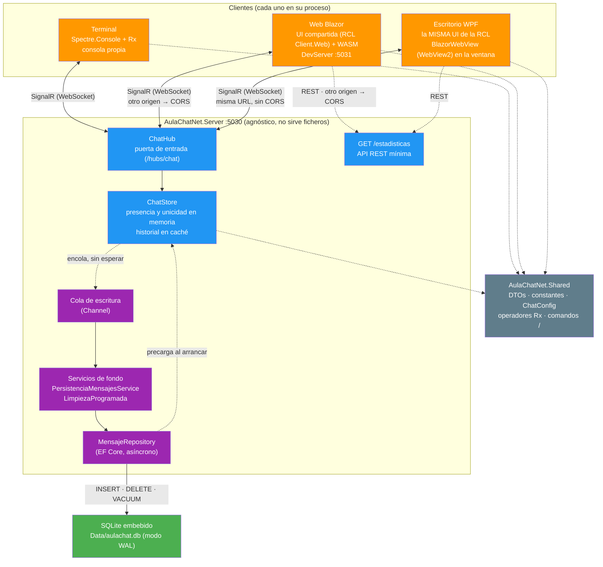

# AulaChatNet 💬

[](https://dotnet.microsoft.com/)
[](https://dotnet.microsoft.com/en-us/apps/aspnet)
[](https://docs.microsoft.com/en-us/dotnet/csharp/)
[](https://learn.microsoft.com/aspnet/core/signalr/introduction)
[](https://github.com/dotnet/reactive)
[](https://www.sqlite.org/)
[](https://learn.microsoft.com/ef/core/)


**Chat en tiempo real para el aula con .NET 10, SignalR y Rx.NET, con el historial persistido en SQLite. Clientes para terminal, web (Blazor) y escritorio (WPF), con estética de Discord.**

## 📑 Tabla de Contenidos

- [🎯 Descripción](#-descripción)
- [✨ Características](#-características)
- [🚀 Tecnologías](#-tecnologías)
- [📂 Estructura del Proyecto](#-estructura-del-proyecto)
- [🏗️ Arquitectura](#️-arquitectura)
- [🏃‍♂️ Inicio rápido](#️-inicio-rápido)
- [📡 Hub del chat](#-hub-del-chat)
- [🌐 Endpoints REST](#-endpoints-rest)
- [⚙️ Configuración](#️-configuración)
- [✅ Estado por fases](#-estado-por-fases)
- [📚 Documentación](#-documentación)
- [📝 Licencia](#-licencia)
- [👨‍💻 Autor](#-autor)

## 🎯 Descripción

AulaChatNet es un proyecto educativo de ejemplo para el módulo **Desarrollo Web en Servidor** (ciclos 2DAW y DAM). El objetivo docente es que el alumnado entienda cómo **SignalR** (transporte en tiempo real) y **Rx.NET** (composición de flujos) se complementan en una arquitectura .NET moderna, y cómo diseñar una solución con **múltiples clientes** sobre el mismo hub.

- 📡 **SignalR**: un único `ChatHub` en el servidor; mensajes, presencia y canales en tiempo real
- 🗂️ **Canales por aula**: `#general`, `#daw`, `#dam`, `#asir` y `#smr`, configurables en `appsettings.json`
- 🔄 **Rx.NET**: los mensajes entrantes se exponen como `IObservable<MensajeDto>` y la UI aplica operadores reactivos
- 💻 **Tres clientes sobre el mismo hub**: terminal (Spectre.Console), web (Blazor WebAssembly) y escritorio (WPF + Blazor Hybrid)
- 🎨 **Estética Discord**: layout de dos columnas, avatares (DiceBear) y paleta oscura
- 🗄️ **Persistencia**: el historial en SQLite con EF Core, escrito en segundo plano sin frenar el chat

## ✨ Características

- 💬 **Comandos /**: `/canal`, `/usuarios`, `/ayuda`, `/sesion`... con el parser compartido en `Shared`
- 🔒 **Mensajes privados**: `/privado` (alias `/mp`, `/dm`) entre personas conectadas del canal; efímeros, no se guardan
- ✍️ **Escritura en vivo**: "está escribiendo..." muestreada con Rx.NET y caducada a los 5 s en cada cliente
- 👍 **Reacciones**: lista cerrada de seis emoji bajo cada mensaje, con el estado completo emitido al canal
- 🚦 **Control de ráfagas**: cuota por conexión aplicada en el servidor, con aviso sin tocar a los clientes
- 💬 **Menciones**: `@ana` con detección única compartida y aviso privado a quien nombra
- 📜 **Historial paginado**: páginas del historial antiguo bajo demanda, con recuperación del scroll
- ✏️ **Editar y borrar**: mensajes propios con editor y confirmación en línea, sincronizados en todos los clientes
- 🕵️ **Avatares**: deterministas por nombre de usuario vía DiceBear
- 🧪 **Testing**: NUnit + Moq + bUnit, con tests por proyecto
- 📓 **Logging**: Serilog en los cuatro procesos (consola, fichero o navegador según el medio)

## 🚀 Tecnologías

- **.NET 10 con C# 14** - Plataforma principal
- **ASP.NET Core + SignalR** - Servidor en tiempo real
- **SQLite + EF Core 10** - Base de datos embebida en un fichero, sin servidor ni contenedor; migraciones aplicadas al arrancar
- **Rx.NET (System.Reactive)** - Programación reactiva en los clientes
- **Blazor (Razor Class Library + WebAssembly)** - Cliente web: la UI vive en la librería compartida `AulaChatNet.Client.Blazor.Components` y el host WebAssembly la sirve en el 5031
- **WPF + Blazor Hybrid (`BlazorWebView`)** - Cliente de escritorio: la MISMA librería `Client.Web` dentro de una ventana WPF, con el navegador WebView2 embebido (sin servidor detrás: los estáticos salen del propio .exe)
- **Spectre.Console** - Cliente de terminal
- **Serilog** - Logging en los cuatro procesos de la solución: servidor (consola + fichero), terminal (fichero), escritorio (fichero en `%LOCALAPPDATA%`) y web (consola del navegador)
- **DiceBear API** - Avatares deterministas por nombre de usuario
- **NUnit + FluentAssertions** - Tests por proyecto

## 📂 Estructura del Proyecto

```
AulaChatNet/
├── AulaChatNet.slnx                        # Solución (.slnx, formato .NET 10)
├── global.json                             # SDK fijado (10.0.401)
├── Directory.Build.props                    # LangVersion, Nullable, warnings como errores
├── Directory.Packages.props                 # Central Package Management (versiones aquí)
├── docs/                                   # Documentación didáctica
├── scripts/                                # Utilidades de la repo (auditoría de diagramas Mermaid)
├── resources/                              # Icono de la app (maestro): cada cliente lleva su propia copia dentro del proyecto
├── AulaChatNet.Shared/                      # DTOs, constantes del hub, ChatConfig, avatar, operadores Rx, comandos (parser + ayuda) y helpers (mezcla del chat, seguimiento de escritura)
│   └── AulaChatNet.Shared.Tests/
├── AulaChatNet.Server/                      # ASP.NET Core + SignalR + SQLite
│   ├── Hubs/                                # ChatHub (alta, mensajes, canales, nick, estadísticas)
│   ├── Services/                            # IChatStore / ChatStore (caché en memoria)
│   ├── Models/                              # EstadoCanal, ConexionChat
│   ├── Persistencia/                        # Entidad, contexto, repositorio, escritor y limpieza programada
│   ├── Migrations/                          # Migraciones de EF Core (esquema de la tabla Mensajes)
│   ├── Infrastructures/                     # Extensiones de arranque (servicios, CORS, hub, persistencia)
│   └── AulaChatNet.Server.Tests/
├── AulaChatNet.Client.Terminal/             # Consola con Spectre.Console (TUI estilo Discord)
│   └── AulaChatNet.Client.Terminal.Tests/
├── AulaChatNet.Client.Blazor.Components/                   # Razor Class Library: UI Blazor compartida (componentes, stores, servicios, CSS y JS)
│   └── AulaChatNet.Client.Blazor.Components.Tests/         #   bUnit de la UI (componentes y stores)
├── AulaChatNet.Client.Web/                # Host WebAssembly de esa UI (proceso propio en el 5031): arranque y configuración
└── AulaChatNet.Client.Wpf/                   # Cliente de escritorio WPF + Blazor Hybrid: la MISMA UI de la RCL en una ventana (WebView2 embebido)
    └── AulaChatNet.Client.Wpf.Tests/         #   configuración DI y almacenamiento de la sesión en fichero
```

## 🏗️ Arquitectura

Capa compartida (`Shared`) como contrato entre servidor y clientes, un hub de SignalR como puerta de entrada, el estado en el `ChatStore` y el historial respaldado en SQLite — **la escritura y el mantenimiento del fichero ocurren en dos servicios en segundo plano**, para que el hilo de SignalR nunca espere a disco. Fíjate en que **los cuatro son procesos separados**: el servidor está en el `5030` y no sirve ficheros, la web corre en su DevServer del `5031`, el terminal en consola y el de escritorio en su ventana WPF — la web habla con el servidor por `Web:UrlServidor` y, al ser otro origen, con CORS por medio; el escritorio apunta a esa misma URL pero **sin CORS**, porque su BlazorWebView no es un navegador de verdad (el HTML y el JS salen del propio .exe). Detalle en [`docs/01-arquitectura-del-servidor.md`](docs/01-arquitectura-del-servidor.md), en [`docs/04-persistencia.md`](docs/04-persistencia.md) y en [`docs/12-cliente-escritorio.md`](docs/12-cliente-escritorio.md):



## 🏃‍♂️ Inicio rápido

```bash
# Servidor (puerto 5030): solo el hub SignalR y GET /estadisticas
dotnet run --project AulaChatNet.Server

# Web (Blazor WebAssembly, puerto 5031); si cambias su código, usa watch
dotnet run --project AulaChatNet.Client.Web
dotnet watch --project AulaChatNet.Client.Web

# Terminal
dotnet run --project AulaChatNet.Client.Terminal

# Escritorio (WPF + Blazor Hybrid)
dotnet run --project AulaChatNet.Client.Wpf

# Tests
dotnet test
```

Cada cliente apunta al servidor con su `appsettings.json` (`Terminal:UrlServidor` o `Web:UrlServidor`, por defecto `http://localhost:5030`) y se arranca en su propia consola o ventana. El servidor crea `Data/aulachat.db` solo: aplica las migraciones y precarga el historial (en desarrollo se vacía al arrancar, `Persistencia:LimpiarAlArrancar`).

## 📡 Hub del chat

Ruta `/hubs/chat` (`Chat:HubRuta`); los nombres viajan como constantes en `Shared` (`ChatHubMetodos` y `ChatHubEventos`). Casi todos los métodos devuelven `string?` (`null` = OK, texto = error):

| Método | Qué hace |
|--------|----------|
| `ConnectAsync` | Alta en un canal; el historial solo va al que entra |
| `SendAsync` | Difunde el mensaje al grupo de su canal |
| `CambiarCanalAsync` | Mueve al usuario entre canales |
| `CambiarNickAsync` | Cambia el nombre con aviso al canal |
| `ObtenerUsuariosAsync` | Devuelve los conectados de cualquier canal |
| `EnviarPrivadoAsync` | Mensaje privado a una persona del canal (no se guarda) |
| `EscribiendoAsync` | Reenvía el aviso solo al resto del canal (`Clients.OthersInGroup`) |
| `ReaccionarAsync` | Alterna una reacción y emite el estado completo al grupo |
| `EditarMensajeAsync` | Edita un mensaje propio y lo reenvía al grupo |
| `BorrarMensajeAsync` | Borra un mensaje propio (caché y SQLite) |

**Servidor → cliente**: `MensajeNuevo`, `ListaUsuariosActualizada`, `HistorialRecibido`, `EstadisticasActualizadas`, `PrivadoRecibido`, `Escribiendo`, `ReaccionActualizada`, `ReaccionesRecibidas`, `MensajeEditado` y `MensajeBorrado`, cada uno con su destino (grupo del canal, solo al que conecta o solo a los implicados). El detalle de argumentos y destinos está en [`docs/01-arquitectura-del-servidor.md`](docs/01-arquitectura-del-servidor.md).

**Canales**: `#general`, `#daw`, `#dam`, `#asir`, `#smr`; el orden del array del `appsettings.json` es el orden de pantalla y el primero es el por defecto.

## 🌐 Endpoints REST

| Método | Ruta | Qué devuelve |
|--------|------|--------------|
| `GET` | `/estadisticas` | Total de conectados y reparto por canal |

La ruta vive en `Shared` (`ChatRutas.Estadisticas`). Es una consulta bajo demanda; el evento `EstadisticasActualizadas` es su versión push en tiempo real. Detalle en [`docs/01-arquitectura-del-servidor.md`](docs/01-arquitectura-del-servidor.md).

## ⚙️ Configuración

Todo vive en `appsettings.json` (con `appsettings.Development.json` por entorno), sin hardcodeos:

| Sección | Qué controla |
|---------|--------------|
| `Chat` | Canales, ruta del hub, límites y URL de avatares |
| `Persistencia` | Fichero SQLite, migraciones, limpieza al arrancar, retención y `VACUUM` |
| `Cors` | Orígenes permitidos para la web (obligatorio: corre en otro proceso) |
| `Terminal` / `Web` | URL del servidor y sesión recordada de cada cliente |

El logging se fija según el medio: consola + fichero en el servidor, fichero en terminal y escritorio, consola del navegador en la web.

## ✅ Estado por fases

| Fase | En una línea |
|------|--------------|
| **1** | Núcleo: servidor con SignalR, cliente terminal (Spectre.Console) y cliente web (Blazor) sobre el mismo hub, con comandos `/` |
| **2** | Persistencia: historial en SQLite con EF Core, escritura en segundo plano y limpieza programada |
| **3** | Conversación: mensajes privados, "está escribiendo..." y reacciones |
| **4** | Calidad de uso: control de ráfagas, menciones, historial paginado y edición/borrado de mensajes propios |
| **5** | Múltiples clientes: la UI en una librería compartida (RCL) y cliente de escritorio WPF con Blazor Hybrid |

## 📚 Documentación

Toda la documentación didáctica vive en [`docs/`](docs/):

| # | Documento | Qué verás |
|---|-----------|-----------|
| 01 | [Arquitectura del servidor](docs/01-arquitectura-del-servidor.md) | Capas, ciclo de vida de una conexión de SignalR y la cola de escritura en segundo plano |
| 02 | [Cliente terminal](docs/02-cliente-terminal.md) | TUI con Spectre.Console, capa reactiva con Rx.NET y cómo se prueba sin abrir una terminal |
| 03 | [Cliente web](docs/03-cliente-blazor.md) | Blazor WebAssembly, estética Discord en CSS propio, stores reactivas y comandos `/` |
| 04 | [Persistencia](docs/04-persistencia.md) | SQLite con EF Core, escritura *write-behind*, precarga y limpieza del fichero |
| 05 | [Mensajes privados](docs/05-mensajes-privados.md) | El recorrido completo de un `/privado` y por qué es efímero |
| 06 | [Escritura en vivo](docs/06-escritura-en-vivo.md) | Muestreo con `Sample` de Rx.NET y el quinto destino de SignalR |
| 07 | [Reacciones](docs/07-reacciones.md) | Lista cerrada de emoji, conjuntos en vez de contadores y estado completo por mensaje |
| 08 | [Control de ráfagas](docs/08-control-de-rafagas.md) | Ventana deslizante por conexión, aplicada solo en el servidor |
| 09 | [Menciones y avisos](docs/09-menciones-y-avisos.md) | Detección única compartida y aviso dirigido con `Clients.Client` |
| 10 | [Historial paginado](docs/10-historial-paginado.md) | Invocaciones con retorno y cursor temporal sobre SQLite |
| 11 | [Editar y borrar](docs/11-editar-y-borrar.md) | Mutaciones sincronizadas en todos los clientes y confirmación en línea |
| 12 | [Cliente de escritorio](docs/12-cliente-escritorio.md) | Blazor Hybrid con WPF: arranque, recursos de cada host y sesión sin navegador |
| — | [Boceto visual](docs/boceto-vistas.html) | Las dos vistas de la web en HTML con los mismos estilos |

> 💡 **Consejo:** si solo vas a leer un documento, empieza por el del servidor: es el mapa sobre el que se apoyan los clientes.

## 📝 Licencia

Este proyecto es un ejemplo educativo con fines didácticos.

## 👨‍💻 Autor

Codificado con :sparkling_heart: por [José Luis González Sánchez](https://joseluisgs.dev)

[](https://github.com/joseluisgs)
[](https://github.com/joseluisgs)

### Contacto

<p>
    <a href="https://joseluisgs.dev/" target="_blank">
        
    </a>&nbsp;
    <a href="https://github.com/joseluisgs" target="_blank">
        
    </a>&nbsp;
    <a href="https://www.linkedin.com/in/JoseLuisGSDev" target="_blank">
        
    </a>&nbsp;
    <a href="https://www.youtube.com/@joseluisgs" target="_blank">
        
    </a>&nbsp;
    <a href="https://x.com/JoseLuisGSDev" target="_blank">
        
    </a>&nbsp;
    <a href="https://www.instagram.com/joseluisgs.dev/" target="_blank">
        
    </a>
</p>

## Licencia de uso

Este repositorio está licenciado bajo **Creative Commons**. Por favor si compartes, usas o modifica este proyecto cita a su autor.

<a rel="license" href="https://creativecommons.org/licenses/by-nc-sa/4.0/deed.es"></a>
