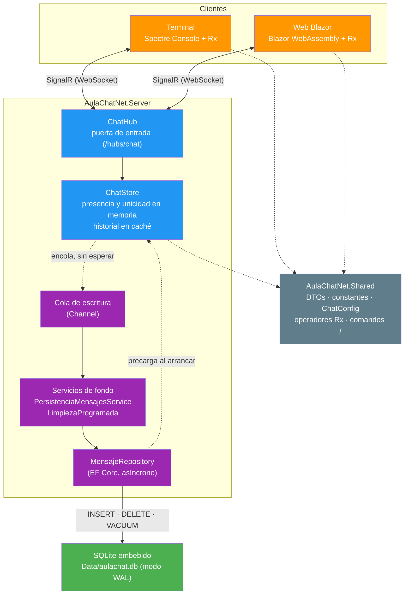

# AulaChatNet 💬

[](https://dotnet.microsoft.com/)
[](https://dotnet.microsoft.com/en-us/apps/aspnet)
[](https://docs.microsoft.com/en-us/dotnet/csharp/)
[](https://learn.microsoft.com/aspnet/core/signalr/introduction)
[](https://github.com/dotnet/reactive)
[](https://www.sqlite.org/)
[](https://learn.microsoft.com/ef/core/)


**Chat en tiempo real para el aula con .NET 10, SignalR y Rx.NET, con el historial persistido en SQLite. Clientes para terminal y web (Blazor), con estética de Discord.**

## 📑 Tabla de Contenidos

- [🎯 Descripción](#-descripción)
- [🚀 Tecnologías](#-tecnologías)
- [📂 Estructura del Proyecto](#-estructura-del-proyecto)
- [🏗️ Arquitectura](#️-arquitectura)
- [🏃‍♂️ Inicio rápido](#️-inicio-rápido)
- [📡 Hub del chat](#-hub-del-chat)
- [🌐 Endpoints REST](#-endpoints-rest)
- [⚙️ Configuración](#️-configuración)
- [✅ Estado por fases](#-estado-por-fases)
- [📚 Documentación](#-documentación)
- [📝 Licencia](#-licencia)
- [👨‍💻 Autor](#-autor)

## 🎯 Descripción

AulaChatNet es un proyecto educativo de ejemplo para el módulo **Desarrollo Web en Servidor** (ciclos 2DAW y DAM). El objetivo docente es que el alumnado entienda cómo **SignalR** (transporte en tiempo real) y **Rx.NET** (composición de flujos) se complementan en una arquitectura .NET moderna, y cómo diseñar una solución con **múltiples clientes** sobre el mismo hub.

- 📡 **SignalR**: un único `ChatHub` en el servidor; mensajes, entradas, salidas y cambio de nick en tiempo real
- 🗂️ **Canales por aula**: `#general`, `#daw`, `#dam`, `#asir` y `#smr` (grupos de SignalR, configurables en `appsettings.json`); historial y lista de conectados por canal, con cambio en vivo
- 🔄 **Rx.NET**: los mensajes entrantes se exponen como `IObservable<MensajeDto>`; la UI se suscribe aplicando operadores reactivos (filtrar, agrupar, formatear)
- 💻 **Múltiples clientes**: consola con Spectre.Console (vista en vivo con cabecera y pie fijos, editor de línea con cursor y reconexión con re-alta) y web con Blazor WebAssembly, ambos sobre el mismo hub y con los **mismos comandos `/`** (el parser vive en `Shared` y lo usan los dos clientes)
- 🎨 **Estética Discord**: layout de dos columnas, avatares (DiceBear) y paleta oscura
- 🗄️ **Persistencia (Fase 2)**: SQLite embebido en un fichero (`Data/aulachat.db`) con EF Core; el historial sobrevive a cualquier reinicio mientras que la presencia y la unicidad de nicks siguen en memoria, y se escribe en segundo plano sin frenar el chat

## 🚀 Tecnologías

- **.NET 10 con C# 14** - Plataforma principal
- **ASP.NET Core + SignalR** - Servidor en tiempo real
- **SQLite + EF Core 10** - Base de datos embebida en un fichero, sin servidor ni contenedor; migraciones aplicadas al arrancar
- **Rx.NET (System.Reactive)** - Programación reactiva en los clientes
- **Blazor WebAssembly** - Cliente web
- **Spectre.Console** - Cliente de terminal
- **Serilog** - Logging en los tres procesos de la solución: servidor (consola + fichero), terminal (fichero) y web (consola del navegador)
- **DiceBear API** - Avatares deterministas por nombre de usuario
- **NUnit + FluentAssertions** - Tests por proyecto

## 📂 Estructura del Proyecto

```
AulaChatNet/
├── AulaChatNet.slnx                        # Solución (.slnx, formato .NET 10)
├── global.json                             # SDK fijado (10.0.401)
├── Directory.Build.props                    # LangVersion, Nullable, warnings como errores
├── Directory.Packages.props                 # Central Package Management (versiones aquí)
├── docs/                                   # Documentación didáctica
├── scripts/                                # Utilidades de la repo (auditoría de diagramas Mermaid)
├── resources/                              # Icono de la app (maestro): cada cliente lleva su propia copia dentro del proyecto
├── AulaChatNet.Shared/                      # DTOs, constantes del hub, ChatConfig, avatar, operadores Rx, comandos (parser + ayuda)
│   └── AulaChatNet.Shared.Tests/
├── AulaChatNet.Server/                      # ASP.NET Core + SignalR + SQLite
│   ├── Hubs/                                # ChatHub (alta, mensajes, canales, nick, estadísticas)
│   ├── Services/                            # IChatStore / ChatStore (caché en memoria)
│   ├── Models/                              # EstadoCanal, ConexionChat
│   ├── Persistencia/                        # Entidad, contexto, repositorio, escritor y limpieza programada (Fase 2)
│   ├── Migrations/                          # Migraciones de EF Core (esquema de la tabla Mensajes)
│   ├── Infrastructures/                     # Extensiones de arranque (servicios, CORS, hub, persistencia)
│   └── AulaChatNet.Server.Tests/
├── AulaChatNet.Client.Terminal/             # Consola con Spectre.Console (TUI estilo Discord)
│   └── AulaChatNet.Client.Terminal.Tests/
└── AulaChatNet.Client.Blazor/               # Blazor WebAssembly (alojado por el servidor)
    └── AulaChatNet.Client.Blazor.Tests/
```

## 🏗️ Arquitectura

Capa compartida (`Shared`) como contrato entre servidor y clientes, un hub de SignalR como puerta de entrada y el estado en el `ChatStore`. Desde la Fase 2 se añade la persistencia: el historial se respalda en SQLite y **la escritura y el mantenimiento del fichero ocurren en dos servicios en segundo plano**, para que el hilo de SignalR nunca espere a disco. Detalle en [`docs/01-arquitectura-del-servidor.md`](docs/01-arquitectura-del-servidor.md) y en [`docs/04-persistencia.md`](docs/04-persistencia.md):



## 🏃‍♂️ Inicio rápido

Los tres puntos de entrada de la aplicación —servidor, web y terminal— y la base de datos:

```bash
# ── 1) SERVIDOR ───────────────────────────────────────────────────────
# Compila y arranca; sirve TODO: hub SignalR, API REST y la web.
dotnet run --project AulaChatNet.Server
#   → http://localhost:5030

# ── 2) WEB (Blazor WebAssembly) ───────────────────────────────────────
# No tiene comando propio: se sirve desde el servidor del apartado 1.
# Uso normal: abre el navegador en http://localhost:5030 y ya estás
# dentro, sin instalar nada más.
#
# Solo si estás CAMBIANDO el código de la web, usa watch en lugar de
# run: reconstruye el cliente y relanza el servidor (el manifiesto de
# assets de Blazor se lee al arrancar, así que sin watch los cambios
# no llegan al navegador)
dotnet watch --project AulaChatNet.Server

# ── 3) TERMINAL ───────────────────────────────────────────────────────
# En OTRA consola: se conecta al servidor del 5030 por defecto
# (la URL es configurable en la sección Terminal de appsettings)
dotnet run --project AulaChatNet.Client.Terminal

# ── 4) TESTS de todos los proyectos ───────────────────────────────────
dotnet test
```

**Base de datos (SQLite)**: no hay que crearla ni instalarla. Al arrancar, el servidor crea `Data/aulachat.db` si no existe, aplica las migraciones pendientes y precarga el historial de cada canal —mientras el servidor siga en pie, la web y el terminal leen ese mismo historial sin hacer nada especial—. En desarrollo la vacía a propósito (`Persistencia:LimpiarAlArrancar` está en `true` en `appsettings.Development.json`): ponla a `false` y reinicia para comprobar que los mensajes sobreviven.

En desarrollo, el servidor añade `Cache-Control: no-cache` a `index.html` y a `/_framework/*`, para que el navegador pida siempre la última versión del manifiesto.

## 📡 Hub del chat

Ruta: `/hubs/chat` (configurable en `Chat:HubRuta`). Los métodos y eventos se referencian por constantes en `Shared/Constantes` (`ChatHubMetodos` y `ChatHubEventos`).

**Cliente → servidor** (casi todos devuelven `string?`: `null` = OK, texto = error; la excepción es `ObtenerUsuariosAsync`, que devuelve datos):

| Método | Argumentos | Qué hace |
|--------|-----------|----------|
| `ConnectAsync` | `usuario`, `canal?` | Alta en un canal (si no se indica, el por defecto); envía el historial SOLO al que entra |
| `SendAsync` | `texto` | Difunde el mensaje al grupo de SU canal |
| `CambiarCanalAsync` | `canal` | Mueve al usuario: aviso de salida en el viejo, historial del nuevo solo a él, aviso de entrada |
| `CambiarNickAsync` | `nuevoNick` | Cambia el nombre en caliente, con aviso "X ahora se llama Y" al canal |
| `ObtenerUsuariosAsync` | `canal` | Devuelve los conectados de CUALQUIER canal; responde SOLO al que pregunta (para `/usuarios <canal>`) |

**Servidor → cliente**:

| Evento | Argumento | Destino |
|--------|-----------|---------|
| `MensajeNuevo` | `MensajeDto` | Grupo del canal (mensajes normales y de sistema) |
| `ListaUsuariosActualizada` | `IReadOnlyList<UsuarioConectadoDto>` | Grupo del canal |
| `HistorialRecibido` | `IReadOnlyList<MensajeDto>` | SOLO al cliente que se conecta o cambia de canal |
| `EstadisticasActualizadas` | `EstadisticasDto` | A TODOS (total + reparto por canal) |

**Canales**: `#general`, `#daw`, `#dam`, `#asir`, `#smr`. Nombre único por canal, historial de 25 mensajes por canal (50 en Development) y rechazo con lista de válidos si el canal no existe. El orden del array del `appsettings.json` es el orden de pantalla en los clientes, y el primero es el canal por defecto.

## 🌐 Endpoints REST

Además del hub SignalR, el servidor expone una pequeña API para consultas puntuales (lo típico: contar gente **antes** de registrarse, como hace la entrada guiada del terminal):

| Método | Ruta | Qué devuelve |
|--------|------|--------------|
| `GET` | `/estadisticas` | `EstadisticasDto`: total de conectados + reparto por canal |

La ruta vive en `Shared` (`ChatRutas.Estadisticas`), sin rutas escritas dos veces. No sustituye al evento `EstadisticasActualizadas`: este es push en tiempo real y el endpoint es pull bajo demanda.

## ⚙️ Configuración

La configuración vive en `appsettings.json` (con override por entorno en `appsettings.Development.json`), sin hardcodeos. Los destinos de Serilog de los dos clientes se fijan en código, porque dependen del medio donde corren (fichero en disco / consola del navegador):

| Sección | Qué controla |
|---------|--------------|
| `Chat` | Canales, ruta del hub, límites de usuario/mensaje, historial máximo, URL de avatares |
| `Persistencia` | Fichero SQLite, migración automática, limpieza al arrancar, mensajes precargados y mantenimiento (`LimpiezaCadaHoras`, `RetencionDias`, `VacuumSiFragmentado`) |
| `Serilog` | **Servidor**: consola (Information, con color) + fichero de errores (`logs/aulachat-YYYY-MM-DD.log`, rolling y retención de 7 días). **Terminal**: solo fichero en `%LOCALAPPDATA%\AulaChatNet\logs\terminal-YYYY-MM-DD.log` (config en `SerilogConfig.cs`; sin consola para no romper el lienzo Live). **Web**: consola del navegador (sink `BrowserConsole`, config en `Program.cs`) |
| `Cors` | Orígenes permitidos para el cliente Blazor en desarrollo |
| `Terminal` | Sección del cliente terminal: `UrlServidor` y `RecordarSesion` |
| `Web` | Cliente Blazor: `UrlServidor` (vacío = mismo origen) y `RecordarSesion` (sesión en localStorage). En desarrollo, `appsettings.Development.json` + `launchSettings.json` permiten ejecutar el cliente por separado: DevServer en el `5031` apuntando al servidor del `5030` |

## ✅ Estado por fases

| Fase | Contenido | Estado |
|------|-----------|--------|
| Entorno | `.slnx`, Central Package Management, GitFlow | ✅ Hecho |
| **Fase 1 · Shared** | DTOs, `ChatConfig`, avatar, operadores Rx, parser de comandos `/` y catálogo de ayuda | ✅ Hecho |
| **Fase 1 · Server** | `ChatHub`, `ChatStore` en memoria, canales, estadísticas, Serilog | ✅ Hecho |
| **Fase 1 · Terminal** | Spectre.Console, vista en vivo, entrada guiada, comandos, sesión y Serilog a fichero | ✅ Hecho |
| **Fase 1 · Blazor** | Layout Discord + store reactiva estilo `NotificationStore` + comandos `/` (parser compartido) + Serilog a consola del navegador | ✅ Hecho |
| **Fase 2 · Server** | Persistencia con SQLite + EF Core: modelo e índices, migraciones, escritura en segundo plano, precarga del historial y mantenimiento (retención + `VACUUM`) | ✅ Hecho |
| Fase 3 | Extras (moderación, reacciones) | 🔜 Futura |

> 📝 **Nota:** la Fase 2 tocó **solo el servidor**: ni el hub ni los clientes cambiaron, porque el contrato ya estaba hecho en la Fase 1.

## 📚 Documentación

Toda la documentación didáctica vive en [`docs/`](docs/):

- 📖 [`docs/01-arquitectura-del-servidor.md`](docs/01-arquitectura-del-servidor.md) - Arquitectura por capas, ciclo de vida de una conexión de SignalR, estado por canal, grupos, estadísticas, Serilog, dos bugs reales y la evolución Fase 1 → Fase 2 (sección 3.5), con diagramas Mermaid
- 💻 [`docs/02-cliente-terminal.md`](docs/02-cliente-terminal.md) - **Manual de uso** con capturas reales en ASCII (arranque, vista en vivo, comandos y sus salidas, reconexión y sesión) y su arquitectura interna: Spectre.Console, capa reactiva con Rx, modo doble (consola/tubería) y tests. Incluye la nota de por qué la persistencia no lo tocó
- 🌐 [`docs/03-cliente-blazor.md`](docs/03-cliente-blazor.md) - **El cliente web**: Blazor WebAssembly alojado por el servidor, la estética de Discord en CSS propio, la store central y la capa reactiva con suscripciones en los componentes, los comandos `/` reutilizando el parser de `Shared`, la sesión en `localStorage`, el desarrollo con `dotnet watch` y **dos bugs reales** (el `Closed` fantasma y el manifiesto de assets caducado), con sus arreglos y tests
- 🗄️ [`docs/04-persistencia.md`](docs/04-persistencia.md) - **La persistencia de la Fase 2**: por qué SQLite, qué se guarda en disco y qué no (separación por longevidad), el modelo con EF Core y sus índices, `Migrate()` frente a `EnsureCreated()`, la escritura en segundo plano con el patrón *write-behind*, la precarga, la limpieza con retención y `VACUUM`, y **tres trampas reales** que solo salieron al ejecutar
- 🖼️ [`docs/boceto-vistas.html`](docs/boceto-vistas.html) - **Boceto visual de las dos vistas de la web** con los mismos estilos y elementos que la app: [vista 1 · panel de entrada](docs/boceto-vistas.html#vista-1) y [vista 2 · vista de canal](docs/boceto-vistas.html#vista-2)

> 💡 **Consejo:** si solo vas a leer un documento, empieza por el del servidor: es el mapa completo sobre el que se apoyan los dos clientes.

## 📝 Licencia

Este proyecto es un ejemplo educativo con fines didácticos.

## 👨‍💻 Autor

Codificado con :sparkling_heart: por [José Luis González Sánchez](https://joseluisgs.dev)

[](https://github.com/joseluisgs)
[](https://github.com/joseluisgs)

### Contacto

<p>
    <a href="https://joseluisgs.dev/" target="_blank">
        
    </a>&nbsp;
    <a href="https://github.com/joseluisgs" target="_blank">
        
    </a>&nbsp;
    <a href="https://www.linkedin.com/in/JoseLuisGSDev" target="_blank">
        
    </a>&nbsp;
    <a href="https://www.youtube.com/@joseluisgs" target="_blank">
        
    </a>&nbsp;
    <a href="https://x.com/JoseLuisGSDev" target="_blank">
        
    </a>&nbsp;
    <a href="https://www.instagram.com/joseluisgs.dev/" target="_blank">
        
    </a>
</p>

## Licencia de uso

Este repositorio está licenciado bajo **Creative Commons**. Por favor si compartes, usas o modifica este proyecto cita a su autor.

<a rel="license" href="https://creativecommons.org/licenses/by-nc-sa/4.0/deed.es"></a>
