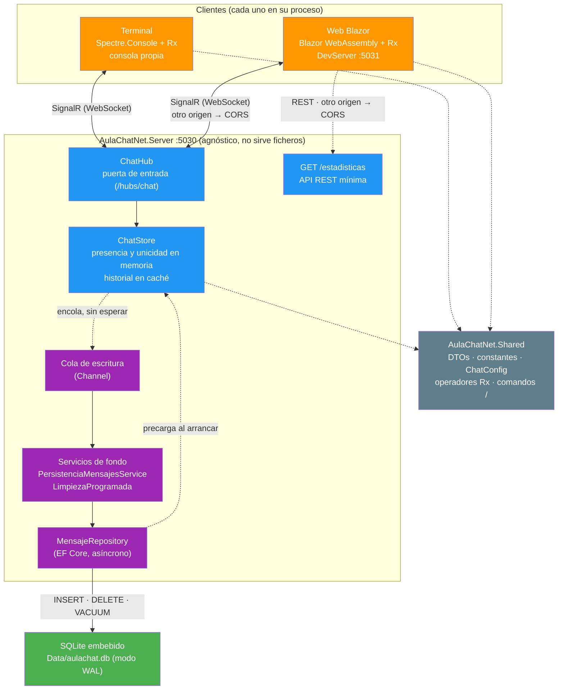

# AulaChatNet 💬

[](https://dotnet.microsoft.com/)
[](https://dotnet.microsoft.com/en-us/apps/aspnet)
[](https://docs.microsoft.com/en-us/dotnet/csharp/)
[](https://learn.microsoft.com/aspnet/core/signalr/introduction)
[](https://github.com/dotnet/reactive)
[](https://www.sqlite.org/)
[](https://learn.microsoft.com/ef/core/)


**Chat en tiempo real para el aula con .NET 10, SignalR y Rx.NET, con el historial persistido en SQLite. Clientes para terminal y web (Blazor), con estética de Discord.**

## 📑 Tabla de Contenidos

- [🎯 Descripción](#-descripción)
- [🚀 Tecnologías](#-tecnologías)
- [📂 Estructura del Proyecto](#-estructura-del-proyecto)
- [🏗️ Arquitectura](#️-arquitectura)
- [🏃‍♂️ Inicio rápido](#️-inicio-rápido)
- [📡 Hub del chat](#-hub-del-chat)
- [🌐 Endpoints REST](#-endpoints-rest)
- [⚙️ Configuración](#️-configuración)
- [✅ Estado por fases](#-estado-por-fases)
- [📚 Documentación](#-documentación)
- [📝 Licencia](#-licencia)
- [👨‍💻 Autor](#-autor)

## 🎯 Descripción

AulaChatNet es un proyecto educativo de ejemplo para el módulo **Desarrollo Web en Servidor** (ciclos 2DAW y DAM). El objetivo docente es que el alumnado entienda cómo **SignalR** (transporte en tiempo real) y **Rx.NET** (composición de flujos) se complementan en una arquitectura .NET moderna, y cómo diseñar una solución con **múltiples clientes** sobre el mismo hub.

- 📡 **SignalR**: un único `ChatHub` en el servidor; mensajes, entradas, salidas y cambio de nick en tiempo real
- 🗂️ **Canales por aula**: `#general`, `#daw`, `#dam`, `#asir` y `#smr` (grupos de SignalR, configurables en `appsettings.json`); historial y lista de conectados por canal, con cambio en vivo
- 🔄 **Rx.NET**: los mensajes entrantes se exponen como `IObservable<MensajeDto>`; la UI se suscribe aplicando operadores reactivos (filtrar, agrupar, formatear)
- 💻 **Múltiples clientes**: consola con Spectre.Console (vista en vivo con cabecera y pie fijos, editor de línea con cursor y reconexión con re-alta) y web con Blazor WebAssembly, ambos sobre el mismo hub y con los **mismos comandos `/`** (el parser vive en `Shared` y lo usan los dos clientes)
- 🎨 **Estética Discord**: layout de dos columnas, avatares (DiceBear) y paleta oscura
- 🗄️ **Persistencia (Fase 2)**: SQLite embebido en un fichero (`Data/aulachat.db`) con EF Core; el historial sobrevive a cualquier reinicio mientras que la presencia y la unicidad de nicks siguen en memoria, y se escribe en segundo plano sin frenar el chat
- 🔒 **Mensajes privados (Fase 3.1)**: `/privado <quien> <texto>` (alias `/mp` y `/dm`) dentro de un canal, entre personas CONECTADAS en ese mismo canal; llegan SOLO a los dos implicados, se mezclan en la misma cronología que el canal en las dos vistas y **no se guardan** — ni en SQLite ni en el historial
- ✍️ **Escritura en vivo (Fase 3.2)**: "está escribiendo..." con el operador `Sample` de Rx.NET (máximo una señal por segundo, jamás una por tecla), reenvío del hub SOLO al resto del canal (`Clients.OthersInGroup`, el quinto destino) y **caducidad de 5 s en CADA cliente** — sin estado que limpiar en el servidor y sin que viaje nunca el texto
- 👍 **Reacciones (Fase 3.3)**: `/reaccion <emoji>` (alias `/react`) y chips bajo cada mensaje, con una **lista cerrada de seis emoji** normalizada en `Shared`; el servidor alterna (conjunto por mensaje, no contador), emite el estado COMPLETO a todo el canal con el emisor incluido y las reacciones **se van con su mensaje** al podar la caché — sin persistencia
- 🚦 **Control de ráfagas (Fase 4.1)**: ventana deslizante por conexión (5 mensajes cada 5 s por defecto) guardada en un singleton —los hubs de SignalR son transitorios—, aplicada en el hub DESPUÉS de validar y ANTES de tocar store o red, solo a `Enviar` y `/privado` (en un canal y en privado comparten cuota), con el aviso viajando por el mismo `string?` de los errores: **cero cambios en los clientes**
- 💬 **Menciones y avisos (Fase 4.2)**: `@ana` en cualquier mensaje del canal con una regla de detección ÚNICA en `Shared` (`Menciones`: servidor y clientes leen lo mismo); el hub añade un aviso dirigido con `Clients.Client` —el mismo camino que los privados— solo a quien nombra, nunca a uno mismo; la web resalta la mención, pone badge de "sin mirar" y parpadea la pestaña, y la terminal la pinta en amarillo con campana

## 🚀 Tecnologías

- **.NET 10 con C# 14** - Plataforma principal
- **ASP.NET Core + SignalR** - Servidor en tiempo real
- **SQLite + EF Core 10** - Base de datos embebida en un fichero, sin servidor ni contenedor; migraciones aplicadas al arrancar
- **Rx.NET (System.Reactive)** - Programación reactiva en los clientes
- **Blazor WebAssembly** - Cliente web
- **Spectre.Console** - Cliente de terminal
- **Serilog** - Logging en los tres procesos de la solución: servidor (consola + fichero), terminal (fichero) y web (consola del navegador)
- **DiceBear API** - Avatares deterministas por nombre de usuario
- **NUnit + FluentAssertions** - Tests por proyecto

## 📂 Estructura del Proyecto

```
AulaChatNet/
├── AulaChatNet.slnx                        # Solución (.slnx, formato .NET 10)
├── global.json                             # SDK fijado (10.0.401)
├── Directory.Build.props                    # LangVersion, Nullable, warnings como errores
├── Directory.Packages.props                 # Central Package Management (versiones aquí)
├── docs/                                   # Documentación didáctica
├── scripts/                                # Utilidades de la repo (auditoría de diagramas Mermaid)
├── resources/                              # Icono de la app (maestro): cada cliente lleva su propia copia dentro del proyecto
├── AulaChatNet.Shared/                      # DTOs, constantes del hub, ChatConfig, avatar, operadores Rx, comandos (parser + ayuda) y helpers (mezcla del chat, seguimiento de escritura)
│   └── AulaChatNet.Shared.Tests/
├── AulaChatNet.Server/                      # ASP.NET Core + SignalR + SQLite
│   ├── Hubs/                                # ChatHub (alta, mensajes, canales, nick, estadísticas)
│   ├── Services/                            # IChatStore / ChatStore (caché en memoria)
│   ├── Models/                              # EstadoCanal, ConexionChat
│   ├── Persistencia/                        # Entidad, contexto, repositorio, escritor y limpieza programada (Fase 2)
│   ├── Migrations/                          # Migraciones de EF Core (esquema de la tabla Mensajes)
│   ├── Infrastructures/                     # Extensiones de arranque (servicios, CORS, hub, persistencia)
│   └── AulaChatNet.Server.Tests/
├── AulaChatNet.Client.Terminal/             # Consola con Spectre.Console (TUI estilo Discord)
│   └── AulaChatNet.Client.Terminal.Tests/
└── AulaChatNet.Client.Blazor/               # Blazor WebAssembly (proceso propio en el 5031)
    └── AulaChatNet.Client.Blazor.Tests/
```

## 🏗️ Arquitectura

Capa compartida (`Shared`) como contrato entre servidor y clientes, un hub de SignalR como puerta de entrada y el estado en el `ChatStore`. Desde la Fase 2 se añade la persistencia: el historial se respalda en SQLite y **la escritura y el mantenimiento del fichero ocurren en dos servicios en segundo plano**, para que el hilo de SignalR nunca espere a disco. Fíjate en que **los tres son procesos separados**: el servidor está en el `5030` y no sirve ficheros, la web corre en su DevServer del `5031` y el terminal en consola — la web habla con el servidor por `Web:UrlServidor` y, al ser otro origen, con CORS por medio. Detalle en [`docs/01-arquitectura-del-servidor.md`](docs/01-arquitectura-del-servidor.md) y en [`docs/04-persistencia.md`](docs/04-persistencia.md):



## 🏃‍♂️ Inicio rápido

Tres procesos **independientes**: el servidor solo expone lo que todos consumen, y cada cliente se arranca en su propia consola:

```bash
# ── 1) SERVIDOR ────────────────────────────────────────────────────────
# El servidor es AGNÓSTICO: no conoce a ningún cliente ni sirve ficheros
# (pide "/" y devuelve 404). Expone SOLO lo que consumen los clientes:
# el hub SignalR y el GET /estadisticas.
dotnet run --project AulaChatNet.Server
#   → http://localhost:5030

# ── 2) WEB (Blazor WebAssembly) ────────────────────────────────────────
# OTRA consola. Proyecto aparte, con su propio DevServer en el 5031
# (lo fija launchSettings.json). Ella sola sirve su index.html, su
# favicon y su .wasm, y habla con el servidor del 5030 indicado en
# Web:UrlServidor. Como son orígenes distintos hace falta CORS, que ya
# está configurado (Cors:OrigenesPermitidos).
dotnet run --project AulaChatNet.Client.Blazor
#   → http://localhost:5031

# Si CAMBIAS el código de la web, usa watch en lugar de run: el
# manifiesto de assets de Blazor se lee al arrancar, así que sin watch
# los cambios no llegan al navegador
dotnet watch --project AulaChatNet.Client.Blazor

# ── 3) TERMINAL ────────────────────────────────────────────────────────
# En OTRA consola: se conecta al servidor del 5030 por defecto
# (la URL es configurable en la sección Terminal de appsettings)
dotnet run --project AulaChatNet.Client.Terminal

# ── 4) TESTS de todos los proyectos ────────────────────────────────────
dotnet test
```

**Base de datos (SQLite)**: no hay que crearla ni instalarla. Al arrancar, el servidor crea `Data/aulachat.db` si no existe, aplica las migraciones pendientes y precarga el historial de cada canal —mientras el servidor siga en pie, la web y el terminal leen ese mismo historial sin hacer nada especial—. En desarrollo la vacía a propósito (`Persistencia:LimpiarAlArrancar` está en `true` en `appsettings.Development.json`): ponla a `false` y reinicia para comprobar que los mensajes sobreviven.

## 📡 Hub del chat

Ruta: `/hubs/chat` (configurable en `Chat:HubRuta`). Los métodos y eventos se referencian por constantes en `Shared/Constantes` (`ChatHubMetodos` y `ChatHubEventos`).

**Cliente → servidor** (casi todos devuelven `string?`: `null` = OK, texto = error; la excepción es `ObtenerUsuariosAsync`, que devuelve datos):

| Método | Argumentos | Qué hace |
|--------|-----------|----------|
| `ConnectAsync` | `usuario`, `canal?` | Alta en un canal (si no se indica, el por defecto); envía el historial SOLO al que entra |
| `SendAsync` | `texto` | Difunde el mensaje al grupo de SU canal |
| `CambiarCanalAsync` | `canal` | Mueve al usuario: aviso de salida en el viejo, historial del nuevo solo a él, aviso de entrada |
| `CambiarNickAsync` | `nuevoNick` | Cambia el nombre en caliente, con aviso "X ahora se llama Y" al canal |
| `ObtenerUsuariosAsync` | `canal` | Devuelve los conectados de CUALQUIER canal; responde SOLO al que pregunta (para `/usuarios <canal>`) |
| `EnviarPrivadoAsync` | `destinatario`, `texto` | Envía un mensaje a UNA persona de SU canal: valida destino (que exista y conectado, que no seas tú mismo) y lo emite SOLO a las dos conexiones implicadas. **No llama a `AddMensaje`**: el privado no entra en el historial ni en la cola de escritura (efímero) |
| `EscribiendoAsync` | ninguno | Avisa de que estás escribiendo en TU canal y reenvía SOLO tu nombre al resto del grupo (`Clients.OthersInGroup`, el quinto destino). **Sin estado, sin texto y sin `AddMensaje`**: cada cliente caduca sus marcas a los 5 s |
| `ReaccionarAsync` | `idMensaje`, `emoji` | Alterna una reacción sobre un mensaje NORMAL de TU canal (el mismo gesto quita lo que ya tenías). Valida el emoji contra la lista cerrada, alterna el conjunto del mensaje y emite el estado COMPLETO a todo el grupo. **Sin `AddMensaje` y sin SQLite**: las reacciones se van con su mensaje al podar la caché |

**Servidor → cliente**:

| Evento | Argumento | Destino |
|--------|-----------|---------|
| `MensajeNuevo` | `MensajeDto` | Grupo del canal (mensajes normales y de sistema) |
| `ListaUsuariosActualizada` | `IReadOnlyList<UsuarioConectadoDto>` | Grupo del canal |
| `HistorialRecibido` | `IReadOnlyList<MensajeDto>` | SOLO al cliente que se conecta o cambia de canal |
| `EstadisticasActualizadas` | `EstadisticasDto` | A TODOS (total + reparto por canal) |
| `PrivadoRecibido` | `MensajePrivadoDto` | SOLO a los dos implicados: `Clients.Client(destino)` y `Clients.Caller` (el eco, para que ambas partes pinten el mismo objeto) |
| `Escribiendo` | `string` (solo el nombre) | Grupo del canal MENOS el emisor (`Clients.OthersInGroup`): cada otro cliente lo muestra como "está escribiendo..." y lo caduca a los 5 s si no se renueva |
| `ReaccionActualizada` | `ReaccionesMensajeDto` | Grupo del canal ENTERO, **emisor incluido**: estado COMPLETO de UN mensaje (emoji + quiénes), para que nadie se desincronice aunque pierda un evento |
| `ReaccionesRecibidas` | `IReadOnlyList<ReaccionesMensajeDto>` | SOLO al cliente que se conecta o cambia de canal: snapshot de TODAS las reacciones del canal, junto al historial |

**Canales**: `#general`, `#daw`, `#dam`, `#asir`, `#smr`. Nombre único por canal, historial de 25 mensajes por canal (50 en Development) y rechazo con lista de válidos si el canal no existe. El orden del array del `appsettings.json` es el orden de pantalla en los clientes, y el primero es el canal por defecto.

## 🌐 Endpoints REST

Además del hub SignalR, el servidor expone una pequeña API para consultas puntuales (lo típico: contar gente **antes** de registrarse, como hace la entrada guiada del terminal):

| Método | Ruta | Qué devuelve |
|--------|------|--------------|
| `GET` | `/estadisticas` | `EstadisticasDto`: total de conectados + reparto por canal |

La ruta vive en `Shared` (`ChatRutas.Estadisticas`), sin rutas escritas dos veces. No sustituye al evento `EstadisticasActualizadas`: este es push en tiempo real y el endpoint es pull bajo demanda.

## ⚙️ Configuración

La configuración vive en `appsettings.json` (con override por entorno en `appsettings.Development.json`), sin hardcodeos. Los destinos de Serilog de los dos clientes se fijan en código, porque dependen del medio donde corren (fichero en disco / consola del navegador):

| Sección | Qué controla |
|---------|--------------|
| `Chat` | Canales, ruta del hub, límites de usuario/mensaje, historial máximo, URL de avatares |
| `Persistencia` | Fichero SQLite, migración automática, limpieza al arrancar, mensajes precargados y mantenimiento (`LimpiezaCadaHoras`, `RetencionDias`, `VacuumSiFragmentado`) |
| `Serilog` | **Servidor**: consola (Information, con color) + fichero de errores (`logs/aulachat-YYYY-MM-DD.log`, rolling y retención de 7 días). **Terminal**: solo fichero en `%LOCALAPPDATA%\AulaChatNet\logs\terminal-YYYY-MM-DD.log` (config en `SerilogConfig.cs`; sin consola para no romper el lienzo Live). **Web**: consola del navegador (sink `BrowserConsole`, config en `Program.cs`) |
| `Cors` | Orígenes permitidos para la web. **Hace falta siempre** —no solo en desarrollo—: la web corre en su proceso (`5031`) y llama al servidor (`5030`), que es otro origen. Lista vacía = cualquier origen (cómodo en clase); en producción se listan los orígenes reales |
| `Terminal` | Sección del cliente terminal: `UrlServidor` y `RecordarSesion` |
| `Web` | Cliente Blazor: `UrlServidor` (dirección del servidor: `http://localhost:5030` — imprescindible porque web y servidor van en procesos y orígenes distintos) y `RecordarSesion` (sesión en localStorage). El cliente se arranca aparte, con su DevServer en el `5031` (`launchSettings.json`) |

## ✅ Estado por fases

| Fase | Contenido | Estado |
|------|-----------|--------|
| Entorno | `.slnx`, Central Package Management, GitFlow | ✅ Hecho |
| **Fase 1 · Shared** | DTOs, `ChatConfig`, avatar, operadores Rx, parser de comandos `/` y catálogo de ayuda | ✅ Hecho |
| **Fase 1 · Server** | `ChatHub`, `ChatStore` en memoria, canales, estadísticas, Serilog | ✅ Hecho |
| **Fase 1 · Terminal** | Spectre.Console, vista en vivo, entrada guiada, comandos, sesión y Serilog a fichero | ✅ Hecho |
| **Fase 1 · Blazor** | Layout Discord + store reactiva estilo `NotificationStore` + comandos `/` (parser compartido) + Serilog a consola del navegador | ✅ Hecho |
| **Fase 2 · Server** | Persistencia con SQLite + EF Core: modelo e índices, migraciones, escritura en segundo plano, precarga del historial y mantenimiento (retención + `VACUUM`) | ✅ Hecho |
| Arquitectura | Servidor agnóstico: sin `wwwroot` ni referencia a los clientes — solo expone el hub SignalR y `GET /estadisticas`; la web corre en su DevServer (`5031`) y habla con él por `Web:UrlServidor` y CORS, que ya es obligatorio siempre | ✅ Hecho |
| **Fase 3.1 · Shared y Server** | Mensajes privados: `MensajePrivadoDto`, comando `/privado` (alias `/mp`, `/dm`), validación de destino y emisión a las DOS conexiones implicadas — sin `AddMensaje`, así que no entran en el historial ni en SQLite | ✅ Hecho |
| **Fase 3.1 · Terminal y Blazor** | Fusión cronológica canal + privados con `CombinadorChat` (vive en `Shared`: misma mezcla en las dos vistas), fila `🔒` con "para/de quien", clic en la lista de usuarios para pre-rellenar el privado en la web y aviso de que no se guarda | ✅ Hecho |
| **Fase 3.2** | "Está escribiendo...": `SenalEscritura` (muestreo `Sample` de 1 s, un `Envio()` que corta la ventana), reenvío del hub solo al resto del canal con `Clients.OthersInGroup` y `SeguimientoEscritura` en `Shared` (caducidad de 5 s en cada cliente, orden alfabético, reloj `IScheduler` inyectable) | ✅ Hecho |
| Fase 3.3 | Reacciones a los mensajes: lista cerrada de emoji con `Canonico()` (normaliza `U+FE0F`), `AlternarReaccion` en conjuntos del `EstadoCanal`, emisión del estado COMPLETO al canal con el emisor incluido, poda de reacciones junto al historial y `/reaccion` (alias `/react`) en los dos clientes | ✅ Hecho |
| **Fase 4.1** | Control de ráfagas: ventana deslizante por conexión en el singleton `ControlRafagas` (cola de instantes, candado por conexión, `0` = sin límite), guardia en `SendAsync` y `EnviarPrivadoAsync` tras validar y antes de emitir, limpieza en `OnDisconnectedAsync`, aviso por el canal de errores existente y la cuota en `appsettings.json` | ✅ Hecho |
| **Fase 4.2** | Menciones y avisos: `Menciones` en `Shared` (regex `GeneratedRegex` con `Extraer`, `Contiene` y `Trocear`), `MencionDto` + evento `MencionRecibida` emitido con `Clients.Client` solo a quien nombra, resaltado en los dos clientes (`TextoMencion` en web, markup amarillo en `VistaChat`), badge de "sin mirar" + parpadeo de la pestaña y campana en terminal | ✅ Hecho |

> 📝 **Nota:** los privados son **efímeros a propósito**: no hay autenticación, así que guardarlo en SQLite significaría que el siguiente que se registre con ese nombre herede los mensajes de otros. Por el mismo motivo, la **moderación no entra** en este proyecto: un rol atado a un nombre que cualquiera puede cambiar al recargar la página no protege nada. Y el aviso de "esto no se guarda" se muestra **una vez por sesión en la terminal y mientras preparas el privado en la web**, no en cada envío — repetirlo en la charla lo convierte en ruido que nadie lee.

> 📝 **Nota:** la lógica de la Fase 2 vivió **solo en el servidor**: ni el hub ni el contrato de los clientes se movieron, porque ya estaba hecho en la Fase 1. (Verificado con `git diff 0.2.0 0.3.0`: los únicos toques en clientes de ese tramo fueron cosméticos —el icono de la app—, ni una línea de lógica.)

## 📚 Documentación

Toda la documentación didáctica vive en [`docs/`](docs/):

- 📖 [`docs/01-arquitectura-del-servidor.md`](docs/01-arquitectura-del-servidor.md) - Arquitectura por capas, ciclo de vida de una conexión de SignalR, estado por canal, el patrón **productor/consumidor** y la cola de escritura con `Channel` (sección 3.6, con diagramas), grupos, estadísticas, Serilog, dos bugs reales y la evolución Fase 1 → Fase 2 (sección 3.5), con diagramas Mermaid
- 💻 [`docs/02-cliente-terminal.md`](docs/02-cliente-terminal.md) - **El cliente terminal**: por dentro y por fuera — su arquitectura en capas y su flujo de conexión con diagramas Mermaid, el bucle de vista en vivo de Spectre.Console, la capa reactiva con Rx.NET, el modo doble (consola/tubería) y cómo se prueba todo sin abrir una terminal; acompañado del recorrido de uso con capturas reales en ASCII (arranque, vista en vivo, comandos y sus salidas, reconexión y sesión). Incluye la nota de por qué la persistencia no lo tocó
- 🌐 [`docs/03-cliente-blazor.md`](docs/03-cliente-blazor.md) - **El cliente web**: Blazor WebAssembly en su propio proceso hablando con el servidor agnóstico por `Web:UrlServidor` y CORS, la estética de Discord en CSS propio, la store central y la capa reactiva con suscripciones en los componentes, los comandos `/` reutilizando el parser de `Shared`, la sesión en `localStorage`, el desarrollo con `dotnet watch` y **dos bugs reales** (el `Closed` fantasma y el manifiesto de assets caducado), con sus arreglos y tests
- 🗄️ [`docs/04-persistencia.md`](docs/04-persistencia.md) - **La persistencia de la Fase 2**: por qué SQLite, qué se guarda en disco y qué no (separación por longevidad), el modelo con EF Core y sus índices, `Migrate()` frente a `EnsureCreated()`, la escritura en segundo plano con el patrón *write-behind*, la precarga, la limpieza con retención y `VACUUM`, y **tres trampas reales** que solo salieron al ejecutar
- 🔒 [`docs/05-mensajes-privados.md`](docs/05-mensajes-privados.md) - **Los mensajes privados de la Fase 3.1**: el recorrido completo de un `/privado` (del parser a los dos clientes), por qué son **efímeros** y no tocan SQLite, la fusión cronológica del canal con los privados (`CombinadorChat` en `Shared`), el clic en la lista de usuarios de la web, el aviso de que no se guarda sin convertirlo en ruido, y cómo se prueba — con una prueba de red real incluida
- ✍️ [`docs/06-escritura-en-vivo.md`](docs/06-escritura-en-vivo.md) - **El indicador de escritura de la Fase 3.2**: el viaje completo de una señal (del editor al otro cliente), por qué se muestrea con `Sample` en lugar de `Throttle`/`Debounce`, el **quinto destino de SignalR** (`OthersInGroup`), el servidor sin estado, la caducidad de 5 s en cada cliente (`SeguimientoEscritura` con reloj inyectable), las cuatro formas de apagar una señal en el momento exacto, y cómo se prueba con reloj virtual y red de verdad
- 👍 [`docs/07-reacciones.md`](docs/07-reacciones.md) - **Las reacciones de la Fase 3.3**: el viaje de un emoji, la lista cerrada y la normalización Unicode (`Canonico`), por qué el estado son **conjuntos y no contadores**, el servidor como única fuente de verdad con emisión del estado completo (emisor incluido), el interruptor que hace el alterna, cómo las reacciones **se van con su mensaje** al podar la caché, los chips de los dos clientes y el comando `/reaccion`, con su prueba de red
- 🚦 [`docs/08-control-de-rafagas.md`](docs/08-control-de-rafagas.md) - **El control de ráfagas de la Fase 4.1**: por qué la cuota solo vale en el servidor, la ventana deslizante (y la trampa de los intervalos fijos), el estado entre invocaciones en un singleton porque los hubs de SignalR son transitorios, la clave por conexión y su limpieza al desconectar, el orden de las validaciones en el hub, qué se limita y qué no, y cómo se prueba sin esperar ni un segundo real
- 💬 [`docs/09-menciones-y-avisos.md`](docs/09-menciones-y-avisos.md) - **Menciones y avisos de la Fase 4.2**: por qué la mención es un aviso aparte y no un segundo mensaje, una sola regla de detección compartida por servidor y clientes (`Menciones` en `Shared`), el aviso saliendo por `Clients.Client` con cuatro decisiones de diseño, el resaltado seguro en los dos clientes (sin `MarkupString` en la web), el badge de "sin mirar" y el parpadeo de la pestaña, la campana de la terminal y qué queda fuera —sin persistencia, sin privados y con el límite de los nicks con espacios—
- 🖼️ [`docs/boceto-vistas.html`](docs/boceto-vistas.html) - **Boceto visual de las dos vistas de la web** con los mismos estilos y elementos que la app: [vista 1 · panel de entrada](docs/boceto-vistas.html#vista-1) y [vista 2 · vista de canal](docs/boceto-vistas.html#vista-2)

> 💡 **Consejo:** si solo vas a leer un documento, empieza por el del servidor: es el mapa completo sobre el que se apoyan los dos clientes.

## 📝 Licencia

Este proyecto es un ejemplo educativo con fines didácticos.

## 👨‍💻 Autor

Codificado con :sparkling_heart: por [José Luis González Sánchez](https://joseluisgs.dev)

[](https://github.com/joseluisgs)
[](https://github.com/joseluisgs)

### Contacto

<p>
    <a href="https://joseluisgs.dev/" target="_blank">
        
    </a>&nbsp;
    <a href="https://github.com/joseluisgs" target="_blank">
        
    </a>&nbsp;
    <a href="https://www.linkedin.com/in/JoseLuisGSDev" target="_blank">
        
    </a>&nbsp;
    <a href="https://www.youtube.com/@joseluisgs" target="_blank">
        
    </a>&nbsp;
    <a href="https://x.com/JoseLuisGSDev" target="_blank">
        
    </a>&nbsp;
    <a href="https://www.instagram.com/joseluisgs.dev/" target="_blank">
        
    </a>
</p>

## Licencia de uso

Este repositorio está licenciado bajo **Creative Commons**. Por favor si compartes, usas o modifica este proyecto cita a su autor.

<a rel="license" href="https://creativecommons.org/licenses/by-nc-sa/4.0/deed.es"></a>
