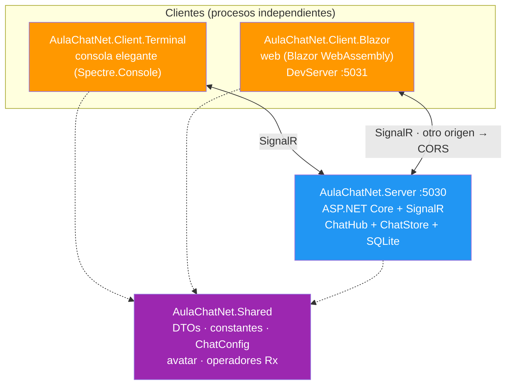
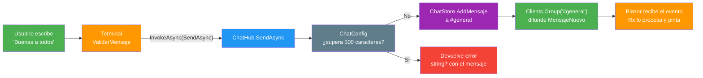
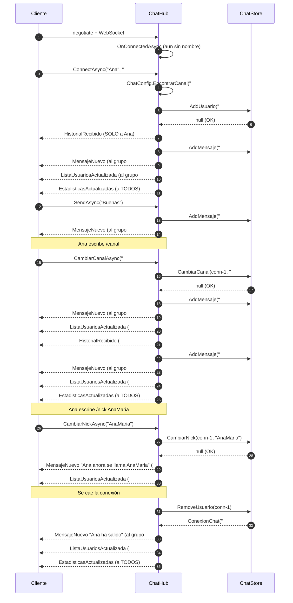
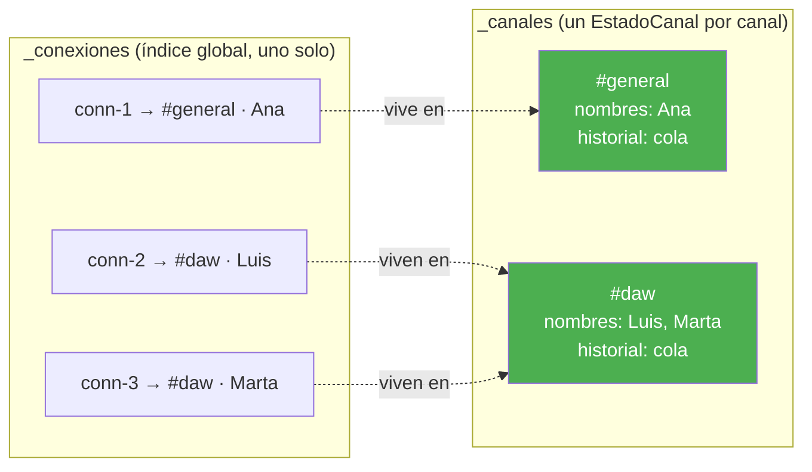
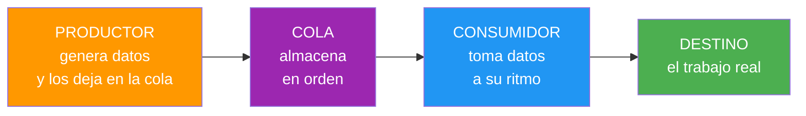
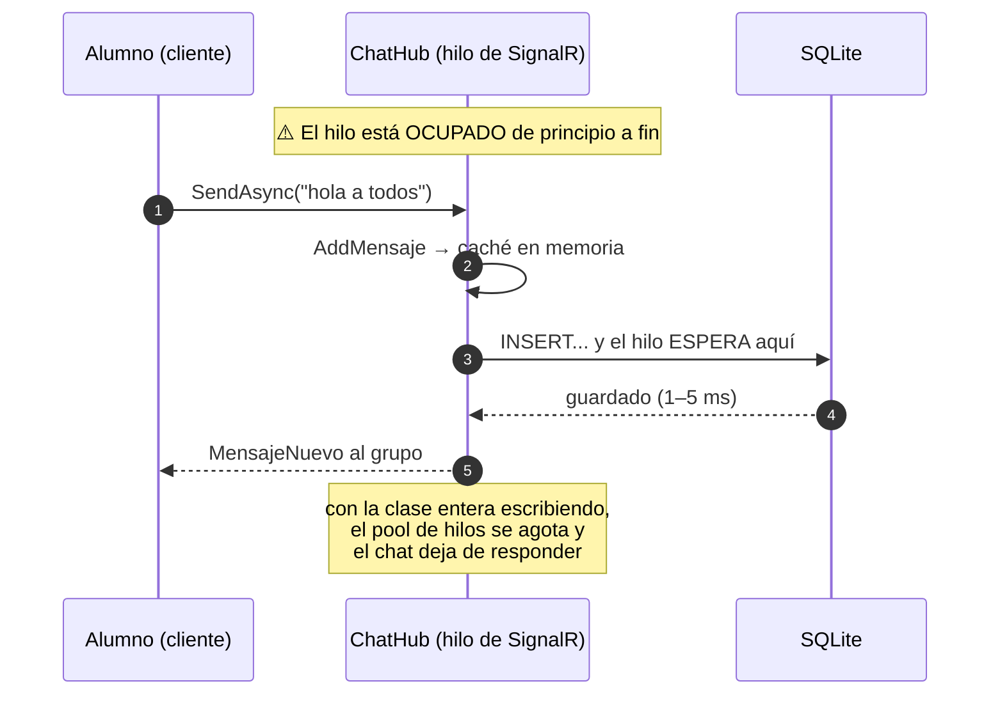
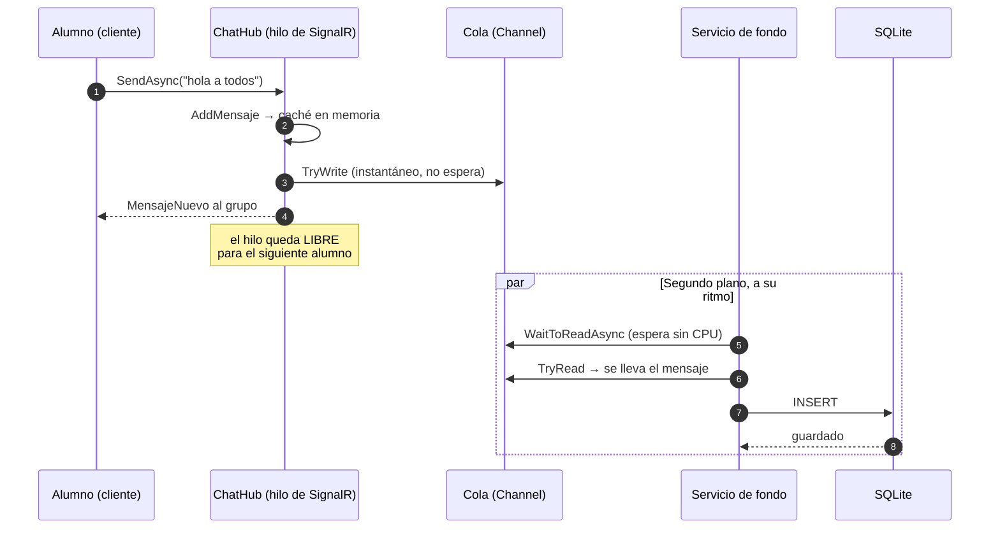
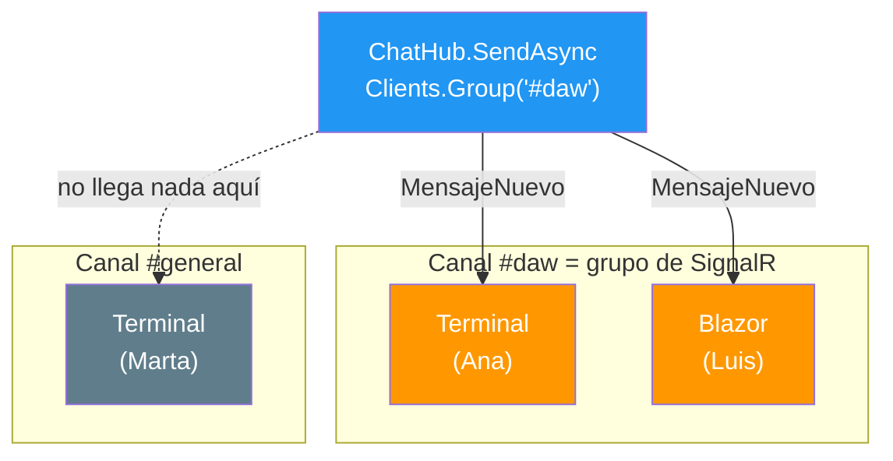
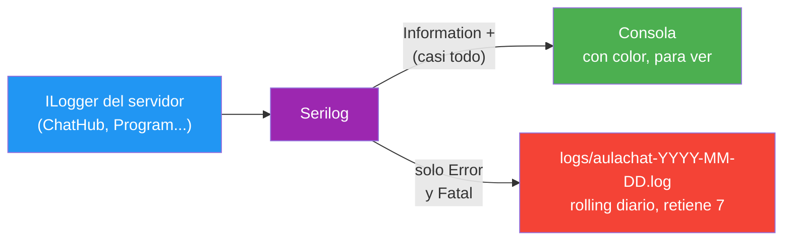

- [1. La arquitectura del servidor](#1-la-arquitectura-del-servidor)
  - [1.1. Los proyectos y su misión](#11-los-proyectos-y-su-misión)
    - [1.1.1. El servidor es agnóstico: qué expone y qué no](#111-el-servidor-es-agnóstico-qué-expone-y-qué-no)
  - [1.2. El viaje de un mensaje](#12-el-viaje-de-un-mensaje)
  - [1.3. Un patrón de errores, un solo formato](#13-un-patrón-de-errores-un-solo-formato)
- [2. El ciclo de vida de una conexión](#2-el-ciclo-de-vida-de-una-conexión)
  - [2.1. La secuencia completa](#21-la-secuencia-completa)
  - [2.2. Alta: ConnectAsync](#22-alta-connectasync)
  - [2.3. Envío: SendAsync](#23-envío-sendasync)
  - [2.4. Cambio de canal: CambiarCanalAsync](#24-cambio-de-canal-cambiarcanalasync)
  - [2.5. Cambio de nick en caliente: CambiarNickAsync](#25-cambio-de-nick-en-caliente-cambiar.nickasync)
  - [2.6. Consulta de usuarios: ObtenerUsuariosAsync](#26-consulta-de-usuarios-obtenerusuariosasync)
  - [2.7. Desconexión: OnDisconnectedAsync](#27-desconexión-ondisconnectedasync)
  - [2.8. Cómo se prueba todo esto sin abrir una terminal](#28-cómo-se-prueba-todo-esto-sin-abrir-una-terminal)
- [3. El estado del chat: ChatStore](#3-el-estado-del-chat-chatstore)
  - [3.1. Dos estructuras, dos misiones](#31-dos-estructuras-dos-misiones)
  - [3.2. Unicidad de nombres sin bloqueos](#32-unicidad-de-nombres-sin-bloqueos)
  - [3.3. La cola circular del historial](#33-la-cola-circular-del-historial)
  - [3.4. Las estadísticas globales y GET /estadisticas](#34-las-estadísticas-globales-y-get-estadisticas)
  - [3.5. Evolución: qué cambió en la Fase 2 y por qué](#35-evolución-qué-cambió-en-la-fase-2-y-por-qué)
  - [3.6. Productor/consumidor: la cola de escritura con Channel](#36-productorconsumidor-la-cola-de-escritura-con-channel)
- [4. Los canales como grupos de SignalR](#4-los-canales-como-grupos-de-signalr)
  - [4.1. Un canal, un grupo](#41-un-canal-un-grupo)
  - [4.2. Configuración sin hardcodeos](#42-configuración-sin-hardcodeos)
  - [4.3. Normalización: daw, #daw y #DAW](#43-normalización-daw-daw-y-daw)
- [5. Logging con Serilog desde appsettings](#5-logging-con-serilog-desde-appsettings)
  - [5.1. Consola para ver, fichero para investigar](#51-consola-para-ver-fichero-para-investigar)
  - [5.2. El símbolo doble dos puntos de Serilog](#52-el-símbolo-doble-dos-puntos-de-serilog)
  - [5.3. Rotación de 7 días](#53-rotación-de-7-días)
- [6. Dos bugs reales del servidor](#6-dos-bugs-reales-del-servidor)
  - [6.1. La carrera de los diez Anas](#61-la-carrera-de-los-diez-anas)
  - [6.2. El ConfigurationBinder que duplica listas](#62-el-configurationbinder-que-duplica-listas)
- [7. Resumen del punto](#7-resumen-del-punto)


# 1. La arquitectura del servidor

> 💡 **Punto de partida:** abres Discord y entras al canal #general. En pantalla ves a 40 personas y el mensaje que escribió Marta hace tres minutos. Abres otra pestaña en #daw y ves a otras 12 y su historial, sin mezclarse. Nadie ha recargado nada: todo llega solo. ¿Cómo sabe el servidor quién está en cada canal? ¿Cómo hace para mandarte el historial correcto y no el de otro? ¿Y qué pasa si dos personas se ponen el mismo nombre a la vez?

En este punto diseñamos por dentro el servidor de AulaChatNet: la arquitectura por capas, el ciclo de vida completo de una conexión de SignalR, las estructuras de datos que sostienen los canales en memoria, por qué cada canal es un "grupo", cómo se configura el logging sin tocar código, qué cambió de verdad en la Fase 2 cuando el historial se mudó a SQLite y, para rematar, los dos bugs reales que enseñó este servidor mientras se construía.

**Objetivos de aprendizaje:**

- Entender la arquitectura por capas Hub → Store → Shared y qué responsabilidad tiene cada una
- Seguir el ciclo de vida de una conexión SignalR: alta, envío, cambio de canal, cambio de nick y desconexión
- Comprender por qué el estado vive en `ConcurrentDictionary` y qué es la concurrencia
- Ver la cola circular del historial y el límite configurable
- Aplicar el criterio de longevidad que separa, en la Fase 2, lo que queda en memoria de lo que se persiste
- Entender el patrón **productor/consumidor** y usar un `Channel` para guardar en segundo plano sin bloquear el hilo de SignalR
- Usar los grupos de SignalR para que cada canal reciba solo lo suyo
- Sacar provecho de las estadísticas globales: evento `EstadisticasActualizadas` (push) y `GET /estadisticas` (pull)
- Configurar Serilog entero desde `appsettings.json`, con rotación de 7 días
- Conocer dos fallos reales: las carreras de concurrencia y el "truco" del ConfigurationBinder

## 1.1. Los proyectos y su misión

AulaChatNet es una solución con varios proyectos porque **el contrato entre servidor y clientes merece su propio proyecto**. Tanto el terminal como la web tienen que hablar el mismo idioma, y ese idioma (`Shared`) lo define nadie mejor que una capa común:



Cada carpeta del servidor tiene una responsabilidad, y los nombres lo dicen todo:

| Carpeta | Contenido | Ejemplo |
|---------|-----------|---------|
| `Hubs/` | La puerta de entrada de SignalR | `ChatHub.cs` |
| `Services/` | La lógica y el estado | `IChatStore`, `ChatStore` |
| `Models/` | Los datos que usa el servidor | `EstadoCanal`, `ConexionChat` |
| `Persistencia/` | La persistencia (Fase 2): entidad, contexto, repositorio y servicios de fondo | `AulaChatContexto`, `MensajeRepository`, `LimpiezaProgramada` |
| `Infrastructures/` | Extensiones de arranque (registran servicios, mapean rutas) | `AddChatServices`, `MapChatHub` |

> 📝 **Nota:** el patrón de "extensiones en `Infrastructures/`" no es un capricho: es el mismo estilo que usan proyectos reales para dejar el `Program.cs` limpio y leerlo como un índice.

### 1.1.1. El servidor es agnóstico: qué expone y qué no

Un dato que se entiende mejor abriendo el proyecto que leyéndolo: **este servidor no sirve ficheros y no sabe que los clientes existen**. No hay carpeta `wwwroot/` porque no hace falta: ni `index.html`, ni runtime de WebAssembly, ni CSS. De hecho, en toda la solución hay **un solo `index.html`** —el de `AulaChatNet.Client.Blazor/wwwroot/`— y lo entrega el proceso del cliente, no el servidor. Si pides `http://localhost:5030/` con el navegador, lo que recibes es un `404`.

| El servidor **sí** expone | El servidor **no** hace |
|---------------------------|-------------------------|
| El hub de SignalR en `/hubs/chat` | Servir la web: pide `"/"` y devuelve `404` |
| `GET /estadisticas`, una línea de API REST | Saber quién es su público: su único `ProjectReference` es `Shared` |
| El historial de SQLite (escritura y limpieza en segundo plano) | Compilar junto a los clientes: cada uno arranca en su proceso |

Por eso los tres viven en **procesos separados**: servidor en el `5030`, web en su DevServer del `5031`, terminal en consola. Y por eso existe CORS — es la consecuencia inevitable de que la web llame a un origen que no es el suyo. Si mañana añades un cliente de móvil o de escritorio, este servidor no se entera: basta con que hable SignalR y, si quiere contar gente antes de registrarse, pregunte por `/estadisticas`.

> 💡 **Consejo:** esta es también la razón de que el hub y el contrato (`Shared`) puedan seguir intactos entre fases. Al servidor no le importa quién conecta ni cómo se pinta: solo habla por `MensajeDto` y eventos. Un cliente nuevo es una flecha más en este mismo diagrama.

## 1.2. El viaje de un mensaje

Un mensaje escrito en el terminal viaja así hasta la pantalla de un compañero:



📌 **Ejemplo real:** WhatsApp. Cuando envías un mensaje, tu móvil no espera a que el del otro esté encendido: el servidor lo recibe, lo guarda y lo reenvía a los que están conectados. Si el destinatario está fuera, el mensaje le llegará cuando se conecte (eso ya lo hace la Fase 2: el historial se guarda en SQLite y te recupera lo que te perdiste al volver; de momento, en la Fase 1, solo se enviaba a los conectados).

## 1.3. Un patrón de errores, un solo formato

SignalR devuelve las llamadas como `Task<T>`. En AulaChatNet, **los métodos del hub devuelven `Task<string?>`, y `null` siempre significa "todo correcto"**. Si hay un problema, devuelven el mensaje de error en español para que el cliente lo muestre.

```csharp
var error = await conexion.InvokeAsync<string?>(ChatHubMetodos.Enviar, texto);

if (error is not null)
{
    // Algo fue mal: el servidor nos explica qué
    Log.Warning(error);
    return;
}
```

El mismo patrón se repite en las validaciones de `ChatConfig`: los métodos `ValidarUsuario` y `ValidarMensaje` devuelven `string?` (null = OK), y en el store (`AddUsuario`, `CambiarCanal`...). **Una sola convención en todo el sistema**: si devuelves texto, hay un problema; si devuelves `null`, sigue adelante.

> 💡 **Consejo:** fíjate en que `ConnectAsync`, `CambiarCanalAsync` y `CambiarNickAsync` **también** devuelven `string?`. La diferencia es semántica: `ConnectAsync` valida el nombre Y lo registra; `CambiarCanalAsync` y `CambiarNickAsync` comprueban que estés registrado antes de moverte o renombrarte. La única excepción del patrón es `ObtenerUsuariosAsync`, que **devuelve datos** (una lista de conectados, o `null` si el canal no existe): es una consulta, no una mutación.

## 2. El ciclo de vida de una conexión

### 2.1. La secuencia completa

Este es el viaje completo de una conexión, desde que el cliente abre el WebSocket hasta que se desconecta. Presta atención a quién recibe cada cosa (el historial SOLO al que entra, los mensajes a todo el grupo):



> ⚠️ **Advertencia:** fíjate en el paso del cambio de canal. Cuando Ana cambia, el historial del nuevo canal se le envía **a ella sola** (`Clients.Caller`), mientras que los mensajes de sistema van al **grupo entero** (`Clients.Group`). Enviar el historial a todo el grupo saturaría a los demás, que no lo piden. Y las estadísticas viajan con `Clients.All`: el total es global, no de un canal.

### 2.2. Alta: ConnectAsync

```csharp
public async Task<string?> ConnectAsync(string? usuario, string? canal = null)
```

- Si no se pasa canal, se entra al `CanalPorDefecto` (el primero de la lista de `appsettings.json`)
- El nombre se valida con `ChatConfig.ValidarUsuario` (longitud entre mínima y máxima)
- El registro en el store puede fallar si el nombre ya está en uso en ese canal

El nombre llega como parámetro de `ConnectAsync` y no en `OnConnectedAsync` porque **SignalR conecta primero y "quién eres" se dice después**: así el servidor puede rechazar nombres inválidos o duplicados devolviendo un mensaje de error al cliente.

### 2.3. Envío: SendAsync

```csharp
public async Task<string?> SendAsync(string? texto)
```

- Comprueba que la conexión esté registrada (una conexión "fantasma" que no se ha dado de alta no puede escribir)
- Valida el texto con `Config.ValidarMensaje` (no vacío, hasta `MensajeLongitudMaxima`)
- Guarda el mensaje en el historial de SU canal y lo difunde con `Clients.Group(conexion.Canal)`

Un detalle de buenas prácticas: **el log registra la longitud del mensaje, no el contenido**. Los logs pueden verlos personas no autorizadas.

### 2.4. Cambio de canal: CambiarCanalAsync

```csharp
public async Task<string?> CambiarCanalAsync(string? canal)
```

Este es el método que hace que Discord "sienta vivo": moverte entre canales sin reconectar. Los pasos, en orden:

1. Se comprueba que estés registrado (`GetConexion`) y que el canal exista (`EncontrarCanal`)
2. Se mueve el usuario en el store: alta en el destino (con la unicidad de nombre de ese canal) y liberación del nombre en el origen
3. Aviso de salida en el canal anterior, lista actualizada del anterior
4. Historial del nuevo canal SOLO al cliente que cambia
5. Aviso de entrada en el nuevo canal, lista actualizada del nuevo

Si el nombre ya está ocupado en el destino, el cambio se rechaza con un error y **te quedas donde estabas**.

### 2.5. Cambio de nick en caliente: CambiarNickAsync

```csharp
public async Task<string?> CambiarNickAsync(string? nuevoNick)
```

Discord permite "Cambiar apodo" sin reconectar, y este método hace exactamente eso. Los pasos, en orden:

1. Se comprueba que estés registrado (`GetConexion`)
2. Se valida el nuevo nombre con `Config.ValidarUsuario` (mismas reglas que al entrar)
3. Si el nombre es el mismo (ignorando mayúsculas), **no se emite nada**: silencio total
4. El store aplica el cambio: `TryUpdate` en el índice de nombres por canal (la unicidad del destino se respeta: otro en el canal ya usando ese nombre lo rechaza)
5. Aviso de sistema "X ahora se llama Y" al grupo y lista de conectados actualizada

Un detalle importante: el nick **no cambia `Context.ConnectionId`** ni la identidad de la conexión; solo cambia el nombre visible y la clave del índice de ese canal. Por eso las estadísticas globales **no** se emiten aquí: el número de conectados no ha variado.

> 📝 **Nota:** el store guarda `Usuario` dentro de `ConexionChat`, y `GetConexion` devuelve copias inmutables; por eso el cambio pasa por `TryUpdate` y no por "tocar el objeto".

### 2.6. Consulta de usuarios: ObtenerUsuariosAsync

```csharp
public Task<IReadOnlyList<UsuarioConectadoDto>?> ObtenerUsuariosAsync(string? canal)
```

Es el primer método del hub que **no muta nada ni sigue el patrón `string?`**: devuelve datos. Responde **solo al que pregunta** (`Clients.Caller` implícito, porque no hay `SendAsync` de por medio) y no difunde nada a nadie:

- Si el canal existe → la lista de conectados (DTOs) de ese canal
- Si no existe → `null` (el cliente lo traduce como "no hay nadie ahí" o error)

📌 **Ejemplo real:** el equivalente a abrir el desplegable de "miembros de #daw" en Discord estando tú en #general: miras otra sala sin moverte. En terminal, `/usuarios daw` hace exactamente esta consulta.

> 💡 **Consejo:** fíjate en la diferencia con `ListaUsuariosActualizada`: ese evento se **difunde** (push, a todo el grupo, sin que nadie lo pida); esta consulta es un **pull bajo demanda**. Los dos son lecturas de `store.GetUsuarios(canal)`, pero con destinatarios y momento distintos.

### 2.7. Desconexión: OnDisconnectedAsync

SignalR llama a `OnDisconnectedAsync` cuando se corta la conexión (el cliente cierra la pestaña, se va el wifi...). El hub elimina al usuario del store y emite el aviso de salida **solo a su canal**:

```csharp
public override async Task OnDisconnectedAsync(Exception? exception)
{
    var conexion = store.RemoveUsuario(Context.ConnectionId);

    if (conexion is not null)
    {
        var mensaje = MensajesSistema.UsuarioSalio(conexion.Usuario);
        store.AddMensaje(conexion.Canal, mensaje);

        await Clients.Group(conexion.Canal).SendAsync(ChatHubEventos.MensajeNuevo, mensaje);
        await Clients.Group(conexion.Canal).SendAsync(
            ChatHubEventos.ListaUsuariosActualizada, store.GetUsuarios(conexion.Canal));

        // Estadísticas globales a TODOS: uno menos conectado
        await Clients.All.SendAsync(
            ChatHubEventos.EstadisticasActualizadas, store.GetEstadisticas());
    }

    await base.OnDisconnectedAsync(exception);
}
```

Si la excepción no es `null`, es que la conexión cayó por un error (se registra como warning con la excepción). Si es `null`, es una desconexión limpia (se registra como información).

### 2.8. Cómo se prueba todo esto sin abrir una terminal

La clave está en que **el hub depende de interfaces**: `IChatStore` (el estado), `IControlRafagas` (la cuota de ráfagas de la Fase 4.1) e `IHubCallerClients` (a quién emitir). Con Moq simulamos las tres, y con los *setters* públicos inyectamos el doble de contexto:

```csharp
var hub = new ChatHub(store, rafagas, Options.Create(config), logger.Object)
{
    Context = Mock.Of<HubCallerContext>(c => c.ConnectionId == "conn-1"),
    Clients = clientes.Object   // proxies que GRABAN lo que se emite
};
```

Los proxies no hacen nada de red: solo guardan en una lista cada `SendCoreAsync`. Así un test puede preguntar: "¿qué recibió el grupo #daw?" y "¿recibió algo el grupo #general?". En `ChatHubTests.cs` tienes el patrón completo, incluida la simulación de varias conexiones.

## 3. El estado del chat: ChatStore

### 3.1. Dos estructuras, dos misiones

El estado del chat vive en memoria, en dos colecciones concurrentes con misiones distintas:



| Estructura | Contenido | Por qué |
|------------|-----------|---------|
| `_conexiones` | `connectionId` → canal + usuario | Única fuente de verdad de "quién está conectado"; acceso en O(1) |
| `_canales` | canal → `EstadoCanal` (nombres + historial) | Unicidad de nombres e historial **separados por canal** |

Los nombres de canal y los usuarios se guardan con `ConcurrentDictionary`, pensada para que múltiples hilos (peticiones) lean y escriban a la vez sin bloquearse.

### 3.2. Unicidad de nombres sin bloqueos

Si dos personas intentan llamarse "Ana" a la vez en #general, **solo una puede ganar**. La clave no es un bloqueo tradicional, sino `TryAdd`, que es atómico: la operación entera es "o la hace alguien o la hace otro, nunca las dos":

```csharp
// TryAdd atómico POR CANAL: si alguien llegó primero con ese nombre
// en este canal, se rechaza sin necesidad de bloquear nada
if (!estado.UsuariosPorNombre.TryAdd(clave, nuevo))
    return Config.ErrorUsuarioDuplicado;
```

📌 **Ejemplo real:** Discord. Si intentas cambiar el nick de tu servidor a un nombre ya usado por otro miembro, te lo rechaza. En nuestro caso la regla es más laxa: la unicidad es **por canal**, así que puede haber una "Ana" en #general y otra distinta en #daw.

> 📝 **Nota:** las claves se normalizan con `ToUpperInvariant()` antes de comparar, así que "Ana", "ANA" y "ana" son la misma persona. El mismo truco se aplica a los canales (ver sección 4.3).

### 3.3. La cola circular del historial

Cada `EstadoCanal` guarda sus últimos N mensajes en una `ConcurrentQueue`. Al añadir uno nuevo, si la cola supera el límite configurado, se descarta el más antiguo:

```csharp
estado.Historial.Enqueue(mensaje);

// Cola circular: al superar el límite configurado, el más antiguo
// sale del historial.
while (estado.Historial.Count > Config.HistorialMaximo
       && estado.Historial.TryDequeue(out _))
{
}
```

📌 **Ejemplo real:** Discord te muestra los últimos 100 mensajes de un canal; más atrás, no hay nada (eso es historial persistido, que en nuestra Fase 2 ya se guarda en SQLite, como veremos en la sección 3.5).

### 3.4. Las estadísticas globales y GET /estadisticas

Además de "quién hay en cada canal", la app necesita "cuánta gente hay en TOTAL" (el contador de arranque de la terminal, por ejemplo). El store lo resuelve con un único barrido de las conexiones vivas:

```csharp
public EstadisticasDto GetEstadisticas()
{
    // Agrupamos las conexiones vivas por su canal: como CADA conexión está
    // en exactamente UN canal, la suma de los grupos es el total real
    var conteos = _conexiones.Values
        .GroupBy(c => c.Canal, StringComparer.OrdinalIgnoreCase)
        .Select(g => new ConteoCanalDto(g.Key, g.Count()))
        .OrderByDescending(c => c.Conectados)
        .ThenBy(c => c.Canal, StringComparer.OrdinalIgnoreCase)
        .ToArray();

    return new EstadisticasDto(_conexiones.Count, conteos);
}
```

Devuelve un `EstadisticasDto` (total + reparto por canal) que llega a los clientes por **dos caminos distintos**, cada uno para su momento:

| Camino | Cuándo | Quién lo recibe | Para qué |
|--------|--------|-----------------|----------|
| Evento `EstadisticasActualizadas` | Alta, cambio de canal y desconexión | **Todos** los conectados (`Clients.All`) | La línea de estado se actualiza en tiempo real |
| `GET /estadisticas` (REST) | Cuando el cliente lo pide | Solo el que pregunta | Contar **antes de registrarse** (entrada guiada del terminal) |

El endpoint es una línea de API mínima en `Program.cs`, usando la constante de `Shared` (nada de rutas escritas dos veces):

```csharp
app.MapGet(ChatRutas.Estadisticas, (IChatStore store) =>
    Results.Ok(store.GetEstadisticas()));
```

> 💡 **Consejo:** el evento y el endpoint **no se pisan, se complementan**: el evento es "push" (el servidor avisa cuando cambia algo), el endpoint es "pull" (pídeme el estado cuando quieras). Es el mismo reparto que ves en casi todas las apps reales: WebSocket para el tiempo real y REST para lo puntual.

📌 **Ejemplo real:** abrir Discord sin iniciar sesión y ver "12.345.678 personas en línea": ese número no viene de una conexión de chat, viene de una consulta rápida como esta.

### 3.5. Evolución: qué cambió en la Fase 2 y por qué

La Fase 1 terminó con **todo** el estado en memoria, y ese era el problema de fondo: al parar el servidor, el historial desaparecía. La Fase 2 lo arregló, pero sin meterlo todo en la base de datos. La decisión fue aplicar el criterio de **longevidad**: separar por la pregunta *¿qué pasa si apago el proceso?*

| Estado | Fase 1 | Fase 2 | Por qué |
|--------|--------|--------|---------|
| Presencia (`_conexiones`) | Memoria | **Sigue en memoria** | Un `connectionId` no significa nada tras un reinicio: las conexiones ya no existen |
| Unicidad de nicks (`_canales`) | Memoria | **Sigue en memoria** | Nadie está conectado al arrancar, así que todos los nicks están libres |
| Historial (`_canales`) | Cola en memoria | **Caché + SQLite** | Es el único con valor pasado: leerlo mañana es justo su propósito |
| Mensajes de sistema | Memoria | **No se persisten** | Son ruido de sesión, no historia del aula |

Dos detalles de diseño que no son evidentes y conviene retener:

1. **El hub y la lógica de los clientes no se tocaron.** El contrato (`MensajeDto`, los eventos, `GetHistorial`) seguía valiendo tal cual: la memoria dejó de ser la *única* fuente de verdad del historial para pasar a ser su **caché**. Ese es el verdadero éxito de la fase: añadir persistencia con **cero cambios en el protocolo**. Único matiz honesto, comprobado con `git diff 0.2.0 0.3.0`: los clientes SÍ recibieron cambios en ese tramo, pero solo de imagen —el icono de la app (`feat:` de cosmética)—; ni una línea de lógica ni del contrato.
2. **Escribir dejó de ser síncrono respecto al disco.** `AddMensaje` sigue siendo síncrono —memoria más encolado en un `Channel`, instantáneo— y la escritura real pasó a un `BackgroundService`. Así el hilo de SignalR **nunca espera a un disco**, que es la regla de oro de los hubs en tiempo real. Qué es exactamente ese `Channel` y por qué hace falta, en la sección 3.6.

La asimetría que esto produce es deliberada y es lo que más confunde al principio: `IChatStore` es síncrono (no hace E/S) e `IMensajesRepository` es asíncrono (siempre toca disco). **`async` va donde hay E/S**, no por convención.

> 📝 **Nota:** en el punto 4 está la evolución completa de esa decisión —el modelo de datos, las migraciones, el escritor en segundo plano, la limpieza con `VACUUM` y las tres trampas reales que solo salieron al ejecutar—, con el detalle de cada porqué: [4. La persistencia con SQLite](04-persistencia.md).

### 3.6. Productor/consumidor: la cola de escritura con Channel

La sección 3.5 decía que el `AddMensaje` "encola en un `Channel`" sin explicar qué es eso ni por qué hace falta. Vamos a ello, porque detrás hay un patrón de programación que aparece cada vez que dos piezas trabajan a ritmos distintos.

> 💡 **Punto de partida:** estás en un bar y pides una caña. El camarero no se queda parado esperando a que el barril se llene: apunta tu pedido en la libreta, cobra la mesa siguiente y ya irá a por ella. Tu bebida llega igualmente, pero **el camarero no ha dejado de trabajar a lo tuyo**. Ahora imagina que en vez de un camarero hubiera UNO solo para todo el bar y que, además, cada pedido le costara esperar 5 segundos de pie en la cocina. El bar se paralizaría. Pues eso es lo que le pasa a un hub de SignalR cuando escribe en disco dentro del método.

**Objetivos de esta sección:**

- Entender qué es el patrón **productor/consumidor** y cuándo conviene usarlo
- Ver con números por qué un hilo de SignalR **no puede esperar al disco**
- Saber qué es un `System.Threading.Channels.Channel` y usar sus cuatro métodos
- Distinguir qué resuelve el `Channel` y qué no (y por qué no es lo mismo que Rx)

#### El problema: el hilo del hub no puede esperar

`ChatStore.AddMensaje` se ejecuta **dentro del hilo de SignalR** que atiende a ese alumno. En la Fase 1 eso no importaba: solo tocaba memoria. Pero en la Fase 2 hay que guardar el mensaje en SQLite, y una escritura en disco **cuesta milisegundos reales** —que suenen a poco, pero que se multiplican:

| Situación | Coste | Qué ocurre |
|-----------|-------|------------|
| 1 alumno escribe | ~1–5 ms de disco | Nadie se entera |
| 25 alumnos escribiendo a la vez | 25 esperas en el *pool* de hilos | Los mensajes se serializan y el chat "respira" mal |
| Pico de una prueba con toda la clase | El *pool* se agota | Los mensajes dejan de llegar **a todos**, conectados o no |

Y la regla de oro es simple: **un hub de SignalR atiende conexiones, no espera E/S**. Su hilo es caro y compartido; gastarlo esperando a un disco es exactamente lo contrario de lo que debe hacer.

#### El patrón productor/consumidor, en teoría

El problema tiene nombre y es anterior a .NET: cuando **quien produce** algo y **quien lo consume** trabajan a ritmos distintos, se intercala una **cola** entre ambos y cada uno hace lo suyo:



Las tres propiedades que aporta la cola son las que nos interesan:

1. **Desacople.** El productor no sabe quién consume ni cuándo: solo sabe que su dato ya está depositado. Puede cambiar el consumidor sin tocar al productor.
2. **Absorbe picos.** Si llegan 20 mensajes de golpe, la cola crece y el consumidor los va digiriendo a su ritmo. Nada se pierde y nadie espera.
3. **Ordena.** Como es una cola, lo primero que entra es lo primero que sale. En un chat eso no es un detalle: el historial debe respetar el orden en que se escribieron.

📌 **Ejemplo real:** es el mismo patrón de una cinta de montaje, de un buzón de correos o de la lista de reproducción de Spotify —tú añades canciones (productor) y el reproductor las va tragando (consumidor), aunque añadas más rápido de lo que dura cada una—.

#### Sin el patrón: el bar se para

Para ver la diferencia, comparemos los dos escenarios con el mismo mensaje:



#### Con el patrón: el camarero sigue cobrando



La diferencia sustancial no es la velocidad del disco —esa es igual en los dos—, sino **quién espera**. En el primer caso espera el hilo que atiende a todos; en el segundo espera un hilo propio que no le quita tiempo a nadie. El alumno ve su mensaje al instante en los dos casos; lo que cambia es si el servidor sigue en pie.

#### Qué es exactamente un Channel

`System.Threading.Channels.Channel<T>` es una clase **del propio SDK de .NET** —no hay que instalar ningún paquete— pensada exactamente para esto: comunicar un productor y un consumidor con una cola thread-safe. No inventa nada nuevo, es la formalización del patrón.

Nuestro uso se reduce a **cuatro métodos**, y conviene conocerlos bien porque son todo lo que hay que saber:

| Método | Quién lo usa | Qué hace | Por qué aquí |
|--------|--------------|----------|--------------|
| `Channel.CreateUnbounded<T>()` | Al construir el store | Crea la cola **sin límite** | Un chat no debe descartar mensajes; si el disco va lento, la cola crece un poco y ya |
| `Writer.TryWrite(item)` | **Productor** (`AddMensaje`) | Intenta meter el dato. Devuelve `true`/`false` y **nunca bloquea** | Se ejecuta en el hilo de SignalR: no puede esperar nada |
| `Reader.WaitToReadAsync()` | **Consumidor** (servicio de fondo) | Devuelve un `Task` que termina cuando haya algo que leer. Espera **sin consumir CPU** | No hay sondeo ni bucles ocupados: el hilo se duerme y el runtime lo despierta |
| `Reader.TryRead(out item)` | **Consumidor** | Saca el dato de la cola | El bucle de drenado vacía lo que haya acumulado |

Y este es el código real, lado a lado:

```csharp
// PRODUCTOR — ChatStore.AddMensaje (hilo de SignalR)
if (_repository is not null)
    _colaEscritura.Writer.TryWrite((canal, mensaje));   // instantáneo

// CONSUMIDOR — PersistenciaMensajesService (hilo propio)
while (await lector.WaitToReadAsync(stoppingToken))     // espera sin CPU
    await DrenarAsync(lector, stoppingToken);           // vacía con TryRead
```

> 💡 **Consejo:** cuando necesites desacoplar "quien produce" de "quien consume" en .NET —una cola de trabajos, un envío de correos, un logger con cola—, `System.Threading.Channels` es la respuesta por defecto. No construyas colas propias con `ConcurrentQueue` y semáforos: el `Channel` ya es thread-safe, ya sabe esperar y ya sabe drenar.

#### Por qué no se hizo con Rx, si el proyecto ya lo usa

Este proyecto usa Rx.NET por todas partes —`Shared/Observables` y las stores de los dos clientes—, así que la pregunta es legítima: ¿por qué aquí un `Channel` y no un `Subject<T>`?

Porque resuelven cosas distintas:

- Un `Subject<T>` de Rx es un **empujón** (`OnNext`), no una cola: si en ese instante no hay suscriptor, **el dato se pierde**. Además no es thread-safe para llamadas concurrentes, y si el consumidor lanza una excepción, **la suscripción muere** y todo lo que llegue después se cae en silencio.
- Un `Channel` **bufferiza de verdad** (los datos esperan hasta que alguien los lea), **es thread-safe** y **sigue funcionando aunque el consumidor se retrase**.

Es decir: Rx está pensado para **componer y transformar** flujos, y el `Channel` para **transportarlos con garantías**. No compiten; se complementan. Si en el futuro quisieras reintentos automáticos o volcados por lotes, podrías envolver el `Channel` en Rx y usar lo mejor de ambos.

> ⚠️ **Advertencia:** el `Channel` **sin límite** tiene una contrapartida. Si el disco se colgara del todo, la cola crecería sin parar y se comería la memoria. En un servidor de aula es un riesgo despreciable; en producción habría que ponerle un techo y decidir qué hacer cuando se llene. Esa decisión es, precisamente, la que un patrón productor/consumidor te obliga a tomar en serio.

## 4. Los canales como grupos de SignalR

### 4.1. Un canal, un grupo

SignalR tiene un concepto nativo llamado **grupos**: conjuntos de conexiones a las que puedes enviar mensajes de golpe. Un canal de AulaChatNet **es exactamente un grupo de SignalR**:



La belleza de esto es que **no hay que inventar la lógica de reenvío**: SignalR ya sabe a quién está enviando dentro del grupo, y quien se desconecta sale del grupo automáticamente.

### 4.2. Configuración sin hardcodeos

Los canales NO están escritos en el código: viven en `appsettings.json`, en la sección `Chat`:

```json
"Chat": {
  "Canales": [ "#general", "#daw", "#dam", "#asir", "#smr" ],
  "HubRuta": "/hubs/chat",
  "HistorialMaximo": 25
}
```

Y en `appsettings.Development.json` se puede sobreescribir para desarrollo:

```json
"Chat": {
  "HistorialMaximo": 50
}
```

La configuración se carga en un objeto tipado `ChatConfig` (opciones de .NET) que se inyecta donde haga falta (hub, store...). Añadir el canal "#erli" a un aula es añadir una línea al JSON, sin tocar ni recompilar una línea de C#.

> 📝 **Nota:** **el orden del array importa**: es el orden en que se pintan los canales en el selector de los clientes, y el primero (`#general`) es además el `CanalPorDefecto` al que se entra sin escribir nada.

### 4.3. Normalización: daw, #daw y #DAW

Los usuarios escriben a su manera: "daw", "#daw", "#DAW", " #daw ". Para que todo el mundo caiga en el mismo canal, `ChatConfig.NormalizarCanal` recorta espacios, añade la almohadilla si falta y pasa a mayúsculas. Después, `EncontrarCanal` devuelve la forma canónica (la que aparece en la configuración) para usarla como clave interna.

> 💡 **Consejo:** el cliente terminal aprovecha esto: escribir `/canal daw` funciona igual que `/canal #daw` o `/canal #DAW`, porque la normalización ocurre en `ChatConfig`, compartida por ambos lados.

## 5. Logging con Serilog desde appsettings

### 5.1. Consola para ver, fichero para investigar

El logging se configura **entero** en `appsettings.json`, sin tocar código: la sección `Serilog` describe dos destinos (sinks):



| Destino | Nivel mínimo | Detalle |
|---------|--------------|---------|
| Consola | Information | Se ve casi todo; las peticiones HTTP a `/hubs` se bajan a Debug para no ensuciar |
| Fichero | Error | Solo errores, en `logs/aulachat-YYYY-MM-DD.log` |

### 5.2. El símbolo doble dos puntos de Serilog

Hay un detalle de sintaxis en el JSON que desconcierta al principio: el tema de la consola se referencia así:

```json
"theme": "Serilog.Sinks.SystemConsole.Themes.AnsiConsoleTheme::Code, Serilog.Sinks.Console"
```

Ese `::` es la forma de que Serilog se refiera a un **miembro estático** de un tipo de un ensamblado externo: `Tipo::Miembro, Ensamblado`. Es como si el JSON hiciera lo mismo que en C#: `AnsiConsoleTheme.Code`.

### 5.3. Rotación de 7 días

El fichero de errores usa rotación diaria (`rollingInterval: Day`) y retiene un máximo de 7 ficheros (`retainedFileCountLimit: 7`). Además, si un fichero pasa de 10 MB, rueda antes (`rollOnFileSizeLimit`). El resultado es que `logs/` nunca crece sin control: siempre tendrás los últimos 7 días de errores.

> 📝 **Nota:** la carpeta `logs/` está en `.gitignore`. Los logs son de ejecución, no del repositorio.

## 6. Dos bugs reales del servidor

No todo fue suave. Estos dos fallos aparecieron mientras se construía el servidor, y ambos son material de estudio.

### 6.1. La carrera de los diez Anas

**El problema.** Imagina diez personas entrando a la vez a un mismo canal y todas llamándose "Ana". Sin protección, el resultado sería imprevisible. Este es el test que lo reproduce:

```csharp
// Diez conexiones intentan registrarse como "Ana" A LA VEZ
Parallel.For(0, 10, i => resultados[i] = _store.AddUsuario(General, "Ana", $"conn-{i}"));
```

**La solución.** `ConcurrentDictionary.TryAdd` es atómico: de las diez, exactamente una gana el `TryAdd` del índice de nombres, y las nueve restantes reciben el error de duplicado. No hay bloqueos, no hay esperas: la operación completa es "todo o nada".

📌 **Ejemplo real:** el mostrador de un bar. Dos clientes llegan a la vez a pedir la última croqueta: el cajero atiende a uno primero y al otro le dice que ya no queda. No hace falta cerrar el bar entero.

### 6.2. El ConfigurationBinder que duplica listas

**El problema.** Al arrancar el servidor, el banner de inicio mostraba los canales dos veces:

```
Disponibles: #general, #smr, #daw, #asir, #dam, #general, #smr, #daw, #asir, #dam
```

¿Por qué? **El `ConfigurationBinder` de .NET añade los valores de `appsettings.json` a la lista existente en lugar de reemplazarla**. Si la propiedad `Canales` arrancaba con una lista por defecto de 5 canales, y el JSON traía otros 5, el resultado eran 10.

**La solución.** La propiedad arranca **vacía a propósito**:

```csharp
/// <remarks>
/// Arranca VACÍA a propósito: el ConfigurationBinder de .NET AÑADE los
/// valores de appsettings a la lista existente en lugar de reemplazarla,
/// así que una lista con valores por defecto los duplicaría con los del
/// fichero.
/// </remarks>
public List<string> Canales { get; set; } = [];
```

> ⚠️ **Advertencia:** este patrón de "inicializar vacío" aplica a **cualquier lista o diccionario** que se cargue desde configuración. Es un clásico de ASP.NET Core, y el error es tan silencioso que puede vivir meses en producción sin que nadie lo note.

📌 **Ejemplo real:** el equivalente del "doble envío" en formularios web: si tu validador "añade" en vez de "reemplazar", acabas con registros duplicados.

## 7. Resumen del punto

| Concepto | Qué retener |
|----------|-------------|
| Arquitectura | Hub (transporte) → Store (estado) → Shared (contrato compartido); desde la Fase 2, el historial se respalda en SQLite |
| Superficie del servidor | **Agnóstico**: solo expone `/hubs/chat` y `GET /estadisticas`; no sirve ficheros (`"/"` → `404`) y no tiene referencia a ningún cliente. Cada cliente es un proceso aparte (web en `5031`, de ahí CORS) |
| Errores | `Task<string?>`: `null` = OK, texto = mensaje para el cliente (`ObtenerUsuariosAsync` devuelve datos) |
| Ciclo de vida | Conectar → alta → historial (solo al caller) → mensajes al grupo → salida |
| Nick | `CambiarNickAsync` cambia el nombre en caliente, con aviso "X ahora se llama Y" al canal |
| Consultas | `ObtenerUsuariosAsync` mira cualquier canal sin cambiar de él y sin avisar a nadie |
| Estado | `_conexiones` global + un `EstadoCanal` (nombres + historial) por canal; separación **por longevidad**: solo el historial se persiste |
| Unicidad | `TryAdd` atómico por canal, con claves normalizadas |
| Historial | `ConcurrentQueue` circular, límite `HistorialMaximo` configurable; desde la Fase 2, cacheado en memoria y respaldado en SQLite |
| Canales | Cada canal es un grupo de SignalR; lista en `appsettings.json`, **el orden del array es el orden de pantalla** |
| Estadísticas | `GetEstadisticas` → evento `EstadisticasActualizadas` (push a todos) + `GET /estadisticas` (pull, antes de registrarse) |
| Logging | Serilog desde `appsettings.json`; consola Information, fichero Error con rolling de 7 días |
| Bugs reales | Carreras de concurrencia y el ConfigurationBinder que duplica listas |

En el siguiente punto vamos al primer cliente: el [terminal con Spectre.Console, su vista en vivo y su capa reactiva con Rx](02-cliente-terminal.md). Después vendrá la web con Blazor WebAssembly y su estética de Discord.
