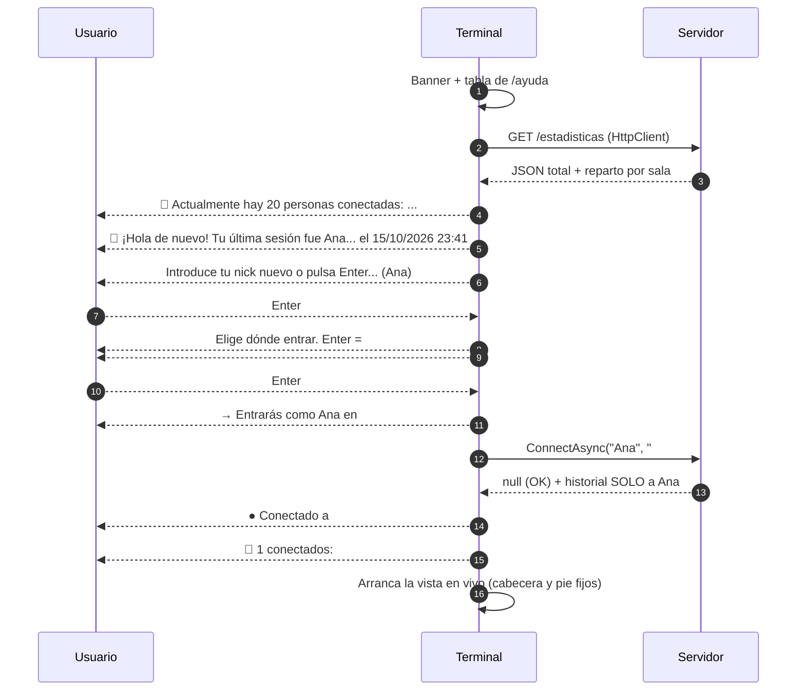
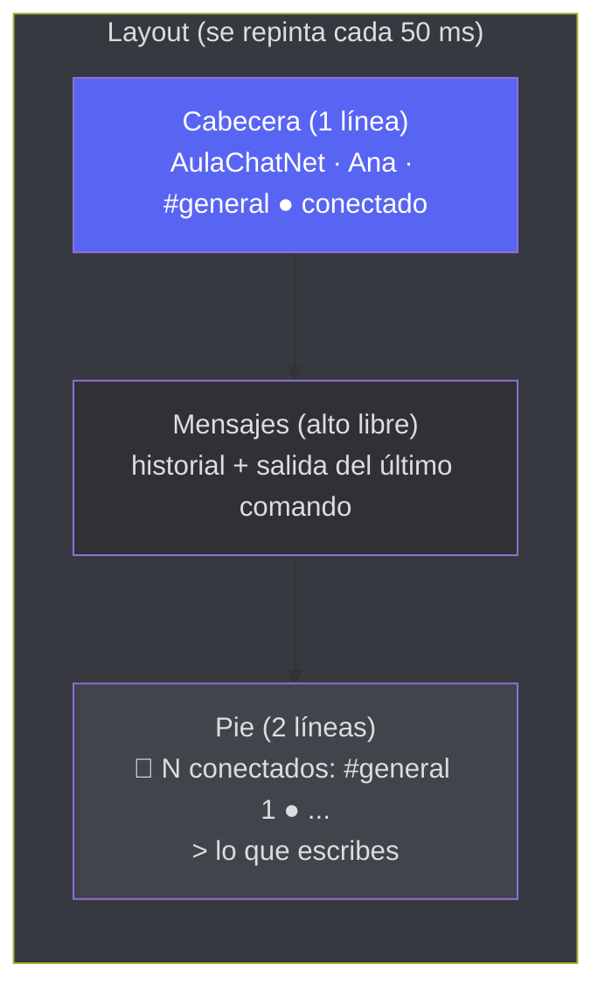
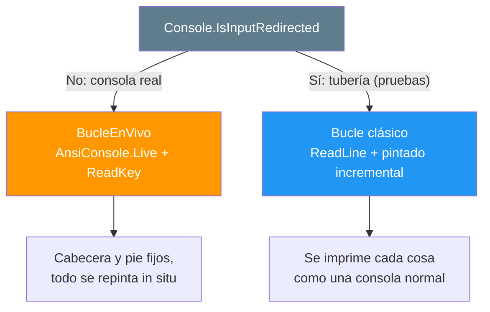

- [2. El cliente terminal](#2-el-cliente-terminal)
  - [2.1. Qué hay dentro del proyecto](#21-qué-hay-dentro-del-proyecto)
  - [2.2. El arranque guiado, paso a paso](#22-el-arranque-guiado-paso-a-paso)
  - [2.3. La vista en vivo con Spectre.Console](#23-la-vista-en-vivo-con-spectreconsole)
  - [2.4. Los dos modos de entrada](#24-los-dos-modos-de-entrada)
  - [2.5. La capa reactiva con Rx](#25-la-capa-reactiva-con-rx)
  - [2.6. Los comandos del chat](#26-los-comandos-del-chat)
  - [2.7. La sesión recordada](#27-la-sesión-recordada)
  - [2.8. La configuración del terminal](#28-la-configuración-del-terminal)
  - [2.9. Cómo se prueba sin abrir una terminal](#29-cómo-se-prueba-sin-abrir-una-terminal)
  - [2.10. Resumen del punto](#210-resumen-del-punto)


# 2. El cliente terminal

> 💡 **Punto de partida:** abres Discord y ya está ahí tu último servidor, tu nick y el canal donde te quedaste. Nadie lo teclea otra vez. Además, mientras escribes un mensaje en el canal, los mensajes de los demás van cayendo por encima sin descuadrarte lo que llevas escrito. En una consola de texto eso no es tan obvio: la terminal es "de solo lectura", cada vez que escribes, la línea de estado se imprime otra vez... ¿cómo hace este cliente para que la cabecera y los contadores se queden fijos arriba y abajo mientras el chat sigue vivo en medio?

En este punto recorremos el cliente terminal de AulaChatNet: el arranque guiado (con el número de conectados **antes** de pedir el nick), la vista en vivo de Spectre.Console, la capa reactiva con Rx.NET que alimenta la pantalla, los comandos tipo Discord, la sesión recordada y cómo se prueba todo sin abrir una terminal.

**Objetivos de aprendizaje:**

- Seguir el arranque guiado: de la banner al prompt, con la cuenta de conectados antes de registrarse
- Entender la vista en vivo (`AnsiConsole.Live` + `Layout`) y por qué la línea de estado ya no se reimprime
- Ver la capa reactiva: stores con `BehaviorSubject` y una UI que solo **pinta el estado actual**
- Conocer el parser de comandos como lógica pura y por qué eso se testea sin consola
- Distinguir los dos modos de entrada (consola real y tubería) y entender la sesión recordada

## 2.1. Qué hay dentro del proyecto

El cliente es una aplicación de consola normal (no usa `WebApplication` ni hosts): todo empieza y termina en `Program.cs`, y la lógica está partida en carpetas por responsabilidad:

| Carpeta | Contenido | Ejemplo |
|---------|-----------|---------|
| `Program.cs` | Pantalla de entrada, bucle de chat y pintado | Entrada guiada, `BucleEnVivo` |
| `Comandos/` | Parser puro y tipos de comando | `ParserComandos`, `Comando` |
| `Consola/` | Todo lo que se escribe en pantalla | `Banner`, `Ayuda`, `Conectados`, `TemaDiscord` |
| `Servicios/` | La conexión a SignalR y las stores reactivas | `ClienteChat` |
| `Sesion/` | Último nick/canal del usuario | `SesionStore`, `SesionTerminal` |
| `Configuracion/` | Sección `Terminal` del appsettings | `TerminalConfig` |

> 📝 **Nota:** `Comandos/` no toca la consola ni la red: `ParserComandos.Parse("...")` recibe una cadena y devuelve un `record`. Por eso `ParserComandosTests` prueba mayúsculas, alias y argumentos ausentes en milisegundos, sin abrir ninguna ventana.

## 2.2. El arranque guiado, paso a paso

Nada por arte de magia: cada pantalla **dice de dónde sale el dato y qué va a pasar después**:



Vale la pena detenerse en tres decisiones:

1. **La cuenta de conectados sale de `GET /estadisticas`**, no de SignalR. Cuando el usuario aún no se ha registrado, no tiene conexión al hub "como persona", pero sí puede hacer una consulta tipo API REST: el servidor devuelve un JSON con el total y el reparto por sala. Si el servidor no está, se muestra un aviso en amarillo y el arranque **sigue igual** (ya fallará el paso de conexión si toca).
2. **La bienvenida tiene un mensaje por caso** (nunca todos lo mismo):

| Caso | Mensaje |
|------|---------|
| Primera vez (no hay fichero) | `🙂 Primera vez por aquí: ¿con qué nick entras?` |
| Fichero corrupto | `⚠ No pude leer tu sesión guardada (fichero corrupto): empezamos de cero.` |
| Fichero sin nick o sin canal | `⚠ Tu sesión guardada está vacía (falta el nick o el canal): empezamos de cero.` |
| Sesión antigua sin fecha | `👋 ... fue Ana en el canal #general (sin fecha guardada)` |
| Sesión completa | `👋 ... fue Ana en el canal #general el 15/10/2026 23:41` |

3. **La validación ocurre ANTES de tocar el servidor**, con la MISMA clase (`ChatConfig`) que usa el servidor: si aquí dice que el nick vale por longitud, allí no puede fallar por eso. Lo único que solo puede decidirlo el servidor es **el nombre duplicado en ese canal**, y por eso el bucle de conexión tiene reintento: si el servidor dice "ya hay un Ana", se vuelve a preguntar el nick **sin reiniciar el programa** y se explica DÓNDE falló.

> 💡 **Consejo:** fíjate en que la lista de canales marca con `←` el canal que se repetirá con Enter, y que el orden en pantalla es el orden de `appsettings.json` (el primero es además el canal por defecto). Si el canal de tu sesión ya no existe en la configuración, se avisa y se cae al por defecto: el programa nunca se queda sin opciones.

## 2.3. La vista en vivo con Spectre.Console

Una consola clásica "solo imprime": cada línea de estado nueva va subiendo por el scroll, y si estás a mitad de escribir, el prompt se descuadra. El cliente usa **`AnsiConsole.Live`** con un `Layout` de tres zonas que se repintan **en su sitio**:



- **Cabecera fija**: identidad + punto de estado de la conexión (verde conectado, naranja reconectando, rojo caído). Este es el punto de Discord.
- **Zona de mensajes**: pinta las últimas líneas que caben (margen por si un mensaje largo se envuelve) más la salida del último comando (`/ayuda`, `/canales`...). Escribir un mensaje normal la deja limpia.
- **Pie fijo**: la línea de contadores (total y por sala) y el `> ` donde escribes.

**Las teclas se leen sin bloquear**: el bucle usa `Console.KeyAvailable` + una pausa corta de 50 ms; si no hay tecla, se repinta y se vuelve a mirar. Así el repintado sigue vivo mientras tecleas. De las teclas se aprovechan `Enter` (envía), `Retroceso` (borra), `Escape` (borra todo lo escrito) y `Ctrl+C` (salida ordenada).

> ⚠️ **Advertencia:** debajo se usa `Console.ReadKey`, el mismo que usan los prompts de Spectre, así que las teclas muertas y los acentos se comportan igual que en el resto del programa. Y un detalle que costó un lunes: **cada etiqueta de markup debe estar cerrada y sin `]` sueltos** — un `[bold]#5865f2]` con un corchete de más hacía estallar el primer repintado con `Encountered unescaped ']' token`.

📌 **Ejemplo real:** las aplicaciones TUI tipo `htop` o `btop`: el encabezado y la barra inferior no dejan de estar ahí mientras la lista del medio se actualiza. `AnsiConsole.Live` es la forma de Spectre de hacer eso sin salir de la consola.

## 2.4. Los dos modos de entrada

El programa no tiene un interruptor de "modo demo": **decide según la entrada**:



La razón es práctica: **`Console.ReadKey` no existe sin consola**. Las pruebas automatizadas acoplan un fichero al `stdin` del programa (`echo Ana | ...`), y ahí el cliente toma el modo clásico: `Console.ReadLine` con el mismo contrato que los prompts (vacío = valor por defecto, EOF = cerrar ordenado) y pintado incremental de los mensajes.

Ese pintado incremental es reactivo a su vez: Rx entrega la **vista completa** del canal (`BehaviorSubject`), o se le AÑADEN mensajes (lista anterior + el nuevo) o se REEMPLAZA entera (historial de otro canal). El cliente distingue ambos casos con `EsContinuacion` (¿siguen siendo los mismos objetos al principio?) para no repintar lo que ya estaba en pantalla.

> 💡 **Consejo:** por eso mismo, una prueba puede entrar, escribir, cambiar de canal y salir en dos segundos: no hay que simular teclas, solo datos en la tubería.

## 2.5. La capa reactiva con Rx

`ClienteChat` no tiene eventos de UI ni delegados: mantiene el estado en **stores con `BehaviorSubject`** y lo expone como `IObservable<T>`. Cualquier parte que quiera "saber algo" se suscribe y pinta; nadie más entera:

| Store | Tipo | De dónde viene |
|-------|------|----------------|
| `Mensajes` | `IObservable<IReadOnlyList<MensajeDto>>` | Eventos `MensajeNuevo` y `HistorialRecibido` |
| `Usuarios` | `IObservable<IReadOnlyList<UsuarioConectadoDto>>` | Evento `ListaUsuariosActualizada` |
| `Estadisticas` | `IObservable<EstadisticasDto>` | Evento `EstadisticasActualizadas` (a TODOS) |
| `Estado` | `IObservable<EstadoConexion>` | Ciclo de vida de la conexión (`Reconnecting`/`Reconnected`/`Closed`) |

Además, para donde no conviene suscribirse (la cabecera se repinta en cada vuelta del bucle), hay lecturas síncronas del valor actual: `VistaMensajes`, `VistaUsuarios`, `EstadisticasActuales` y `EstadoValor` — que son simplemente `.Value` del `BehaviorSubject`.

Y aquí está la idea bonita: **el bucle de la vista en vivo no procesa eventos, solo pinta el estado actual** cada 50 ms. Los eventos van llegando por SignalR → Rx actualiza el store → la siguiente vuelta del bucle pinta lo que hay. Sin colas, sin "cola de repintados", sin estados intermedios: la pantalla nunca miente.

📌 **Ejemplo real:** es el mismo patrón que React con un estado global (el componente no calcula nada: renderiza el estado), y el mismo que sigue `NotificationStore` de Blazor en el otro cliente.

## 2.6. Los comandos del chat

| Comando | Alias | Qué hace |
|---------|-------|----------|
| `/ayuda [comando]` | `/help` | Tabla general o ayuda de un comando |
| `/canales` | — | Canales con sus conteos, marcando el actual con `● actual` |
| `/canal <nombre>` | — | Cambia de sala (`/canal daw` = `/canal #daw`) |
| `/nick <nombre>` | `/nickname` | Cambia el nombre en caliente |
| `/usuarios [canal]` | `/quienes` | Conectados de tu sala; con argumento, consulta **otra sala sin cambiar** (método `ObtenerUsuariosAsync` del hub, que responde solo al que pregunta) |
| `/limpiar` | `/clear` | Limpia la pantalla; en la vista en vivo, deja viendo solo lo que llegue después |
| `/salir` | `/exit`, `/quit` | Desconectar y cerrar (Ctrl+C hace lo mismo) |

Lo que no empieza por `/` es un mensaje para el canal actual. El parser es `switch` con *pattern matching* sobre los `record` de `Comando`: añadir un comando nuevo es una línea en el parser, su `record` y su caso en `ProcesarLinea` (el procesamiento es el MISMO en los dos modos de entrada; solo cambia dónde acaba la salida).

> 📝 **Nota:** `/usuarios` sin argumento usa la lista local (mismo dato que el servidor, sin ida y vuelta); con argumento hace la invocación con retorno de valor del hub. Es el equivalente terminal de un `GET` de una API dentro de SignalR.

## 2.7. La sesión recordada

Al salir (o con Ctrl+C) se guarda `nick`, `canal` y `UltimaConexion` en el perfil del usuario: `%APPDATA%\AulaChatNet\sesion.json` en Windows.

- **Por qué ahí y no en `appsettings.json`**: el JSON del repositorio es configuración común; esto es **estado personal** de cada alumno, así que vive en su perfil y no se commitea.
- **Si `Terminal:RecordarSesion` es `false`**, no se guarda ni se ofrece nada.
- **La fecha** permite decir en la bienvenida cuándo fue la última vez; los ficheros antiguos sin ese campo se leen igual (queda `default` y simplemente no se muestra).

Los tests de `SesionStoreTests` usan una carpeta temporal por test, así que el fichero real del equipo nunca se toca.

## 2.8. La configuración del terminal

```json
"Terminal": {
  "RecordarSesion": true,
  "UrlServidor": "http://localhost:5030"
}
```

- **`UrlServidor`** es la base: la URL completa del hub es `UrlServidor` + `Chat:HubRuta`, y el `GET /estadisticas` se pide sobre la misma base. Nada de URLs escritas en el código.
- La sección **`Chat`** del terminal es la MISMA que la del servidor (canales, límites de usuario y mensaje): una regla, dos orígenes. Los canales se usan para pintar el selector y la línea de estado; los límites, para el `maxlength` del input y los avisos. **La validación real la hace el servidor.**

## 2.9. Cómo se prueba sin abrir una terminal

| Suite | Qué cubre |
|-------|-----------|
| `ParserComandosTests` | Comandos, alias, mayúsculas, argumento presente/ausente |
| `SesionStoreTests` | Guardar/cargar, fecha, fichero corrupto (no lanza y lo marca), fichero antiguo |
| `ConectadosTests` | Fórmulas de "cuánta gente hay": singular/plural, orden de config, `●` del canal actual |
| `TemaDiscordTests` | Paleta, colores derivados del nombre e iniciales |

Además, el **smoke E2E** arranca el servidor real y el terminal con `stdin`/`stdout` acoplados a ficheros, y comprueba por marcadores de texto que salen la bienvenida, la cuenta de conectados, el prompt guiado, el mensaje ecoado y la salida ordenada. Ese es precisamente el valor del **dual-mode**: la misma app, probada sin consola.

## 2.10. Resumen del punto

| Concepto | Qué retener |
|----------|-------------|
| Arranque guiado | Banner → `GET /estadisticas` → bienvenida por casos → prompts con default → confirmación → conexión |
| Vista en vivo | `AnsiConsole.Live` + `Layout` de 3 zonas; la cabecera y el pie se repintan en sitio, no se reimprimen |
| Modos de entrada | Consola real → Live + `ReadKey`; tubería → `ReadLine` + pintado incremental (pruebas) |
| Rx | Stores con `BehaviorSubject`; el bucle **solo pinta el estado actual** cada 50 ms |
| Comandos | Parser puro con `record` + pattern matching; procesamiento compartido entre modos |
| Sesión | `%APPDATA%\AulaChatNet\sesion.json` con nick, canal y fecha; opcional con `RecordarSesion` |
| Configuración | `Terminal:UrlServidor` + sección `Chat` compartida; la validación real, en el servidor |

Con el terminal listo, el siguiente cliente es la web: Blazor WebAssembly con la estética de Discord y la misma capa reactiva sobre el mismo hub.
