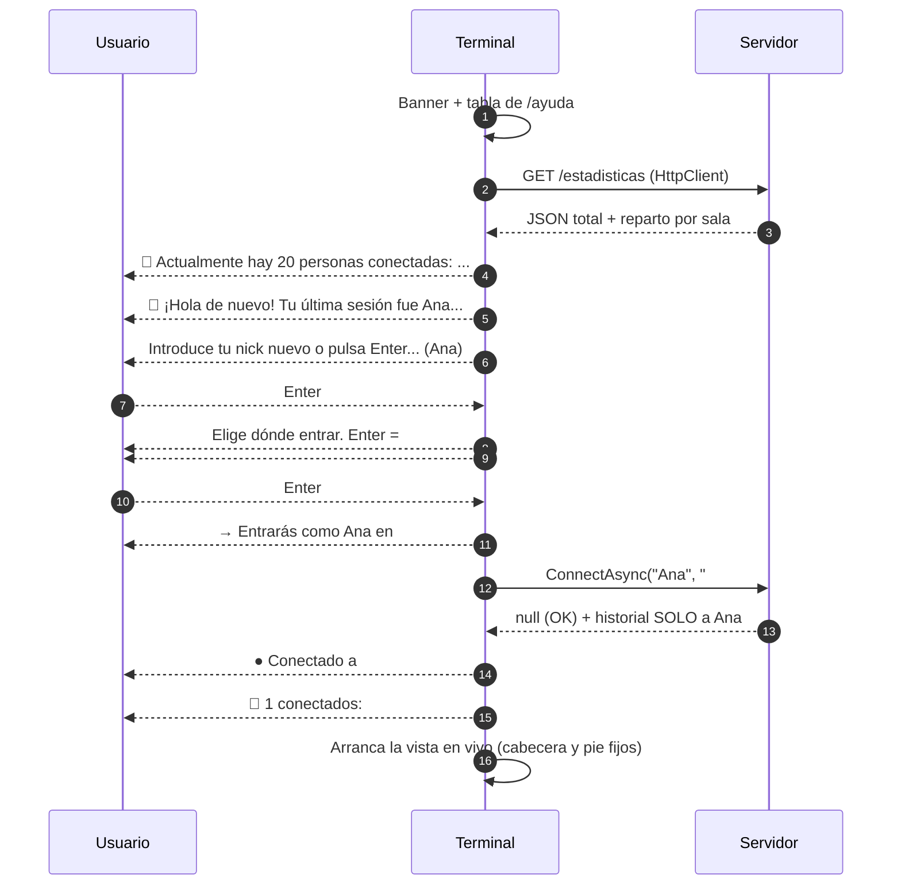
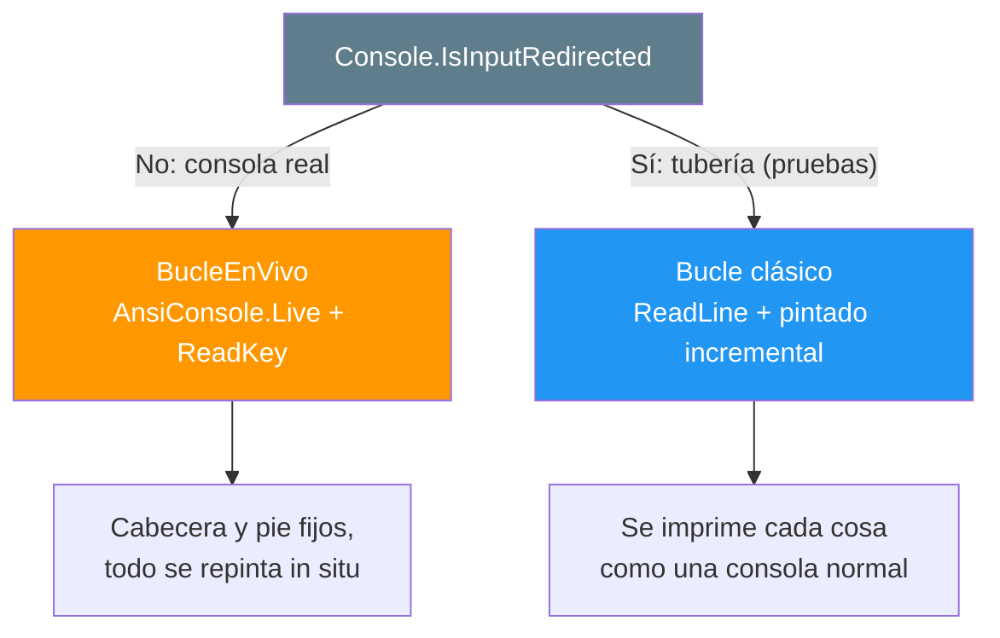

- [2. El cliente terminal](#2-el-cliente-terminal)
  - [2.1. Qué hay dentro del proyecto](#21-qué-hay-dentro-del-proyecto)
  - [2.2. El arranque, pantalla a pantalla](#22-el-arranque-pantalla-a-pantalla)
  - [2.3. La vista en vivo con Spectre.Console](#23-la-vista-en-vivo-con-spectreconsole)
  - [2.4. Los comandos, con sus salidas](#24-los-comandos-con-sus-salidas)
  - [2.5. La reconexión sin dramas](#25-la-reconexión-sin-dramas)
  - [2.6. La sesión recordada y /sesion](#26-la-sesión-recordada-y-sesion)
  - [2.7. Los dos modos de entrada](#27-los-dos-modos-de-entrada)
  - [2.8. La capa reactiva con Rx](#28-la-capa-reactiva-con-rx)
  - [2.9. La configuración del terminal](#29-la-configuración-del-terminal)
  - [2.10. Cómo se prueba sin abrir una terminal](#210-cómo-se-prueba-sin-abrir-una-terminal)
  - [2.11. Resumen del punto](#211-resumen-del-punto)


# 2. El cliente terminal

> 💡 **Punto de partida:** abres Discord y ya está ahí tu último servidor, tu nick y el canal donde te quedaste. Nadie lo teclea otra vez. Además, mientras escribes un mensaje en el canal, los mensajes de los demás van cayando por encima sin descuadrarte lo que llevas escrito. En una consola de texto eso no es tan obvio: la terminal es "de solo lectura", cada vez que escribes, la línea de estado se imprime otra vez... ¿cómo hace este cliente para que la cabecera y los contadores se queden fijos arriba y abajo mientras el chat sigue vivo en medio?

Este punto tiene dos mitades: primero un **manual de uso** —recorrido pantalla a pantalla con capturas reales del cliente, comandos y salidas— y después el **por dentro**: la capa reactiva con Rx.NET, los dos modos de entrada y cómo se prueba todo sin abrir una terminal.

**Objetivos de aprendizaje:**

- Usar el cliente como si fuera Discord: arranque guiado, vista en vivo, comandos y sesión recordada
- Entender la vista en vivo (`AnsiConsole.Live` + `Layout`) y por qué la línea de estado ya no se reimprime
- Ver la capa reactiva: stores con `BehaviorSubject` y una UI que solo **pinta el estado actual**
- Conocer el parser de comandos como lógica pura y por qué eso se testea sin consola
- Distinguir los dos modos de entrada (consola real y tubería)

## 2.1. Qué hay dentro del proyecto

El cliente es una aplicación de consola normal (no usa `WebApplication` ni hosts): todo empieza y termina en `Program.cs`, y la lógica está partida en carpetas por responsabilidad:

| Carpeta | Contenido | Ejemplo |
|---------|-----------|---------|
| `Program.cs` | Pantalla de entrada, bucle de chat y pintado | Entrada guiada, `BucleEnVivo` |
| `Comandos/` | Parser puro y tipos de comando | `ParserComandos`, `Comando` |
| `Consola/` | Todo lo que se escribe en pantalla | `Banner`, `Ayuda`, `EditorLinea`, `Conectados`, `TemaDiscord` |
| `Servicios/` | La conexión a SignalR, las stores reactivas y los mensajes de error | `ClienteChat`, `ResultadoConexion`, `MensajesError` |
| `Sesion/` | Último nick/canal del usuario | `SesionStore`, `SesionTerminal` |
| `Configuracion/` | Sección `Terminal` del appsettings | `TerminalConfig` |

> 📝 **Nota:** `Comandos/` y la línea de entrada no tocan la consola ni la red: `ParserComandos.Parse("...")` recibe una cadena y devuelve un `record`, y `EditorLinea` guarda texto y cursor sin saber qué tecla se pulsó. Por eso esas dos piezas se testean en milisegundos, sin abrir ninguna ventana.

## 2.2. El arranque, pantalla a pantalla

Esto es lo que ves al ejecutar el cliente — **captura real**, salida del programa con una sesión guardada del día anterior:

```text
     _              _            ____   _               _
    / \     _   _  | |   __ _   / ___| | |__     __ _  | |_
   / _ \   | | | | | |  / _` | | |     | '_ \   / _` | | __|
  / ___ \  | |_| | | | | (_| | | |___  | | | | | (_| | | |_
 /_/   \_\  \__,_| |_|  \__,_|  \____| |_| |_|  \__,_|  \__|

Chat en tiempo real para el aula · .NET 10 + SignalR + Rx

╭───────────────────┬──────────────────────────────────────────────────────────╮
│ Comando           │ Qué hace                                                 │
├───────────────────┼──────────────────────────────────────────────────────────┤
│ /ayuda [comando]  │ Esta ayuda, o la de un comando concreto                  │
│ /canales          │ Lista los canales disponibles                            │
│ /canal <nombre>   │ Cambia de canal (p. ej. /canal daw)                      │
│ /nick <nombre>    │ Cambia tu nombre en caliente (p. ej. /nick Ana2)         │
│ /usuarios [canal] │ Conectados de tu canal o de otro (p. ej. /usuarios daw)  │
│ /reconectar       │ Vuelve a entrar si se perdió la conexión (en vivo,       │
│                   │ también la tecla R)                                      │
│ /sesion [borrar]  │ Ver la sesión guardada o borrarla (útil en aulas         │
│                   │ compartidas)                                             │
│ /limpiar          │ Limpia la pantalla (el historial lo repinta el servidor) │
│ /salir            │ Desconectar y cerrar (Ctrl+C hace lo mismo)              │
╰───────────────────┴──────────────────────────────────────────────────────────╯

📌 Actualmente no hay nadie conectado todavía.

👋 ¡Hola de nuevo! Tu última sesión fue Ana en el canal #general el 16/10/2026
10:07

Introduce tu nick nuevo o pulsa Enter para usar el antiguo (Ana)
Elige dónde entrar. Enter = #general (tu último canal visitado)
  #general ←   #daw   #dam   #asir   #smr
Canal (#general)
→ Entrarás como Ana en #general

Conectando a http://localhost:5030/hubs/chat...
● Conectado a #general como Ana · 1 en la sala · 1 en total. Escribe /ayuda para
ver los comandos.
● conectado · 📌 1 conectados: #general 1 ● · #daw 0 · #dam 0 · #asir 0 · #smr 0

10:11 · Ana se ha unido al canal
```

Orden de lo que acaba de pasar (los colores —paleta Discord— no se ven en texto plano):

1. **Banner + tabla de `/ayuda`**: nada más arrancar ya sabes qué puedes escribir.
2. **📌 Conteo de conectados**: sale de `GET /estadisticas` **antes** de registrarse.
3. **Bienvenida** con su mensaje según el caso (aqui, sesión del día anterior).
4. **Prompts guiados**: nick y canal con sus defaults entre paréntesis, y la lista de canales con `←` marcando cuál se repite con Enter.
5. **Confirmación** ("Entrarás como...") antes de tocar el servidor.
6. **Conexión**: spinner mientras, y línea de éxito con los contadores + la línea de estado.

Vale la pena detenerse en tres decisiones de diseño:

1. **La cuenta de conectados sale de `GET /estadisticas`**, no de SignalR: cuando aún no te has registrado no tienes conexión al hub "como persona", pero sí puedes hacer una consulta tipo REST. Si el servidor no está, se muestra un aviso en amarillo y el arranque **sigue igual**.
2. **La bienvenida tiene un mensaje por caso** (nunca todos lo mismo):

| Caso | Mensaje |
|------|---------|
| Primera vez (no hay fichero) | `🙂 Primera vez por aquí: ¿con qué nick entras?` |
| Fichero corrupto | `⚠ No pude leer tu sesión guardada (fichero corrupto): empezamos de cero.` |
| Fichero sin nick o sin canal | `⚠ Tu sesión guardada está vacía (falta el nick o el canal): empezamos de cero.` |
| Sesión antigua sin fecha | `👋 ... fue Ana en el canal #general (sin fecha guardada)` |
| Sesión completa | `👋 ... fue Ana en el canal #general el 16/10/2026 10:07` |

3. **La validación ocurre ANTES de tocar el servidor**, con la MISMA clase (`ChatConfig`) que usa el servidor. Lo único que solo puede decidirlo el servidor es **el nombre duplicado en ese canal**, y por eso el bucle de conexión distingue **qué** falló (`ResultadoConexion.HayServidor`):
   - **El servidor respondió y rechazó el alta** (p. ej. dos terminales con el mismo nick) → se vuelve a preguntar **solo el nick**, sin reiniciar el programa, y se dice dónde.
   - **El servidor ni se alcanza** (apagado, otra URL) → el nick **no tiene la culpa**: no se vuelve a preguntar nada, se conservan nick y canal y se ofrece **reintentar con Enter** (o salir si se cierra la entrada).

   Y una regla de higiene de la interfaz: los fallos se traducen a **palabras de usuario** (`MensajesError`), nunca a tipos de excepción — "HttpRequestException" no le dice nada a quien solo quiere entrar al aula; el detalle técnico se queda fuera de la pantalla (y, en el log del fichero, gracias a Serilog).

Y este es el viaje completo por dentro — desde que se abre la conexión hasta que te vas:



> 💡 **Consejo:** fíjate en que el orden de la lista de canales es el orden de `appsettings.json` (el primero es además el canal por defecto). Si el canal de tu sesión ya no existe en la configuración, se avisa y se cae al por defecto: el programa nunca se queda sin opciones.

## 2.3. La vista en vivo con Spectre.Console

Una consola clásica "solo imprime": cada línea de estado nueva va subiendo por el scroll, y si estás a mitad de escribir, el prompt se descuadra. El cliente usa **`AnsiConsole.Live`** con un `Layout` de tres zonas que se repintan **en su sitio**. Así se ve en consola real (esquema fiel al código, con la leyenda de colores al lado):

```text
┌──────────────────────────────────────────────────────────────────────┐
│ AulaChatNet · Ana · #general · ● conectado                          │  ← cabecera (1 fila)
├──────────────────────────────────────────────────────────────────────┤
│ 10:11 · Ana se ha unido al canal                                     │
│ 10:11 [AN] Ana: Hola a todos                                         │  ← zona de mensajes
│ 10:12 [LU] Luis: ¿Alguien ha hecho el ejercicio 3?                   │     (alto libre)
│                                                                      │
│ /canales                                                             │
│ 📌 2 conectados en total:                                            │
│   #general 2 ● actual                                                │  ← salida del último
│   #daw 0                                                             │     comando
├──────────────────────────────────────────────────────────────────────┤
│ ● conectado · 📌 2 conectados: #general 2 ● · #daw 0 · #dam 0 · ...  │  ← pie (2 filas)
│ > ¿Alguien ha hecho el ej|                                           │
└──────────────────────────────────────────────────────────────────────┘
```

**Leyenda de la paleta Discord** (aquí en texto plano): la cabecera lleva el nombre en **blurple** `#5865f2` sobre `#36393f`; el `●` es **verde** `#43b581` conectado, **naranja** reconectando y **rojo** caído; los mensajes son texto `#dcddde` con los nombres en un color derivado del nombre y las horas en gris; los mensajes de sistema salen en *gris cursiva* con su `·`; y el `|` del final es el **cursor resaltado** (el carácter con fondo claro, no el cursor real de la terminal).

- **Cabecera fija**: identidad + punto de estado de la conexión. Este es el punto de Discord.
- **Zona de mensajes**: pinta las últimas líneas que caben (margen por si un mensaje largo se envuelve) más la salida del último comando (`/ayuda`, `/canales`...). Las horas se pintan en **hora local**: el servidor guarda en UTC (la regla de oro: guardar UTC, convertir SOLO al presentar).
- **Pie fijo**: el punto de estado + la línea de contadores (total y por sala) y el `> ` donde escribes, con el cursor visible.

**La línea de entrada es un editor de verdad**: el texto se guarda en `EditorLinea` (una clase pura, sin consola, por eso testeable), que además del texto guarda la **posición del cursor**. Se pinta con el cursor **resaltado como un carácter con fondo claro** en lugar de mover el cursor real de la terminal — ese es el truco para que `AnsiConsole.Live` pueda repintar el lienzo entero sin pelearse con el cursor del SO.

**Las teclas se leen sin bloquear**: el bucle usa `Console.KeyAvailable` + una pausa corta de 50 ms; si no hay tecla, se repinta y se vuelve a mirar. El editor aprovecha `Enter` (envía), `Retroceso` (borra atrás), `Supr` (borra delante), las flechas `←` `→` (mueven el cursor), `Inicio`/`Fin` (saltos), `Escape` (borra todo lo escrito), `R` (reconectar, solo si la conexión está caída y la línea vacía) y `Ctrl+C` (salida ordenada).

> ⚠️ **Advertencia:** debajo se usa `Console.ReadKey`, el mismo que usan los prompts de Spectre, así que las teclas muertas y los acentos se comportan igual que en el resto del programa. Y un detalle que costó un lunes: **cada etiqueta de markup debe estar cerrada y sin `]` sueltos** — un `[bold]#5865f2]` con un corchete de más hacía estallar el primer repintado con `Encountered unescaped ']' token`.

📌 **Ejemplo real:** las aplicaciones TUI tipo `htop` o `btop`: el encabezado y la barra inferior no dejan de estar ahí mientras la lista del medio se actualiza. `AnsiConsole.Live` es la forma de Spectre de hacer eso sin salir de la consola.

## 2.4. Los comandos, con sus salidas

| Comando | Alias | Qué hace |
|---------|-------|----------|
| `/ayuda [comando]` | `/help` | Tabla general o ayuda de un comando |
| `/canales` | — | Canales con sus conteos, marcando el actual con `● actual` |
| `/canal <nombre>` | — | Cambia de sala (`/canal daw` = `/canal #daw`) |
| `/nick <nombre>` | `/nickname` | Cambia el nombre en caliente |
| `/usuarios [canal]` | `/quienes` | Conectados de tu sala; con argumento, consulta **otra sala sin cambiar** (`ObtenerUsuariosAsync` del hub) |
| `/reconectar` | `/reconnect` | Vuelve a entrar si se perdió la conexión (la tecla `R` hace lo mismo) |
| `/sesion [borrar]` | — | Ve la sesión guardada en el perfil o la borra |
| `/limpiar` | `/clear` | Limpia la pantalla; en la vista en vivo, deja viendo solo lo que llegue después |
| `/salir` | `/exit`, `/quit` | Desconectar y cerrar (Ctrl+C hace lo mismo) |

Lo que no empieza por `/` es un mensaje para el canal actual. Las salidas, calcadas de una sesión real:

**`/ayuda`** (y `/ayuda canal`, que filtra por prefijo):

```text
/canales — Lista los canales disponibles
/canal <nombre> — Cambia de canal (p. ej. /canal daw)
```

**`/canales`** — el tuyo con `● actual`:

```text
📌 1 conectados en total:
  #general 1 ● actual
  #daw 0
  #dam 0
  #asir 0
  #smr 0
```

**`/usuarios`** (tu sala, de la lista local) y **`/usuarios daw`** (otra sala, consulta al servidor sin cambiar de canal):

```text
📌 1 en línea en #general:
● Ana

📌 0 en línea en #daw:
Aún no hay nadie conectado en este canal.
```

**Errores** — cada uno te dice cómo se usa el comando, sin mandarte a mirar la ayuda entera:

```text
Comando no reconocido: /noexistecomando. Escribe /ayuda para ver todos.

Falta el nombre del canal
Usa: /canal <nombre> (p. ej. /canal daw)
```

> 📝 **Nota:** el parser es `switch` con *pattern matching* sobre los `record` de `Comando`: añadir un comando nuevo es una línea en el parser, su `record`, su caso en `ProcesarLinea` y su fila en `Ayuda` (el procesamiento es el MISMO en los dos modos de entrada; solo cambia dónde acaba la salida). Y `/usuarios` sin argumento usa la lista local (mismo dato que el servidor, sin ida y vuelta): es el equivalente terminal de un `GET` de una API dentro de SignalR.

## 2.5. La reconexión sin dramas

SignalR reintenta solo (0, 2, 10 y 30 s), pero al reconectar el transporte **no basta**: el servidor ya te dio de baja (`OnDisconnectedAsync`) y tu conexión nueva tiene otro `ConnectionId` que no está en ningún grupo. Por eso, al volver (`Reconnected`), el cliente **vuelve a invocar `ConnectAsync`** con el nick y el canal recordados — si no, quedarías de escayola: la cabecera diría "conectado" pero nadie te vería ni te llegaría nada.

Si los reintentos automáticos se agotan (`Closed`), el pie se convierte en instrucción y el mensaje de la caída entra en la zona de mensajes:

```text
10:23 · Se perdió la conexión con el servidor.
● desconectado · la reconexión automática se agotó: pulsa R para reconectar, o /salir para salir
> _
```

Con `R` (o escribiendo `/reconectar`, que funciona también en modo tubería) se reabre la conexión y se vuelve a entrar **sin reiniciar el programa**. Y si no estaba caído nada, te lo dice:

```text
● Ya estás conectado: no hace falta reconectar.
```

> 💡 **Consejo:** la tecla `R` y el comando `/reconectar` recorren el MISMO código (`ProcesarLinea("/reconectar")`): una sola ruta que probar.

## 2.6. La sesión recordada y /sesion

Al salir (o con Ctrl+C) se guarda `nick`, `canal` y `UltimaConexion` en el perfil del usuario: `%APPDATA%\AulaChatNet\sesion.json` en Windows.

- **Por qué ahí y no en `appsettings.json`**: el JSON del repositorio es configuración común; esto es **estado personal** de cada alumno, así que vive en su perfil y no se commitea.
- **Si `Terminal:RecordarSesion` es `false`**, no se guarda ni se ofrece nada.
- **La fecha** permite decir en la bienvenida cuándo fue la última vez; los ficheros antiguos sin ese campo se leen igual (queda `default` y simplemente no se muestra).

**`/sesion`** relee del disco y te enseña qué hay (salida real):

```text
📌 Sesión guardada: Ana en #general el 16/10/2026 10:11
Se ofrecerá al arrancar y se guardará al salir. Fichero:
C:\Users\joseluisgs\AppData\Roaming\AulaChatNet\sesion.json
Bórrala con /sesion borrar (útil si compartes el equipo).
```

**`/sesion borrar`** (alias `eliminar` u `olvidar`) elimina el fichero **e impide que la salida lo vuelva a guardar** esta vez — o se borraría para nada:

```text
🗑️ Sesión borrada: la próxima vez se preguntará de cero (y esta vez no se guardará nada al salir).
```

En aulas compartidas es la forma de no heredar el nick del compañero de la turno anterior.

> 📝 **Nota:** los tests de `SesionStoreTests` usan una carpeta temporal por test, así que el fichero real del equipo nunca se toca.

## 2.7. Los dos modos de entrada

El programa no tiene un interruptor de "modo demo": **decide según la entrada**. Ojo: las capturas de este manual (salvo el esquema de la vista en vivo) salen del **modo tubería**, donde la línea de estado se imprime antes de cada prompt; en la consola real esa misma línea es el pie fijo.



La razón es práctica: **`Console.ReadKey` no existe sin consola**. Las pruebas automatizadas acopian un fichero al `stdin` del programa (`echo Ana | ...`), y ahí el cliente toma el modo clásico: `Console.ReadLine` con el mismo contrato que los prompts (vacío = valor por defecto, EOF = cerrar ordenado) y pintado incremental de los mensajes.

Ese pintado incremental es reactivo a su vez: Rx entrega la **vista completa** del canal (`BehaviorSubject`), o se le AÑADEN mensajes (lista anterior + el nuevo) o se REEMPLAZA entera (historial de otro canal). El cliente distingue ambos casos con `EsContinuacion` (¿siguen siendo los mismos objetos al principio?) para no repintar lo que ya estaba en pantalla.

> 💡 **Consejo:** por eso mismo, una prueba puede entrar, escribir, cambiar de canal y salir en dos segundos: no hay que simular teclas, solo datos en la tubería.

## 2.8. La capa reactiva con Rx

`ClienteChat` no tiene eventos de UI ni delegados: mantiene el estado en **stores con `BehaviorSubject`** y lo expone como `IObservable<T>`. Cualquier parte que quiera "saber algo" se suscribe y pinta; nadie más entera:

| Store | Tipo | De dónde viene |
|-------|------|----------------|
| `Mensajes` | `IObservable<IReadOnlyList<MensajeDto>>` | Eventos `MensajeNuevo` y `HistorialRecibido` |
| `Usuarios` | `IObservable<IReadOnlyList<UsuarioConectadoDto>>` | Evento `ListaUsuariosActualizada` |
| `Estadisticas` | `IObservable<EstadisticasDto>` | Evento `EstadisticasActualizadas` (a TODOS) |
| `Estado` | `IObservable<EstadoConexion>` | Ciclo de vida de la conexión (`Reconnecting`/`Reconnected`/`Closed`) |

Además, para donde no conviene suscribirse (la cabecera se repinta en cada vuelta del bucle), hay lecturas síncronas del valor actual: `VistaMensajes`, `VistaUsuarios`, `EstadisticasActuales` y `EstadoValor` — que son simplemente `.Value` del `BehaviorSubject`.

Y los cambios de conexión que solo conoce el cliente (la caída, la re-alta tras reconectar) **entran por el mismo sitio**: el cliente fabrica un mensaje de sistema local y lo añade a la vista de mensajes. Un único flujo para pintar TODO, sea o no del servidor.

La idea bonita de todo esto: **el bucle de la vista en vivo no procesa eventos, solo pinta el estado actual** cada 50 ms. Los eventos van llegando por SignalR → Rx actualiza el store → la siguiente vuelta del bucle pinta lo que hay. Sin colas, sin "cola de repintados", sin estados intermedios: la pantalla nunca miente.

📌 **Ejemplo real:** es el mismo patrón que React con un estado global (el componente no calcula nada: renderiza el estado), y el mismo que sigue `NotificationStore` de Blazor en el otro cliente.

## 2.9. La configuración del terminal

```json
"Terminal": {
  "RecordarSesion": true,
  "UrlServidor": "http://localhost:5030"
}
```

- **`UrlServidor`** es la base: la URL completa del hub es `UrlServidor` + `Chat:HubRuta`, y el `GET /estadisticas` se pide sobre la misma base. Nada de URLs escritas en el código.
- La sección **`Chat`** del terminal es la MISMA que la del servidor (canales, límites de usuario y mensaje): una regla, dos orígenes. Los canales se usan para pintar el selector y la línea de estado; los límites, para el `maxlength` del input y los avisos. **La validación real la hace el servidor.**

## 2.10. Cómo se prueba sin abrir una terminal

| Suite | Qué cubre |
|-------|-----------|
| `ParserComandosTests` | Comandos, alias, mayúsculas, argumento presente/ausente |
| `SesionStoreTests` | Guardar/cargar/borrar, fecha, fichero corrupto (no lanza y lo marca), fichero antiguo |
| `ConectadosTests` | Fórmulas de "cuánta gente hay": singular/plural, orden de config, `●` del canal actual |
| `EditorLineaTests` | Cursor de la línea de entrada: insertar en medio, borrar, mover, límites y pintado |
| `TemaDiscordTests` | Paleta, colores derivados del nombre e iniciales |
| `MensajesErrorTests` | Traducción de excepciones a mensajes de usuario (sin tipos en pantalla) |
| `ResultadoConexionTests` | La regla `Exitoso` que usa el bucle del arranque para decidir si sigue dentro |
| `ClienteChatTests` | Los dos caminos de conexión: sin servidor (fallo de red tipado) y con `ServidorDePrueba` — un hub mínimo de mentira en Kestrel con puerto aleatorio que rechaza el alta, como el servidor real |

> 💡 **Consejo:** el truco de `ServidorDePrueba` merece atención: no vale el *TestServer* de ASP.NET (su transporte es en memoria y un cliente SignalR necesita HTTP de verdad), así que se levanta **Kestrel real en un puerto 0** (el sistema elija uno libre) con un hub de dos líneas. Es la forma barata de probar el rechazo del servidor sin arrancar AulaChatNet.Server.

Además, el **smoke E2E** arranca el servidor real y el terminal con `stdin`/`stdout` acoplados a ficheros, y comprueba por marcadores de texto que salen la bienvenida, la cuenta de conectados, el prompt guiado, el mensaje ecoado y la salida ordenada. Ese es precisamente el valor del **dual-mode**: la misma app, probada sin consola — y la misma técnica con la que se recabaron las capturas de este manual.

## 2.11. Resumen del punto

| Concepto | Qué retener |
|----------|-------------|
| Arranque guiado | Banner → `GET /estadisticas` → bienvenida por casos → prompts con default → confirmación → conexión |
| Vista en vivo | `AnsiConsole.Live` + `Layout` de 3 zonas; la cabecera y el pie se repintan en sitio, no se reimprimen |
| Línea de entrada | `EditorLinea` (clase pura): texto + cursor, con el cursor resaltado en lugar de moverlo |
| Reconexión | Al volver, se re-invoca `ConnectAsync` (el alta no viaja sola); si se agota, `R` o `/reconectar` sin reiniciar |
| Horas | El servidor guarda en UTC y la terminal convierte a hora local SOLO al pintar (también en mensajes de sistema) |
| Comandos | 9 comandos, parser puro con `record` + pattern matching; procesamiento compartido entre modos |
| Sesión | `%APPDATA%\AulaChatNet\sesion.json`; ver con `/sesion`, borrar con `/sesion borrar` |
| Modos de entrada | Consola real → Live + `ReadKey`; tubería → `ReadLine` + pintado incremental (pruebas y capturas) |
| Rx | Stores con `BehaviorSubject`; el bucle **solo pinta el estado actual** cada 50 ms |
| Configuración | `Terminal:UrlServidor` + sección `Chat` compartida; la validación real, en el servidor |

> 📝 **Nota (evolución de la Fase 2):** el terminal **no se tocó** para la persistencia, y esa es precisamente la conclusión que conviene retener. Sigue recibiendo `MensajeNuevo` y pidiendo el historial exactamente igual que en la Fase 1; lo único que cambió es que el historial que llega al conectar procede ahora de SQLite en lugar de morirse con el servidor. El contrato compartido resistió completo. La parte que sí cambió vive en el servidor: [4. La persistencia con SQLite](04-persistencia.md).

Con el terminal listo, el siguiente cliente es la web: [Blazor WebAssembly con la estética de Discord y su store central](03-cliente-blazor.md), con la misma capa reactiva sobre el mismo hub.
