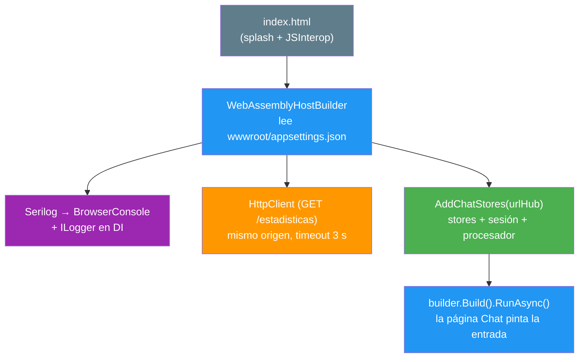
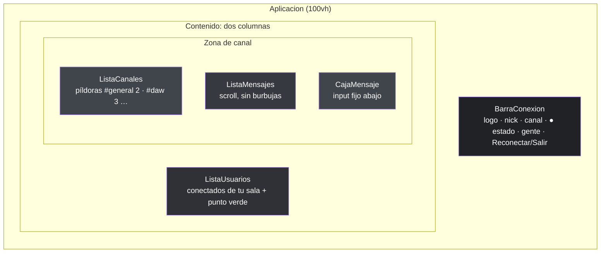
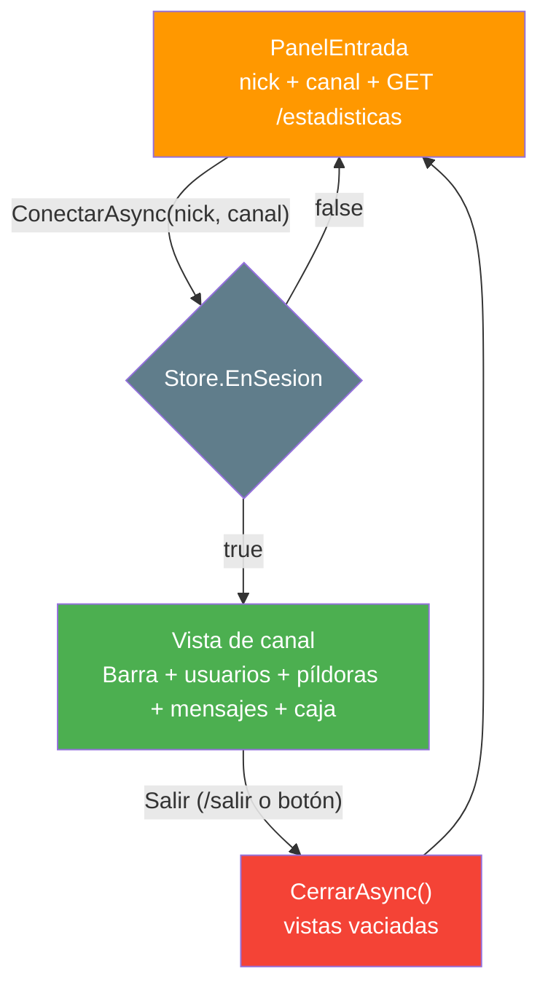
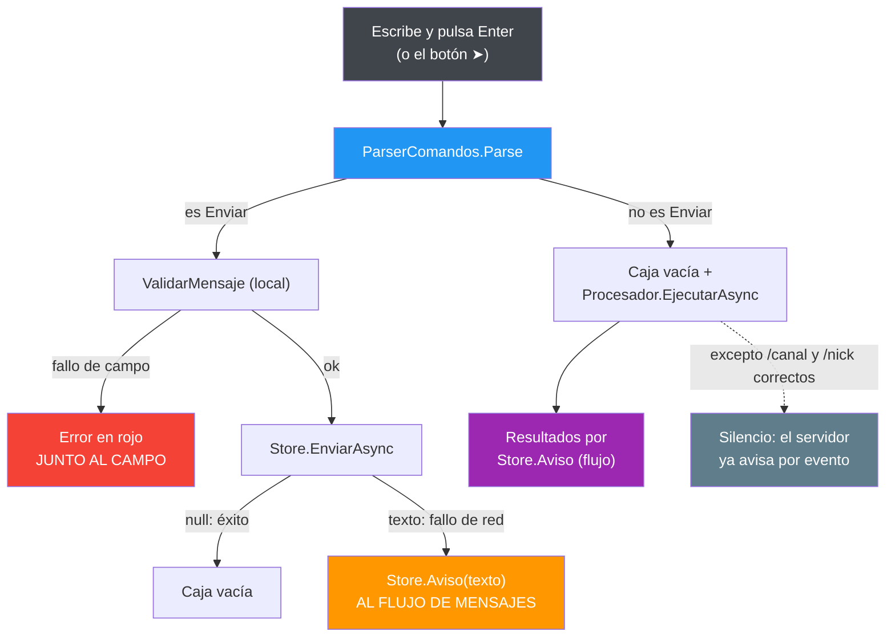

- [3. El cliente web (Blazor WebAssembly)](#3-el-cliente-web-blazor-webassembly)
  - [3.1. Qué hay dentro del proyecto](#31-qué-hay-dentro-del-proyecto)
  - [3.2. El arranque: de index.html a la pantalla de entrada](#32-el-arranque-de-indexhtml-a-la-pantalla-de-entrada)
  - [3.3. La estética de Discord con CSS propio](#33-la-estética-de-discord-con-css-propio)
  - [3.4. Una sola página y una store que manda](#34-una-sola-página-y-una-store-que-manda)
  - [3.5. La capa reactiva en la web](#35-la-capa-reactiva-en-la-web)
  - [3.6. Los comandos / también en la web](#36-los-comandos--también-en-la-web)
  - [3.7. Un bug real: el Closed fantasma](#37-un-bug-real-el-closed-fantasma)
  - [3.8. La sesión en el navegador](#38-la-sesión-en-el-navegador)
  - [3.9. Desarrollo: dotnet watch y el manifiesto de assets](#39-desarrollo-dotnet-watch-y-el-manifiesto-de-assets)
  - [3.10. Cómo se prueba](#310-cómo-se-prueba)
  - [3.11. Resumen del punto](#311-resumen-del-punto)


# 3. El cliente web (Blazor WebAssembly)

> 💡 **Punto de partida:** abres Discord en el navegador y, sin recargar la página, van cayendo los mensajes de tus compañeros. Nadie pulsa F5. La página "escucha" mientras tú haces otra cosa. ¿Cómo sabe una web que alguien ha escrito en el aula de al lado sin que tú le preguntes? Y aún más: esa misma web se acuerda de tu nick la próxima vez que la abras, ¿de dónde sale ese recuerdo si la web no tiene disco?

Este punto es el hermano web del [cliente terminal](02-cliente-terminal.md): **mismo hub, mismos comandos, misma capa reactiva**, con dos piezas propias — Blazor WebAssembly y la estética de Discord en CSS puro— y un final de película: dos bugs reales que se cazaron probando la app de verdad, con sus arreglos.

**Objetivos de aprendizaje:**

- Montar una SPA con Blazor WebAssembly alojada por el servidor, sin CORS ni URLs escritas a mano
- Entender el patrón "una store central + componentes que solo pintan estado", el mismo que usa la terminal
- Suscribirse a `IObservable<T>` desde un componente y **liberar la suscripción** al destruirlo
- Reutilizar lógica entre clientes: el parser de comandos vive en `Shared` y lo ejecutan los dos
- Diagnosticar dos problemas reales: un evento de SignalR que llega tarde y un manifiesto de assets caducado

## 3.1. Qué hay dentro del proyecto

El cliente es una aplicación de Blazor WebAssembly (WASM) **alojada por el servidor**: no tiene puerto propio en uso normal; el servidor del `5030` sirve tanto el hub como los archivos del cliente. La lógica está partida por responsabilidades:

| Carpeta | Contenido | Ejemplo |
|---------|-----------|---------|
| `Components/Pages/` | Páginas con ruta (`@page`) | `Chat.razor` (la única) |
| `Components/Layout/` | Esqueleto de la app | `MainLayout.razor` (columna vertebral de `100vh`) |
| `Components/Shared/` | Trozos de interfaz | `PanelEntrada`, `BarraConexion`, `ListaCanales`, `ListaMensajes`, `ListaUsuarios`, `CajaMensaje`, `MensajeItem`, `Avatar` |
| `State/` | Stores reactivas y sesión | `ChatStore`, `SesionStore`, `SesionGuardada` |
| `Services/` | Lógica de servicio | `ProcesadorComandos`, `Storage/LocalStorageService` |
| `Configuracion/` | Sección `Web` del appsettings | `WebConfig` (`UrlServidor`, `RecordarSesion`) |
| `Infrastructures/` | Registro de servicios (estilo Tienda) | `ServicesConfig.AddChatStores(...)` |
| `wwwroot/` | Lo que el navegador descarga | `index.html`, `css/app.css` |

> 📝 **Nota:** `State/` y `Services/` no tienen NADA de Blazor dentro: son clases C# normales con Rx y SignalR. Eso es lo que permite probarlas sin navegador, igual que la `ClienteChat` de la terminal.

## 3.2. El arranque: de index.html a la pantalla de entrada

La primera vez que entras, el navegador descarga unos megas de runtime: mientras tanto ves el **splash** que vive en `index.html` (`# AulaChatNet · Cargando el chat…` con su barra). Blazor vacía ese `div` en cuanto arranca y pinta la app encima. Ese mismo HTML trae dos joyas didácticas:

- `#blazor-error-ui`: el aviso por si el runtime se cae en mitad de la sesión (con su botón Recargar).
- Unas **funciones JavaScript de dos líneas** (`window.aulachat.abajo` y `window.aulachat.enfocar`) que la web llama desde C# con JSInterop para bajar el scroll de los mensajes y devolver el foco al cuadro de texto. Sin librerías: JavaScript puro donde JavaScript es la única salida (mover el DOM).

El `Program.cs` del cliente hace, en orden:

1. **Lee la configuración** que el propio `WebAssemblyHostBuilder` ya cargó de `wwwroot/appsettings.json`. Ojo con el detalle de seguridad: en WASM **todo lo que aquí se lee viaja al navegador**, así que solo puede haber ajustes de presentación (canales, límites, URL del avatar) — nunca secretos. La validación real la hace el servidor.
2. **Monta Serilog** con un solo sink: `BrowserConsole`, la pestaña "Console" de las herramientas de desarrollo del navegador. Un solo `Log.Logger` que ataca por estático y, además, se registra como provider para que las stores reciban su `ILogger<T>` por DI.
3. **Calcula la URL del servidor**: `Web:UrlServidor` vacío = **mismo origen** desde el que se sirve la app (lo normal) — así no hay CORS ni nada escrito a mano. El `HttpClient` del `GET /estadisticas` apunta ahí con un timeout corto de 3 segundos: la cifra de bienvenida es opcional, no puede frenar el arranque.
4. **Registra los servicios** con `AddChatStores($"{baseServidor}{chat.HubRuta}")`: la URL del hub se compone desde la configuración, igual que en la terminal.



> 💡 **Consejo:** si ejecutas el cliente por separado (DevServer del `5031`), solo tienes que poner `Web:UrlServidor` en `appsettings.Development.json`; sin ese ajuste, todo vive bajo el mismo `5030` y no hay CORS en el camino.

## 3.3. La estética de Discord con CSS propio

La regla de la casa: **CSS propio, sin librerías pesadas**, con TODOS los colores en variables de `:root` — si un día hay que cambiar la paleta, se toca un solo sitio. La paleta es la de Discord clásica: fondo `#36393f`, sidebar `#2f3136`, cabeceras `#202225`, input `#40444b`, acento *blurple* `#5865f2` y verde en línea `#43b581`.

El mapa de la interfaz (dos columnas, la regla del proyecto):



Tres decisiones de diseño que conviene retener:

1. **Nunca burbujas**: como Discord y Slack, cada mensaje es una **fila** — hora a la izquierda, avatar circular, nombre en su color y el texto debajo. Los mensajes de sistema salen en gris cursiva, sin avatar, con un `·` delante.
2. **La hora es local**: el servidor guarda en UTC (regla de oro: guardar UTC, convertir SOLO al presentar); `MensajeItem` pinta `Timestamp.ToLocalTime()`, o la web enseñaría la hora del servidor.
3. **Los avatares tienen respaldo**: el `Avatar` pinta la imagen de DiceBear (semilla = nombre de usuario, así es determinista) y, si el navegador no puede cargarla — sin internet, API caída, aula sin red — **el propio evento `onerror` de la etiqueta ``** avisa al componente y se pintan las iniciales sobre el color determinista del usuario. Los mismos cálculos que la terminal (`AvatarHelper` en `Shared`): un solo código, dos presentaciones.

> 📝 **Nota:** el texto de los mensajes lleva `white-space: pre-wrap` en el CSS. Ese detalle parece menor y no lo es: permite que los avisos multilínea de los comandos (`/ayuda`, `/canales`) se respeten con sus saltos de línea dentro del flujo de mensajes.

## 3.4. Una sola página y una store que manda

`Chat.razor` es la única página (`@page "/"`) y su lógica entera cabe en un `if`: si la store dice que **no hay sesión activa** pinta el `PanelEntrada`; en cuanto `ConectarAsync` triunfa, la store pone `EnSesion` a `true` y aquí aparece la vista de canal. **Un solo sitio manda: la store central** — los componentes no deciden de dónde vienen los datos, solo los pintan.



La página se suscribe en `OnInitialized` y se desuscribe en `Dispose` — el patrón de toda la web:

```csharp
protected override void OnInitialized()
{
    _suscripcion = Store.EnSesion.Subscribe(valor =>
    {
        _enSesion = valor;
        _ = InvokeAsync(StateHasChanged);  // ← Blazor no "ve" a Rx: hay que pedirle repintado
    });
}

public void Dispose() => _suscripcion?.Dispose();
```

Ese `InvokeAsync(StateHasChanged)` merece una nota al margen: Rx no conoce a Blazor. Cuando el flujo emite un valor, hay que decirle al componente "repíntate" — y como los eventos de SignalR pueden llegar desde otro hilo, se pide **a través de `InvokeAsync`**, que respeta el hilo del sincronizador de Blazor.

El `PanelEntrada` es, además, el sitio donde se ven los **casos diferenciados** (cada uno con su mensaje, como en la terminal):

| Caso | Qué se ve |
|------|-----------|
| Primera vez (no hay sesión) | Solo el formulario |
| Sesión recordada | "Hola de nuevo, **Ana**. ¿No eres tú? Borrar sesión" |
| Servidor consultado | `📌 Actualmente hay 20 personas conectadas: #general 12 · #daw 3 · …` |
| Servidor caído o sin red | `⚠ No pude consultar cuántos hay conectados…` — **el arranque sigue igual** |
| Rechazo del servidor (nick en uso) | Error rojo bajo el formulario y se corrige el nombre |
| Fallo de red al conectar | Se **conserva** todo y el botón pasa a "Reintentar" (el nick no tiene la culpa) |

Y la validación local ocurre **antes** de tocar la red, con la MISMA `ChatConfig` que usa el servidor: lo único que solo puede decidirlo el servidor es el nombre duplicado en el canal.

## 3.5. La capa reactiva en la web

La `ChatStore` es el **puerto** de la `ClienteChat` de la terminal: mismo contrato con el hub, mismos estados y mismas traducciones de error (`MensajesError`, nunca "HttpRequestException" en pantalla). Mantiene el estado en `BehaviorSubject<T>` y lo expone como `IObservable<T>`:

| Observable | Tipo | De dónde viene |
|------------|------|----------------|
| `Mensajes` | `IObservable<IReadOnlyList<MensajeDto>>` | Eventos `MensajeNuevo` (sumar) y `HistorialRecibido` (reemplazar entero) |
| `Usuarios` | `IObservable<IReadOnlyList<UsuarioConectadoDto>>` | Evento `ListaUsuariosActualizada` (de tu grupo) |
| `Estadisticas` | `IObservable<EstadisticasDto>` | Evento `EstadisticasActualizadas` (a TODOS: total + reparto) |
| `CanalActual`, `Nick` | `IObservable<string?>` | Cambios locales (cambio de píldora, `/nick`) |
| `Estado` | `IObservable<EstadoConexion>` | Ciclo de vida de la conexión |
| `EnSesion` | `IObservable<bool>` | Qué mitad de la página pinta |

Cada componente se suscribe **solo a lo que pinta**: la barra a cinco flujos (una `CompositeDisposable` con las cinco suscripciones), las píldoras a canal + estadísticas, la lista de mensajes al flujo de mensajes. Y para donde no conviene suscribirse, la store ofrece lecturas síncronas del valor actual (`Canal`, `EstadoValor`, `VistaUsuarios`, `EstadisticasActuales`), que son simplemente `.Value` del sujeto.

La idea clave, la misma que en la terminal: **el componente no procesa eventos, solo pinta el estado**. Evento de SignalR → la store actualiza su sujeto → el componente se repinta. Sin colas ni estados intermedios.

Detalles de implementación que valen la pena:

- **Sin bloqueos**: los eventos de SignalR de una conexión llegan serializados (una invocación detrás de otra), así que los `OnNext` son secuenciales.
- **Los nombres de evento no se escriben "a pelo"**: vienen de las constantes `ChatHubEventos`/`ChatHubMetodos` de `Shared` — la misma fuente que usa el servidor.
- **La store es singleton a propósito**: la conexión a SignalR es UNA por pestaña; si fuera transitoria, cada componente tendría su propia conexión (y su propio alta).
- **Reconexión**: `WithAutomaticReconnect` reintenta a los 0, 2, 10 y 30 segundos; el transporte vuelve solo, pero **el ALTA no** — el servidor ya te dio de baja y la conexión nueva tiene otro `ConnectionId`. Por eso `Reconnected` dispara `ReenviarAltaAsync()`, que vuelve a invocar `ConnectAsync` con el nick y canal recordados. Sin ese paso, quedarías de escayola: la barra diría "conectado" pero nadie te vería.
- **`Aviso(texto)` fabrica mensajes de sistema** con el mismo formato que los del servidor (`TipoMensaje.Sistema`, autor del sistema): la web no distingue si un aviso vino del hub o de casa.

📌 **Ejemplo real:** es el patrón de `NotificationStore` que usan muchas apps React con estado global — y el mismo que ya usaba la terminal, cambiadamente: en lugar de repintar con un bucle cada 50 ms, quien repinta es Blazor cuando le piden `StateHasChanged`.

## 3.6. Los comandos / también en la web

Los 9 comandos de la terminal (`/ayuda`, `/canales`, `/canal`, `/nick`, `/usuarios`, `/reconectar`, `/sesion`, `/limpiar`, `/salir`) **también existen en la web**, y la parte bonita es que el parser **no se ha escrito dos veces**:

| Pieza | Vive en | Quién la usa |
|-------|---------|--------------|
| `Comando` (tipos) y `ParserComandos` (lógica pura) | `AulaChatNet.Shared/Comandos/` | Terminal y web |
| `AyudaComandos` (catálogo: sintaxis + descripción) | `AulaChatNet.Shared/Comandos/` | La tabla de la terminal y el texto de la web |
| `ProcesarLinea` (ejecución + pintado en consola) | Terminal | `Program.cs` |
| `ProcesadorComandos` (ejecución + avisos al flujo) | Web (`Services/`) | `CajaMensaje.razor` |

`ParserComandos.Parse("...")` recibe una cadena y devuelve un `record`; **la misma línea es un comando aquí y allí**. Si no empieza por `/`, la caja la valida (`ChatConfig.ValidarMensaje`) y la envía por `EnviarAsync`. El flujo dentro de `CajaMensaje`:



Dos reglas de la casa, aplicadas al pie de la letra:

- **Los errores de campo van junto al campo** (rojo bajo el cuadro): el texto está mal, no la conexión.
- **Los fallos de conexión van al flujo de mensajes**: el campo estaba perfecto, lo que falla es el mundo.

El `ProcesadorComandos` es un singleton que ejecuta los comandos con los recursos de la store y la sesión del navegador. Salidas reales, calcadas de una sesión de pruebas:

**`/ayuda`** (desde el catálogo compartido; `/ayuda canal` filtra por prefijo):

```text
Comandos disponibles:
/ayuda [comando] — Esta ayuda, o la de un comando concreto
/canales — Lista los canales disponibles y cuánta gente hay en cada uno
/canal <nombre> — Cambia de canal (p. ej. /canal daw)
```

**`/canales`** (el tuyo con `● actual`) y **`/usuarios`**:

```text
📌 1 conectados en total:
  #general 1 ● actual
  #daw 0

📌 1 en línea en #general:
  ● Ana
```

**Errores y avisos**:

```text
Comando no reconocido: /magia. Escribe /ayuda para ver todos.

Sesión guardada: Ana → #general

● Ya estás conectado: no hace falta reconectar.
```

> 💡 **Consejo:** añadir un comando nuevo es **tocar cuatro sitios y solo cuatro**: su `record` y su caso en el parser (Shared), su fila en el catálogo `AyudaComandos` (Shared), su caso en `ProcesarLinea` (terminal) y su caso en `ProcesadorComandos` (web). Las dos ayudas salen del catálogo, así que **nunca divergen**.

## 3.7. Un bug real: el Closed fantasma

Al probar la web en el navegador con dos pestañas (mismo nick "Ambas dicen llamarse Ana"), el servidor rechazó correctamente el segundo alta — pero **en la consola del navegador aparecía un warning fantasma**: `Conexión perdida de forma inesperada…`, justo después del aviso legítimo del rechazo. El servidor estaba en lo cierto, el cliente mentía.

La causa: el cliente marca `_cierreIntencionado = true` antes de cerrar la conexión tras un rechazo (para que el evento `Closed` no avise de una caída que pedimos nosotros)… y **reseteaba el flag justo después del `StopAsync`**. El problema es de tiempo: SignalR invoca `Closed` de forma **asíncrona**, a veces DESPUÉS de que `StopAsync` devuelva. El evento tardío llegaba con el flag ya en `false` y soltaba su aviso fantasma:

```mermaid
sequenceDiagram
    autonumber
    participant C as Cliente (ChatStore)
    participant S as Servidor

    C->>S: ConnectAsync("Ana", "#general")
    S-->>C: "Ese nombre de usuario ya está en uso, elige otro"
    Note over C: _cierreIntencionado = true
    C->>S: StopAsync()
    Note over C: _cierreIntencionado = false (¡prematuramente!)
    S-->>C: Closed (tardío, asíncrono)
    Note over C: flag en false → WARNING FANTASMA 😱

    style C fill:#2196F3,color:#fff
    style S fill:#4CAF50,color:#fff
```

El arreglo es **no resetear el flag al cerrar**: solo se "despierta" al empezar la siguiente conexión (`ConectarAsync`/`ReconectarAsync`), que es el único momento en que un `Closed` viejo ya no puede confundirse con nada. El mismo patrón se aplicó a la `ClienteChat` de la terminal (idéntico problema, idéntico arreglo).

> ⚠️ **Advertencia:** la moraleja es para toda la vida: **los eventos de conexión no tienen por qué llegar en el orden en que los provocas**. Cualquier flag de "esto lo pedí yo" debe vivir lo suficiente como para cubrir la entrega tardía, y reiniciarse donde se INICIA una acción, no donde termina.

Verificado de punta a punta en navegador: rechazo de nick duplicado → solo el warning legítimo del hub, **cero** avisos fantasma; `/salir` y reconexión, igual.

## 3.8. La sesión en el navegador

La terminal guardaba la sesión en un fichero del perfil; aquí no hay disco, pero sí **`localStorage`** — el armario del navegador, que sobrevive a recargas y apagones. `SesionStore` decide la política (qué recordamos y qué pasa si el navegador no deja escribir) y el trabajo sucio con JS y JSON vive en `ILocalStorageService` (calco del servicio de la Tienda).

- **Clave**: `aulachat.sesion` (una por aplicación).
- **Qué se guarda**: nick y canal — al conectar con éxito, si `Web:RecordarSesion` es `true`.
- **Nunca rompe**: un chat no puede estrellarse porque el navegador esté en modo privado. Todos los fallos (`JSException` de lectura o escritura) se traducen en "no hay sesión" + un warning **en el log del navegador**, nunca en pantalla.

`/sesion` relee del navegador y te enseña lo guardado; `/sesion borrar` lo borra — en aulas compartidas, la forma de no heredar el nick del compañero de la turno anterior. El enlace "¿No eres tú? Borrar sesión" del panel de entrada hace exactamente lo mismo a un clic.

## 3.9. Desarrollo: dotnet watch y el manifiesto de assets

Blazor WASM emite un **manifiesto de assets** (`blazor.boot.json`) con los hashes de todos los ficheros del cliente. Detrás de la última pantalla en blanco que costó un susto: **ese manifiesto se lee al arrancar el servidor**, no petición a petición. Si editas el cliente y solo haces F5, el navegador recibe un manifiesto viejo que apunta a nombres de archivo que ya no existen → 404 → página en blanco, **sin ningún error en el servidor**.

La solución, en dos mitades (guía oficial de Blazor alojado):

1. **`dotnet watch --project AulaChatNet.Server`** en desarrollo: al tocar cualquier fichero del cliente, watch reconstruye y **relanza el servidor solo** — el manifiesto nuevo se lee en el arranque limpio. Verificado: tres reinicios automáticos en una sesión de trabajo (arranque, cambio, reversión).
2. **`Cache-Control: no-cache` en Development**: un middleware pequeño en el `Program.cs` del servidor (antes de `UseBlazorFrameworkFiles`) añade la cabecera a `index.html` y a `/_framework/*`, para que el navegador pida siempre la última versión en lugar de servir una caché amiga.

> 💡 **Consejo:** el middleware solo se activa en Development. En producción el manifiesto cambia con cada despliegue, que es cuando la caché larga SÍ es tu amiga.

## 3.10. Cómo se prueba

La web tiene **93 tests** (bUnit + NUnit + FluentAssertions + Moq), con el mismo doble enfoque que el resto del proyecto:

| Suite | Qué cubre |
|-------|-----------|
| `ChatStoreTests` | Los caminos de conexión de la store: sin servidor (fallo tipado) y con `ServidorDePrueba` (Kestrel real en puerto aleatorio, igual que en la terminal) |
| `SesionStoreTests` | Guardar/cargar/borrar sobre un doble de almacenamiento; un `JSException` responde "no hay sesión" y no lanza |
| `LocalStorageServiceTests` | El adaptador JS de verdad, con doble de JSInterop |
| `PanelEntradaTests` | Casos del panel: sesión recordada, stats caídas, rechazo vs fallo de red (¿botón "Reintentar"?) |
| `BarraConexionTests` | Los cinco observables pintan su trocito; Reconectar aparece solo cuando toca |
| `ListaCanalesTests` | Píldoras, conteos, activa, cambio de canal y errores al flujo |
| `ListaUsuariosTests` / `MensajeItemTests` / `AvatarTests` | Filas de conectados, mensajes (sistema vs normal, hora local) y avatares con respaldo |
| `ChatTests` | La página cambia de mitad según `EnSesion` |
| `CajaMensajeTests` | Validación de campo, envío y **despacho de comandos** |
| `ProcesadorComandosTests` | Los 9 comandos: avisos correctos, validación de canal, `/sesion`, `/salir`… |

El truco de los tests de componentes es la **`StoreFalsa`**: en lugar de una conexión a SignalR real, expone `BehaviorSubject` que el test "menea" para simular lo que llegaría del servidor, y deja verificar las llamadas con Moq. A un componente no le importa de dónde vienen los datos: **le importa cómo los pinta y qué le dice al pulsar**. Los "valores actuales" (`Canal`, `EstadoValor`…) se resuelven en el momento de la llamada contra el sujeto correspondiente, así que "menear" el flujo desde el test se refleja al instante.

> 📝 **Nota:** un detalle de Moq aprendido a golpe: `It.Is<T>(x => x is Tipo)` no compila (CS8122) porque los árboles de expresión no admiten `is`; en su lugar se verifica sobre `_procesador.Invocations[0].Arguments[0]`, que es lo que de verdad se invocó.

Y más allá de los tests unitarios, la verificación de esta fase se hizo en **navegador de verdad** contra el servidor real: los 9 comandos tecleados en la caja (incluido `/limpiar` con sus 6 mensajes borrados y `/salir` volviendo al panel), la carrera del nick duplicado con dos pestañas, y las cabeceras `no-cache` comprobadas con las herramientas de desarrollo. La misma filosofía que en la terminal: **probar la app como la usaría el alumno**.

## 3.11. Resumen del punto

| Concepto | Qué retener |
|----------|-------------|
| Alojamiento | El servidor del `5030` sirve el WASM; por defecto, mismo origen (sin CORS ni URLs escritas) |
| Configuración | `wwwroot/appsettings.json`; en WASM todo lo leído es PÚBLICO — solo presentación, nunca secretos |
| Página única | `Chat.razor` pinta panel o canal según `EnSesion`; la store central manda |
| Componentes | Se suscriben en `OnInitialized`, se desuscriben en `Dispose`, y repintan con `InvokeAsync(StateHasChanged)` |
| Store | Puerto de la `ClienteChat` de la terminal: mismos eventos, `BehaviorSubject`, singletons (una conexión por pestaña) |
| Reconexión | El transporte vuelve solo; el ALTA se reenvía con `ReenviarAltaAsync` — sin eso, "conectado de escayola" |
| Comandos | Mismo parser (`Shared`) y mismo catálogo (`AyudaComandos`); ejecución en `ProcesadorComandos`; feedback por el flujo de mensajes |
| Errores | De campo → junto al campo; de conexión → al flujo de mensajes; nunca tipos de excepción en pantalla |
| Bug Closed | SignalR entrega `Closed` tarde: el flag de cierre se resetea al INICIAR la siguiente conexión, nunca al cerrar |
| Sesión | `localStorage` clave `aulachat.sesion`; un navegador bloqueado no rompe nada |
| Desarrollo | `dotnet watch` (reconstruye y relanza) + `no-cache` en Development: el manifiesto se lee al arrancar |
| Pruebas | 93 tests: stores con red de verdad, componentes contra `StoreFalsa` con sujetos "meneables" |
| CSS | Propio, con variables en `:root`; paleta Discord clásica; avatares DiceBear con respaldo de iniciales |

Con los dos clientes listos sobre el mismo hub, la Fase 2 abre el siguiente capítulo: sacar el estado de las `ConcurrentDictionary` a una base de datos real (SQLite + EF Core) sin tocar ni el hub ni los clientes — el contrato ya está hecho.

> 📝 **Nota:** el boceto previo de estas vistas sigue disponible en [`docs/boceto-vistas.html`](boceto-vistas.html), por si quieres comparar el dibujo con lo que acabó saliendo.
