- [3. El cliente web (Blazor WebAssembly)](#3-el-cliente-web-blazor-webassembly)
  - [3.1. Qué es Blazor WebAssembly y por qué lo elegimos](#31-qué-es-blazor-webassembly-y-por-qué-lo-elegimos)
  - [3.2. Qué hay dentro del proyecto](#32-qué-hay-dentro-del-proyecto)
  - [3.3. El arranque: de index.html a la pantalla de entrada](#33-el-arranque-de-indexhtml-a-la-pantalla-de-entrada)
  - [3.4. La estética de Discord con CSS propio](#34-la-estética-de-discord-con-css-propio)
  - [3.5. Una sola página y una store que manda](#35-una-sola-página-y-una-store-que-manda)
  - [3.6. La store central y la capa reactiva](#36-la-store-central-y-la-capa-reactiva)
    - [Cómo se comunican los componentes: propiedades y eventos](#cómo-se-comunican-los-componentes-propiedades-y-eventos)
    - [¿Qué es una store central?](#qué-es-una-store-central)
    - [Propiedades y eventos: el contrato de la store](#propiedades-y-eventos-el-contrato-de-la-store)
    - [Por qué nadie se pasa datos: adiós a los "saltos"](#por-qué-nadie-se-pasa-datos-adiós-a-los-saltos)
    - [La vida de una suscripción](#la-vida-de-una-suscripción)
    - [¿Qué aporta frente a otras alternativas?](#qué-aporta-frente-a-otras-alternativas)
  - [3.7. Los comandos / también en la web](#37-los-comandos--también-en-la-web)
  - [3.8. Un caso de estudio: el Closed fantasma](#38-un-caso-de-estudio-el-closed-fantasma)
  - [3.9. La sesión en el navegador](#39-la-sesión-en-el-navegador)
  - [3.10. Desarrollo: dotnet watch y el manifiesto de assets](#310-desarrollo-dotnet-watch-y-el-manifiesto-de-assets)
  - [3.11. Cómo se prueba](#311-cómo-se-prueba)
  - [3.12. Decisiones, patrones y técnicas del punto](#312-decisiones-patrones-y-técnicas-del-punto)


# 3. El cliente web (Blazor WebAssembly)

> 💡 **Punto de partida:** abres Discord en el navegador y, sin recargar la página, van cayendo los mensajes de tus compañeros. Nadie pulsa F5. La página "escucha" mientras tú haces otra cosa. ¿Cómo sabe una web que alguien ha escrito en el aula de al lado sin que tú le preguntes? Y aún más: esa misma web se acuerda de tu nick la próxima vez que la abras, ¿de dónde sale ese recuerdo si la web no tiene disco?

Este punto es el hermano web del [cliente terminal](02-cliente-terminal.md): **mismo hub, mismos comandos, misma capa reactiva**, con dos piezas propias — Blazor WebAssembly y la estética de Discord en CSS puro— y un final de película: dos casos de estudio que se cazaron probando la app de verdad, con sus arreglos.

**Objetivos de aprendizaje:**

- Situar qué es Blazor y WebAssembly, y por qué este cliente está hecho en C# y no en JavaScript
- Montar una SPA con Blazor WebAssembly que vive en su PROPIO proceso, habla con el servidor por `Web:UrlServidor` y cruza orígenes con CORS
- Entender qué es una store central (fuente única de verdad, estilo Pinia/Redux): cómo se comunican los componentes con ella, por qué evita los "saltos" de datos y qué aporta la reactividad frente a un singleton clásico
- Suscribirse a `IObservable<T>` desde un componente y **liberar la suscripción** al destruirlo
- Reutilizar lógica entre clientes: el parser de comandos vive en `Shared` y lo ejecutan los dos
- Diagnosticar dos problemas reales: un evento de SignalR que llega tarde y un manifiesto de assets caducado

## 3.1. Qué es Blazor WebAssembly y por qué lo elegimos

Antes de mirar una sola línea de código, conviene aterrizar la plataforma: este cliente **no está escrito en JavaScript**, y eso tiene consecuencias prácticas (y ventajas) que se ven en todo el punto.

**Blazor** es el framework de Microsoft para construir interfaces web escribiendo **C# con plantillas Razor** en lugar de JavaScript. Un fichero `.razor` mezcla HTML con código C#, se compila a una clase normal de .NET y —según dónde se aloje— la interfaz puede ejecutarse en el servidor o dentro del navegador:

| Modelo de Blazor | ¿Dónde corre la interfaz? | Cómo llega lo que ves |
|------------------|---------------------------|------------------------|
| Blazor Server | En el servidor | La pinta allí y manda diferencias por SignalR |
| **Blazor WebAssembly (el nuestro)** | **Dentro del navegador** | El navegador descarga tu código y lo ejecuta él mismo |

**WebAssembly (WASM)** es, junto a HTML y JavaScript, el tercer lenguaje del navegador: un formato **binario** que los navegadores ejecutan casi a velocidad nativo, dentro de una caja de arena (sandbox) sin acceso al disco ni al DOM. Desde 2017 lo soportan Chrome, Firefox, Edge y Safari.

📌 **Ejemplo real:** Figma, la web de Photoshop y Google Earth se apoyan en WebAssembly para rendir en el navegador — tareas que antes solo hacía JavaScript hoy corren ahí dentro con código compilado.

Blazor WebAssembly combina las dos cosas: el runtime de .NET (Mono) **compilado a WebAssembly** junto con tus DLLs. La primera vez que entras, el navegador descarga unos megas de runtime (el *splash* que verás en la 3.2) y a partir de ahí todo tu C# corre dentro de la pestaña:

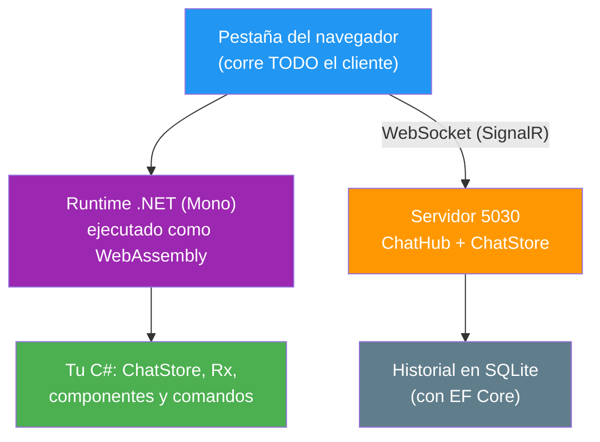

**¿Por qué elegimos esta opción?** Cuatro razones, en orden de importancia para una clase:

1. **Un solo lenguaje en los dos extremos.** El mismo C# del servidor para el cliente: no hay que cambiar de cabeza (ni de guion) a mitad de clase.
2. **La lógica se reutiliza de verdad.** Los contratos (`ChatHubMetodos`, `ChatHubEventos`, `MensajeDto`), el parser de comandos de `Shared/Comandos/` y hasta los operadores de Rx.NET viajan **tal cual** a los dos clientes. En JavaScript habría que reescribirlos o exponerlos por HTTP.
3. **Mismo modelo que ya conoces.** Componentes, inyección de dependencias, `ILogger<T>`, NUnit con Moq: lo aprendido en el servidor se traslada al cliente sin tener que aprender React o Vue por el camino.
4. **Encaja con SignalR y Rx.NET.** El `HubConnection` de .NET y `System.Reactive` funcionan en la pestaña igual que en la terminal — el cliente puede "escuchar" sin que nadie pregunte, que es justo lo que pide este chat.

> 📝 **Nota:** ¿y por qué no una SPA (*single-page application*, aplicación de una sola página) en JavaScript (React o Vue) o Blazor Server? JavaScript obligaría a dos lenguajes y a reescribir el parser de `Shared`; Blazor Server mantendría la interfaz en el servidor y perderíamos el cliente autónomo (con su `localStorage` y su CSS propio) que es la mitad interesante de este módulo. Todas son opciones válidas: esta es la que mejor encaja con los objetivos didácticos.

Dos contras honestas que conviene conocer:

- **La primera carga pesa**: el runtime se descarga y después se cachea en el navegador; si la cache se pierde o está caducada (el manifiesto de assets de la 3.10), se nota. Por eso existen el *splash* y el aviso de error.
- **Todo lo compilado viaja al cliente**: cualquiera puede abrir las herramientas de desarrollo y ver tu C#. Por eso la configuración WASM (`wwwroot/appsettings.json`) solo contiene ajustes de presentación y **nunca secretos** — la validación real la hace el servidor.

## 3.2. Qué hay dentro del proyecto

El cliente es una aplicación de Blazor WebAssembly (WASM) que corre en **su propio proceso**: el `launchSettings.json` le asigna el puerto `5031` y su DevServer sirve sus ficheros (`index.html`, el runtime y el CSS). El servidor del `5030` es agnóstico y no sabe que esta app existe: solo expone el hub y el `/estadisticas` que ella consume. La lógica está partida por responsabilidades:

| Carpeta | Contenido | Ejemplo |
|---------|-----------|---------|
| `Pages/` | Páginas con ruta (`@page`) | `Chat.razor` (la única) |
| `Layout/` | Esqueleto de la app | `MainLayout.razor` (columna vertebral de `100vh`) |
| `Shared/` | Trozos de interfaz | `PanelEntrada`, `BarraConexion`, `ListaCanales`, `ListaMensajes`, `ListaUsuarios`, `CajaMensaje`, `MensajeItem`, `Avatar` |
| `State/` | Stores reactivas y sesión | `ChatStore`, `SesionStore`, `SesionGuardada` |
| `Services/` | Lógica de servicio | `ProcesadorComandos`, `Storage/LocalStorageService` |
| `Configuracion/` | Sección `Web` del appsettings | `WebConfig` (`UrlServidor`, `RecordarSesion`) |
| `Infrastructures/` | Registro de servicios (estilo Tienda) | `ServicesConfig.AddChatStores(...)` |
| `wwwroot/` | Lo que el navegador descarga | `index.html`, `css/app.css` |

> 📝 **Nota:** `State/` y `Services/` no tienen NADA de Blazor dentro: son clases C# normales con Rx y SignalR. Eso es lo que permite probarlas sin navegador, igual que la `ClienteChat` de la terminal.

## 3.3. El arranque: de index.html a la pantalla de entrada

La primera vez que entras, el navegador descarga unos megas de runtime: mientras tanto ves el **splash** que vive en `index.html` (`# AulaChatNet · Cargando el chat…` con su barra). Blazor vacía ese `div` en cuanto arranca y pinta la app encima. Ese mismo HTML trae dos joyas didácticas:

- `#blazor-error-ui`: el aviso por si el runtime se cae en mitad de la sesión (con su botón Recargar).
- Unas **funciones JavaScript de dos líneas** (`window.aulachat.abajo` y `window.aulachat.enfocar`) que la web llama desde C# con JSInterop (el puente entre C# y JavaScript de Blazor) para bajar el scroll de los mensajes y devolver el foco al cuadro de texto. Sin librerías: JavaScript puro donde JavaScript es la única salida (mover el DOM).

El `Program.cs` del cliente hace, en orden:

1. **Lee la configuración** que el propio `WebAssemblyHostBuilder` ya cargó de `wwwroot/appsettings.json`. Ojo con el detalle de seguridad: en WASM **todo lo que aquí se lee viaja al navegador**, así que solo puede haber ajustes de presentación (canales, límites, URL del avatar) — nunca secretos. La validación real la hace el servidor.
2. **Monta Serilog** con un solo sink: `BrowserConsole`, la pestaña "Console" de las herramientas de desarrollo del navegador. Un solo `Log.Logger` que ataca por estático y, además, se registra como provider para que las stores reciban su `ILogger<T>` por DI (inyección de dependencias).
3. **Calcula la URL del servidor**: `Web:UrlServidor` es la base del servidor (`http://localhost:5030`). Es imprescindible porque la web vive en **otro proceso y otro origen** que el servidor: sin esa URL la app buscaría el hub en el `5031` y no lo encontraría. El `HttpClient` del `GET /estadisticas` apunta ahí con un timeout corto de 3 segundos: la cifra de bienvenida es opcional, no puede frenar el arranque.
4. **Registra los servicios** con `AddChatStores($"{baseServidor}{chat.HubRuta}")`: la URL del hub se compone desde la configuración, igual que en la terminal.

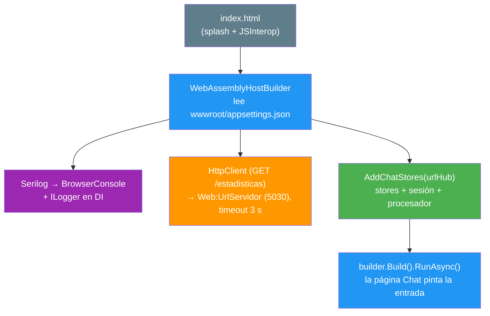

> 💡 **Consejo:** `Web:UrlServidor` vive en `wwwroot/appsettings.json` y viaja con el cliente. Si algún día cambias el puerto del servidor, ese es el único sitio que hay que tocar. Y no te alarme ver CORS por medio: es la consecuencia natural de que cada proceso tenga su propio origen, y ya viene configurado (`Cors:OrigenesPermitidos`).

## 3.4. La estética de Discord con CSS propio

La convención del proyecto: **CSS propio, sin librerías pesadas**, con TODOS los colores en variables de `:root` — si un día hay que cambiar la paleta, se toca un solo sitio. La paleta es la de Discord clásica: fondo `#36393f`, barra lateral `#2f3136`, cabeceras `#202225`, campo de escritura `#40444b`, acento *blurple* `#5865f2` y verde en línea `#43b581`.

El mapa de la interfaz (dos columnas, la regla del proyecto):

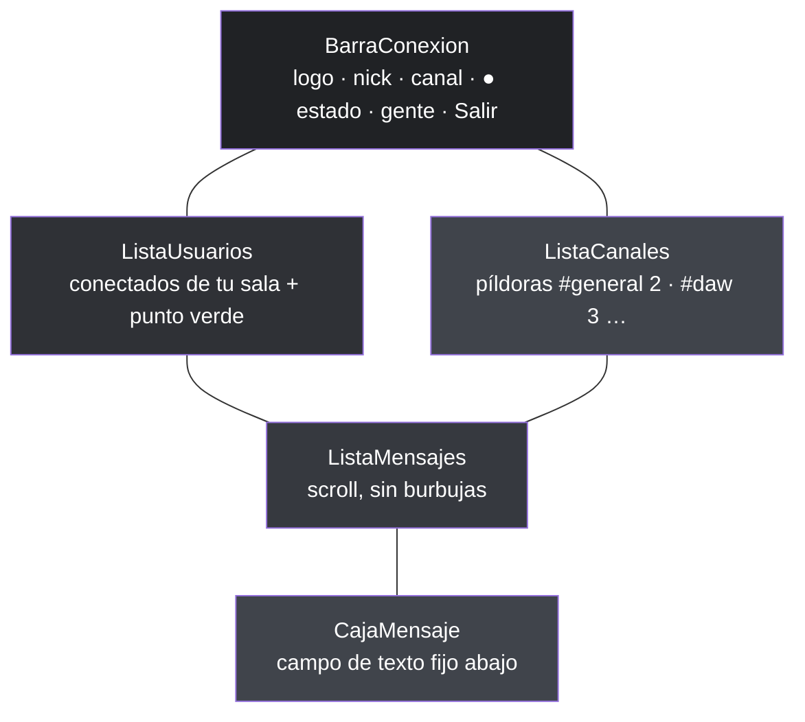

Tres decisiones de diseño que conviene retener:

1. **Nunca burbujas**: como Discord y Slack, cada mensaje es una **fila** — hora a la izquierda, avatar circular, nombre en su color y el texto debajo. Los mensajes de sistema salen en gris cursiva, sin avatar, con un `·` delante.
2. **La hora es local**: el servidor guarda en UTC (regla de oro: guardar UTC, convertir SOLO al presentar); `MensajeItem` pinta `Timestamp.ToLocalTime()`, o la web enseñaría la hora del servidor.
3. **Los avatares tienen respaldo**: el `Avatar` pinta la imagen de DiceBear (semilla = nombre de usuario, así es determinista) y, si el navegador no puede cargarla — sin internet, API caída, aula sin red — **el propio evento `onerror` de la etiqueta ``** avisa al componente y se pintan las iniciales sobre el color determinista del usuario. Los mismos cálculos que la terminal (`AvatarHelper` en `Shared`): un solo código, dos presentaciones.

> 📝 **Nota:** el texto de los mensajes lleva `white-space: pre-wrap` en el CSS. Ese detalle parece menor y no lo es: permite que los avisos multilínea de los comandos (`/ayuda`, `/canales`) se respeten con sus saltos de línea dentro del flujo de mensajes.

## 3.5. Una sola página y una store que manda

`Chat.razor` es la única página (`@page "/"`) y su lógica entera cabe en un `if`: si la store dice que **no hay sesión activa** pinta el `PanelEntrada`; en cuanto `ConectarAsync` triunfa, la store pone `EnSesion` a `true` y aquí aparece la vista de canal. **Un solo sitio manda: la store central** — los componentes no deciden de dónde vienen los datos, solo los pintan.

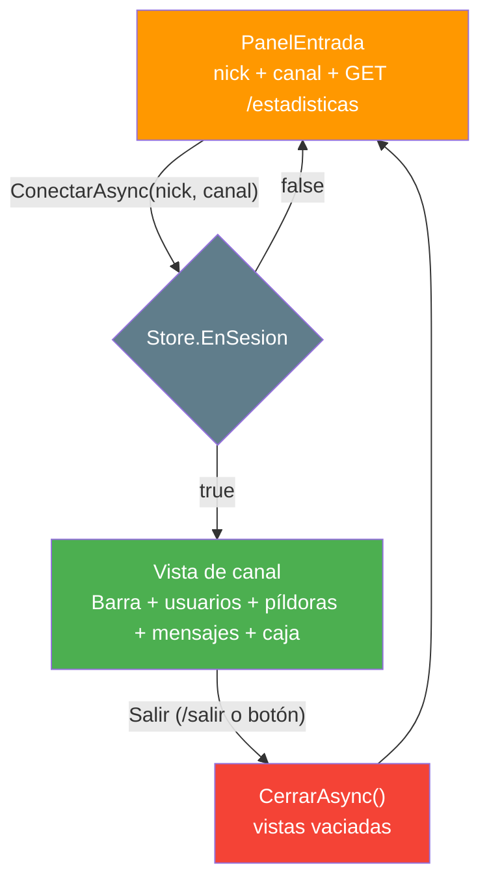

La página se suscribe en `OnInitialized` y se desuscribe en `Dispose` — el patrón de toda la web:

```csharp
protected override void OnInitialized()
{
    _suscripcion = Store.EnSesion.Subscribe(valor =>
    {
        _enSesion = valor;
        _ = InvokeAsync(StateHasChanged);  // ← Blazor no "ve" a Rx: hay que pedirle repintado
    });
}

public void Dispose() => _suscripcion?.Dispose();
```

Ese `InvokeAsync(StateHasChanged)` merece una nota al margen: Rx no conoce a Blazor. Cuando el flujo emite un valor, hay que decirle al componente "repíntate" — y como los eventos de SignalR pueden llegar desde otro hilo, se pide **a través de `InvokeAsync`**, que respeta el hilo del sincronizador de Blazor.

El `PanelEntrada` es, además, el sitio donde se ven los **casos diferenciados** (cada uno con su mensaje, como en la terminal):

| Caso | Qué se ve |
|------|-----------|
| Primera vez (no hay sesión) | Solo el formulario |
| Sesión recordada | "Hola de nuevo, **Ana**. ¿No eres tú? Borrar sesión" |
| Servidor consultado | `📌 Actualmente hay 20 personas conectadas: #general 12 · #daw 3 · …` |
| Servidor caído o sin red | `⚠ No pude consultar cuántos hay conectados…` — **el arranque sigue igual** |
| Rechazo del servidor (nick en uso) | Error rojo bajo el formulario y se corrige el nombre |
| Fallo de red al conectar | Se **conserva** todo y el botón pasa a "Reintentar" (el nick no tiene la culpa) |

Y la validación local ocurre **antes** de tocar la red, con la MISMA `ChatConfig` que usa el servidor: lo único que solo puede decidirlo el servidor es el nombre duplicado en el canal.

## 3.6. La store central y la capa reactiva

Varios componentes necesitan **los mismos datos**: la barra pinta el nick y el canal, las píldoras el canal actual, la lista de mensajes los mensajes, la lista de usuarios los conectados… ¿De dónde salen? Antes de contestar, conviene repasar cómo se comunican los componentes de Blazor entre sí, porque la store es la respuesta a las limitaciones de ese repaso.

### Cómo se comunican los componentes: propiedades y eventos

Blazor tiene DOS direcciones fijas de comunicación entre componentes, y siempre del mismo árbol:

1. **Propiedades hacia abajo (padre → hijo)**: el padre le "enchufa" datos al hijo declarando una propiedad con `[Parameter]`. El hijo no busca los datos: se los pasan.

   ```razor
   @* El padre pinta al hijo y le pasa el dato *@
   <MensajeItem Mensaje="mensaje" />
   ```

   ```csharp
   @* El hijo declara la propiedad de entrada *@
   [Parameter] public MensajeDto Mensaje { get; set; } = default!;
   ```

   En este proyecto así trabajan `Avatar` (`Usuario`, `Tamano`) y `MensajeItem` (`Mensaje`): componentes **hoja** que solo pintan lo que reciben.

2. **Eventos hacia arriba (hijo → padre)**: cuando el hijo necesita DECIRLE algo al padre ("el usuario ha pulsado", "el formulario se ha enviado"), expone una propiedad `[Parameter]` de tipo `EventCallback` y la dispara con `InvokeAsync`. El padre enlaza su propio método:

   ```csharp
   @* El hijo declara el evento y lo dispara cuando toca *@
   [Parameter] public EventCallback<string> Enviado { get; set; }

   private async Task AlPulsar() => await Enviado.InvokeAsync(texto);
   ```

   ```razor
   @* El padre se suscribe al evento del hijo *@
   <Hijo Enviado="OnEnviado" />
   ```

Resumen visual de las dos direcciones — un único árbol, dos flechas opuestas:

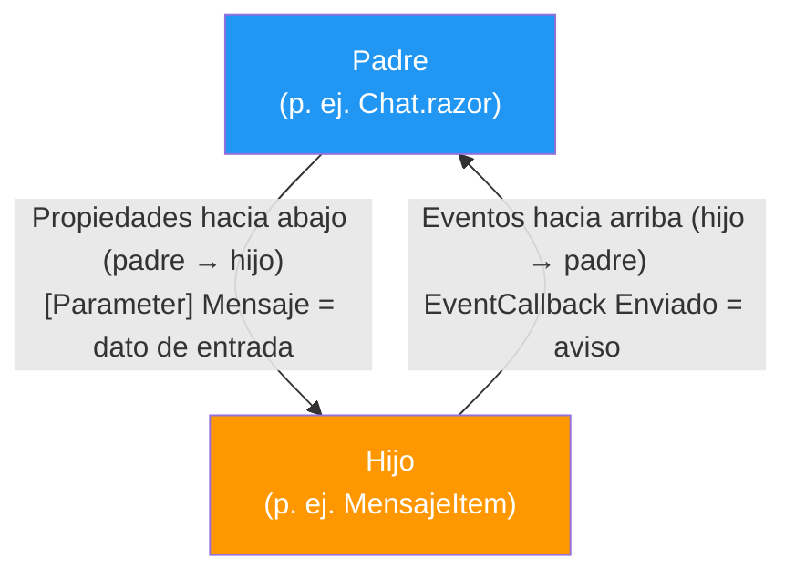

Este modelo **propiedades abajo, eventos arriba** es perfecto para árboles pequeños y para componentes decorativos. Su límite aparece en cuanto el dato es de INTERÉS GENERAL: si la lista de mensajes quiere saber el canal actual, y la barra también, y las píldoras también, el dato tendría que bajar de `Chat.razor` a cada uno — y cada pulsación subir por eventos hasta la página para que sea ella quien decida. En React y Vue le llaman *prop drilling* (taladro de propiedades): el dato perfora niveles que no lo usan, y la página se convierte en la centralita de todos los eventos.

> 📝 **Nota:** fíjate en un detalle revelador de este cliente: hay `[Parameter]` en dos componentes hoja, pero **ni un solo `EventCallback`** en todo el proyecto. No es un descuido: la comunicación "hacia arriba" la absorbe la store. Ese es precisamente el salto de la siguiente subsección.

### ¿Qué es una store central?

Una store es un objeto C# corriente (registrado en DI como **singleton**) que cumple tres reglas:

1. **Es la única fuente de verdad** (*single source of truth*) del estado: los mensajes, los conectados, el canal, el nick, el estado de la conexión y la sesión activa viven EN ESE OBJETO y en ningún otro sitio.
2. **Solo se lee**: los componentes reciben el estado; **nunca lo modifican**. La lectura puede ser reactiva (`IObservable<T>`) o síncrona (el valor actual), según lo que convenga.
3. **Solo se escribe mediante acciones** (sus métodos): `EnviarAsync`, `CambiarCanalAsync`, `CerrarAsync`… El componente que quiere cambiar algo **pide** a la store que lo haga; no toca nada directamente.

El dato viaja en **una sola dirección** — el patrón *unidirectional data flow*:

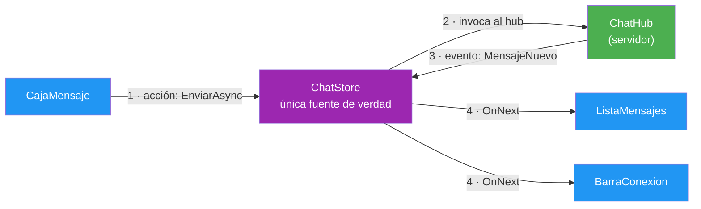

Un cambio es, siempre, el mismo viaje: **acción → store → hub → evento de vuelta → store → todos los que escuchan**. Nadie salta del medio.

### Propiedades y eventos: el contrato de la store

La `ChatStore` es el **equivalente** de la `ClienteChat` de la terminal: mismo contrato con el hub, mismos estados y mismas traducciones de error (`MensajesError`, nunca "HttpRequestException" en pantalla). Su cara pública se agrupa en tres familias:

| Familia | En C# | Ejemplos | Para qué |
|---------|-------|----------|----------|
| **Lectura reactiva** (los "eventos") | propiedades `IObservable<T>` | `Mensajes`, `Usuarios`, `Estadisticas`, `Estado`, `Nick`, `CanalActual`, `EnSesion` | Suscribirse: el componente se entera de **cada** cambio |
| **Lectura síncrona** (los "valores actuales") | propiedades con el valor presente | `Canal`, `EstadoValor`, `VistaUsuarios`, `EstadisticasActuales` | Leer de un vistazo sin suscribirse (`.Value` del sujeto) |
| **Acciones** (los "métodos") | `async Task` o `void` | `ConectarAsync`, `EnviarAsync`, `CambiarCanalAsync`, `CambiarNickAsync`, `ObtenerUsuariosAsync`, `ReconectarAsync`, `CerrarAsync`, `Aviso`, `LimpiarVista` | Pedir un cambio; la store lo hace y lo difunde |

Los observables exponen estos flujos:

| Observable | Tipo | De dónde viene |
|------------|------|----------------|
| `Mensajes` | `IObservable<IReadOnlyList<MensajeDto>>` | Eventos `MensajeNuevo` (sumar) y `HistorialRecibido` (reemplazar entero) |
| `Usuarios` | `IObservable<IReadOnlyList<UsuarioConectadoDto>>` | Evento `ListaUsuariosActualizada` (de tu grupo) |
| `Estadisticas` | `IObservable<EstadisticasDto>` | Evento `EstadisticasActualizadas` (a TODOS: total + reparto) |
| `CanalActual`, `Nick` | `IObservable<string?>` | Cambios locales (cambio de píldora, `/nick`) |
| `Estado` | `IObservable<EstadoConexion>` | Ciclo de vida de la conexión |
| `EnSesion` | `IObservable<bool>` | Qué mitad de la página pinta |

Dos convenciones del contrato, heredadas del hub:

- Las acciones de conexión devuelven `string?`: **`null` = OK, texto = error**. El componente no mira excepciones, mira si hay texto.
- Los nombres de evento no se escriben "a pelo": vienen de las constantes `ChatHubEventos`/`ChatHubMetodos` de `Shared` — la misma fuente que usa el servidor.

### Por qué nadie se pasa datos: adiós a los "saltos"

Sin store, la forma natural de Blazor es enredar los datos por el árbol de componentes — el dato **baja** por parámetros y los cambios **suben** por eventos, pasando por componentes que no los usan:

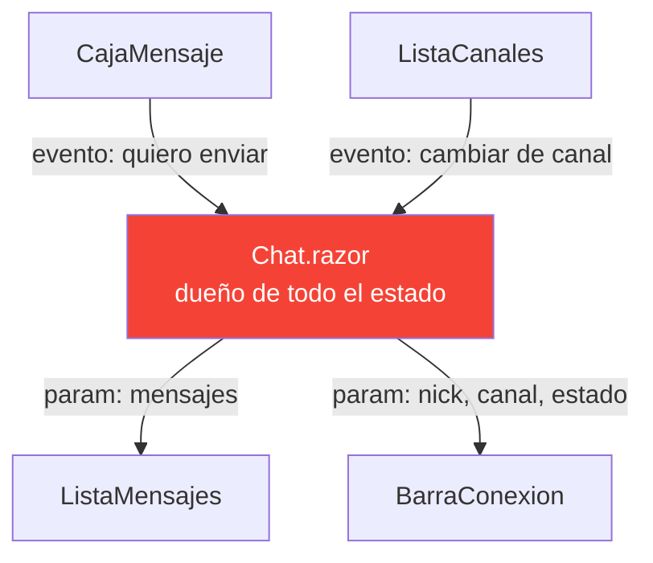

Con store, cada componente habla directamente con ella y **no le importa dónde está colgado en el árbol**:

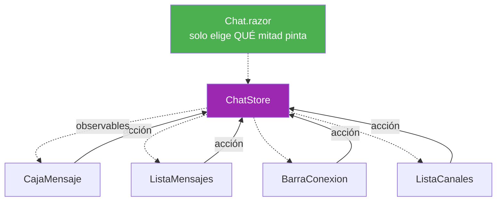

¿Qué se gana con la store?

- **Reutilización**: `ListaMensajes` sirve en cualquier página; no pide parámetros a su padre, se suscribe a `Store.Mensajes`.
- **Pruebas**: un componente se prueba solo, contra una `StoreFalsa` — no hace falta montar la página entera.
- **Añadir componentes**: un nuevo panel (p. ej. estadísticas) se suscribe y listo; no hay que tocar la página ni tender cables.
- **Menos fallos de desincronización**: si dos componentes muestran el nick, muestran el MISMO nick, porque leen de la misma fuente.

> 💡 **Consejo:** el único sitio donde SÍ se "pasan datos" es `Chat.razor`, y solo para decidir qué mitad pintar según `EnSesion` — que no es compartir estado, es consultar la puerta de entrada.

### La vida de una suscripción

`BehaviorSubject` es la clave de que no haya huecos: al suscribirte recibes **el valor actual en el mismo acto** y después, cada cambio. Si los flujos fueran `Subject` corrientes, habría una carrera entre "leo el valor inicial" y "me suscribo"; con `BehaviorSubject` no existe:

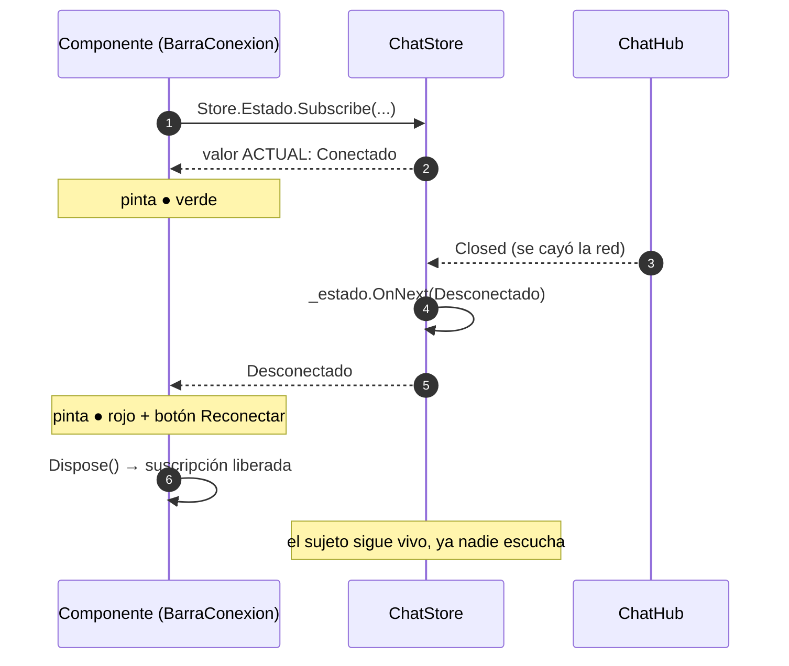

Cada componente se suscribe **solo a lo que pinta**: la barra a cinco flujos (una `CompositeDisposable` con las cinco suscripciones), las píldoras a canal + estadísticas, la lista de mensajes al flujo de mensajes. Y para donde no conviene suscribirse, la store ofrece lecturas síncronas del valor actual, que son simplemente `.Value` del sujeto.

La idea clave, la misma que en la terminal: **el componente no procesa eventos, solo pinta el estado**. Evento de SignalR → la store actualiza su sujeto → el componente se repinta. Sin colas ni estados intermedios.

### ¿Qué aporta frente a otras alternativas?

El patrón no es nuevo: se usa en muchos frameworks con distintos nombres. La store de AulaChatNet bebe directamente de **Pinia** (la librería de stores de Vue), que a su vez recoge la idea de Redux:

| Alternativa | Cómo es | Qué le falta respecto a la store reactiva |
|-------------|---------|-------------------------------------------|
| **Objeto singleton "a pelo"** (servicio con campos públicos) | DI lo entrega igual, pero sus campos son imperativos: leer está bien, ENTERARSE de que cambió no | No hay notificación: habría que consultar a mano o montar eventos caseros; y los "eventos caseros" son la siguiente fila |
| **Eventos C# del singleton** (`event Action<...>`) | El servicio dispara `MensajesCambiaron += ...` | Suscripción manual y fácil de olvidar (fugas), sin "valor actual al suscribirte", sin composición y sin lenguaje común entre tipos distintos |
| **Redux** (React) | Store única + acciones + *reducers* + inmutabilidad, con depurador de acciones | Muy didáctico, mucha ceremonia (tipos de acción, reducers); el patrón de flujo es el mismo que aquí |
| **Pinia** (Vue) | Stores con *state*, *getters* y *actions*; el motor de reactividad de Vue repinta | El diseño ES este: la única diferencia es el motor — Vue repinta solo; aquí el motor es Rx.NET y hay que pedir `StateHasChanged` |
| **Store reactiva de AulaChatNet** | Estado privado en `BehaviorSubject`, lectura `IObservable` + valores actuales, acciones `async` | — |

¿Y qué aporta **Rx.NET** encima del patrón Pinia/Redux? Precisamente la potencia de los flujos, sobre todo al escuchar:

- **Valor actual al suscribirte** (`BehaviorSubject`): cero carreras entre "leo" y "me suscribo".
- **Un solo lenguaje para todo el estado**: leer el estado de la conexión es el MISMO código que leer los mensajes — `Subscribe`. El componente aprende un patrón y lo aplica siete veces.
- **Composición sin tocar la store**: con operadores Rx, cada consumidor deriva SU vista — `Store.Mensajes.Where(m => m.Tipo == TipoMensaje.Sistema)`, un `Select` para contar, un `DistinctUntilChanged`… — y la store sigue intacta, sin métodos de más para cada necesidad.
- **Desacople total**: la store no sabe quién escucha (no tiene lista de suscriptores propia: la lleva Rx). Añadir o quitar un componente no la toca.
- **Despido ordenado**: `Subscribe` devuelve `IDisposable`; el componente se desuscribe en su `Dispose` y ya no hay pintados fantasma ni fugas.

> 📝 **Nota:** en Vue o React, el motor de reactividad repinta **solo**; en Blazor hay que pedirlo con `InvokeAsync(StateHasChanged)` dentro del `Subscribe`. Es el único peaje del patrón en esta plataforma, y es de una línea.

📌 **Ejemplo real:** Pinia de Vue es la inspiración declarada del diseño de estas stores — el autor del proyecto la copió de ahí a propósito. Redux, el abuelo de todo esto, añade además un depurador que registra cada acción: la misma idea de "un solo camino de escritura" llevada al extremo.

Detalles de implementación que valen la pena:

- **Sin bloqueos**: los eventos de SignalR de una conexión llegan serializados (una invocación detrás de otra), así que los `OnNext` son secuenciales.
- **La store es singleton a propósito**: la conexión a SignalR es UNA por pestaña; si fuera transitoria, cada componente tendría su propia conexión (y su propio alta).
- **Reconexión**: `WithAutomaticReconnect` reintenta a los 0, 2, 10 y 30 segundos; el transporte vuelve solo, pero **el ALTA no** — el servidor ya te dio de baja y la conexión nueva tiene otro `ConnectionId`. Por eso `Reconnected` dispara `ReenviarAltaAsync()`, que vuelve a invocar `ConnectAsync` con el nick y canal recordados. Sin ese paso, quedarías de escayola: la barra diría "conectado" pero nadie te vería.
- **`Aviso(texto)` fabrica mensajes de sistema** con el mismo formato que los del servidor (`TipoMensaje.Sistema`, autor del sistema): la web no distingue si un aviso vino del hub o de casa.

📌 **Ejemplo real:** la tienda de notificaciones de muchas apps React sigue el mismo patrón, y en la terminal de este propio proyecto la `ClienteChat` ya lo usaba — solo cambia el motor de repintado: allí un bucle cada 50 ms pintaba el estado actual; aquí quien repinta es Blazor cuando le piden `StateHasChanged`.

## 3.7. Los comandos / también en la web

Los 11 comandos de la terminal (`/ayuda`, `/canales`, `/canal`, `/nick`, `/usuarios`, `/privado`, `/reaccion`, `/reconectar`, `/sesion`, `/limpiar`, `/salir`) **también existen en la web**, y la parte bonita es que el parser **no se ha escrito dos veces**:

| Pieza | Vive en | Quién la usa |
|-------|---------|--------------|
| `Comando` (tipos) y `ParserComandos` (lógica pura) | `AulaChatNet.Shared/Comandos/` | Terminal y web |
| `AyudaComandos` (catálogo: sintaxis + descripción) | `AulaChatNet.Shared/Comandos/` | La tabla de la terminal y el texto de la web |
| `ProcesarLinea` (ejecución + pintado en consola) | Terminal | `Program.cs` |
| `ProcesadorComandos` (ejecución + avisos al flujo) | Web (`Services/`) | `CajaMensaje.razor` |

`ParserComandos.Parse("...")` recibe una cadena y devuelve un `record`; **la misma línea es un comando aquí y allí**. Si no empieza por `/`, la caja la valida (`ChatConfig.ValidarMensaje`) y la envía por `EnviarAsync`. El flujo dentro de `CajaMensaje`:

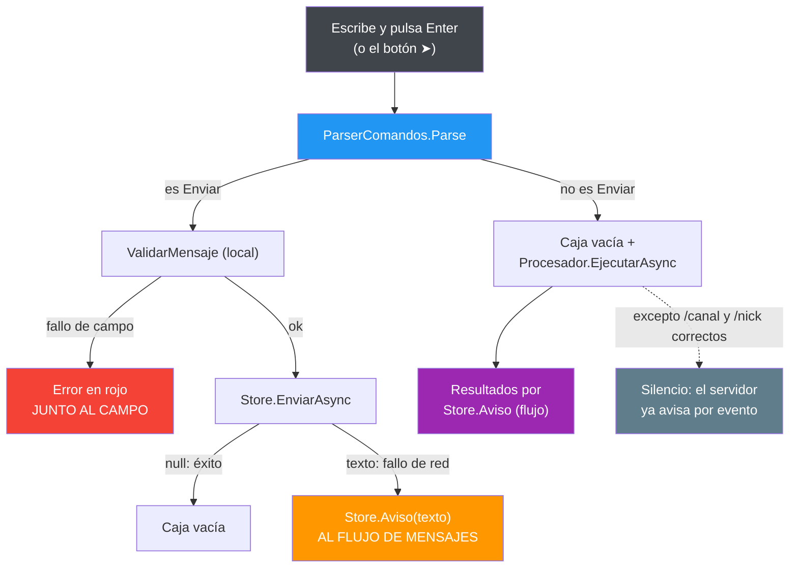

Dos convenciones del proyecto, aplicadas al pie de la letra:

- **Los errores de campo van junto al campo** (rojo bajo el cuadro): el texto está mal, no la conexión.
- **Los fallos de conexión van al flujo de mensajes**: el campo estaba perfecto, lo que falla es el mundo.

El `ProcesadorComandos` es un singleton que ejecuta los comandos con los recursos de la store y la sesión del navegador. Salidas reales, calcadas de una sesión de pruebas:

**`/ayuda`** (desde el catálogo compartido; `/ayuda canal` filtra por prefijo):

```text
Comandos disponibles:
/ayuda [comando] — Esta ayuda, o la de un comando concreto
/canales — Lista los canales disponibles y cuánta gente hay en cada uno
/canal <nombre> — Cambia de canal (p. ej. /canal daw)
/nick <nombre> — Cambia tu nombre en caliente (p. ej. /nick Ana2)
/usuarios [canal] — Conectados de tu canal o de otro (p. ej. /usuarios daw)
/privado <quien> <texto> — Mensaje privado a alguien de tu canal (efímero, no se guarda)
/reaccion <emoji> — Pone un emoji en el último mensaje del canal; pulsarlo otra vez lo quita
/reconectar — Vuelve a entrar si se perdió la conexión
/sesion [borrar] — Ver la sesión guardada o borrarla (útil en aulas compartidas)
/limpiar — Limpia la vista local de mensajes (el historial sigue en el servidor)
/salir — Desconectar y cerrar la sesión
```

**`/canales`** (el tuyo con `● actual`) y **`/usuarios`**:

```text
📌 1 conectados en total:
  #general 1 ● actual
  #daw 0

📌 1 en línea en #general:
  ● Ana
```

**Errores y avisos**:

```text
Comando no reconocido: /magia. Escribe /ayuda para ver todos.

Sesión guardada: Ana → #general

● Ya estás conectado: no hace falta reconectar.
```

> 💡 **Consejo:** añadir un comando nuevo es **tocar cuatro sitios y solo cuatro**: su `record` y su caso en el parser (Shared), su fila en el catálogo `AyudaComandos` (Shared), su caso en `ProcesarLinea` (terminal) y su caso en `ProcesadorComandos` (web). Las dos ayudas salen del catálogo, así que **nunca divergen**.

## 3.8. Un caso de estudio: el Closed fantasma

Al probar la web en el navegador con dos pestañas (ambas dicen llamarse Ana), el servidor rechazó correctamente el segundo alta — pero **en la consola del navegador aparecía un warning fantasma**: `Conexión perdida de forma inesperada…`, justo después del aviso legítimo del rechazo. El servidor estaba en lo cierto, el cliente mentía.

La causa: el cliente marca `_cierreIntencionado = true` antes de cerrar la conexión tras un rechazo (para que el evento `Closed` no avise de una caída que pedimos nosotros)… y **reseteaba el flag justo después del `StopAsync`**. El problema es de tiempo: SignalR invoca `Closed` de forma **asíncrona**, a veces DESPUÉS de que `StopAsync` devuelva. El evento tardío llegaba con el flag ya en `false` y soltaba su aviso fantasma:

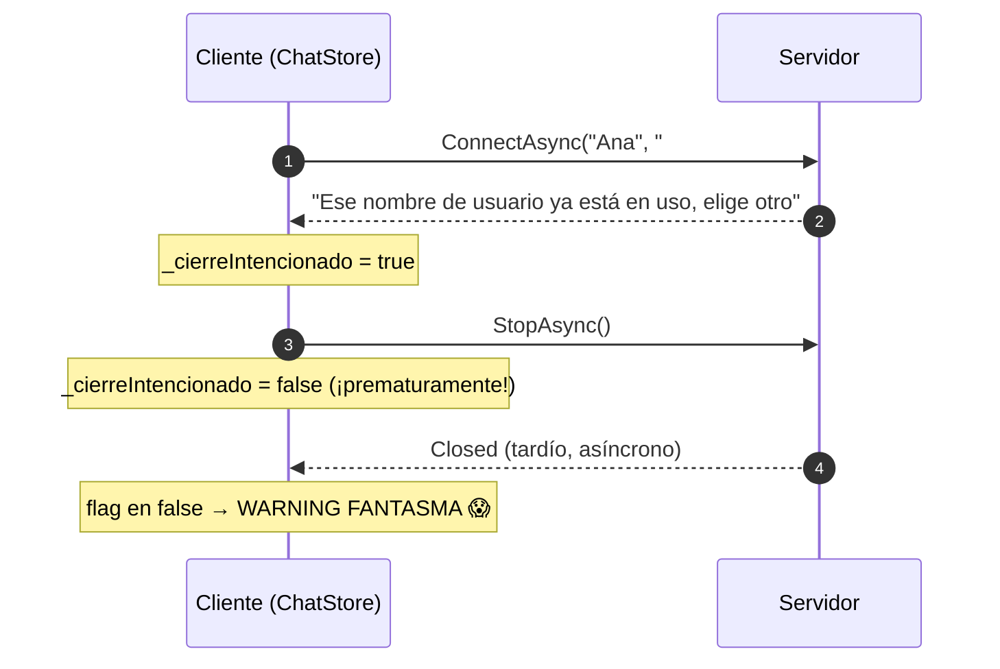

El arreglo es **no resetear el flag al cerrar**: solo se "despierta" al empezar la siguiente conexión (`ConectarAsync`/`ReconectarAsync`), que es el único momento en que un `Closed` viejo ya no puede confundirse con nada. El mismo patrón se aplicó a la `ClienteChat` de la terminal (idéntico problema, idéntico arreglo).

> ⚠️ **Advertencia:** la moraleja es para toda la vida: **los eventos de conexión no tienen por qué llegar en el orden en que los provocas**. Cualquier flag de "esto lo pedí yo" debe vivir lo suficiente como para cubrir la entrega tardía, y reiniciarse donde se INICIA una acción, no donde termina.

Verificado de punta a punta en navegador: rechazo de nick duplicado → solo el warning legítimo del hub, **cero** avisos fantasma; `/salir` y reconexión, igual.

## 3.9. La sesión en el navegador

La terminal guardaba la sesión en un fichero del perfil; aquí no hay disco, pero sí **`localStorage`** — el armario del navegador, que sobrevive a recargas y apagones. `SesionStore` decide la política (qué recordamos y qué pasa si el navegador no deja escribir) y el trabajo sucio con JS y JSON vive en `ILocalStorageService` (calco del servicio de la Tienda).

- **Clave**: `aulachat.sesion` (una por aplicación).
- **Qué se guarda**: nick y canal — al conectar con éxito, si `Web:RecordarSesion` es `true`.
- **Nunca rompe**: un chat no puede estrellarse porque el navegador esté en modo privado. Todos los fallos (`JSException` de lectura o escritura) se traducen en "no hay sesión" + un warning **en el log del navegador**, nunca en pantalla.

`/sesion` relee del navegador y te enseña lo guardado; `/sesion borrar` lo borra — en aulas compartidas, la forma de no heredar el nick del compañero del turno anterior. El enlace "¿No eres tú? Borrar sesión" del panel de entrada hace exactamente lo mismo a un clic.

## 3.10. Desarrollo: dotnet watch y el manifiesto de assets

Blazor WASM emite un **manifiesto de assets** con los hashes de todos los ficheros del cliente. Detrás de la última pantalla en blanco que costó un susto: **ese manifiesto se lee al arrancar**, no petición a petición. Si editas el cliente y solo haces F5, el navegador recibe un manifiesto viejo que apunta a nombres de archivo que ya no existen → 404 → página en blanco, **sin ningún error a la vista**.

La solución, en dos mitades:

1. **`dotnet watch --project AulaChatNet.Client.Web`** en desarrollo: al tocar cualquier fichero del cliente, watch reconstruye y **relanza su DevServer** — el manifiesto nuevo se lee en el arranque limpio. Fíjate en el proyecto: el servidor ya no interviene, es agnóstico y no sirve la web, así que hacer watch sobre él no arreglaría nada.
2. **La caché la resuelve el propio DevServer.** Medido en el `5031`: `GET /index.html` devuelve `Cache-Control: no-cache` de serie, así que el navegador pide siempre la última versión sin necesidad de ningún middleware propio.

> 📝 **Nota:** este es un cambio de modelo respecto a lo que documentaba esta guía al principio. Antes el servidor del `5030` alojaba la web y había que añadirle a mano un middleware `no-cache` y hacer watch sobre él. Con el servidor agnóstico, la web tiene su proceso y sus problemas de desarrollo propios, resueltos por su propia herramienta.

## 3.11. Cómo se prueba

La web tiene su propia suite (bUnit + NUnit + FluentAssertions + Moq), con el mismo doble enfoque que el resto del proyecto:

| Suite | Qué cubre |
|-------|-----------|
| `ChatStoreTests` | Los caminos de conexión de la store: sin servidor (fallo tipado) y con `ServidorDePrueba` (Kestrel real en puerto aleatorio, igual que en la terminal) |
| `SesionStoreTests` | Guardar/cargar/borrar sobre un doble de almacenamiento; un `JSException` responde "no hay sesión" y no lanza |
| `LocalStorageServiceTests` | El adaptador JS de verdad, con doble de JSInterop |
| `PanelEntradaTests` | Casos del panel: sesión recordada, stats caídas, rechazo vs fallo de red (¿botón "Reintentar"?) |
| `BarraConexionTests` | Los cinco observables pintan su trocito; Reconectar aparece solo cuando toca |
| `ListaCanalesTests` | Píldoras, conteos, activa, cambio de canal y errores al flujo |
| `ListaUsuariosTests` / `MensajeItemTests` / `AvatarTests` | Filas de conectados, mensajes (sistema vs normal, hora local) y avatares con respaldo |
| `ChatTests` | La página cambia de mitad según `EnSesion` |
| `CajaMensajeTests` | Validación de campo, envío y **despacho de comandos** |
| `ProcesadorComandosTests` | Los comandos: avisos correctos, validación de canal, `/sesion`, `/salir`, y también el `/privado` y el `/reaccion` (objetivo, validación sin red y traducción de errores) |

El truco de los tests de componentes es la **`StoreFalsa`**: en lugar de una conexión a SignalR real, expone `BehaviorSubject` que el test "menea" para simular lo que llegaría del servidor, y deja verificar las llamadas con Moq. A un componente no le importa de dónde vienen los datos: **le importa cómo los pinta y qué le dice al pulsar**. Los "valores actuales" (`Canal`, `EstadoValor`…) se resuelven en el momento de la llamada contra el sujeto correspondiente, así que "menear" el flujo desde el test se refleja al instante.

> 📝 **Nota:** un detalle de Moq aprendido a golpe: `It.Is<T>(x => x is Tipo)` no compila (CS8122) porque los árboles de expresión no admiten `is`; en su lugar se verifica sobre `_procesador.Invocations[0].Arguments[0]`, que es lo que de verdad se invocó.

Y más allá de los tests unitarios, la verificación de esta versión se hizo en **navegador de verdad** contra el servidor real: se teclearon los comandos de la época (los 9 originales) en la caja (incluido `/limpiar` con sus 6 mensajes borrados y `/salir` volviendo al panel) y también se probó la carrera del nick duplicado con dos pestañas. La misma filosofía que en la terminal: **probar la app como la usaría el alumno**.

> 📝 **Nota (evolución):** con los dos clientes listos sobre el mismo hub, abrió el siguiente capítulo la persistencia: sacar el historial de las `ConcurrentDictionary` a una base de datos real (SQLite + EF Core, Entity Framework Core) **sin tocar el hub ni la lógica de los clientes**. Y así salió: el contrato ya estaba hecho y no hubo que moverlo — la web sigue suscribiéndose a `MensajeNuevo` y pidiendo el historial exactamente igual que cuando todo vivía en memoria, solo que ahora ese historial procede de SQLite. El detalle de las decisiones y de sus trampas, en [4. La persistencia con SQLite](04-persistencia.md).

> 📝 **Nota:** el boceto previo de estas vistas sigue disponible en [`docs/boceto-vistas.html`](boceto-vistas.html), por si quieres comparar el dibujo con lo que acabó saliendo.

## 3.12. Decisiones, patrones y técnicas del punto

La web es el cliente con más piezas móviles, y cada una es una decisión que volverás a tomar en cualquier SPA. El resumen, en una tabla:

| Patrón o técnica | Dónde vive en AulaChatNet | La lección transferible |
|------------------|---------------------------|-------------------------|
| Blazor WebAssembly | El cliente corre entero en la pestaña (runtime .NET + DLLs) | Un lenguaje y un modelo en los dos extremos; el navegador es solo un ejecutor más |
| Store central (fuente única de verdad) | `ChatStore` con `BehaviorSubject`, al estilo de Redux o Pinia | Ningún componente calcula: lee el estado. Adiós a los "saltos" de datos |
| Propiedades y eventos | Componentes que solo reciben datos por arriba y emiten eventos | La flecha nunca va al revés: la interfaz baja, los hechos suben |
| Interfaz con CSS propio | Paleta de Discord escrita a mano, sin librerías de estilos | Aprender a componer interfaz sin un framework que tape el HTML |
| JSInterop mínimo | Dos funciones de JavaScript para scroll y foco | JavaScript solo donde es la única salida: mover el DOM |
| Fallo seguro en el almacenamiento | `SesionStore` traduce cualquier `JSException` en "no hay sesión" | Una app no se tumbe por un dato de confort: degrada y sigue |
| Configuración solo de presentación | `wwwroot/appsettings.json` sin secretos | Todo lo que viaja al cliente es público: la seguridad se decide en el servidor |
| Pruebas sin navegador | Stores y `ProcesadorComandos` con Moq y bUnit | Separa lógica de presentación y el navegador deja de ser requisito para testear |

---

**Resumen del punto:**

| Concepto | Qué retener |
|----------|-------------|
| Plataforma | Blazor WebAssembly: el runtime de .NET corre como WebAssembly dentro del navegador — un solo lenguaje en cliente y servidor |
| Proceso propio | DevServer en el `5031` (su `launchSettings.json`); el servidor es agnóstico y no sirve ficheros — por eso la URL del servidor va en `Web:UrlServidor` y hace falta CORS |
| Configuración | `wwwroot/appsettings.json`; en WASM todo lo leído es PÚBLICO — solo presentación, nunca secretos |
| Página única | `Chat.razor` pinta panel o canal según `EnSesion`; la store central manda |
| Componentes | Se suscriben en `OnInitialized`, se desuscriben en `Dispose`, y repintan con `InvokeAsync(StateHasChanged)` |
| Store | Única fuente de verdad (patrón Pinia/Redux): estado en `BehaviorSubject`, lectura reactiva + valores actuales, escritura SOLO por acciones; singleton (una conexión por pestaña) |
| Reconexión | El transporte vuelve solo; el ALTA se reenvía con `ReenviarAltaAsync` — sin eso, "conectado de escayola" |
| Comandos | Mismo parser (`Shared`) y mismo catálogo (`AyudaComandos`); ejecución en `ProcesadorComandos`; feedback por el flujo de mensajes |
| Errores | De campo → junto al campo; de conexión → al flujo de mensajes; nunca tipos de excepción en pantalla |
| Fallo Closed | SignalR entrega `Closed` tarde: el flag de cierre se resetea al INICIAR la siguiente conexión, nunca al cerrar |
| Sesión | `localStorage` clave `aulachat.sesion`; un navegador bloqueado no rompe nada |
| Desarrollo | `dotnet watch --project AulaChatNet.Client.Web` (reconstruye y relanza su DevServer) — el manifiesto se lee al arrancar |
| Pruebas | Stores con red de verdad y componentes contra `StoreFalsa` con sujetos "meneables" |
| CSS | Propio, con variables en `:root`; paleta Discord clásica; avatares DiceBear con respaldo de iniciales |

**Anterior:** [2. El cliente terminal](02-cliente-terminal.md) · **Índice:** [README](../README.md)
