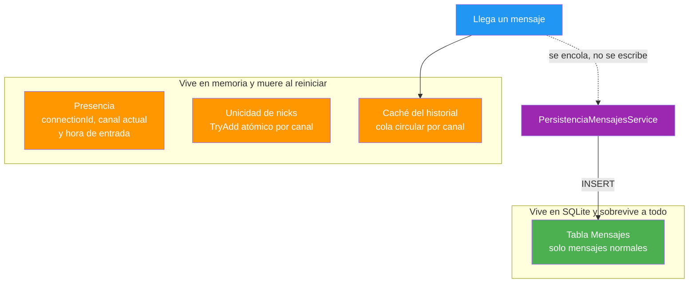
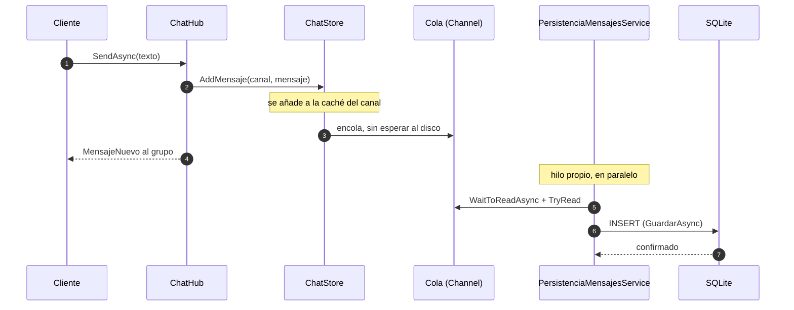
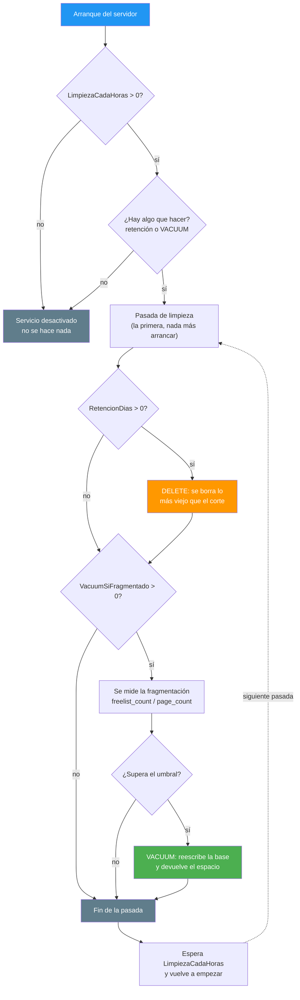

- [4. La persistencia con SQLite](#4-la-persistencia-con-sqlite)
  - [4.1. Por qué SQLite y no un servidor de bases de datos](#41-por-qué-sqlite-y-no-un-servidor-de-bases-de-datos)
  - [4.2. Qué se guarda en disco y qué no](#42-qué-se-guarda-en-disco-y-qué-no)
  - [4.3. El modelo: entidad, contexto e índices](#43-el-modelo-entidad-contexto-e-índices)
  - [4.4. Migraciones: aplicar cambios sin perder datos](#44-migraciones-aplicar-cambios-sin-perder-datos)
  - [4.5. Escribir sin frenar el chat](#45-escribir-sin-frenar-el-chat)
  - [4.6. Leer: el historial ya está cargado](#46-leer-el-historial-ya-está-cargado)
  - [4.7. Mantener el fichero: retención y VACUUM](#47-mantener-el-fichero-retención-y-vacuum)
  - [4.8. Arrancar vacío en desarrollo](#48-arrancar-vacío-en-desarrollo)
  - [4.9. Las claves de configuración](#49-las-claves-de-configuración)
  - [4.10. Tres trampas que solo salen al ejecutar](#410-tres-trampas-que-solo-salen-al-ejecutar)
  - [4.11. Cómo se prueba](#411-cómo-se-prueba)
  - [4.12. Resumen del punto](#412-resumen-del-punto)


# 4. La persistencia con SQLite

> 💡 **Punto de partida:** cierras clase con 40 mensajes escritos en #general, apagas el ordenador del profesor y al día siguiente vuelves a entrar. En WhatsApp tus mensajes siguen ahí. En el chat de la Fase 1, no: todo vivía en memoria y murió con el proceso. ¿Cómo se consigue que el historial **sobreviva a cualquier reinicio** sin reescribir ni el hub ni los clientes?

En este punto montamos la persistencia de AulaChatNet: SQLite embebido en un fichero, EF Core como ORM, un servicio en segundo plano que escribe sin frenar al chat y otro que mantiene el fichero por dentro. Lo interesante no es el "qué", sino el "por qué": qué estado merece ir a disco, cuándo se escribe, cuándo se borra y qué decisiones se tomaron y por qué, con sus trampas reales.

**Objetivos de aprendizaje:**

- Justificar la elección de un motor de bases de datos por lo que el proyecto necesita, no por moda
- Aplicar el criterio de **longevidad** para separar lo que va a disco de lo que se queda en memoria
- Modelar con EF Core: entidad, contexto, índices y por qué `DateTime` en UTC y no `DateTimeOffset`
- Aplicar migraciones con `Migrate()` y entender por qué `EnsureCreated()` es una trampa
- Escribir en segundo plano con el patrón *write-behind* (`Channel` + `BackgroundService`)
- Precargar el historial al arrancar, antes de aceptar la primera conexión
- Mantener el fichero: retención por tiempo y un `VACUUM` decidido por fragmentación real
- Arrancar con la base vacía en desarrollo sin esconder la decisión dentro del entorno
- Reconocer tres trampas que solo aparecen al ejecutar, nunca al compilar

## 4.1. Por qué SQLite y no un servidor de bases de datos

El requisito de la Fase 2 es modesto y hay que decirlo en voz alta: **que el historial no se pierda**. No hace falta replicación, ni clúster, ni atender a 500 escrituras por segundo. Un aula con 30 personas escribiendo genera un puñado de mensajes por minuto.

Con ese panorama, montar un contenedor de PostgreSQL es montar una infraestructura para resolver un problema que no tenemos. SQLite es justo lo contrario: **una librería dentro de tu proceso** que gestiona un único fichero.

| | SQLite | PostgreSQL / MySQL |
|---|--------|--------------------|
| Instalación | Ninguna: ya viene con .NET | Servidor a instalar y configurar |
| Proceso aparte | No: corre dentro de la app | Sí, y hay que arrancarlo |
| Credenciales y puertos | No hay | Sí |
| Contenedor Docker | No hace falta | Casi obligatorio |
| Archivo de datos | Uno solo: `aulachat.db` | Ficheros de servidor dispersos |
| Ideal cuando | Embebido, un escritor, portátil | Muchos clientes, réplicas, transacciones complejas |

📌 **Ejemplo real:** es la base de datos más extendida del planeta y casi seguro la usas a diario sin saberlo: Chrome y Firefox guardan tu historial de navegación en SQLite, Android la lleva de fábrica, y Windows y macOS la traen integrada en el sistema. No es "la base de datos de los pequeños": es la de los que necesitan datos fiables en un fichero.

> ⚠️ **Advertencia:** SQLite tiene límites reales y conviene conocerlos. Un solo escritor a la vez (los demás esperan), todo el mundo en el mismo fichero (no sirve para varios servidores escribiendo a la vez en red), y el crecimiento de un fichero enorme cuesta más que una tabla partida. Cuando el proyecto crezca hasta ahí, toca migrar a un servidor de verdad. Elegir SQLite aquí no es ignorar sus límites: es conocerlos y decidir que no nos afectan todavía.

> 💡 **Consejo:** elige tecnología respondiendo a "¿qué problema tengo y cuál es la solución más pequeña que lo resuelve bien?". La respuesta a menudo no es la más reluciente del anuncio.

## 4.2. Qué se guarda en disco y qué no

Este es el **corazón de la Fase 2**, y el criterio es sencillo de enunciar pero fácil de aplicar mal: **se separa por longevidad, no por entidad**. No se trata de "esta tabla va a la base de datos y esta otra no", sino de preguntar a cada dato: *¿qué pasa si apago el servidor?*



| Dato | ¿Dónde vive? | Por qué |
|------|--------------|---------|
| Quién está conectado y en qué canal | Memoria | Un `connectionId` de SignalR **no significa nada** tras un reinicio: las conexiones se han ido |
| Unicidad de nicks | Memoria | Nadie está conectado al arrancar, así que todos los nicks están libres: es lo correcto |
| Historial de mensajes | **Disco** (y caché en memoria) | Es el único que tiene valor pasado: leerlo mañana es justo su propósito |
| Mensajes de sistema (unión, salida, cambio de nick) | **No se guardan** | Son ruido de sesión; el repositorio filtra `TipoMensaje.Normal` |

> 📝 **Nota:** la consecuencia honesta de esta decisión es que, tras un reinicio, la lista de conectados empieza vacía (los clientes vuelven a dar de alta al reconectar) y un nick que usaba alguien se libera. En un aula es exactamente lo que quieres: no quedan fantasmas de sesiones que ya no existen.

> 💡 **Consejo:** si te aprendes una sola frase de este punto, que sea esta: **si moriría al apagar el proceso y eso no es un problema, no va a disco.** Aplicado con rigor, la respuesta sale sola casi siempre.

📌 **Ejemplo real:** es el mismo criterio que usan Discord o Slack. Tu lista de amigos "en línea" se recalcula con las conexiones vivas, mientras que el historial de un canal es lo que buscas cuando vuelves tres días después. Nadie persiste a los usuarios conectados en una tabla: se hubieran muerto con cada caída de red.

## 4.3. El modelo: entidad, contexto e índices

Aquí aparecen dos objetos que parecen iguales y no lo son: `MensajeDto` y `MensajeEntidad`.

- **`MensajeDto`** viaja por la red hacia los clientes. Es inmutable (un `record`) y su forma es un contrato público.
- **`MensajeEntidad`** es el reflejo del esquema en disco. Es una clase mutable porque EF Core la rellena propiedad a propiedad y necesita un constructor sin argumentos y *setters*.

Que sean dos objetos permite cambiar uno sin tocar al otro: partir la tabla en dos, añadir una columna de auditoría o cambiar de motor, sin mover el contrato con los clientes.

```csharp
public class MensajeEntidad
{
    // El MISMO GUID que generó el servidor, no uno nuevo de la base de datos:
    // así el cliente reconoce "su" mensaje sin id adicional (ValueGeneratedNever)
    public Guid Id { get; set; }

    public string Canal { get; set; } = string.Empty;    // texto denormalizado
    public string Usuario { get; set; } = string.Empty;  // sin tabla de usuarios: no hay cuentas
    public string Texto { get; set; } = string.Empty;
    public DateTime Timestamp { get; set; }              // UTC SIEMPRE
    public TipoMensaje Tipo { get; set; }                // se guarda como entero
}
```

**El canal va como texto y no como clave foránea.** Los canales los define la configuración (`appsettings.json`), no los datos: montar una tabla `Canales` solo para poder hacer un `JOIN` innecesario sería complejidad sin valor.

> ⚠️ **Advertencia: el `DateTimeOffset` que rompió la consulta central.** La primera versión de la entidad usó `DateTimeOffset` para "blindar" el UTC... y SQLite reventó al ordenar:
>
> ```
> SQLite does not support expressions of type 'DateTimeOffset' in ORDER BY clauses
> ```
>
> La consulta central del chat ("los últimos N de un canal") es exactamente un `ORDER BY`, así que la opción "más segura" rompía lo más importante. Con `DateTime` en UTC el orden sí funciona: SQLite guarda texto ISO-8601 con ceros a la izquierda, así que el orden lexicográfico coincide con el cronológico. Una trampa que solo cazaron los tests.

Hay un segundo detalle del mismo tipo: al **leer**, el proveedor devuelve el `Kind` perdido (`Unspecified` en vez de `Utc`), así que el repositorio lo devuelve a UTC con `DateTime.SpecifyKind(m.Timestamp, DateTimeKind.Utc)`. Guardar en UTC es solo la mitad del contrato; devolverlo también.

### Los índices, diseñados mirando las consultas

No hay índices "por si acaso". En `AulaChatContexto.OnModelCreating` hay exactamente dos, y cada uno responde a una pregunta distinta:

```csharp
// Consulta 1: "dame los últimos N de #general" → barrido por rango ordenado
mensaje.HasIndex(m => new { m.Canal, m.Timestamp });

// Consulta 2: la limpieza → "borra todo lo anterior a hace 30 días"
// es GLOBAL, sin canal, así que el índice anterior no le sirve
mensaje.HasIndex(m => m.Timestamp);
```

Dos consultas distintas, dos índices distintos. El primero resuelve la lectura habitual del chat sin ordenar la tabla entera; el segundo evita que la limpieza tenga que recorrerlo todo.

### Por qué una fábrica de contextos y no un contexto compartido

`ChatStore` es un **singleton**, y un `DbContext` de EF Core es de corta vida y **no es thread-safe**: compartirlo entre hilos lo rompe. La solución es `AddDbContextFactory<AulaChatContexto>`: el singleton pide a la fábrica **un contexto nuevo por cada operación** y lo descarta (`await using`), que es el patrón correcto cuando quien invoca vive más que el contexto.

## 4.4. Migraciones: aplicar cambios sin perder datos

El esquema no se crea a mano: se **migra**. La carpeta `Migrations/` guarda el historial de cambios, y cada fichero es un paso reversible con su fecha:

```
Migrations/
├── 20261018131734_InicialMensajes.cs            ← el cambio de verdad
├── 20261018131734_InicialMensajes.Designer.cs   ← metadatos
└── AulaChatContextoModelSnapshot.cs             ← el esquema actual
```

📌 **Ejemplo real:** las migraciones son el *changelog* de tu esquema, o lo que es lo mismo, **`git` pero para la estructura de las tablas**. Nadie aplica cambios de esquema "a mano en el servidor de producción": se versionan, se revisan y se aplican.

### Migrate() y no EnsureCreated()

| | `EnsureCreated()` | `Migrate()` |
|---|---|---|
| Crea las tablas | Sí, si no existen | Sí |
| Lleva historial de cambios | **No** | Sí (`__EFMigrationsHistory`) |
| Evoluciona el esquema | **No**: detecta diferencias y puede recrear | Aplica solo lo que falta |
| Conserva los datos | No garantizado | Sí |

`EnsureCreated()` crea el esquema de cero y, si detecta que cambió, lo **recrea**: se iría el historial guardado. `Migrate()` aplica únicamente las migraciones pendientes y toca lo mínimo. Por eso en `Program.cs` la secuencia es:

```csharp
var migraciones = await contexto.Database.GetPendingMigrationsAsync();

if (migraciones.Any())
{
    await contexto.Database.MigrateAsync();
    Log.Information("💾 Base de datos migrada en {Ruta}", ...);
}
else
{
    Log.Information("💾 Base de datos al día en {Ruta}", ...);
}
```

Para generar una nueva migración tras tocar el modelo:

```bash
dotnet ef migrations add DescripcionDelCambio
dotnet ef database update     # opcional: en arranque lo hace MigrateAsync()
```

> 📝 **Nota:** el comando `dotnet ef` está instalado a nivel de SDK en la versión 10.0.12 mientras el runtime es el 10.0.13. Aparece un aviso de versión menor, pero no bloquea nada: funciona correctamente.

> ⚠️ **Advertencia:** si pones `MigrarAutomaticamente` a `false`, no se aplican migraciones y **no hay tablas nuevas**. Y si además `LimpiarAlArrancar` está en `true`, habrás borrado la base sin recrear el esquema: la aplicación fallará al arrancar. `Program.cs` lo detecta y lo avisa alto y claro en el log, pero es una combinación que solo tiene sentido si vas a aplicar las migraciones tú a mano.

## 4.5. Escribir sin frenar el chat

Aquí está la pregunta incómoda de la persistencia en tiempo real: **¿en qué momento se escribe en disco?** Si lo haces dentro del hub, cada mensaje espera al disco.

Y eso es un problema serio: un hub de SignalR **nunca debe bloquear esperando E/S**, porque con pocos usuarios agotaría el *pool* de hilos y el chat se quedaría congelado. La solución se llama *write-behind*: **escribir por detrás**.

1. `ChatStore.AddMensaje` es **síncrono** y no toca el disco: guarda en la caché del canal (que es lo que los clientes ven al instante) y **encola** el mensaje en un `Channel`.
2. `PersistenciaMensajesService`, un `BackgroundService`, drena esa cola en un hilo propio y hace el `INSERT` real.



📌 **Ejemplo real:** es lo mismo que hace WhatsApp o Instagram con la palomita. El mensaje aparece en tu pantalla al instante (confirmación optimista), y la entrega se confirma después por detrás. La interfaz **nunca espera al disco**.

```csharp
public void AddMensaje(string canal, MensajeDto mensaje)
{
    // ... se poda la cola circular y se añade a la caché del canal ...

    // Persistencia (Fase 2): si hay repositorio, se encola para guardarla
    // en segundo plano. NO se escribe aquí: AddMensaje es síncrono y no
    // debe bloquear esperando disco.
    if (_repository is not null)
        _colaEscritura.Writer.TryWrite((canal, mensaje));
}
```

### La asimetría que confunde a todo el mundo

`IChatStore` es **síncrono** e `IMensajesRepository` es **asíncrono**, y esa diferencia es deliberada:

- `AddMensaje` no hace E/S: memoria + `TryWrite` son instantáneos. Hacerlo `async` solo arrastraría `async` al hub para nada.
- El repositorio sí toca disco, y ahí lo asíncrono es obligatorio.

La regla es: **`async` va donde hay E/S**, no por convención.

> 💡 **Consejo:** la cola es **sin límite** (*unbounded*) a propósito. En un aula el volumen es bajo, y no se debe perder ni un mensaje por un atasco de disco. En un sistema con presión real, ahí sí que pondrías un tope y una estrategia de descarte consciente.

### Cuando algo falla, o cuando se apaga

- Un fallo al guardar **nunca rompe la cola**: se registra el error y se sigue con el siguiente mensaje. Un disco malo no debe tumbar el servidor.
- Al apagar, queda un **margen de 5 segundos** con un token propio para escribir lo que quede encolado, sin que un disco lento retenga el apagado.

> ⚠️ **Advertencia:** el trade-off hay que decirlo claro. Si el proceso muere de golpe (una cortada de luz) con cosas en la cola, **esos mensajes se pierden**. Para un aula es un riesgo aceptable y documentado. En un banco, no: ahí la escritura es síncrona y el mensaje no se confirma al usuario hasta que está en disco. La arquitectura no es buena o mala en abstracto: es buena o mala para el problema.

## 4.6. Leer: el historial ya está cargado

La lectura no cambió de contrato: `ChatStore.GetHistorial` sigue devolviendo la caché en memoria, así que **el hub no se enteró de nada**. Lo que cambió es cómo llega ahí el contenido.

Al arrancar, y **antes de `app.Run()`** (es decir, antes de aceptar la primera conexión), se cargan los últimos mensajes de cada canal desde el disco:

```csharp
var store = app.Services.GetRequiredService<ChatStore>();
var precargados = await store.PrecargarAsync(opcionesPersistencia.PreloadMensajes);
Log.Information("📚 Historial precargado: {N} mensajes desde la base de datos", precargados);
```

Tres detalles que importan:

- **Se limita dos veces**: a `PreloadMensajes` (50 por defecto) y además a `Chat:HistorialMaximo`, porque no tiene sentido traer del disco más mensajes de los que la caché va a retener.
- **Va directo a la caché**, sin pasar por la cola de escritura: esos mensajes ya están en la base de datos, no hay que volver a guardarlos.
- **Si falla, no tumbar nada**: si el esquema no está migrado, se registra un aviso y se arranca con la caché vacía. Una precarga no debe impedir que el servidor funcione.

> 💡 **Consejo:** no confundas dos claves que suenan parecido. `Persistencia:PreloadMensajes` decide cuántos mensajes se **traen del disco al encender**; `Chat:HistorialMaximo` decide cuántos se **mantienen en caché durante la sesión**. La primera es un arranque, la segunda es un límite permanente.

## 4.7. Mantener el fichero: retención y VACUUM

Una base de datos que solo crece acaba siendo un problema. Pero borrar y devolver espacio son **dos operaciones distintas** que hacen cosas diferentes.

| Operación | Qué hace | Coste |
|-----------|----------|-------|
| `DELETE` | Elimina filas. SQLite marca sus páginas como **libres para reutilizarlas** | Barato |
| `VACUUM` | Reescribe la base entera en una versión compacta y **devuelve el espacio al sistema operativo** | Caro: reescribe todo |

📌 **Ejemplo real:** imagina un cuaderno donde arrancas páginas usadas. Al arrancarlas, el cuaderno sigue pesando lo mismo, pero esas páginas en blanco sirven para escribir nuevas anotaciones (eso es el `DELETE`: frena el crecimiento). El `VACUUM` sería rehacer el cuaderno entero sin ninguna página arrancada, y devolver las arrancadas a la pila de papel.

Por eso el diseño separa las dos decisiones, y las dos son claves de configuración:

- **`RetencionDias`** (0 = conservar todo): días que se conserva un mensaje. La limpieza borra lo que sea más viejo que el corte.
- **`LimpiezaCadaHoras`** (24): cada cuánto se ejecuta. **0 = limpieza desactivada.**
- **`VacuumSiFragmentado`** (25): a partir de qué porcentaje de páginas libres se ejecuta el `VACUUM`. **0 = nunca.**

El servicio `LimpiezaProgramada` es un `BackgroundService` que, en su primera pasada **inmediata al arrancar** (así se limpia lo acumulado mientras el servidor estuvo apagado, y se ve en el log), hace esto:



Nunca lanza excepciones: si algo falla (disco lleno, base bloqueada por una lectura concurrente) lo registra y espera a la siguiente pasada. Un fallo de mantenimiento jamás debe tumbar al servidor.

### La trampa de medir el tamaño del fichero

La tentación al diseñar un "compactador" es medir el tamaño de `aulachat.db` y actuar si pesa mucho. **Eso no funciona aquí**, y esto es un hallazgo empírico, no una teoría:

El proyecto corre en modo **WAL**. En WAL, los datos recién escritos viven en el fichero `aulachat.db-wal`, y el `.db` se queda en una sola página de cabecera de **4096 bytes**. Se comprobó sobre la base real: mientras el historial crecía en `aulachat.db-wal`, el `.db` se quedó clavado en 4096 bytes. Medir `FileInfo(.db).Length` habría dado siempre "casi nada" y el compactador nunca se habría ejecutado.

La señal honesta es la que SQLite expone directamente:

```
fragmentación (%) = freelist_count / page_count × 100
```

- `page_count` → páginas totales del fichero
- `freelist_count` → cuántas de ellas están libres (esperando ser reutilizadas)

Con ese porcentaje no se mide "cuánto pesa", sino **cuánto espacio se está desperdiciando**, que es la pregunta de verdad. Y funciona de verdad: tras un borrado masivo, `freelist_count` marcó **792 páginas libres**, y después del `VACUUM` volvió a **0**.

> 💡 **Consejo:** un umbral entre 20 y 30 es razonable. Por debajo, el espacio libre es tan poco que SQLite lo reutilizará con los mensajes nuevos sin necesidad de reescribir nada.

## 4.8. Arrancar vacío en desarrollo

La Fase 2 existe para que el historial **sobreviva** a un reinicio. Pero en desarrollo a menudo quieres empezar de cero sin borrar ficheros a mano. La respuesta es la clave `LimpiarAlArrancar`.

El orden completo del arranque es este:

1. **Crear la carpeta `Data`** si no existe (SQLite crea el fichero, pero **no** su carpeta: sin este paso, el primer arranque revienta con `unable to open database file`).
2. **Borrar la base entera** si `LimpiarAlArrancar` está activa.
3. **Migrar** si hay migraciones pendientes.
4. **Precargar** el historial en la caché.
5. **`app.Run()`**: solo entonces empiezan a aceptarse conexiones.

> 📝 **Nota:** `LimpiarAlArrancar` es una **clave de configuración y no una regla por entorno** (Development/Production), y es a propósito. Si el entorno de desarrollo limpiase siempre la base de datos, **nunca podrías comprobar en tu entorno de trabajo que el historial sobrevive**, que es exactamente el objetivo de esta fase. Además, el borrado silencioso por entorno engaña: crees que tu código persiste y no es así. Con una clave explícita la decisión es tuya y visible: está en `appsettings.Development.json`, en `true`, como elección consciente.

Para verificar la supervivencia del historial, ponla en `false`, manda tres mensajes, reinicia el servidor y reconecta: siguen ahí. Es la prueba que da sentido a la fase entera.

> ⚠️ **Advertencia:** en producción, `LimpiarAlArrancar` es `false`. Borrar la base de datos en cada arranque de un servicio público no tiene ningún caso de uso legítimo.

## 4.9. Las claves de configuración

Toda la persistencia se controla desde la sección `Persistencia` de `appsettings.json`:

```json
{
  "Persistencia": {
    "Ruta": "Data/aulachat.db",
    "MigrarAutomaticamente": true,
    "LimpiarAlArrancar": false,
    "PreloadMensajes": 50,
    "LimpiezaCadaHoras": 24,
    "RetencionDias": 0,
    "VacuumSiFragmentado": 25
  }
}
```

| Clave | Por defecto | Qué manda |
|-------|-------------|-----------|
| `Ruta` | `Data/aulachat.db` | Dónde vive el fichero, relativo a la carpeta del servidor |
| `MigrarAutomaticamente` | `true` | Aplicar migraciones pendientes al arrancar |
| `LimpiarAlArrancar` | `false` (`true` en Development) | Borrarlo todo y empezar vacío |
| `PreloadMensajes` | `50` | Cuántos mensajes por canal se traen del disco al encender |
| `LimpiezaCadaHoras` | `24` | Cadencia de la limpieza. `0` = desactivada |
| `RetencionDias` | `0` | Días de retención. `0` = conservarlo todo |
| `VacuumSiFragmentado` | `25` | Umbral de fragmentación para el `VACUUM`. `0` = nunca |

Igual que en el resto del proyecto, los valores por defecto están también en la clase `PersistenciaConfig`: si faltara la sección entera, la aplicación arrancaría con la configuración razonable en vez de fallar.

## 4.10. Tres trampas que solo salen al ejecutar

Los tres fallos siguientes **compilaban perfectamente** y ninguno aparecía en un análisis estático. Los tres exigían ejecutar y leer el error real.

### 1. `:memory:` no es "una base de datos en memoria", es "una por conexión"

Los tests del repositorio usaban SQLite en memoria. Como el repositorio trabaja con `IDbContextFactory` —una **conexión distinta por operación**—, con la cadena `:memory:` llana cada operación veía una base de datos **vacía y distinta**: el test escribía, y al leer llegaba otra. Podía fallar, pero lo peor es que podía **salir en verde por accidente**.

La solución es el modo memoria **compartido**, y hay que mantener abierta al menos una conexión para que no se destruya:

```csharp
"Data Source=file:pruebas?mode=memory&cache=shared"
```

`Cache=Shared` hace que todas las conexiones con ese nombre apunten a la misma base de datos. Ese truco **solo es de tests**: en producción cada contexto abre y cierra su propia conexión, que es lo normal y lo correcto.

### 2. EF Core no deja pasar el `PRAGMA` a secas

Para medir la fragmentación hacía falta leer `PRAGMA page_count`. EF Core envuelve el SQL crudo en un `FROM`, y un `PRAGMA` no es un `SELECT` componible:

```
CheckComposableSql: la instrucción no se puede componer
```

Y cuando por fin se compuso, el segundo error: para tipos escalares EF genera `SELECT [s].[Value] FROM (...) AS [s]`, así que la columna debe llamarse **exactamente `Value`** o SQLite responde `no such column: s.Value`.

La forma válida combina las dos cosas —la función de tabla del `PRAGMA` (que sí es un `SELECT`) y el alias obligatorio:

```csharp
var paginas = await contexto.Database
    .SqlQueryRaw<long>("SELECT page_count AS Value FROM pragma_page_count()")
    .SingleAsync(cancelacion);
```

### 3. `StartAsync` no espera a `ExecuteAsync`

Al testear el servicio de limpieza, la primera versión asumía que, tras llamar a `servicio.StartAsync(...)`, la primera pasada ya se había ejecutado. Falso. En .NET, `BackgroundService.StartAsync` lanza `ExecuteAsync` con `Task.Run` y **devuelve al instante**:

```csharp
_executeTask = Task.Run(() => ExecuteAsync(stoppingToken), CancellationToken.None);
return Task.CompletedTask;   // siempre
```

Es decir: inmediatamente después de `StartAsync` la primera pasada puede no haber ni empezado, y las aserciones eran una **carrera**. La solución es esperar con tope a que la condición se cumpla, nunca asumir orden de ejecución.

> 💡 **Consejo:** las tres trampas comparten un patrón que conviene grabarse: **no eran errores de C#, eran errores de semántica que solo existían en ejecución**. El compilador te garantiza que el código es correcto; no te garantiza que haga lo que crees que hace.

📌 **Ejemplo real:** es la diferencia entre revisar un texto con el corrector ortográfico (todo en verde) y leerlo en voz alta: solo al leerlo en voz alta te das cuenta de que una frase no tiene sentido.

## 4.11. Cómo se prueba

La persistencia se prueba en capas, y cada capa usa la base de datos que le corresponde:

| Capa | Base de datos | Qué demuestra |
|------|---------------|---------------|
| Repositorio | SQLite en memoria **compartida** | SQL real: índices, tipos, conversiones de fecha y las dos consultas |
| Integración | SQLite de **fichero** temporal | Que el historial **sobrevive a un reinicio**, y una pasada completa de limpieza |
| Orquestación de la limpieza | Repositorio **mockeado** | Qué decide el servicio: cuándo borra, cuándo compacta, qué hace si falla |
| Hub y store | Mocks, sin base de datos | Que el contrato de SignalR sigue intacto |

La prueba que justifica la fase entera es la de integración: se escribe un mensaje, se crea un `ChatStore` **nuevo** sobre el mismo fichero —que es exactamente lo que ocurre al parar y arrancar el servidor— y se comprueba que el mensaje sigue ahí. Con memoria en proceso ese test sería imposible: la base de datos muere al cerrar la conexión.

> 💡 **Consejo:** no se usa el proveedor **InMemory** de EF Core. No emula índices ni SQL real: una consulta que funcionaría en InMemory puede reventar en SQLite justo por un ordenamiento o por un tipo de columna. Para probar el esquema, mejor SQLite de verdad —que además es el motor de producción, así que no estás probando algo distinto de lo que se despliega.

## 4.12. Resumen del punto

| Concepto | Qué retener |
|----------|-------------|
| Motor | SQLite embebido en un solo fichero, sin servidor ni contenedor; se elige por lo que el proyecto necesita |
| Criterio | Separación por **longevidad**: presencia y unicidad en memoria, historial en disco |
| Sistema | Los mensajes de sistema no se persisten: el repositorio filtra `TipoMensaje.Normal` |
| Modelo | `MensajeDto` (contrato de red) ≠ `MensajeEntidad` (esquema); canal como texto, sin claves foráneas |
| Fechas | `DateTime` en UTC, no `DateTimeOffset` (SQLite no lo admite en `ORDER BY`); al leer, `SpecifyKind(..., Utc)` |
| Índices | `(Canal, Timestamp)` para el chat, `(Timestamp)` para la limpieza: dos consultas, dos índices |
| Contexto | `AddDbContextFactory`: el `ChatStore` singleton crea un contexto por operación |
| Migraciones | `Migrate()` sí, `EnsureCreated()` no: la primera conserva datos, la segunda puede recrear y perderlos |
| Escritura | *Write-behind*: `AddMensaje` encola (síncrono) y `PersistenciaMensajesService` escribe en hilo propio |
| `async` | Va donde hay E/S de disco: el repositorio sí, el store no |
| Lectura | Precarga antes de `app.Run()`; `GetHistorial` sigue leyendo la caché, así que el hub no cambió |
| Limpieza | Retención por tiempo + `VACUUM` opcional, decidido por `freelist_count / page_count` |
| WAL | El tamaño del `.db` mide mentira: los datos viven en `-.db-wal` |
| Desarrollo | `LimpiarAlArrancar` es clave explícita, no regla de entorno, para poder comprobar la supervivencia |
| Trampas | `:memory:` por conexión, el `PRAGMA` que EF no compone, y `StartAsync` que no espera |

La persistencia cierra el ciclo de la Fase 2: el historial sobrevive a cualquier apagón, el fichero se mantiene solo y **ni el hub ni los clientes se tocaron** — el contrato hecho en la [arquitectura del servidor](01-arquitectura-del-servidor.md), la [terminal](02-cliente-terminal.md) y la [web](03-cliente-blazor.md) seguía valiendo.
