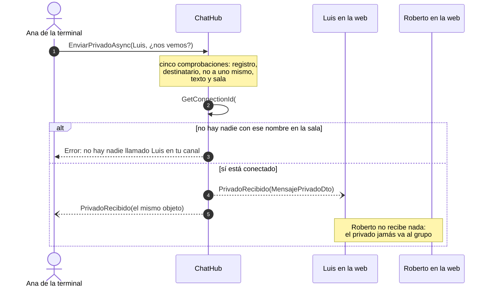
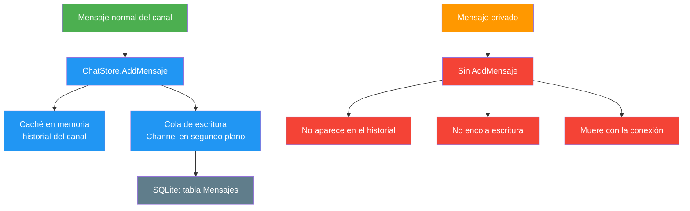
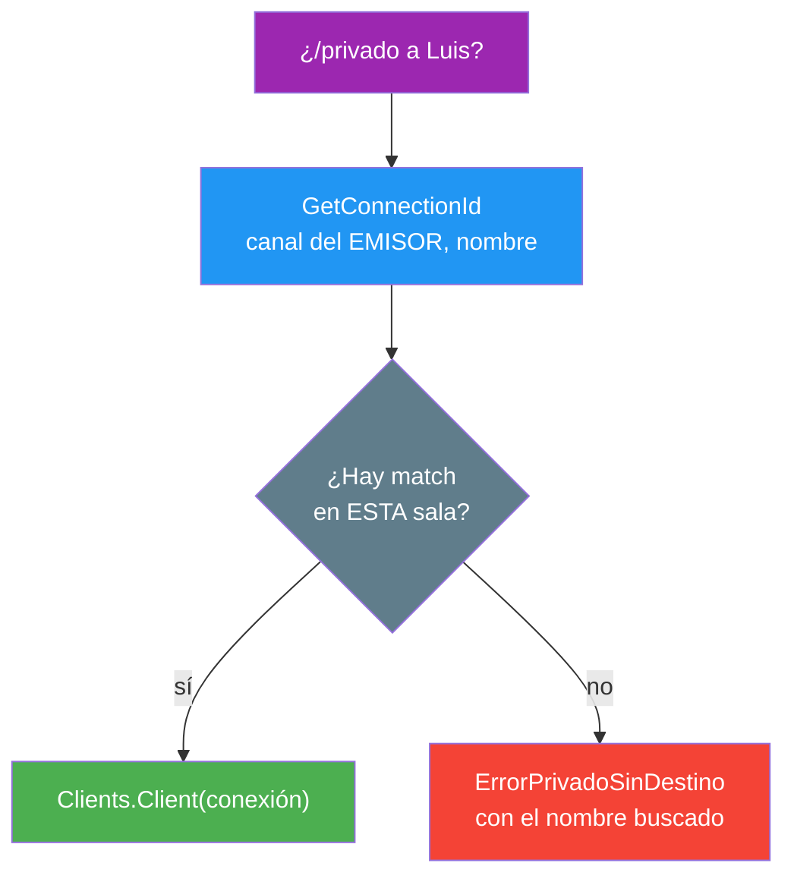
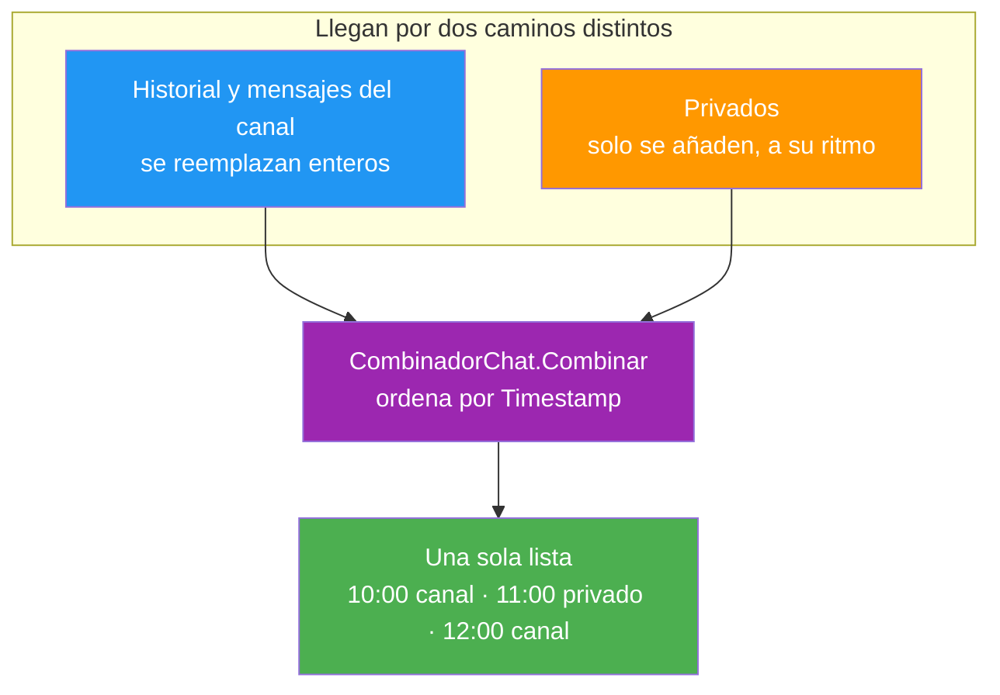

- [5. Los mensajes privados](#5-los-mensajes-privados)
  - [5.1. El viaje de un mensaje privado](#51-el-viaje-de-un-mensaje-privado)
  - [5.2. Por qué no se guarda nada](#52-por-qué-no-se-guarda-nada)
  - [5.3. Encontrar al destinatario: el canal manda](#53-encontrar-al-destinatario-el-canal-manda)
  - [5.4. Una sola cronología para el canal y los privados](#54-una-sola-cronología-para-el-canal-y-los-privados)
  - [5.5. Cómo se pinta en los dos clientes](#55-cómo-se-pinta-en-los-dos-clientes)
  - [5.6. Avisar de que no se guarda sin convertirlo en ruido](#56-avisar-de-que-no-se-guarda-sin-convertirlo-en-ruido)
  - [5.7. El parser como única fuente de verdad](#57-el-parser-como-única-fuente-de-verdad)
  - [5.8. Cómo se prueba](#58-cómo-se-prueba)
  - [5.9. Decisiones, patrones y técnicas del punto](#59-decisiones-patrones-y-técnicas-del-punto)


# 5. Los mensajes privados

> 💡 **Punto de partida:** en el chat de la versión inicial todo es pizarra común: lo que escribe uno lo leen todos los de la sala. En WhatsApp, cuando le escribes a alguien, ese mensaje no lo ve nadie más. ¿Cómo se manda algo que solo puede leer UNA persona concreta... y qué se decide sobre él cuando la gente se va?

En este punto añadimos los mensajes privados: el comando `/privado`, su recorrido hasta los dos implicados y las decisiones que lo sostienen — sobre todo la de que **no se guarda nada**, que no es un detalle de implementación, sino la razón de ser de este punto.

**Objetivos de aprendizaje:**

- Seguir el recorrido completo de una invocación de SignalR, desde el teclado hasta el cliente que la recibe
- Distinguir los destinos de emisión de SignalR (`Group`, `Caller`, `All` y conexión concreta) y elegir el correcto para cada caso
- Tomar una decisión de privacidad (no persistir) y aplicarla en TODAS las capas, no solo en la que cuesta menos
- Componer dos flujos que llegan por caminos distintos con un único criterio temporal
- Reutilizar la lógica común en `Shared` para que los dos clientes no hagan ni digan cosas distintas
- Diseñar avisos que se leen: mostrar la información una vez, en el momento oportuno y en el sitio correcto
- Probar que un mensaje NO llega a nadie más, incluida una prueba con red de verdad

## 5.1. El viaje de un mensaje privado

Todo empieza con una línea que empieza por `/`:

```text
/privado Ana ¿nos vemos en el recreo?
```

El parser — que vive en `Shared`, como todo lo que los dos clientes comparten — la convierte en un `Comando.Privado` con dos cosas: a quién y qué. A partir de ahí, cada cliente la despacha por su propio camino: la terminal en `ProcesarLinea` y la web en su `ProcesadorComandos`. Ambos acaban llamando a `EnviarPrivadoAsync(destinatario, texto)` del hub.

En el servidor se ejecutan cinco comprobaciones, en este orden:

1. ¿Estoy registrado? Si no, el error de siempre: "No estás registrado en el canal, vuelve a conectarte"
2. ¿El destinatario está vacío? → `ErrorPrivadoDestinoVacio`
3. ¿Me lo mando a mí mismo? → `ErrorPrivadoAUnoMismo` (comparando sin distinguir mayúsculas)
4. ¿El texto es válido? → la MISMA validación que un mensaje normal (`ValidarMensaje`)
5. ¿Hay alguien con ese nombre en mi canal? Si no → `ErrorPrivadoSinDestino("Ana")`, con el nombre dentro para que sepas qué escribiste mal

Solo entonces se monta el `MensajePrivadoDto` con su hora en UTC (la regla de oro del proyecto: guardar UTC, convertir solo al presentar) y se emite **a dos conexiones y solo a dos**: primero `Clients.Client(destino)` y después `Clients.Caller`. Este segundo envío es el eco, y sale del MISMO servidor para que las dos partes pinten el mismo objeto con el mismo Id y en el mismo orden, sin que ningún cliente invente su propia fila.



> 📝 **Nota:** el servidor loguea la **longitud** del privado, no su contenido. Es el mismo criterio que con los mensajes del canal: un fichero de log puede leer gente que no debería.

📌 **Ejemplo real:** Discord enruta los mensajes directos por la misma conexión que usa para los servidores, pero el servidor los manda a dos personas concretas y nunca los mete en la transcripción de un canal. Y si te fijas, tampoco forman parte del historial de nadie.

## 5.2. Por qué no se guarda nada

Este es el corazón de la decisión y conviene decirlo claro: **los privados son efímeros a propósito**. No es que se haya dejado para más adelante.

Para entenderlo hay que mirar cómo funciona la persistencia. Todo lo que va a SQLite pasa por `ChatStore.AddMensaje`: esa llamada llena la caché del historial Y encola el mensaje para que un servicio en segundo plano lo escriba en el fichero. Es la única puerta a disco... y `EnviarPrivadoAsync` no la toca.



¿Y si los guardáramos igualmente? Mira lo que pasaría:

1. **No hay autenticación**: lo único que te identifica es el nombre que escribes al entrar
2. Reinicias el servidor, el nick "Ana" queda libre y se lo coge otra persona
3. Esa otra persona, al entrar, heredaría los mensajes privados del anterior

Efímero es, dicho con crudeza, la única opción honesta. Y la decisión se cumple en todos los sitios, no solo en uno: el hub no llama a `AddMensaje`, el historial no los contiene, la cola de escritura no los ve, y la web vacía su lista de privados al pulsar Salir para que el siguiente que use ese navegador no encuentre ni un destello.

> ⚠️ **Advertencia:** si alguna vez decidieras persistirlos, haría falta autenticación de verdad (contraseña o token) ANTES de tocar la base de datos. Sin eso, guardarlos no es "más funcional": es exponer conversaciones ajenas.

> 💡 **Consejo:** en el capítulo de la persistencia el criterio era *se separa por longevidad, no por entidad*. Aquí aparece un segundo criterio que conviene memorizar: **se separa por quién tiene derecho a leerlo**. No todo lo que puede guardarse merece guardarse.

## 5.3. Encontrar al destinatario: el canal manda

La búsqueda parece trivial y no lo es, porque arrastra una decisión heredada de la versión inicial: **los nombres solo son únicos dentro de una sala**. Sin ese filtro, dos personas de clases distintas podrían llamarse igual y los privados se cruzarían.

`GetConnectionId(canal, usuario)` es la operación inversa de `GetConexion`: recorre las conexiones vivas filtrando por canal y comparando el nombre normalizado (sin espacios de más y sin distinguir mayúsculas). De ahí salen tres reglas que se ven en pantalla:

| Situación | Qué pasa |
|-----------|----------|
| El destinatario está en tu sala | Llega el privado a los dos |
| Está en otra sala, o no existe | Error con el nombre buscado: "No hay nadie llamado X conectado en tu canal" |
| Se fue hace un momento | El mismo error: `RemoveUsuario` ya borró su conexión |

📌 **Ejemplo real:** es la regla de las salas de rompecabezas de las videollamaciones. Si Ana está en la sala 2 y tú en la 1, no puedes susurrarle por el pasillo de tu sala: o vas a la suya, o el sistema te dice que ahí no está. Aquí no vas; el servidor te avisa.



## 5.4. Una sola cronología para el canal y los privados

Aquí está el problema que nadie ve hasta que lo ejecutas: **el canal y los privados llegan por caminos distintos**.

- El canal llega REEMPLAZADO: un historial completo (mensajes viejos incluidos) cada vez que entras o cambias de sala
- Los privados llegan a SU ritmo y solo se añaden: no hay historial que cargar porque no existe ninguno

Si los concatenaras tal cual, un privado de las 10:15 quedaría por DEBAJO de un mensaje del canal de las 12:00, porque llegaría después. La solución es ordenarlos por `Timestamp`, y como los DOS clientes necesitan exactamente el mismo resultado, esa lógica vive en `Shared`: `CombinadorChat.Combinar`. Una sola implementación, testeada una vez, compartida por la terminal y la web.



El resultado no es un tipo inventado en los DTOs (objetos de transferencia de datos), sino `FilaChat`: un registro mínimo que dice *esta fila es un privado* o *esta fila es un mensaje del canal*, con el valor en su sitio. Basta para ordenar y deja que cada cliente decida cómo pintarla.

Tres detalles que no son pequeños:

- `OrderBy` es **estable**: si un privado y un mensaje llevan la misma hora, se conserva el orden en que se añadieron (el canal primero), así que dos cosas del mismo segundo no se dan la vuelta sin motivo
- Si una de las dos listas está vacía (lo habitual al entrar), ni siquiera se ordena: se devuelve la otra tal cual
- En la terminal, `/limpiar` cuenta sobre la vista COMBINADA: si no, los privados seguirían en pantalla después de limpiar

> 💡 **Consejo:** cuando dos flujos tienen que convivir en pantalla, busca primero un criterio de orden único y ponlo en el sitio compartido. Ordenar en cada cliente "a su manera" es la forma más rápida de que la terminal y la web enseñen cosas distintas de la misma charla.

## 5.5. Cómo se pinta en los dos clientes

La regla estética es que **un privado no cambia la forma de leer el chat**: misma fila que un mensaje normal, mismos elementos, y solo un candado rosa de más.

**Terminal** (`VistaChat`): la fórmula de pintado vive en una clase aparte, estática y pura — para poder probarla sin abrir la ventana y para que la usen los DOS modos de entrada, el lienzo en vivo y la tubería de pruebas. Una fila privada es: hora, el 🔒 en fucsia, el contexto `para Ana` o `de Ana`, las iniciales del emisor y el texto, con los corchetes escapados. Lo último no es capricho: si alguien escribe `[rojo]` a mano y no lo escapas, Spectre lo interpreta como formato y se tiñe la pantalla entera.

**Web** (`PrivadoItem`): reutiliza la estructura de `MensajeItem` — nunca burbujas, que Discord y Slack son filas — y añade `.privado-marca` con el candado y el contexto. El "para/de quien" se decide comparando el emisor con mi nombre, que la fila lee de la store: el DTO no lo trae, y no lo trae a propósito.

Y aquí aparece la diferencia de plataforma. En la terminal hay que **teclear** `/privado Ana ...`, pero en la web se puede **hacer clic en la lista de conectados**. Los componentes no se hablan entre sí (convención del proyecto: hablan con la store), así que el clic no va a la caja de texto: llama a `Store.PrepararPrivado("Ana")` y la caja, que está suscrita, rellena la línea con el comando y coloca el foco para que solo falte escribir el mensaje. El clic en uno mismo no hace nada: el servidor lo rechazaría, y mejor no abrir siquiera la puerta.

📌 **Ejemplo real:** en Slack y en Discord, pasar el ratón por un nombre de la lista y elegir "mensaje directo" hace exactamente esto: prepara el destino y te deja escribir. La diferencia aquí es que no hay un canal aparte que abrir: el privado sigue siendo parte de la misma sala, y por eso la web pone un chip sobre tu propia caja en lugar de cambiar de pantalla.

## 5.6. Avisar de que no se guarda sin convertirlo en ruido

El aviso existe porque es una decisión que conviene conocer... pero enseñarlo mal es peor que no enseñarlo. Hay dos trampas clásicas:

- Repetirlo en **cada envío**: a la segunda vez nadie lo lee, y en la terminal cada línea extra empuja mensajes reales fuera de la pantalla
- Esconderlo solo en la ayuda: quien no teclea `/ayuda` nunca se entera

La regla aplicada fue: **una sola vez, en el momento en que abres un privado**. El texto vive en `AyudaComandos.NotaPrivados`, una constante de `Shared`, para que los dos clientes digan literalmente lo mismo:

```text
Los privados son efímeros: no se guardan en el servidor ni salen en el historial
```

- **Terminal**: sale en gris con el PRIMER privado de la sesión — el que envíes o el que te llegue, da igual — y no vuelve a aparecer. Se añade a la salida de abajo del lienzo y no al scroll, para no expulsar mensajes
- **Web**: sale como nota gris bajo el campo de texto **mientras la línea va a ser un privado**, incluso antes de que exista el destinatario escrito (que es justo cuando estás decidiendo si mandarlo), y desaparece en cuanto la línea vuelve a ser un mensaje normal. Además, cada fila `🔒` lleva la nota en el `title`, así que es descubrible sin costar una línea más
- **Ayuda**: la fila de `/privado` lo dice a su manera: "Mensaje privado a alguien de tu canal (efímero, no se guarda)"

> 💡 **Consejo:** pregúntate siempre *¿cuándo necesita leer esto alguien por primera vez?* Casi nunca la respuesta es "en cada mensaje". Presenta la información en el momento oportuno y déjala ahí.

## 5.7. El parser como única fuente de verdad

Los alias del comando — `/privado`, `/mp` y `/dm` — están en UNA lista, `ParserComandos.Privados`, y de ahí salen tres preguntas distintas:

| Pregunta | Método | Quién la necesita |
|----------|--------|-------------------|
| ¿Qué es esta línea? | `Parse` | Los dos clientes, para despacharla |
| ¿Va a ser un privado? | `EmpiezaPrivado` | La web, para la nota mientras teclea |
| ¿A quién le estoy escribiendo? | `DestinatarioDePrivado` | La web, para el chip `Privado a Ana` y su ✕ |

El tercer método merece explicarse porque nació de un fallo real durante el desarrollo: el chip se calculaba con `Parse`, que devuelve *comando inválido* mientras solo has escrito el destino — le falta el texto —, así que el chip no aparecía hasta que la línea estaba completa y, mientras tanto, **no había ✕ con el que cancelarlo**. La solución fue preguntarle directamente al parser por el destinatario, antes de que el comando sea válido.

> ⚠️ **Advertencia:** la tentación es consultar la lista de alias desde el componente, o peor, duplicarla "para no complicarse". No lo hagas: si mañana añades un cuarto alias, los tres sitios se enteran porque leen la MISMA lista. Es la diferencia entre un código que crece y un código que se pudre.

## 5.8. Cómo se prueba

La privacidad es el tipo de requisito que **solo se prueba por el lado de "quién NO lo recibe"**, así que la suite ataca ahí:

| Capa | Qué se comprueba |
|------|------------------|
| `Shared` | El parser (alias, texto ausente, destino ausente), el combinador (orden, estabilidad y que no se pierde nada de ninguna lista) y los tres mensajes de error |
| Hub con dobles de SignalR | Quién recibe... y quién NO: un tercero de tu misma sala, alguien de otra sala, dos homónimos repartidos por canales y el error si te lo mandas a ti mismo |
| Regresiones de privacidad | El privado no aparece en `GetHistorial` NI en la cola de escritura: se usa el mismo store con repositorio que el de producción y se contrasta con que un mensaje normal del canal SÍ se encola |
| Terminal y web | El markup de cada fila (para/de, hora local, escapado de corchetes) y los componentes (chip, nota, clic en la lista, orden de la mezcla) |
| **Red de verdad** | Kestrel escuchando en un puerto aleatorio y TRES clientes SignalR reales: el DTO se serializa, el nombre del evento viaja, llega a los dos implicados... y a los otros dos no les llega NADA |

> 💡 **Consejo:** en la prueba de red, espera con tiempo máximo (`WaitAsync(5 s)`), nunca "hasta que llegue". Un test que se cuelga no dice qué falló; uno que falla a los cinco segundos te dice exactamente qué no llegó.

## 5.9. Decisiones, patrones y técnicas del punto

Este punto parece de interfaz y es, sobre todo, de diseño de sistema. Estas son las decisiones que lo sostienen:

| Patrón o técnica | Dónde vive en AulaChatNet | La lección transferible |
|------------------|---------------------------|-------------------------|
| Efímeros a propósito | Los mensajes privados no se persisten jamás | Que algo no se guarde es una decisión de diseño, con su argumento: privacidad y tamaño |
| El canal manda | Solo puedes enviar a alguien de tu propio canal | Autoriza con lo que ya sabes (tu registro) y nunca con parámetros que el cliente pueda falsear |
| Una sola cronología | `FilaChat` mezcla público y privado ordenado por hora | Los clientes no inventan el orden: un único criterio, decidido en servidor |
| Eco al emisor | El servidor envía el mismo objeto al destino y a quien lo escribe | Misma identidad y misma hora en las dos pantallas, sin negociar nada |
| Aviso integrado en la fila | El "esto no se guarda" es un mensaje de sistema en la propia conversación | Informa donde se vive la experiencia; no conviertas un aviso en un diálogo modal |
| Parser único | `/privado` y sus alias viven en `Shared` | Añadir un comando es una línea, y los dos clientes lo entienden sin tocarlos |
| Validación en dos capas | El cliente valida con el parser; el servidor, con su registro | La validación del cliente es comodidad; la del servidor es la que vale |

---

**Resumen del punto:**

| Decisión | Por qué |
|----------|---------|
| `/privado` vive en `Shared` con sus alias y sus errores | Los dos clientes entienden y explican lo mismo |
| El hub emite a `Clients.Client` + `Clients.Caller` | Cuarto destino de SignalR del proyecto: dos conexiones concretas, jamás el grupo |
| El destinatario se busca en el canal del emisor | Los nombres solo son únicos por sala |
| **Sin `AddMensaje`, sin SQLite, sin historial** | Sin autenticación, persistirlos expondría mensajes ajenos al siguiente que coja tu nombre |
| `CombinadorChat` en `Shared` | Una sola cronología en la web y en la terminal |
| El aviso, una vez y en el momento oportuno | Lo que se repite deja de leerse |
| El clic en la lista va por la store | Los componentes no se hablan entre sí |
| Pruebas por el lado de "quién NO lo recibe" | La privacidad solo se prueba con la lista de los que no deben verlo |

**Anterior:** [4. La persistencia con SQLite](04-persistencia.md) · **Índice:** [README](../README.md)
