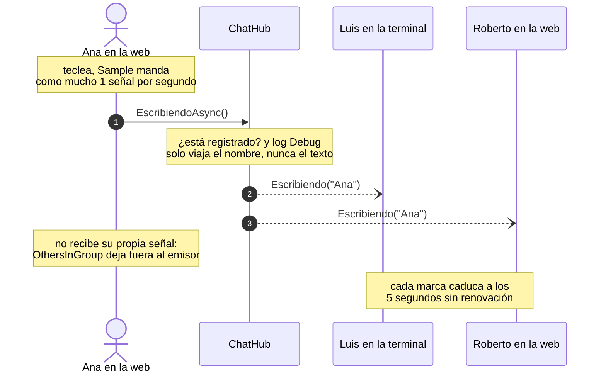
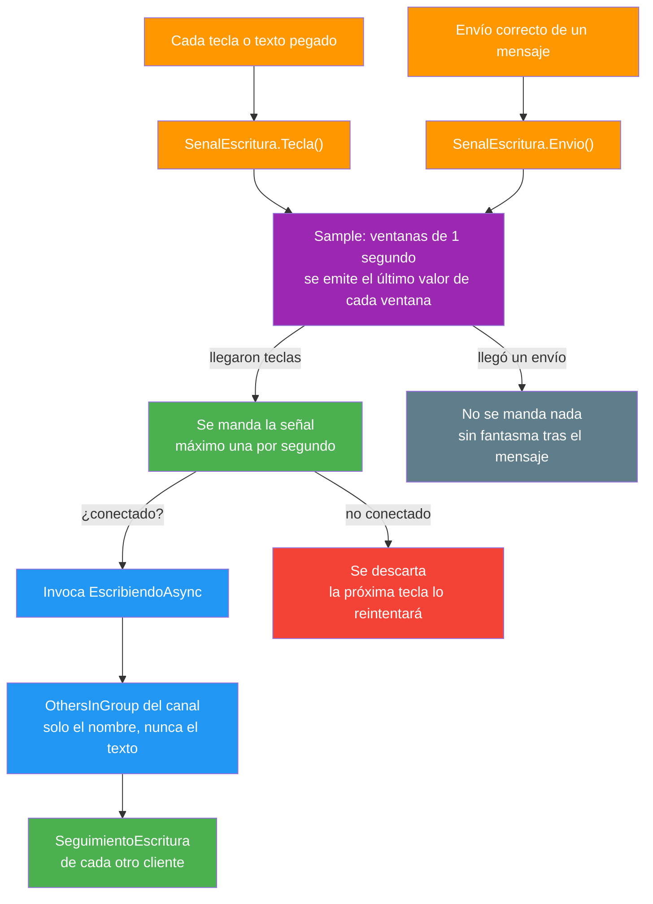
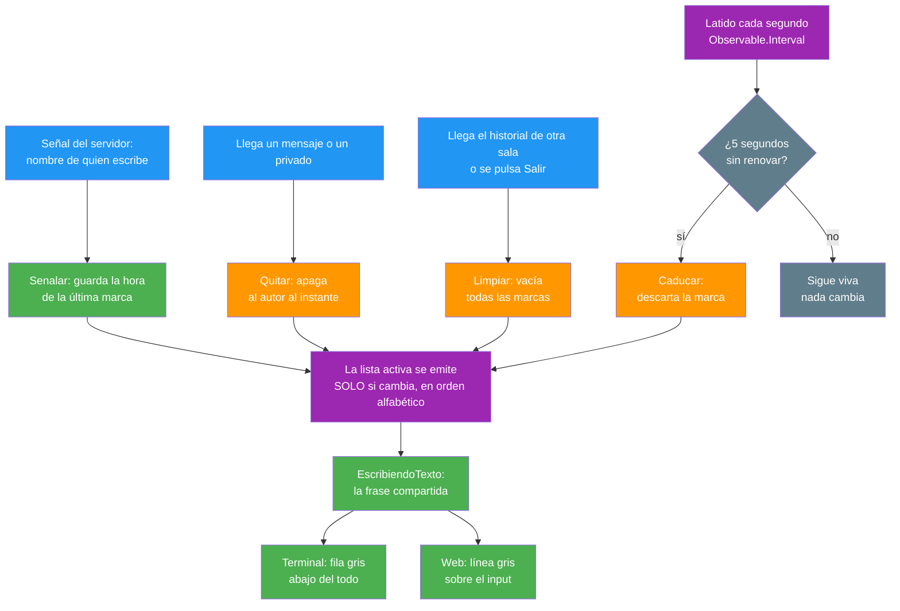

- [6. La escritura en vivo](#6-la-escritura-en-vivo)
  - [6.1. El viaje de una señal de escritura](#61-el-viaje-de-una-señal-de-escritura)
  - [6.2. Muestrear en vez de esperar](#62-muestrear-en-vez-de-esperar)
  - [6.3. El quinto destino de SignalR](#63-el-quinto-destino-de-signalr)
  - [6.4. El servidor no recuerda nada](#64-el-servidor-no-recuerda-nada)
  - [6.5. La caducidad vive en cada cliente](#65-la-caducidad-vive-en-cada-cliente)
  - [6.6. Apagar una señal en el momento exacto](#66-apagar-una-señal-en-el-momento-exacto)
  - [6.7. Cómo se pinta en los dos clientes](#67-cómo-se-pinta-en-los-dos-clientes)
  - [6.8. Cómo se prueba](#68-cómo-se-prueba)
  - [6.9. Resumen del punto](#69-resumen-del-punto)

# 6. La escritura en vivo

> 💡 **Punto de partida:** en el chat de la Fase 1, si alguien se queda tecleando una respuesta larga, tú no te enteras: el mensaje llega de golpe o no llega. En WhatsApp, Discord o Slack, mientras la otra persona escribe ves "está escribiendo...". ¿Cómo se consigue ese aviso SIN que el servidor lleve la cuenta de nadie, SIN mandar una llamada al servidor por cada tecla y SIN que viaje jamás lo que se está escribiendo?

En este punto añadimos el indicador de escritura de la Fase 3.2: la señal que nace en cada tecla, su recorrido hasta el hub y la caducidad que apaga sola cada marca. Como en los privados, lo interesante no es la línea que aparece abajo, sino **las decisiones** que la sostienen: muestrear en vez de esperar, reenviar sin guardar, caducar en cada cliente y apagar en el momento exacto.

**Objetivos de aprendizaje:**

- Distinguir `Throttle`/`Debounce` de `Sample` y elegir el operador según QUÉ se quiere conseguir, no según lo que costaría menos
- Conocer los cinco destinos de emisión de SignalR y elegir `OthersInGroup` para que nadie se vea escribiendo a sí mismo
- Diseñar estado efímero que NO necesita limpieza en el servidor: la caducidad vive en quien lo muestra
- Inyectar un reloj (`IScheduler`) y probar el tiempo con un reloj virtual, sin esperas reales en los tests
- Apagar señales en los momentos exactos para evitar parpadeos y fantasmas
- Compartir frase y orden en `Shared` para que la terminal y la web digan exactamente lo mismo
- Probar el tiempo con reloj virtual y el protocolo con una prueba de red de verdad

## 6.1. El viaje de una señal de escritura

El recorrido empieza en el editor de cada cliente y termina en la pantalla de los demás. La terminal, en su bucle de teclas, llama a `cliente.SenalarEscritura()` justo después de insertar cada carácter imprimible. La web usa `@oninput` en el cuadro de texto: Blazor no deja tener dos manejadores sobre el mismo evento, así que el `@bind` de toda la vida se sustituyó por `value` + un manejador manual que hace las dos cosas — guardar el texto y avisar a la store — y de paso cubre pegar y dictar, que son cambios de texto sin tecla que por un `onkeydown` no saldrían.

Ambos caminos acaban en lo mismo: `SenalEscritura.Tecla()`, de `Shared`. De ahí en adelante el cliente ya no decide nada:

1. El muestreo de Rx manda **como mucho una señal por segundo** (ver 6.2)
2. `EnviarSenalEscribiendoAsync` comprueba que la conexión está en verde y, en silencio, invoca `ChatHubMetodos.Escribiendo` (= `"EscribiendoAsync"`). Si no hay conexión, no pasa nada: la próxima tecla lo reintentará
3. El hub valida el registro —con el mismo error de siempre: "No estás registrado en el canal, vuelve a conectarte"—, loguea a nivel Debug y reenvía
4. Cada OTRO cliente recibe `ChatHubEventos.Escribiendo` (= `"Escribiendo"`) con **un solo dato: el nombre**
5. Su `SeguimientoEscritura` renueva la marca y, si la lista cambia, emite
6. El cliente pinta la frase que arma `EscribiendoTexto` desde la lista recibida

> 📝 **Nota:** `EscribiendoAsync` devuelve `string?` como casi todos los métodos del hub, por la regla de la casa... pero aquí el cliente descarta la respuesta: es un aviso ornamental, no una operación con resultado que notificar.

📌 **Ejemplo real:** en Discord el indicador no sale en la lista de conectados sino pegado a la caja de texto, con la frase "Ana está escribiendo..." y tres puntos. En WhatsApp desaparece a los pocos segundos de que la otra persona deja de teclear. El truco de ambos, que este proyecto reproduce, es que **nunca se entera nadie de qué se está escribiendo**: solo de que alguien lo está haciendo.

## 6.2. Muestrear en vez de esperar

Este es el error clásico de este diseño y conviene verlo de frente: la tentación es usar `Throttle` o `Debounce`, que es lo que se usa para "no saturar" un buscador. Pero esos operadores **esperan a que dejen de llegar eventos**: mientras la persona teclea seguido no emiten nada, y el aviso solo saldría cuando ya se ha dejado de escribir — justo lo contrario de lo que se busca.

| | `Throttle` / `Debounce` | `Sample` |
|---|---|---|
| ¿Cuándo emite? | Cuando se PARA de recibir eventos | Una vez por ventana, mientras lleguen eventos |
| Durante una ráfaga larga | No emite NADA | Una señal por ventana |
| ¿Cuándo se ve el aviso? | Cuando ya has dejado de escribir | Mientras escribes |

`Sample` se queda con el **último valor de cada ventana** de un segundo. Si durante la ventana llegaron teclas, emite una vez; si no llegó nada, no emite. La primera señal sale, como mucho, un periodo después de la primera tecla; después, una por periodo mientras sigas tecleando, y en cuanto te paras, se para sola — quien deja de señalar caduca a los cinco segundos.

Y queda un borde que el propio operador resuelve: el último valor de la ventana puede ser un **envío** (`SenalEscritura.Envio()`). Si ese fuera el valor que se emite, no se manda nada. Sin ese corte, el mensaje saldría en la pantalla ajena y un instante DESPUÉS llegaría la señal de la ventana en curso, reponiendo al autor en la lista como "sigue escribiendo" con el mensaje ya visible: un fantasma que se ve en todos los chats mal hechos.

> 💡 **Consejo:** elige el operador por el COMPORTAMIENTO que quieres observar, no por el nombre que recuerdes. Pregúntate "¿qué debe pasar mientras la gente sigue haciendo esto?" y después "¿qué debe pasar cuando para?". Con esas dos respuestas, `Sample` frente a `Throttle` se decide solo.

Además, por coherencia con todo lo que se ha decidido en este proyecto: **el señal no viaja solo el nombre**, nunca el texto. Una pulsación de teclas no es un mensaje — no es historia de nadie, no se guarda y no se cuenta.

## 6.3. El quinto destino de SignalR

Hasta ahora el proyecto usaba cuatro formas de emitir con SignalR. La Fase 3.2 añade la quinta:

| Destino | Quién lo recibe | Para qué vive en este proyecto |
|---------|-----------------|--------------------------------|
| `Clients.All` | Todos los conectados | Estadísticas globales |
| `Clients.Group(canal)` | El canal entero | Mensajes, avisos y lista de conectados |
| `Clients.Caller` | Solo el que pregunta | El historial al entrar o al cambiar de sala |
| `Clients.Client(conexión)` | Dos conexiones concretas | El mensaje privado y su eco |
| `Clients.OthersInGroup(canal)` | El canal MENOS el que manda | "Está escribiendo..." |

`OthersInGroup` es justo lo que hace falta aquí: SignalR ya se encarga de **excluir al emisor**, así que nadie ve su propio nombre como "está escribiendo...". Con `Group` habría que filtrar el propio mensaje en CADA cliente, que es una comprobación repartida — y olvidarse de una de las pantallas es exactamente lo que produce el "estás escribiendo tú mismo" que se ve en algunos chats por ahí.

Y como el resto, es emisión **al grupo del canal del emisor**: quien está en otra sala no oye nada, porque en la suya nadie está escribiendo. Una sola llamada, sin parámetros de lista: el servidor no sabe ni le importa quiénes están escuchando.

## 6.4. El servidor no recuerda nada

De las tres formas de estado que podría tener esto, el servidor no tiene NINGUNA:

- **Sin diccionario de quién escribe**: no hay tabla, caché ni campo donde apuntar "Ana escribe desde las 10:15:03"
- **Sin temporizador propio**: el único reloj de caducidad corre dentro de cada cliente
- **Sin `AddMensaje`, sin texto**: la señal no entra en el historial ni en la cola de escritura de SQLite — y jamás se envía lo que se está escribiendo

Lo único que hace el hub es comprobar el registro y reenviar. El log de la señal es `LogDebug` **a propósito**: una señal por segundo y persona, con el nivel Information por defecto, llenaría el fichero de log en minutos con información que nadie va a querer leer.

📌 **Ejemplo real:** es el mismo criterio de los mensajes privados de la Fase 3.1 (ver [`05-mensajes-privados.md`](05-mensajes-privados.md)): **estado que necesita limpieza, es estado que se pudre**. Si el servidor guardara quién escribe, haría falta un temporizador por conexión, una limpieza al desconectar y —lo que siempre se olvida— una limpieza por si el proceso se cae a mitad de frase. Con la caducidad en el cliente, nada de eso existe: el que se desconecta a mitad de una palabra no deja rastro en nadie, y sus marcas mueren solas en las pantallas que las tenían, a los cinco segundos.

> ⚠️ **Advertencia:** no confundas "el servidor no guarda ESTO" con "el servidor no guarda nada": la presencia y la unicidad de nicks siguen en memoria desde la Fase 1 y el historial en SQLite desde la Fase 2. La pregunta correcta es siempre **¿esto es información con valor que alguien tiene derecho a recuperar más tarde?** Una señal de "sigue escribiendo" no lo es.

## 6.5. La caducidad vive en cada cliente

`SeguimientoEscritura` (vive en `Shared`, para que los dos clientes se comporten igual y se pruebe una sola vez) es quien lleva la cuenta local. Por dentro tiene:

- Un **diccionario** de nombre → última hora en que señaló, comparando sin distinguir mayúsculas — en un canal dos personas no pueden llamarse "Ana" y "ana", que eso ya lo impide el registro
- Un `BehaviorSubject<IReadOnlyList<string>>` con la lista de activos, al que se llama **`Activos`** (observable, para la web) y **`Vista`** (el último valor, para que la TUI de la terminal lo repinte sin suscribirse)
- Un **latido** (`Observable.Interval` de 1 segundo) que descarta a quien lleve 5 segundos o más sin renovar. Con la lista vacía sale sin mirar: es el caso normal durante toda la vida de la store

Tres detalles que no son pequeños:

- **La lista solo emite si cambia**: renovar la marca de quien ya estaba no es noticia, y una emisión sin cambio es un repintado en balde
- **El orden es alfabético** (sin distinguir mayúsculas): si fuera el de llegada, los nombres bailarían cada vez que alguien renueve
- **Un candado protege el diccionario**: lo tocan a la vez los eventos de SignalR y el latido del reloj, que corren en distinto hilo. La emisión del observable se hace TAMBIÉN dentro del candado, para que los suscriptores reciban los cambios en el mismo orden en que ocurrieron

Hay una última decisión de diseño que vale por varias líneas de código: **el reloj es un `IScheduler` de Rx que se inyecta por constructor**. En producción es el de la máquina; en los tests, un `TestScheduler` que avanza el tiempo al instante. Por eso la suite puede comprobar que algo caduca a los 5 segundos sin esperar ni un milisegundo real.

> 💡 **Consejo:** el tiempo es una dependencia como cualquier otra. Si tu código lee el reloj directamente (`DateTime.UtcNow` por todas partes), estás atado al reloj de tu portátil en cada test. Pásalo por constructor y los tests dejan de dormir.

## 6.6. Apagar una señal en el momento exacto

Si solo se usara la caducidad, el indicador funcionaría... pero con parpadeos molestos. Hay cuatro momentos en los que apagar antes es mejor que esperar:

| Momento | Qué se hace | Por qué no se espera a caducar |
|---------|-------------|--------------------------------|
| Llega un mensaje del canal o un privado | `Quitar(autor)` al instante | Quien acaba de hablar ya no está escribiendo: cinco segundos más sería un fantasma en pantalla |
| Llega el historial de otra sala | `Limpiar()` | Nadie de la sala anterior debe asomar en la nueva ni un instante |
| Se envía un mensaje con éxito | `SenalEscritura.Envio()` corta la ventana en curso | Sin eso, la señal posterior repondría al autor con el mensaje ya visible |
| Web: se pulsa Salir | `Limpiar()` | La sesión siguiente de ese navegador no hereda marcas de la anterior |

Dos apuntes:

- Los mensajes de sistema ("X se ha unido al canal") **no apagan a nadie**: `Quitar` de un nombre que no está en el diccionario no hace nada. Se puede llamar siempre, sin comprobaciones previas
- En la terminal, cambiar de sala con `/canal` llega —como en la web— por `HistorialRecibido`, así que comparte el mismo camino de `Limpiar()`

> 💡 **Consejo:** las dos apagadas (mensaje y envío) cubren el mismo agujero desde los dos lados — el tuyo y el ajeno —. Cuando un estado lo comparten varias pantallas, apúntalo en los puntos donde ESE estado deja de ser cierto, no en el sitio donde se pinta.

## 6.7. Cómo se pinta en los dos clientes

La frase vive en `Shared`, en `EscribiendoTexto.Descripcion`, y con eso basta:

| Personas | Frase |
|----------|-------|
| Ninguna | Cadena vacía (no se pinta NADA) |
| Una | `Ana está escribiendo...` |
| Varias | `Ana, Bruno están escribiendo...` |

Si la frase se montara en cada cliente, la terminal y la web podrían divergir — y la conjugación (está/están) es el sitio exacto donde eso se nota. El emoji, el color y el escapado sí los pone cada cliente.

**Terminal** (`VistaChat.LineaEscribiendoMarkup`): gris, sin adornos y con `Markup.Escape` sobre la frase — un nombre con corchetes, tratado por Spectre como formato, teñiría la línea de un color que nadie eligió. Es la **última fila de la zona de mensajes**, justo encima del pie, y solo se añade si hay alguien (una fila vacía en balde empujaría mensajes fuera de la pantalla). El repintado lee `cliente.VistaEscribiendo` en el bucle de refresco. Y en **modo tubería esa zona ni se construye**: esa entrada no tiene teclas que detectar, así que tampoco se señala.

**Web** (`CajaMensaje`): la componente se suscribe a `Store.Escribiendo` —junto a sus otras dos suscripciones, las tres se liberan en `Dispose`— y pinta la línea `.caja-escribiendo` dentro de la caja, **encima del input**, en gris y cursiva para que se lea como un estado y no como un mensaje. Desaparece sola cuando la store vacía la lista.

📌 **Ejemplo real:** Discord y Slack ponen la línea justo sobre la caja de entrada, nunca en la lista de conectados ni en la cabecera: es información del "ahora mismo", y lo que es del ahora no se acumula en un sitio fijo. Además, solo se ve mientras dura, así que no hay nada que cerrar ni ninguna X que pulsar.

## 6.8. Cómo se prueba

Lo interesante de esta funcionalidad es que se parte por la mitad: el TIEMPO en un lado y el PROTOCOLO en el otro. La suite ataca cada uno por su lado:

| Capa | Qué se comprueba |
|------|------------------|
| `SeguimientoEscritura` con reloj virtual | Primera marca, que no se duplica ni distingue mayúsculas, orden alfabético, renovación del plazo, caducidad pasados 5 s, `Quitar` y `Limpiar` — y que SOLO se emite cuando la lista cambia |
| `SenalEscritura` con reloj virtual | Una señal por ventana con teclas, nada sin teclas, primera señal sin pasar un periodo, que un envío corta la ventana — la misma o la siguiente — y que una tecla posterior vuelve a señalar |
| `EscribiendoTexto` | Frase vacía, singular y plural |
| Hub con doble de SignalR | Que sin registro devuelve el error sin emitir nada, que la emisión sale SOLO a `OthersInGroup` (el emisor no aparece), que no llega a quien está en otro canal y que NO toca el historial ni la cola de escritura |
| **Red de verdad** | Kestrel escuchando en un puerto aleatorio y TRES clientes SignalR reales: la señal llega al resto del canal... y al que escribe no le llega |
| Terminal | La fila en markup gris: vacía sin nadie, singular, plural y nombres con corchetes dejados inofensivos |
| Web | La línea se pinta con la frase, desaparece cuando la lista se vacía, no pinta nada con la lista vacía y cada `oninput` avisa a la store |

> 💡 **Consejo:** la prueba de red vuelve a ser la que más vale: con dobles puedes equivocarte sobre QUÉ emite el hub, pero nunca sobre lo que la otra punta del WebSocket recibe de verdad. Y se espera con tiempo máximo (`WaitAsync(5 s)`), nunca "hasta que llegue": un test que se cuelga no dice qué falló; uno que falla a los cinco segundos te dice exactamente qué no llegó.

## 6.9. Resumen del punto

| Decisión | Por qué |
|----------|---------|
| `Sample` de 1 s en vez de `Throttle`/`Debounce` | El aviso debe salir mientras se escribe, no al parar |
| El servidor solo reenvía: sin estado, sin texto, sin `AddMensaje` | Nadie tiene nada que limpiar y nada sensible viaja ni se guarda |
| `Clients.OthersInGroup(canal)`, el quinto destino | El canal entero menos el emisor, sin comprobaciones repartidas por los clientes |
| Caducidad de 5 s en CADA cliente (`SeguimientoEscritura`) | Un desconectado a mitad de frase no deja rastro en nadie |
| `Quitar` con cada mensaje y `Envio` al enviar | Sin parpadeos ni fantasmas tras el mensaje |
| `HistorialRecibido` y Salir llaman a `Limpiar()` | Lo de la sala anterior no asoma en la nueva ni un instante |
| Reloj `IScheduler` inyectable | Probar el tiempo con un reloj virtual, sin esperas reales |
| Frase, orden y caducidad en `Shared` | La terminal y la web dicen, pintan y olvidan lo mismo |
| Log de la señal a nivel Debug | Una señal por segundo y persona no debe llenar el log |
