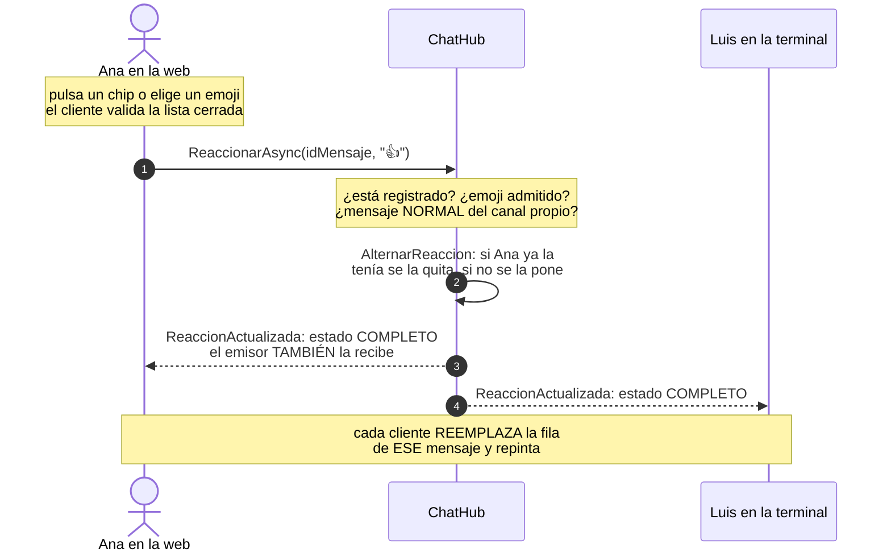
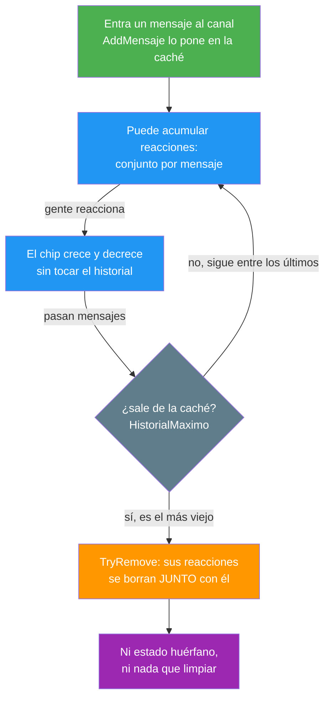

- [7. Las reacciones](#7-las-reacciones)
  - [7.1. El viaje de un emoji](#71-el-viaje-de-un-emoji)
  - [7.2. Una lista cerrada de emoji](#72-una-lista-cerrada-de-emoji)
  - [7.3. El servidor es la fuente de verdad](#73-el-servidor-es-la-fuente-de-verdad)
  - [7.4. Un interruptor, no una suma](#74-un-interruptor-no-una-suma)
  - [7.5. Las reacciones se van con su mensaje](#75-las-reacciones-se-van-con-su-mensaje)
  - [7.6. Cómo se pinta en los dos clientes](#76-cómo-se-pinta-en-los-dos-clientes)
  - [7.7. El comando /reaccion](#77-el-comando-reaccion)
  - [7.8. Cómo se prueba](#78-cómo-se-prueba)
  - [7.9. Resumen del punto](#79-resumen-del-punto)

# 7. Las reacciones

> 💡 **Punto de partida:** en cualquier chat moderno, bajo cada mensaje hay un puñadito de emoji con un número al lado: 👍 3, ❤️ 1. Pulsas el tuyo y aparece; vuelves a pulsar y se va. Parece lo más sencillo del mundo... hasta que dos personas reaccionan al MISMO tiempo y la cifra se desincroniza, o hasta que el mensaje envejece y sus reacciones quedan flotando sin dueño. ¿Cómo se mantiene el tablero de chips igual en todas las pantallas sin contadores que se peleen y sin que nadie guarde lo que ya no significa nada?

En este punto cerramos la Fase 3 con las reacciones: la lista cerrada de emoji, el alternar del servidor y los chips de los dos clientes. Como en los puntos anteriores, lo que enseña no es el chip, sino **las decisiones**: conjuntos en vez de contadores, estado completo en vez de diferencias, y una pieza de estado que muere junto con su mensaje.

**Objetivos de aprendizaje:**

- Elegir conjuntos en vez de contadores para estado que se alterna: `TryAdd`/`TryRemove` no se pisen, un contador sí
- Mantener la fuente de verdad en el servidor y que el cliente NO calcule nada: pintar lo que llega, punto
- Emitir el estado COMPLETO del mensaje, no el "acabo de añadir uno": así nadie se desincroniza aunque pierda un evento
- Incluir al emisor en la emisión, a diferencia de "está escribiendo...": el chip propio debe verse en tu pantalla
- Normalizar emoji (la misma carita tiene varias formas en Unicode) con una lista cerrada que el servidor vuelve a validar
- Amarrar la vida del estado al de su mensaje: lo que sale de la caché se lleva sus reacciones
- Aprovechar el parser y el catálogo de ayuda ya existentes para que `/reaccion` nazca con menú, ayuda y dos clientes

## 7.1. El viaje de un emoji

El gesto nace en dos sitios distintos y acaba en el mismo camino. En la web, el ratón pasa por la fila, asoma el "+" y el selector ofrece los seis emoji admitidos; también se puede pulsar un chip existente. En la terminal, el comando `/reaccion <emoji>` apunta al último mensaje de una persona del canal. A partir de ahí, el cliente ya no decide nada:

1. El cliente valida el emoji contra la lista cerrada de `Shared` y elige el mensaje objetivo (el del chip pulsado, o el último normal del canal)
2. Invoca `ChatHubMetodos.Reaccionar` (= `"ReaccionarAsync"`) con el Id del mensaje y el emoji
3. El hub valida el registro —con el error de siempre—, vuelve a validar el emoji y comprueba que el mensaje es NORMAL y del canal propio del emisor
4. `AlternarReaccion` del store calcula el estado nuevo: si quien reacciona ya tenía ese emoji, se la quita; si no, se la pone
5. El hub emite `ChatHubEventos.ReaccionActualizada` a `Clients.Group(canal)` con el estado COMPLETO del mensaje, **emisor incluido** (a diferencia de la señal de escritura, aquí el gesto propio SÍ se ve en tu pantalla)
6. Además, al que invocó se le devuelve por `ReaccionesRecibidas` el snapshot de TODO el canal, por si entraba en el hueco entre el historial y el alta
7. Cada cliente REEMPLAZA la entrada de ese mensaje en su mapa de reacciones y repinta: no suma, no resta, no calcula nada

📌 **Ejemplo real:** en Discord, si te quedas sin conexión mientras reaccionas, al volver los chips siguen donde estaban: el cliente no "recuerda" su propio clic, pinta lo que el servidor dice que hay. Ese es exactamente el contrato de este punto: **el cliente sugiere, el servidor decide y todos pintan lo mismo**.

## 7.2. Una lista cerrada de emoji

La primera decisión es de seguridad y de sanidad: **la lista de emoji es cerrada**. El servidor admite exactamente seis:

| Emoji | Código |
|-------|--------|
| 👍 | Pulgar arriba |
| ❤️ | Corazón |
| 😂 | Cara de risa |
| 😮 | Cara de sorpresa |
| 😢 | Cara llorando |
| 😡 | Cara enfadada |

¿Y qué pasa si alguien escribe `/reaccion 🔥`? El parser acepta cualquier texto, pero `EmojisReaccion.Canonico()` devuelve `null` y el cliente avisa mostrando la lista, sin siquiera tocar la red. El servidor vuelve a validar igual, porque de la red llega lo que quiera: **la validación es en dos capas, la del cliente es comodidad, la del servidor es la que vale**.

La función `Canonico` hace algo más fino que mirar la lista: primero normaliza. En Unicode, la misma carita puede escribirse de varias formas — ❤️, por ejemplo, es `U+2764` seguido del selector `U+FE0F`, y muchos teclados y apps pegan la versión sin él. `Canonico` recorta espacios, quita ese selector y devuelve la forma canónica de la lista... o `null` si no se parece a nada admitido. Sin esta normalización, el mismo corazón daría dos chips distintos: un bug invisible que en un chat real se ve feo en cuanto alguien pega un emoji desde el móvil.

> 💡 **Consejo:** una lista cerrada no es pereza, es contrato. Con ella, el selector de la web pinta lo MISMO que admite el servidor, el comando puede enseñar la lista en el error, y no hace falta tabla de emoji en la base de datos: seis literales en `Shared` y ya está.

## 7.3. El servidor es la fuente de verdad

Dentro de `EstadoCanal` (la caché en memoria de cada sala) ahora vive un diccionario de reacciones: mensaje → conjunto de nombres. No un contador, un **conjunto**, y la diferencia lo cambia todo:

| | Contador (`int`) | Conjunto (`HashSet` por mensaje) |
|---|---|---|
| Dos personas reaccionan a la vez | Un incremento se pierde: la cuenta miente | Dos altas en el conjunto: ninguna se pisa |
| La MISMA persona pulsa dos veces | La cuenta se dobla | `TryRemove`: vuelve a su sitio anterior |
| ¿Cuántos son? | El número guardado | El tamaño del conjunto |
| ¿Quiénes son? | Habría que guardarlo aparte | Es el propio conjunto |

El DTO que viaja (`ReaccionesMensajeDto`) expone por mensaje la lista de chips, y cada chip (`ReaccionDto`) lleva el emoji y los NOMBRES de quienes lo pusieron — el contador no viaja: se deriva del tamaño del conjunto en el momento de crear el DTO. Y el orden es fijo: los chips se ordenan por su posición en la lista cerrada, y las personas alfabéticamente. Sin ese orden, dos clientes con la misma información pintarían los chips en distinto orden y cada emisión daría la sensación de parpadeo.

Dos detalles de emisión que no son menores:

- **El emisor recibe su propia reacción** (`Clients.Group` entero, no `OthersInGroup`): lo contrario de la señal de escritura. Allí, verte escribir a ti mismo era un error; aquí, ver TU chip en tu pantalla es la confirmación de que el gesto salió
- **El mensaje trae el estado COMPLETO del mensaje, no el delta**: si un cliente pierde un evento por la red, la siguiente emisión lo realinea entero. Con deltas, un paquete perdido dejaba a esa pantalla desincronizada para siempre

📌 **Ejemplo real:** los "reacciones" de Slack o Teams se comportan igual: la cifra que ves es lo que el servidor dice, no lo que tú acabas de pulsar. Si aprietas rápido y la red va lenta, el chip puede tardar un instante en aparecer... pero nunca aparece mal.

## 7.4. Un interruptor, no una suma

La semántica del gesto es la de un interruptor, y hay que decirla en voz alta porque es donde suelen salir los bugs:

- Pulsas un emoji que no tenías → te añade al conjunto de ese chip
- Pulsas un emoji que YA tenías → te quita: es la única forma de deshacer
- Pulsas un emoji distinto → es OTRO chip: nadie está condenado a una sola reacción por mensaje (máximo seis, uno por emoji)
- El chip propio se resalta en la web (borde en el color de la casa) y el tooltip de cada chip dice QUIÉNES lo pusieron

Toda la lógica del alterna vive en el servidor (`AlternarReaccion`), protegida con el mismo cuidado que el resto del store: las operaciones sobre el par clave-valor del mensaje se hacen juntas, para que dos clics simultáneos sobre el mismo mensaje no acaben ambos añadiendo o ambos quitando.

> ⚠️ **Advertencia:** no guardes "mi reacción actual" en el cliente para pintar más rápido. El cliente guarda el mapa que llega del servidor, y ya está. Guardar el propio gesto localmente es como hacer la foto antes de que el camarero traiga el plato: puede que no se parezca en nada a lo que acabas de pedir.

## 7.5. Las reacciones se van con su mensaje

La caché del canal solo conserva los últimos `HistorialMaximo` mensajes (25 por defecto). Cuando un mensaje más antiguo sale de la caché, **sus reacciones se borran con él**: una línea de `AddMensaje` (y otra al precargar la persistencia al arrancar) quita del diccionario de reacciones al mensaje que acaba de caer.

Es una decisión de vida coherente: una reacción no es historia, es comentario DEL MOMENTO. Un 👍 sobre un mensaje que ya nadie puede ver no significa nada, y guardar chips huérfanos sería:

- Estado que nadie va a pintar jamás (el mensaje ya no está en ninguna vista)
- Estado que hay que limpiar... ¿cuándo? La pregunta no tiene buena respuesta
- Una puerta abierta a que el mapa de reacciones crezca sin límite mientras el historial no crece

📌 **Ejemplo real:** en Discord, cuando un mensaje se edita o la conversación envejece fuera del caché, sus reacciones no viajan a un segundo plano: viven y mueren con la fila. Y como en el resto de la Fase 3, **nada de esto se guarda en SQLite**: las reacciones son efímeras por diseño, memoria del caché y no más.

> 💡 **Consejo:** cuando añadas estado a un contenedor con poda (aquí, el historial), busca en el MISMO momento dónde se poda tu estado nuevo. Si tu estado no aparece junto a la poda, es que tiene un agujero de memoria — literalmente.

## 7.6. Cómo se pinta en los dos clientes

**Terminal** (`VistaChat`): los chips van pegados al final de la línea del mensaje, en gris, con el formato `👍 3 (Ana, Bruno)`. La lista de nombres la arma `ReaccionesTexto.Descripcion` (vive en `Shared` para que los dos clientes digan lo mismo): hasta tres nombres y "...", con lo que una racha de reacciones no convierte la fila en un muro. Los nombres pasan por `Markup.Escape` — un nombre con corchetes teñiría el markup de un color que nadie eligió — y el repintado lee `cliente.VistaReacciones` en el bucle de refresco de siempre. Como novedad de este punto, **el modo tubería no pinta chips**: esa vista es un listado impreso que no se puede retocar, así que solo quedan en la vista en vivo.

**Web** (`ReaccionesMensaje.razor`): un componente por mensaje que pinta tres cosas — los chips debajo del texto (el tuyo con la clase `mia`, resaltado), el botón "+" que asoma al pasar el ratón por la fila, y el selector con los seis emoji de `Shared`, que se cierra al elegir. La lista de conectados no entra aquí: `ListaMensajes` se suscribe a `Store.Reacciones` (junto a las otras) y le pasa a cada fila SUS chips; el mapa se reemplaza entero con el snapshot y se vacía con el historial de otra sala. El nick local también llega por suscripción, porque decide qué chip sale resaltado como tuyo — y ese nick puede cambiar con `/nick` a mitad de sesión.

Las dos pantallas comparten la misma regla de presentación que el resto de fases: **el chip no se calcula, se pinta**. Ni la terminal ni la web suman, restan o guardan el resultado de su propio clic: el eco del servidor manda.

## 7.7. El comando `/reaccion`

Como en los puntos anteriores, el comando nace en `Shared` y se sirve en bandeja a los dos clientes:

- El parser reconoce `/reaccion <emoji>` y su alias `/react`
- La fila del catálogo `AyudaComandos` alimenta a la vez `/ayuda` (en ambos clientes), el menú de arranque de la terminal y la ayuda de la web — añadir el comando fue tocar UNA fila
- Ambos clientes ejecutan el mismo criterio: validar el emoji contra la lista cerrada y apuntar al ÚLTIMO mensaje de una persona del canal (los avisos de sistema no se reaccionan). Si no hay mensajes, se explica; si el emoji no está, se explica y se enseña la lista
- El resultado es silencioso cuando sale bien: el chip aparece solo, cuando el servidor difunde el estado. Y si algo falla — red caída, mensaje ya fuera de la caché —, el error entra en la vista como un aviso más, por el mismo flujo que siempre

## 7.8. Cómo se prueba

La suite vuelve a atacar por capas, y aquí hay una novedad: la prueba de red de verdad ya no solo mira mensajes, mira chips:

| Capa | Qué se comprueba |
|------|------------------|
| `EmojisReaccion` | La lista cerrada, la normalización (con y sin selector `U+FE0F`, basura → `null`) y la lista legible del error |
| `ReaccionesTexto` | Vacío, un nombre, varios y la elipsis de más de tres |
| Parser y catálogo | `/reaccion` y `/react` reconocidos, argumento vacío rechazado y fila de ayuda presente |
| Store del servidor | El alternar (alta, baja y que la misma persona no se duplica), el `null` para mensajes ajenos o de sistema, el orden de chips y personas, y que la PODA del historial se lleva sus reacciones |
| Hub con doble de SignalR | Registro obligatorio, emoji fuera de lista rechazado, emisión a TODO el canal con el emisor incluido, snapshot solo al caller y que nada se guarda en el historial ni en SQLite |
| **Red de verdad** | Kestrel escuchando en un puerto aleatorio y clientes SignalR reales: la reacción de uno llega a todos — incluido el que la hizo —, el alterna la quita, y el que entra después recibe el snapshot del canal |
| Terminal | Los chips en markup: vacíos sin reacciones, contador, nombres con corchetes inofensivos y ausencia en el modo tubería |
| Web | El componente: chips con contador, resaltado del propio, selector con EXACTAMENTE la lista cerrada, la invocación al pulsar y el aviso si el servidor rechaza; y el procesador: objetivo correcto, validación sin tocar la red y traducción de errores |

> 💡 **Consejo:** la prueba que más enseña de este punto es la de red: con dobles puedes equivocarte sobre QUÉ emite el hub, pero nunca sobre lo que la otra punta del WebSocket recibe. Y al probar el alterna, haz SIEMPRE la ronda completa (alta, baja, alta): los bugs de alternar viven en el segundo paso, no en el primero.

## 7.9. Resumen del punto

| Decisión | Por qué |
|----------|---------|
| Lista cerrada de seis emoji con `Canonico()` | El selector pinta lo que el servidor admite; la normalización evita el mismo corazón en dos chips distintos |
| Validación en dos capas (cliente y servidor) | Del cliente es comodidad; del servidor, seguridad: de la red llega lo que quiera |
| Conjunto por mensaje, no contador | Dos clics simultáneos no se pisan y la misma persona no se duplica |
| Estado COMPLETO por mensaje en cada emisión | Un evento perdido no desincroniza a nadie: la siguiente emisión realinea |
| El emisor recibe su propia reacción (`Group`, no `OthersInGroup`) | Ver tu chip en tu pantalla es la confirmación del gesto |
| Chips ordenados por lista cerrada y personas alfabéticamente | La misma información se pinta igual en todas las pantallas, sin parpadeos |
| Las reacciones se borran al podar el historial | Un chip sobre un mensaje que ya nadie ve no significa nada; y nada que se pudra |
| Sin persistencia | Comentario del momento, no historia |
| `/reaccion` y `/react` nacidos en el catálogo de `Shared` | Un solo parser, una sola fila de ayuda y dos clientes alineados |
| El eco manda: los clientes no calculan ni guardan su propio gesto | Nadie pinta una foto antes de que llegue el plato |
