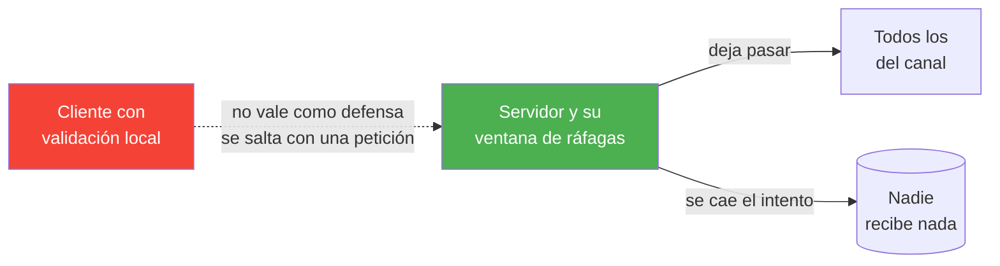
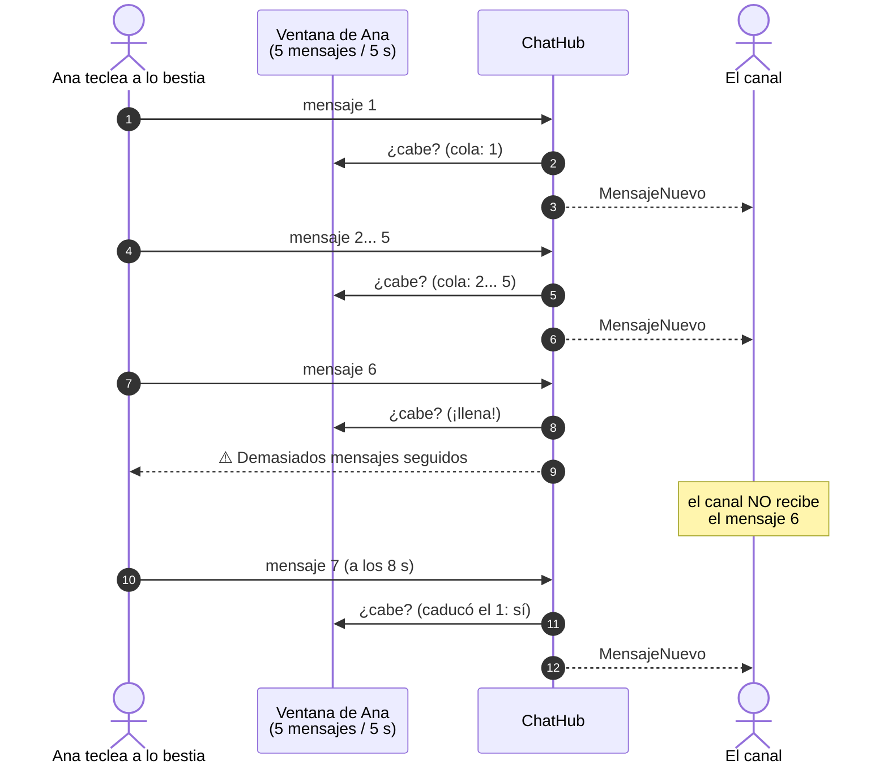
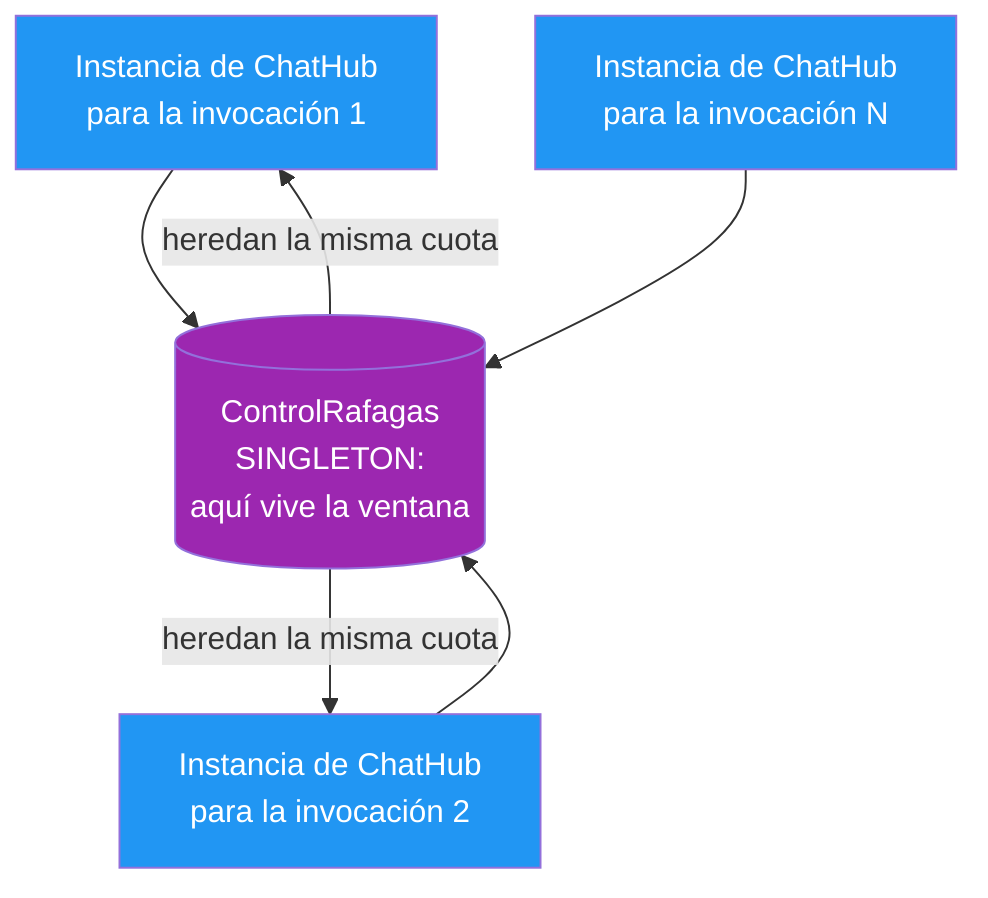

- [8. El control de ráfagas](#8-el-control-de-ráfagas)
  - [8.1. El problema del que nadie habla](#81-el-problema-del-que-nadie-habla)
  - [8.2. Ventana deslizante en treinta segundos](#82-ventana-deslizante-en-treinta-segundos)
  - [8.3. Dónde vive la cuota: los hubs son transitorios](#83-dónde-vive-la-cuota-los-hubs-son-transitorios)
  - [8.4. Por qué la clave es la conexión](#84-por-qué-la-clave-es-la-conexión)
  - [8.5. El orden dentro del hub](#85-el-orden-dentro-del-hub)
  - [8.6. Qué se limita y qué no](#86-qué-se-limita-y-qué-no)
  - [8.7. La configuración y el aviso](#87-la-configuración-y-el-aviso)
  - [8.8. Cómo se prueba](#88-cómo-se-prueba)
  - [8.9. Resumen del punto](#89-resumen-del-punto)


# 8. El control de ráfagas

> 💡 **Punto de partida:** has conectado la terminal de tu compañero, escrito cinco frases en diez segundos... y de repente el aula entera ve pasar un torrente de mensajes imposible de leer. En los chats de verdad esto pasa todos los días: alguien pega mil líneas, un script dispara mensajes, o simplemente hay quien teclea más rápido de lo que el grupo puede seguir. ¿Quién decide cuánto puede escribir cada persona: el cliente (que miente fácil) o el servidor (al que nadie salta)?

En este punto abrimos la Fase 4 con el control de ráfagas: una ventana deslizante que el servidor aplica a cada conexión antes de difundir nada. Como siempre, lo interesante no es el `if`, sino las decisiones que hay detrás: **dónde guarda el servidor la cuota si los hubs son desechables, por qué la clave es la conexión y no el nick, y por qué se valida el mensaje ANTES de cotizarlo**.

**Objetivos de aprendizaje:**

- Entender por qué la única cuota que vale es la del servidor: el cliente puede saltarse cualquier validación local
- Diseñar una ventana deslizante (no un contador por intervalos fijos) y explicar su diferencia
- Colocar estado entre invocaciones en un **singleton**, porque los hubs de SignalR se crean y se tiran en cada llamada
- Elegir la clave correcta del estado (la conexión) y borrarla al desconectar para no gotear memoria
- Ordenar las validaciones del hub por coste y por justicia: un mensaje malformado no gasta cuota
- Añadir un límite configurable que CERO lo apague, siguiendo el criterio de `RetencionDias`
- Ampliar el servidor sin tocar NADA de los clientes: el aviso viaja por el mismo canal que los errores de siempre

## 8.1. El problema del que nadie habla

El servidor de AulaChatNet ya valida mucho: longitud del usuario, longitud del mensaje, canales conocidos, emoji admitidos... Pero hay un hueco que se nota en cuanto lo piensas: **valida el QUÉ, nunca el CUÁNDO**. Cinco mensajes buenos en medio segundo pasan todas esas comprobaciones y llegan enteritos al store, al historial y a todos los canales. Un alumno con un bucle en la consola puede inundar el aula sin saltarse una sola validación.

📌 **Ejemplo real:** Discord aplica dos límites clásicos: *slowmode* (modo lento) por canal — un mensaje cada N segundos, pensado para canales de anuncios — y una cuota por usuario (unos cinco mensajes cada cinco segundos) que evita el spam global. Slack, Teams e IRC tienen algo parecido. Todos comparten una idea: **el límite lo pone el servidor, en el punto exacto donde el mensaje va a salir al mundo**.

La tentación es defenderse en el cliente ("yo no dejo enviar más de una cada segundo"). Eso no protege de nada: quien controla el cliente controla las peticiones. El cliente puede y debe dar buena UX —mostrar el aviso pronto, avisar de que vas rápido—, pero **la cuota la lleva el puesto de mando, que es el servidor**.



## 8.2. Ventana deslizante en treinta segundos

La estructura elegida es una **ventana deslizante**: por cada conexión se guarda la cola de instantes de sus últimos intentos admitidos; al llegar uno nuevo se tira de la cola todo lo que ya tiene más de `RafagaVentanaSegundos` y, si aún así la cola está llena, el intento se cae.

¿Y por qué no un contador simple que se vacíe cada N segundos? Imagina una ventana fija de 5 segundos: puedes mandar cinco mensajes a las 4.99 s y otros cinco a las 5.01 s —diez en una décima de segundo—. La ventana deslizante no tiene ese borde: la recarga se produce gota a gota, según cuándo cayó cada mensaje.



📌 **Ejemplo real:** es el mismo truco que usan los teléfonos para las llamadas perdidas: no guardan "cuántas llamadas hubo hoy", guardan cuándo fueron las últimas y dejan pasar cuando la más antigua ya envejeció.

La implementación entera cabe en un método, y conviene leerla despacio porque cada línea es una decisión:

```csharp
var marcas = _ventanas.GetOrAdd(clave, _ => new Queue<DateTime>());
var ventana = TimeSpan.FromSeconds(config.RafagaVentanaSegundos);

lock (marcas)
{
    // Ventana deslizante: fuera de la cola todo lo que ya caducó
    while (marcas.Count > 0 && ahoraUtc - marcas.Peek() >= ventana)
        marcas.Dequeue();

    // Cuota llena: el intento se cae y el hub devolverá el aviso
    if (marcas.Count >= config.RafagaMensajes)
        return false;

    marcas.Enqueue(ahoraUtc);
    return true;
}
```

Tres apuntes de esa lectura:

- El `while` (no un `if`) es lo que hace deslizante la ventana: una ráfaga vieja puede tener varios instantes caducados a la vez y todos hay que sacarlos
- La `Queue<DateTime>` **no es thread-safe**, y dos invocaciones de la MISMA conexión pueden solaparse. El candado es por conexión (`lock` sobre SU cola), nunca global: un aula llena no debe frener a las demás
- El instante lo **pasa quien llama** (`Intentar(clave, ahoraUtc)`): en producción el hub pasa `DateTime.UtcNow` y las pruebas pasan instantes fijos, así que se prueba la ventana entera **sin esperar ni un segundo real**

> 💡 **Consejo:** cuando un mecanismo dependa del tiempo, no leáis el reloj desde dentro del código que queréis probar. Sacad el reloj a fuera —parámetro, `TimeProvider` o el planificador de Rx— y las pruebas dejan de ser lentas y dejan de ser frágiles.

## 8.3. Dónde vive la cuota: los hubs son transitorios

Aquí viene la lección más importante del punto, y es de SignalR, no de ráfagas. En AulaChatNet pensamos que "el hub" es una pieza única que vive mientras el servidor está encendido... **mentira**. SignalR crea una instancia NUEVA del hub en cada invocación: llamas a `EnviarAsync`, se construye un `ChatHub`, hace su trabajo y se recicla. Si guardaras la cuota en un campo del hub, la instauración siguiente no encontraría nada y cada mensaje tendría la cuota recién estrenada.

Por eso la cuota vive en un **singleton** registrado en la composición raíz:

```csharp
// ServicesConfig.cs: la ventana de ráfagas es estado que SOBREVIVE a las
// invocaciones, y los hubs son transitorios (uno nuevo por llamada)
services.AddSingleton<IControlRafagas, ControlRafagas>();
```



Es el mismo criterio que ya seguimos en otras piezas del proyecto: **lo que se comparte entre peticiones va en singleton; lo que es de una sola llamada se inyecta en el hub**. El `ChatStore` estaba ahí por lo mismo; el control de ráfagas es la segunda pieza con esta naturaleza.

## 8.4. Por qué la clave es la conexión

El diccionario de ventanas necesita una clave. La tentación obvia es el nick... y es un error: los nicks son únicos solo **dentro de un canal**, así que dos "Ana" de dos salas distintas compartirían cuota sin conocerse. La clave elegida es el `ConnectionId` de SignalR, que es único por conexión, no colisiona con nadie y —lo mejor— **muere con su conexión**:

```csharp
public override async Task OnDisconnectedAsync(Exception? exception)
{
    // La cuota de ráfagas era de ESTA conexión: al morir, se olvida
    rafagas.Limpiar(Context.ConnectionId);
    ...
}
```

Sin esa limpieza, el diccionario del singleton crecería durante toda la vida del proceso: cada pestaña cerrada, cada wifi caído, dejaría su cola huérfana. Es un gotero lento —una cola de cinco instantes por conexión—, pero acumular estado muerto es una costumbre que en servidores reales se paga.

📌 **Ejemplo real:** los rate limiters de las APIs públicas (los de GitHub, los de Stripe) trabajan igual: la cuota cuelga de la identidad de la petición (token, IP), y el estado caduca con ella. Aquí nuestra "identidad" es la conexión.

> 📝 **Nota:** elegir la conexión tiene una consecuencia honesta que conviene conocer: quien se reconecta empieza con cuota nueva. Para un chat de aula es un precio razonable —el sistema no es una caja fuerte, es un buen comportamiento por defecto— y alternativas (cotizar por nick) traerían sus propios problemas de colisiones y de limpieza. Elegir es aceptar un compromiso, y aquí lo documentamos en vez de esconderlo.

## 8.5. El orden dentro del hub

El guardián aparece en `SendAsync` y en `EnviarPrivadoAsync` —ambos son escritura del aula—, y su posición dentro del método NO es arbitraria:

```csharp
var error = Config.ValidarMensaje(texto);
if (error is not null)
{
    return error;             // 1) la validación de campo, como siempre
}

// 2) la cuota: DESPUÉS de validar y ANTES de tocar store o red
if (!rafagas.Intentar(Context.ConnectionId, DateTime.UtcNow))
{
    return Config.AvisoRafaga;
}

var mensaje = new MensajeDto(...);   // 3) y solo ahora el efecto
```

Dos razones para ese orden:

- **Justicia:** un mensaje vacío o gigante ya se cae por validación; no debe gastar la cuota del usuario. Si la cuota viniera antes, cualquier bug que mande basura te dejaría sin escribir
- **Coste:** la cuota se consulta solo cuando el mensaje está a punto de costar algo (store, historial, difusión). Y el registro de conexión sigue siendo previo a todo: quien no está dado de alta ni llega a cotizar

Como el hub devuelve `string?` —`null` si todo fue bien, el texto del error si no—, el aviso de ráfaga usa exactamente el mismo canal que "El mensaje no puede superar los 500 caracteres". Y ahí está el regalo de esta fase para el equipo de desarrollo: **los clientes ya saben mostrar eso**. En la web, el aviso aparece en el flujo de mensajes y el texto se queda en la caja, listo para reenviarlo cuando pase la ventana; en la terminal, sale la línea roja `✗` de siempre. Cero cambios en los dos clientes.

## 8.6. Qué se limita y qué no

La cuota cubre `SendAsync` y `EnviarPrivadoAsync`: los dos caminos por los que un texto entra en el aula y va al historial y a la caché. Los demás métodos quedan fuera a propósito:

| Método del hub | ¿Cuota? | Por qué |
|----------------|---------|---------|
| `EnviarAsync` | ✅ Sí | El vector clásico de inundación: escribe en el canal, va al historial y a todos los del grupo |
| `EnviarPrivadoAsync` | ✅ Sí | También es escritura, y comparte la misma cuota de la conexión |
| `ReaccionarAsync` | ❌ No | Son interruptores, no texto: alternar no crece sin límite y no entra en el historial |
| `EscribiendoAsync` | ❌ No | El cliente ya lo muestrea a un aviso por segundo, y su estado caduca solo a los 5 s |
| `ConnectAsync` y demás | ❌ No | Registrar, mirar la lista o pedir estadísticas no inundan el canal |

Dejar algo fuera es una decisión, no un descuido: se documenta, y si algún día hiciera falta, el mismo `Intentar` se invoca en otro sitio sin tocar nada más. Esta es una fase más de la regla de oro del proyecto: **no se adelanta nada; lo que se necesite se añade, pequeño y probado**.

Además, la cuota tiene un apagador en la propia configuración: `RafagaMensajes` en `0` (o menos) desactiva el control entero, igual que `RetencionDias` en la persistencia. En un aula donde se quiera libertad total, basta un cambio en `appsettings.json`.

## 8.7. La configuración y el aviso

Los dos números nuevos viven en `ChatConfig`, la clase tipada que ya leen servidor y clientes:

| Opción | Por defecto | Significado |
|--------|-------------|-------------|
| `RafagaMensajes` | 5 | Cuántos mensajes (canal o privados) cabe una conexión en la ventana. `0` o menos = sin límite |
| `RafagaVentanaSegundos` | 5 | Longitud de la ventana deslizante |
| `AvisoRafaga` | — | Mensaje computado: cita el máximo y la ventana de la config, como el resto de avisos |

Y, como en todo el proyecto, el banner de arranque deja por escrito qué está aplicando el servidor:

```text
LÍMITES (appsettings.json → sección Chat):
  Usuario:       entre 2 y 20 caracteres
  Mensaje:       hasta 500 caracteres
  Historial:     últimos 25 mensajes
  Ráfaga:        máximo 5 mensajes cada 5 s (0 = sin límite)
```

> ⚠️ **Advertencia:** cinco mensajes en cinco segundos es una cuota holgada para una conversación normal —nadie escribe seis frases seguidas en cinco segundos tecleando—, pero cualquier centro puede recogerla en su `appsettings.json`. Lo que no debería tocar nunca es mover la validación al cliente "para que no se note": si el límite es demasiado duro, se afloja AQUÍ, en el servidor, donde es de verdad.

## 8.8. Cómo se prueba

Tres niveles, como en los puntos anteriores:

1. **La ventana sola** (`ControlRafagasTests`): sin red y sin reloj real. Se pasan instantes a mano y se cubren los casos que definen el mecanismo: la cuota se gasta hasta el máximo, el siguiente no pasa, al caducar la marca más antigua vuelve a pasar, dos conexiones no se pisan, `0` apaga todo y `Limpiar` empieza de cero. La prueba `Intentar_AntesDeCaducarLaVentana_SigueContando` es la que diferencia de verdad una ventana deslizante de un contador que se reinicie a intervalos fijos

2. **El hub con dobles** (`ChatHubTests`): el mock de `IControlRafagas` devuelve "llena" y se comprueba que el hub devuelve el aviso, que **no** se emite `MensajeNuevo` a nadie y que el store queda intacto. También la prueba de la colocación (`SendAsync_MensajeVacio_NoConsultaLaCuota`) y la limpieza al desconectar

3. **La red de verdad** (`RafagasEndToEndTests`): servidor real escuchando, cliente SignalR real, cuota de 3 cada 10 s. Se mandan cuatro mensajes seguidos: los tres primeros vuelven `null`, el cuarto devuelve el aviso **por la red** (con su serialización) y en el canal solo hay tres mensajes nuevos. Y la prueba del aislamiento: cuando Ana se queda sin cuota, Luis sigue escribiendo a lo suyo

> 📝 **Nota:** los tests E2E anteriores (privados, reacciones, escribiendo) mandan tandas sin esperar, así que su config en memoria sube `RafagaMensajes = 0`. Es una decisión de prueba, no una escapatoria: cada test prueba SU cosa, y aquí lo que se prueba es la ventana.

## 8.9. Resumen del punto

| Concepto | Decisión en AulaChatNet |
|----------|-------------------------|
| Quién pone el límite | El servidor, en el hub, antes de tocar store o red |
| Estructura | Ventana deslizante: cola de instantes por conexión, sin bordes por intervalos fijos |
| Dónde vive el estado | Singleton `ControlRafagas` (los hubs son transitorios) |
| Clave de la cuota | `ConnectionId`; se borra en `OnDisconnectedAsync` |
| Orden de paso | Registro → validación de campo → cuota → efectos |
| Cubre | `SendAsync` y `EnviarPrivadoAsync`; lo demás queda fuera, documentado |
| Apagador | `RafagaMensajes = 0` en `appsettings.json` |
| Aviso al usuario | El mismo `string?` de los errores: web en el flujo con el texto guardado, terminal en línea roja |
| Clientes | Sin cambios: el aviso viaja por el canal de errores ya existente |

En el siguiente punto seguimos con la Fase 4: menciones y avisos.
