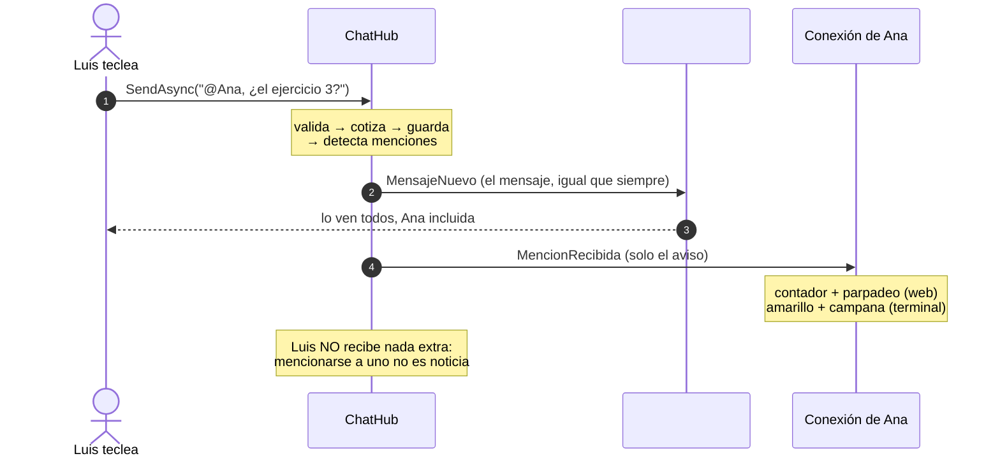
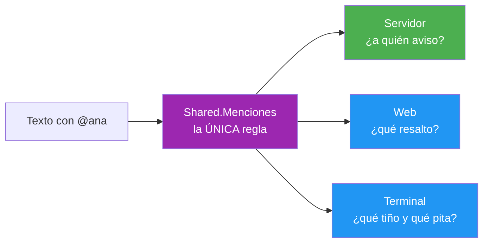

- [9. Menciones y avisos](#9-menciones-y-avisos)
  - [9.1. Un aviso aparte, no un segundo mensaje](#91-un-aviso-aparte-no-un-segundo-mensaje)
  - [9.2. Una sola regla de detección, compartida por tres](#92-una-sola-regla-de-detección-compartida-por-tres)
  - [9.3. El aviso viaja por el camino de los privados](#93-el-aviso-viaja-por-el-camino-de-los-privados)
  - [9.4. Cuatro decisiones del servidor](#94-cuatro-decisiones-del-servidor)
  - [9.5. Cómo se pinta en la web](#95-cómo-se-pinta-en-la-web)
  - [9.6. Cómo suena la terminal](#96-cómo-suena-la-terminal)
  - [9.7. Qué queda fuera (y por qué)](#97-qué-queda-fuera-y-por-qué)
  - [9.8. Cómo se prueba](#98-cómo-se-prueba)
  - [9.9. Decisiones, patrones y técnicas del punto](#99-decisiones-patrones-y-técnicas-del-punto)


# 9. Menciones y avisos

> 💡 **Punto de partida:** escribes un mensaje en un grupo de veinte personas y empiezas por "@Ana". En WhatsApp, en Discord, en Slack... alguien hace clic en el nombre, se pinta en azul, y si esa persona tenía la aplicación abajo recibe un aviso distinto al de cualquier otro mensaje: campana, contador sobre el icono, parpadeo de la pestaña. Nada de eso es magia: es un mensaje que va a TODOS... y además un empujoncito pequeño y dirigido a UNO. ¿Cómo se consigue eso en SignalR sin duplicar mensajes ni crear un canal paralelo?

En este punto seguimos con las menciones. Lo interesante no es el `if` que busca la arroba —aunque también—, sino tres cosas: **por qué la detección vive en `Shared` y no en cada cliente, por qué el aviso es un evento aparte con DTO (objeto de transferencia de datos) propio, y cómo se convierte en ruido —contador, parpadeo, campana— SIN tocar el contrato del servidor dos veces**.

**Objetivos de aprendizaje:**

- Diseñar un aviso dirigido como evento SEPARADO del mensaje, con su DTO propio y su destino propio
- Compartir una regla de detección entre servidor y clientes metiéndola en `Shared`, para que no haya dos versiones de la verdad
- Usar expresiones regulares generadas por el compilador (`GeneratedRegex`) y trocear texto en tramos de forma segura
- Entender por qué un aviso con el mismo destino que otro ya conocido NO es un destino nuevo de SignalR
- Pintar menciones SIN `MarkupString`: escapado por construcción, inyección de HTML imposible por diseño
- Dar avisos de navegador (contador sin mirar, parpadeo de `document.title`) desde Blazor con una función JS pequeña
- Hacer sonar una terminal con `Console.Beep()` y teñir el token con la paleta del tema
- Fijar límites honestos: sin persistencia, sin privados y nicks con espacios que no se pueden mencionar

## 9.1. Un aviso aparte, no un segundo mensaje

El error clásico al diseñar menciones es tratarlas como un mensaje nuevo: "si el texto contiene @Ana, mando un mensaje privado de sistema". Eso duplica contenido, ensucia el historial y crea una segunda clase de mensajes que hay que reconciliar en los dos clientes. La decisión de AulaChatNet es la contraria, y es la misma que ya tomamos con los privados: **contrato propio para destino propio**.

El viaje completo de una mención es este:



Dos eventos, dos razones distintas. `MensajeNuevo` responde a "¿qué pasa en el canal?" y va al grupo —todos lo ven, con su fila en la cronología—. `MencionRecibida` responde a "¿esto va conmigo?" y va a una sola conexión. El cliente que está nombrado recibe LOS DOS: el mensaje (porque está en el canal) y el aviso (porque le concierne). El resto del canal solo recibe el primero, y ni se entera de que existió el segundo.

📌 **Ejemplo real:** Discord hace exactamente esto en la práctica: el mensaje con la mención aparece en el canal para todos, y a la persona nombrada le llega además una entrada en su centro de notificaciones con el emisor y el canal. No hay dos mensajes en la sala; hay el mensaje y un aviso de segundo plano.

## 9.2. Una sola regla de detección, compartida por tres

¿Quién decide qué es una mención? Si cada parte lo decide por su cuenta, acabarán desviándose: el servidor avisa de "@ana" pero la web resalta solo "@Ana", o la terminal se traga la coma y resalta "Ana,". La solución es la de siempre en este proyecto —**un solo módulo en `Shared` que usan los tres**—, y vive en `Helpers/Menciones.cs`:

```csharp
[GeneratedRegex(@"@[\p{L}\p{N}_-]+")]
private static partial Regex Patron();
```

La clase es `partial` a propósito: `GeneratedRegex` es un *source generator* que crea la máquina de estados en tiempo de compilación, sin reflexión ni coste de primera llamada —y funciona igual en el servidor que en WebAssembly, que es justo lo que nos falta cuando el código corre en el navegador.

De esa base salen tres métodos con encargos distintos:

| Método | Quién lo usa | Para qué |
|--------|--------------|----------|
| `Extraer(texto)` | pruebas y quien necesite la lista | los nombres SIN la @, en orden, sin repetir |
| `Contiene(texto, usuario)` | el servidor (hub) y la terminal (campana) | ¿este texto nombra a esta persona? |
| `Trocear(texto)` | la web y la terminal al pintar | trocear en tramos marcando cuáles son mención |

El patrón corta el token en cuanto aparece un carácter que no sea letra, dígito, guion bajo o guion: en "@Ana," o "@luis!" la coma y el signo de exclamación quedan FUERA y el nombre sale limpio. Y la comparación de nombres usa `OrdinalIgnoreCase`, la MISMA regla que ya usan nicks, canales y privados: si en el chat dos grafías distintas son la misma persona, aquí también.

> 📝 **Nota:** `Trocear` es la pieza que conviene mirar despacio. Devuelve tramos `(texto, esMencion)` en orden, y cada cliente decide QUÉ hacer con ellos: la web un `<span>` con clase, la terminal una etiqueta de color de Spectre. Shared manda la FORMA; de los clientes solo se exige el color. Ese es el trato que hace que el comportamiento no se desvíe con el tiempo.

## 9.3. El aviso viaja por el camino de los privados

Una vez detectada la mención, el hub tiene que emitirla. La buena noticia: **no hace falta inventar nada**. SignalR ya tiene el destino "esta conexión concreta" —`Clients.Client(id)`—, que es el mismo por el que circulan los mensajes privados. El aviso de mención no abre ningún destino nuevo; reutiliza el quinto que ya existía en el proyecto (All, Caller, Group, Client, OthersInGroup).

El código del hub cabe en un método con comentario propio, y su posición importa: **después** de emitir el mensaje al grupo.

```csharp
await Clients.Group(conexion.Canal).SendAsync(ChatHubEventos.MensajeNuevo, mensaje);

// Menciones (@ana): el mensaje va igual al canal —la mención NO es
// un mensaje aparte—; esto es solo un empujoncito dirigido a quien
// sale nombrado, para que su cliente pite y parpadee
await NotificarMencionesAsync(conexion, mensaje);

return null;
```

Ese orden no es cosmético: SignalR garantiza el orden dentro de CADA conexión, así que Ana recibe primero el mensaje y después el aviso —su cliente puede anclar el aviso al mensaje que acaba de ver—. Si fuera al revés, un cliente rápido podría recibir "Ana te mencionó" un instante antes de existir el mensaje que la provoca.

El DTO propio es mínimo: emisor, canal, texto completo y hora. Ni identificador de la mención ni estado de leída: **el "no visto" es asunto de cada cliente** (lo veremos en 9.5), porque el servidor no debe llevar la cuenta de lo que un usuario ha mirado en su propia pestaña.



## 9.4. Cuatro decisiones del servidor

Detrás del bucle corto de `NotificarMencionesAsync` hay cuatro decisiones que conviene poder explicar en clase:

| Decisión | Por qué |
|----------|---------|
| Se emite DESPUÉS del mensaje | orden por conexión: el aviso nunca llega antes que su texto |
| El mensaje no cambie aunque nadie reciba el aviso | una mención no es una entrega garantizada; si a quien nombras no está conectado, su mensaje es un mensaje normal |
| Nunca a uno mismo | mencionarte a ti no es noticia — la misma lógica de `Clients.OthersInGroup` en "está escribiendo" |
| Sin estado y sin persistencia | el aviso viaja y se olvida; el contador de "sin mirar" lo lleva cada cliente |

Y una guardia barata al principio: si el texto no contiene ni una arroba, el método se vuelve sin mirar. Casi ningún mensaje trae `@`, así que el bucle sobre los conectados no se ni ejecuta.

📌 **Ejemplo real:** los *rate limiters* y los sistemas de notificaciones de las APIs públicas trabajan con esta misma idea: el emisor del evento no lleva contadores de quién lo ha visto; emite, y el destinatario gestiona su propio estado de lectura. Si el servidor llevara ese contador, cada pestaña que se abriera tendría que sincronizarse con él —y sin autenticación, encima, sería un contador sin dueño real.

> 💡 **Consejo:** fíjate en que las menciones NO se revisan en `EnviarPrivadoAsync`. Un privado ya es un envío dirigido a dos personas: meter una mención dentro sería avisar de que has avisado. Las menciones son cosa del canal.

## 9.5. Cómo se pinta en la web

En el cliente web, el evento `MencionRecibida` llega a la store —los componentes no hablan con SignalR directamente— y de ahí salen DOS consumidores distintos, cada uno con su flujo:

1. **El contador de "sin mirar":** la store mantiene un contador (`BehaviorSubject<int>`), lo incrementa con cada aviso y lo pone a cero con `MarcarMencionesVistas()`, que solo llama quien corresponde: el clic en la píldora. El componente `AvisoMenciones` se suscribe, pinta la píldora "💬 2" cuando el contador es mayor que cero y libera sus suscripciones en `Dispose()`, como todo componente de la app.

2. **El parpadeo de la pestaña:** `document.title` es JavaScript, y desde Blazor no se "pinta" —se pide. `index.html` expone `aulachat.empezarParpadeo(texto)`, que alterna el título con el aviso cada pocos segundos y se PARA SOLO en cuanto la pestaña recupera el foco. Ni botones que apagar, ni temporizadores huérfanos: el navegador ya sabe cuándo vuelves.

El resaltado del texto tiene su propia lección. El componente `TextoMencion` recorre `Menciones.Trocear(texto)` y pinta `<span class="mencion">` para los tramos de mención. **No hay `MarkupString` en ninguna parte**: Blazor escapa cada tramo por construcción, así que un mensaje con `<b>`, comillas o corchetes se ve literalmente como escribió su autor, y una inyección de HTML es imposible por diseño, no por buen ojo.

> ⚠️ **Advertencia:** la tentación con los resaltados es construir el HTML a mano con un `MarkupString` para ir más rápido. No lo hagáis: es la puerta clásica de XSS en aplicaciones Blazor, y aquí no hace falta —trocear y pintar tramos con la sintaxis de plantilla normal da el mismo resultado sin riesgo.

## 9.6. Cómo suena la terminal

La terminal no tiene contadores persistentes ni pestañas, pero tiene dos herramientas de toda la vida que aquí encajan perfecto:

- **Color:** `VistaChat.LineaMensajeMarkup` —la MISMA fórmula que usan el modo en vivo y la tubería de pruebas— ahora manda los tramos de `Trocear` por `TextoConMencionesMarkup`, que teñe de amarillo (`#faa61a`, añadido a `TemaDiscord`) los tokens con `@` y escapa el resto ANTES de teñirlo. Un nombre con corchetes no se come el formato de la línea entera.

- **Campana:** en el bucle que pinta los mensajes nuevos de `Program.cs`, si el mensaje es normal —no de sistema—, no es tuyo y `Menciones.Contiene` dice que te nombra, suena `Console.Beep()`. En un aula, la campana se oye desde atrás de la clase: es el "esto va contigo" más barato que existe.

```text
17:45 [LU] Luis: Hola @Ana, ¿me pasas el ejercicio 3?
```

La distinción entre "resaltar cualquier mención" —para eso basta el token— y "pitarme SOLO si me nombra a mí" —para eso hace falta `Contiene` con tu nick— es la que separa las dos responsabilidades: pintar es de todos, avisar es personal.

## 9.7. Qué queda fuera (y por qué)

Todo punto de este proyecto tiene su "no adelantamos nada" documentado, y esta no es menos:

| Queda fuera | Por qué |
|-------------|---------|
| Persistencia de menciones | como los privados: sin autenticación, el siguiente que use ese nombre se lo encontraría tras un reinicio; el aviso vive en la conexión |
| Menciones dentro de privados | el privado YA es dirigido: avisar de un aviso es ruido |
| Aviso a quien no está conectado | si @Diego no está en el canal, su mención es texto normal — nadie recibe un "te nombraron" cuando vuelve, que sería estado persistente encubierto |
| Nicks con espacios | el token se corta en el primer espacio; es el mismo límite que Discord, y los nicks de este chat (2-20 caracteres) no lo sufren |
| Aviso a TODAS las conexiones de una persona | el store devuelve una conexión por usuario, igual que en los privados: con dos pestañas abiertas, el aviso entra en una |

Y una puerta abierta, no un descuido: si mañana se quisiera un resumen de "mencionado en tu ausencia", sería otra pieza pequeña sobre el mismo `MencionRecibida`, no un rediseño.

## 9.8. Cómo se prueba

Tres niveles, como en los puntos anteriores:

1. **La regla sola** (`MencionesTests`, en `Shared.Tests`): sin red y sin interfaz — extraer nombres con y sin puntuación pegada, no duplicar por mayúsculas, `Contiene` con la comparación insensible, y `Trocear` separando tramos en orden. Como la regla es compartida, estas pruebas blindan a servidor y clientes a la vez.

2. **El hub con dobles** (`ChatHubTests`): el aviso va al mapa POR CONEXIÓN de `conn-ana` y a ningún otro, el mensaje sale igual al canal (contando solo los de tipo normal, que el alta en la sala también emite `MensajeNuevo` de sistema), y las ausencias se comprueban donde realmente se registra `Clients.Client` —el mismo mapa que usan los tests de privados—.

3. **La red de verdad** (`MencionesEndToEndTests`): servidor real, tres clientes reales —dos en `#general`, una en `#smr`—. Luis menciona a Ana y el aviso viaja por la red hasta ella con su emisor y su canal; para comprobar que NO se cuela a nadie más se usa un punto de sincronía: una ida y vuelta más en cada conexión, porque SignalR ordena por conexión y la respuesta de esa llamada certifica que todo lo anterior ya llegó —o no—.

En el cliente, `AvisoMencionesTests` prueba el contrato de la píldora (oculta a cero, contador visible, clic a la store) con `StoreFalsa`, y `VistaChatTests` el resaltado amarillo y el escapado del resto de la línea.

> 📝 **Nota:** el parpadeo de la pestaña y la campana no se prueban en unitario: son APIs del navegador y de la consola. Se verifican en ejecución —dos pestañas y una terminal—, que es donde además se comprueba que las piezas conviven de verdad.

## 9.9. Decisiones, patrones y técnicas del punto

Un aviso de mención parece pequeño y obliga a decisiones de arquitectura de verdad. Estas son las que deja este punto:

| Patrón o técnica | Dónde vive en AulaChatNet | La lección transferible |
|------------------|---------------------------|-------------------------|
| Una regla de detección compartida | `Menciones` en `Shared`, usada por hub y clientes | La lógica que todos necesitan vive donde todos la ven; repetirla la desvía |
| Dos eventos, dos razones | `MensajeNuevo` al grupo; `MencionRecibida` a una sola conexión | Separa el hecho público de la notificación privada: distinto destinatario, distinto DTO |
| Aviso por el camino de los privados | Mismo envío dirigido que los mensajes privados | Reutiliza el canal de entrega que ya funciona y está probado |
| Cuatro decisiones del servidor | Quién se menciona, cuándo, a quién y cuántas veces | El servidor decide con su estado; el cliente solo pinta lo decidido |
| Escapado por construcción | `TextoMencion` pinta trozos de texto; sin `MarkupString` en ninguna parte | Inyección de HTML imposible por diseño; la seguridad no se apoya en acordarse |
| El "no visto" es del cliente | El contador refleja lo que la pestaña aún no ha mirado | Lo que el usuario ha visto es estado de su pestaña, no del servidor |

---

**Resumen del punto:**

| Concepto | Decisión en AulaChatNet |
|----------|-------------------------|
| La mención es | un evento aparte (`MencionRecibida`) con DTO propio, no un segundo mensaje |
| La regla de detección vive | en `Shared/Menciones` —una sola versión para los tres consumidores— |
| El aviso sale por | `Clients.Client`, el mismo camino que los privados; ningún destino nuevo |
| Orden | el mensaje al grupo PRIMERO, el aviso después (orden por conexión) |
| Cobertura | solo mensajes normales del canal; ni privados, ni sistema, ni a uno mismo |
| Estado de lectura | del CLIENTE: píldora con contador en la store, vaciada por clic |
| Web | resaltado sin `MarkupString`, píldora "💬 n", parpadeo de pestaña con JS que se para al recuperar foco |
| Terminal | token en amarillo con la paleta del tema y `Console.Beep()` si te nombra |
| Persistencia | ninguna: como los privados, el aviso vive en la conexión |
| Límites honestos | nicks con espacios no se mencionan; una conexión por persona, como en los privados |

**Anterior:** [8. El control de ráfagas](08-control-de-rafagas.md) · **Índice:** [README](../README.md)
