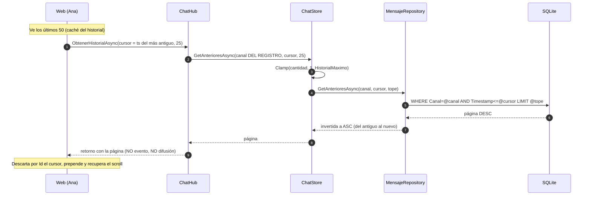
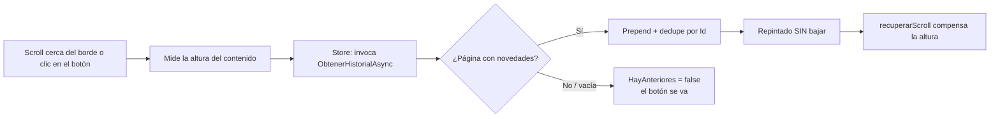

- [10. Historial paginado](#10-historial-paginado)
  - [10.1. Un botón por encima del chat](#101-un-botón-por-encima-del-chat)
  - [10.2. La caché no basta: lo anterior vive en SQLite](#102-la-caché-no-basta-lo-anterior-vive-en-sqlite)
  - [10.3. Invocación con retorno, no evento](#103-invocación-con-retorno-no-evento)
  - [10.4. El cursor: tiempo, no número](#104-el-cursor-tiempo-no-número)
  - [10.5. El canal sale del registro, no de un parámetro](#105-el-canal-sale-del-registro-no-de-un-parámetro)
  - [10.6. Invocación en la web: store reactiva, como todo](#106-invocación-en-la-web-store-reactiva-como-todo)
  - [10.7. Cómo se pinta: scroll, altura y recuperación](#107-cómo-se-pinta-scroll-altura-y-recuperación)
  - [10.8. Qué queda fuera (y por qué)](#108-qué-queda-fuera-y-por-qué)
  - [10.9. Cómo se prueba](#109-cómo-se-prueba)
  - [10.10. Resumen del punto](#1010-resumen-del-punto)


# 10. Historial paginado

> 💡 **Punto de partida:** estás leyendo la charla de `#general` de ayer en Discord y llegas arriba del todo. ¿Se carga entera la sala en el navegador? No: hay un botón (o un simple gesto de scroll) que pide **la página anterior** y la pone por delante, sin arrancar de sitio a nadie. Hasta ahora AulaChatNet solo recuerda los últimos mensajes en pantalla... ¿y lo anterior?

**Objetivos de aprendizaje:**

- Entender **por qué la caché del servidor no puede responder sola** y lo anterior tiene que salir de SQLite.
- Diferenciar **una invocación con retorno de un evento** de SignalR, y cuándo toca cada una.
- Diseñar una paginación con **cursor temporal** (y por qué los números de página mienten con datos en vivo).
- Implementar en Blazor una **carga por scroll** que no arruine la posición de lectura.

📌 **Ejemplo real:** WhatsApp Web, Discord y Slack cargan el historial por páginas al subir con el ratón. Ninguno te manda la sala entera: el chat de un curso activo acumula miles de mensajes en una semana, y el navegador no tiene por qué tragarlos todos para que tú veas los últimos veinte.

---

## 10.1. Un botón por encima del chat

La web de AulaChatNet, al entrar en un canal, muestra lo que el servidor le manda al conectar: la caché de los últimos `HistorialMaximo` mensajes (50 en producción). Pero si la charla tiene más, hay **más ahí abajo, en la base de datos**, y el alumno debe poder bajar a por ellos.

La solución tiene dos caminos que hacen lo mismo:

- El botón **⬆ Cargar mensajes antiguos**, centrado arriba del todo, como el divisor *load more* de Discord.
- El propio **gesto de scroll**: acercarse al borde superior (menos de 80 px) dispara la misma carga sin esperar al clic.

El botón es el plan B, no el único camino; y desaparece solo cuando el servidor contesta con una página vacía (eso significa "no queda más").

## 10.2. La caché no basta: lo anterior vive en SQLite

Aquí hay que recordar cómo reparte el servidor lo que recuerda:

| Dónde | Qué guarda | Cuánto |
|-------|------------|--------|
| Caché del `ChatStore` (memoria) | Últimos mensajes del canal, listos para el que entre | `Chat:HistorialMaximo` (50 por defecto) |
| SQLite (Fase 2) | **TODO** el historial normal de cada canal | Sin límite práctico |

Lo que el cliente pide al hacer scroll hacia arriba es, por definición, **anterior a la caché**. Así que la única fuente posible es el disco:

```
cliente (ve 50) ──¿más antiguos?──► caché (50) ✗ ──► SQLite ✓
```

> 📝 **Nota:** solo se persisten los mensajes NORMALES (política de la Fase 2: los avisos de sistema describen hechos de la sesión viva). Por eso, al paginar hacia atrás solo aparecen mensajes de personas: los "Ana ha entrado" no están en la base de datos porque nunca la tocaron.

## 10.3. Invocación con retorno, no evento

El punto de las menciones añadió un **evento** (`MencionRecibida`) porque el servidor necesitaba *avisar* a alguien sin que nadie lo pidiera. Aquí pasa lo contrario: el cliente **pregunta** y quiere **una respuesta**. En SignalR eso es una invocación con retorno:

```csharp
// Shared/Constantes/ChatHubMetodos.cs
public const string Historial = "ObtenerHistorialAsync";

// Server/Hubs/ChatHub.cs
public async Task<IReadOnlyList<MensajeDto>?> ObtenerHistorialAsync(DateTime antesDe, int cantidad)
```

La comparación completa, que es justo lo que interesa enseñar:

| | Evento (`On` + `SendAsync`) | Invocación con retorno (`InvokeAsync<T>`) |
|---|---|---|
| ¿Quién decide cuándo? | El servidor | El cliente |
| ¿A quién llega? | Al que el servidor escoja | Solo al que preguntó |
| ¿Garantiza orden? | Por conexión | También: la respuesta llega a SU llamada |
| Ejemplo en AulaChatNet | `MensajeNuevo`, `MencionRecibida` | `ObtenerUsuariosAsync`, **`ObtenerHistorialAsync`** |

Ambos viajan por el mismo tubo de la conexión; la diferencia es de **quién manda**. Para un "dame una página", la invocación es natural: sin estado que seguir en el cliente, sin eventos fantasma, y el error (si no estás registrado) vuelve en el propio retorno.

## 10.4. El cursor: tiempo, no número

La tentación clásica es paginar por número: `GetHistorial(canal, desde: 50, cantidad: 25)`. Con un chat EN VIVO esa paginación **miente**: cada mensaje nuevo desplaza los números de posición, así que la segunda página se solapa con la primera o se salta mensajes. Peor aún: el cliente cuenta sus FILAS (que mezclan avisos de sistema) y la base cuenta sus FILAS (solo mensajes normales) — dos mundos con índices distintos.

La solución es un **cursor temporal**: el cliente manda la marca de tiempo de **lo más antiguo que ya ve**, y el servidor devuelve lo anterior:

```sql
SELECT * FROM Mensajes
 WHERE Canal = @canal AND Timestamp <= @cursor   -- índice (Canal, Timestamp)
 ORDER BY Timestamp DESC, Id DESC
 LIMIT @cantidad
```

Tres decisiones dentro de esa consulta, y las tres se enseñan en el código:

1. **`<=` inclusivo.** El cursor no es un límite cortante sino un punto que se toca. ¿Por qué? Dos mensajes escritos en el mismo milisegundo son **gemelos**: con `<` estricto, el gemelo del cursor se perdería para siempre. El servidor devuelve también los del mismo instante y el cliente **descarta por `Id`** los que ya tiene. Ninguno huérfano, un descarte inocuo.
2. **`ORDER BY Timestamp DESC, Id DESC`.** El desempate por `Id` hace determinista la página entre gemelos: dos clientes que pidan lo mismo reciben lo mismo.
3. **Se pagina de atrás hacia delante con `Take`.** Igual que `GetUltimosAsync` (Fase 2): pedir a la base lo último en orden inverso y dar la vuelta es más barato que paginar al revés.



La página **nunca supera** `HistorialMaximo`: el tope se aplica en el store (`Math.Clamp`), con la misma regla que la precarga — una página no puede ser mayor que la ventana del sistema.

> ⚠️ **Advertencia:** el cursor por tiempo tiene un techo teórico: si un canal dispara una página ENTERA de mensajes en el mismo instante exacto (los gemelos ocupan la página entera), la paginación se quedaría sin avanzar. En un aula es imposible (habría que escribir 25 mensajes en el mismo milisegundo); en un chat de miles de mensajes por segundo ya no. Es la frontera honesta de este diseño, y está documentada en el código.

## 10.5. El canal sale del registro, no de un parámetro

`ObtenerHistorialAsync(antesDe, cantidad)` **no acepta un canal**. ¿Y de dónde sale el canal? Del registro de la conexión, igual que `SendAsync`:

```csharp
var conexion = store.GetConexion(Context.ConnectionId);
if (conexion is null) return null;   // sin registro, no hay sala propia

return await store.GetAnterioresAsync(conexion.Canal, antesDe, cantidad);
```

Si el canal fuera parámetro, cualquiera podría tirar de sonda: `ObtenerHistorialAsync("#profesores", ...)`. Al sacarlo del registro, **solo se puede mirar la sala en la que estás** — la seguridad por construcción, sin permisos ni roles (que, sin autenticación, no protegerían nada; véase la nota de la moderación en el README).

## 10.6. Invocación en la web: store reactiva, como todo

En Blazor no se habla al hub desde el componente: se añade un método a la store, con su estado observable, igual que el resto de la Fase 3:

```csharp
// State/ChatStore.cs
IObservable<bool> HayAnteriores { get; }   // ¿puede quedar algo detrás?
Task CargarAnterioresAsync();               // pide una página y la prepende
```

La store hace tres cosas delicadas, y cada una tiene su comentario en el código:

1. **Cursor** = `_mensajes.Value[0].Timestamp` (lo más antiguo de la vista).
2. **Dedupe por `Id`**: el servidor devuelve el cursor inclusive, y una página podría solaparse; quitar lo que ya se ve deja la operación inocua.
3. **Prepend** en una sola emisión: `[.. página, .. vista]`. Y `HayAnteriores` se apaga SOLO ante una página vacía (o sin novedades tras el dedupe) — nunca "adivina" por el tamaño recibido, porque el servidor pudo recortar la página a su tope.

También se reinicia a `true` con cada `HistorialRecibido`: al cambiar de canal hay que volver a permitir la sonda (y si no queda nada, la primera carga lo dirá).

## 10.7. Cómo se pinta: scroll, altura y recuperación

El ingenuo que solo prepende tiene un bug garrafal: el contenido nuevo crece **POR ARRIBA** de donde estás mirando, y el navegador te deja clavado en el pixel 0 — saltando al principio del canal. La web lo resuelve como los chats de verdad, en tres pasos:

1. **Antes de pedir** la página, se mide la altura del contenido (`aulachat.altura`).
2. La página entra por la store → la lista se repinta **sin bajar el scroll** (el marcador `_pendienteRecuperar` apaga el "bajar" de siempre).
3. **Después del repintado** (`OnAfterRenderAsync`), `aulachat.recuperarScroll` suma al `scrollTop` el crecimiento (`alturaNueva − alturaAntes`): la persona que estaba mirando el mensaje de arriba sigue mirándolo.



Un detalle elegante del ajuste: si la carga no produce repintado (sin conexión, página vacía...), el marcador pendiente se consume como **no-op** — la altura no cambió, así que el `delta` es cero y no se mueve nada. Un estado fantasma se autodesactiva.

> 💡 **Consejo:** la carga automática solo se dispara **una vez por evento de scroll** y con la guarda `_cargando`. Si tras recuperar la posición la persona sigue cerca del borde, su propio movimiento dispara la siguiente página — sin bucles ni carreras.

## 10.8. Qué queda fuera (y por qué)

- **La terminal no pagina.** Su vista es impresión incremental: cada mensaje se pinta al llegar y no hay una lista que "recrecer" por arriba sin repintar la pantalla entera. Añadir `/historial` obligaría a un repintor nuevo y a retocar ayuda y menú; no compensa para lo que enseña esta fase. Si se quisiera, sería el próximo paso natural.
- **Reacciones sobre mensajes paginados.** Las reacciones viven en la caché con su mensaje y no se persisten; un mensaje paginado que ya salió de la ventana no tiene chips, y reaccionar a él devuelve el error habitual de "ya no está en el canal". Son contexto de solo lectura.
- **Cursor por tiempo, no por identificador.** Un cursor compuesto (`Timestamp + Id`) podría atravesar gemelos sin el techo descrito; a cambio, el DTO del cursor crece y el alumno carga con más conceptos. Se eligió la fecha por claridad, con el límite escrito a la vista.

## 10.9. Cómo se prueba

La paginación toca cuatro anillos, y cada uno se prueba donde vive:

| Anillo | Cómo | Qué se comprueba |
|--------|------|------------------|
| `MensajeRepository` | SQLite **real** en memoria compartida (`BaseDatosDePrueba`) | Páginas hacia atrás, cursor inclusivo, gemelos juntos, canales separados, Kind UTC |
| `ChatStore` | Repositorio mockeado | Sin repositorio o sin cursor no se toca la base; el `Math.Clamp` del tope |
| `ChatHub` | Dobles de SignalR como en toda la suite | Sin registro → `null`; el canal sale del SUYO; **cero eventos emitidos** (es una consulta) |
| Red completa | E2E con **Kestrel + SQLite de verdad** | Página 1, página 2, página vacía, tope y `null` sin registro |

El E2E es el único que enciende la persistencia en el arnés, y no es capricho: bajando `HistorialMaximo` a 3 se garantiza que cualquier página profunda **pisa disco de verdad**. Y como la escritura es *write-behind* (Fase 2), el test espera a que la cola haya persistido el último mensaje antes de paginar — FIFO: si el último está, los anteriores también. Ese "punto de sincronía" es el mismo truco del TCS de los E2E de menciones, cruzando el proceso de un servicio en segundo plano.

> 📝 **Nota:** en los tests de componentes de Blazor (bUnit), un ayudante de JS que **coincide pero no tiene resultado fijado** no devuelve nada: cuelga la invocación. Por eso cada uno se configura con su `SetResult`/`SetVoidResult`, igual que el parpadeo de las menciones.

## 10.10. Resumen del punto

| Concepto | Decisión |
|----------|----------|
| Fuente de datos | SQLite: la caché solo retiene `HistorialMaximo`, lo anterior está en disco |
| Mecanismo SignalR | Invocación **con retorno** (`ObtenerHistorialAsync`), no evento |
| Cursor | Marca de tiempo **inclusiva** (`<=`) + dedupe por `Id` en el cliente |
| Orden | `Timestamp DESC, Id DESC` en SQL, vuelta a ASC al devolver |
| Seguridad | El canal **sale del registro** de la conexión: no hay parámetro canal |
| Tope de página | `Math.Clamp(cantidad, 1, HistorialMaximo)` en el store |
| Web | Botón "⬆ Cargar mensajes antiguos" + carga al acercarse al borde |
| Scroll | Se mide antes, se repinta sin bajar, se compensa la altura después |
| Estado | `HayAnteriores` se apaga con página vacía y se reinicia al cambiar de canal |
| Fuera del alcance | Terminal (impresión incremental), reacciones sobre mensajes paginados y cursor compuesto |
