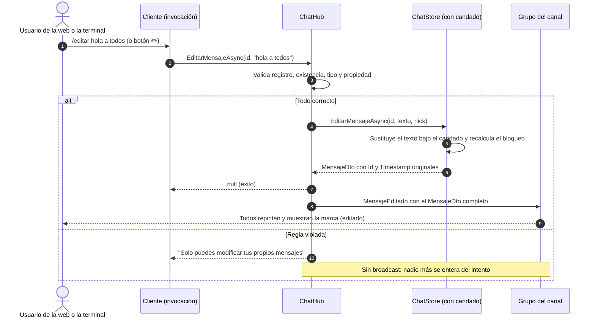
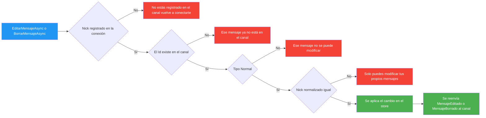

# 11. Editar y borrar mensajes

> 💡 **Punto de partida:** en Discord borras un mensaje con la papelera y lo editas escribiendo encima. Ese mensaje *cambia* sin que se publique uno nuevo: mismo sitio, mismo momento de publicación, texto distinto. En WhatsApp pasa igual cuando ves la etiqueta *Editado*. ¿Cómo se hace sin liar la página y sin romper la persistencia? Ese es el trabajo de este punto: **editar y borrar mensajes propios**.

📌 **Ejemplo real:** Discord permite editar y borrar tus mensajes (y en canales con permisos, los de cualquiera). WhatsApp solo los tuyos, con aviso. Slack borra y edita también los suyos. La regla que comparten: **tú tocas lo tuyo, el servidor lo decide**. Y si el registro ya no existe (alguien lo borró, se fue la conexión...), el cliente se re-sincroniza en vez de quedarse con texto fantasma.

**Objetivos de aprendizaje:**

- Comprender la diferencia entre **invocación con retorno** (el cliente pregunta "¿he podido?") y **evento broadcast** (el servidor avisa "esto ha cambiado").
- Diseñar reglas de negocio en el servidor: propiedad por **nick normalizado**, tipos de mensaje, **canal del registro de la conexión**.
- Gestionar una **cola de escritura** (`SemaphoreSlim`) y una **ventana de bloqueo** del historial para que la paginación 4.3 no sirva datos obsoletos.
- Reconciliar estado en dos clientes muy distintos: el marcado de repintado de terminal y la lista reactiva de Blazor.
- Pedir confirmación **en la propia interfaz** (sin diálogos del navegador) solo cuando la acción es irreversible.

---

## 11.1 Qué se puede tocar, desde dónde y sobre qué

| Superficie | Cómo | Sobre qué |
|------------|------|-----------|
| **Terminal** | `/editar <texto>` y `/borrar` (también `/e`, `/edit` y `/del`) | **Tu último mensaje** del canal actual (el más reciente que escribiste tú) |
| **Web** | Botones ✏️ y 🗑️ bajo el mensaje al pasar el ratón | **Cualquier mensaje propio** de la lista |
| **Web** | Además `/editar <texto>` y `/borrar` | Igual que terminal: tu último mensaje del canal |

¿La diferencia? En terminal no hay ratón ni "pasar el ratón": no tiene sentido elegir entre los 500 mensajes de la lista por teclado, así que basta con el último. En la web el botón está a un clic de cada mensaje tuyo, así que se aprovecha. **Las reglas del servidor son idénticas para ambas superficies**: los comandos `/` usan el hub; los botones usan la store, que a su vez llama al hub.

Solo se pueden tocar mensajes:

- De **tipo Normal** (los del sistema siguen intactos; el usuario no debe tocar "X se ha unido al canal").
- **Tuyos**: el servidor compara el nick registrado en la conexión (normalizado, sin distinguir mayúsculas) con el del mensaje.
- Del **canal al que estás conectado**: el servidor recuerda en qué canal se registró tu conexión; si intentas editar un mensaje de otro canal con su GUID, te dice que no está en el canal.

> 📝 **Nota:** en la terminal, si no has escrito nada en el canal (o solo tocaste los de antes de conectarte), el comando te lo dice con un mensaje claro: "No tienes mensajes recientes en este canal".

---

## 11.2 La identidad de un mensaje: Id y Timestamp

Un mensaje editado **no es un mensaje nuevo**. Sigue siendo el mismo con la misma identidad, solo que con el texto cambiado y con `Editado = true`. Para que eso funcione, cada `MensajeDto` lleva dos marcas de identidad:

- **`Id` (GUID)**: identificador único e inmutable del mensaje. Es el "DNI" que usan hub, store y clientes para decir "ese de ahí".
- **`Timestamp`**: instante en que se publicó. **NO cambia al editar**: el mensaje editado conserva su hora de publicación original, igual que en Discord.

Esa combinación permite reconciliar sin ambigüedad: si llega un `MensajeEditado` con un Id que ya tienes, **sustituyes** el mensaje y dejas la lista tal cual (misma posición, mismo timestamp); si no lo tienes (estabas desconectado o ese mensaje está fuera de la ventana), **lo insertas** y dejas que el marcado de la lista decida dónde queda.

Además el `MensajeDto` gana un flag **`Editado`**, que es el que los clientes traducen en el marcador visual "(editado)".

> 💡 **Consejo:** el marcador vive en un helper compartido (`Helpers/MensajeTexto.cs` con `EditadoTexto`): si mañana el cliente de terminal quiere otro texto (por ejemplo, " [E]"), se cambia en un sitio y se benefician todos los clientes. Ese es el valor de tener `Shared` como fuente única de verdad.

---

## 11.3 La invocación: dos métodos con retorno

El hub crece con dos métodos nuevos. Y aquí viene la diferencia clave con el resto de fases: **devuelven texto**, no `Task` vacío.

| Método del hub | Evento que reenvía | Si todo va bien |
|----------------|--------------------|-----------------|
| `EditarMensajeAsync(Guid id, string? texto)` | `MensajeEditado` con el `MensajeDto` completo | devuelve `null` |
| `BorrarMensajeAsync(Guid id)` | `MensajeBorrado` con el Id | devuelve `null` |

Cuando algo va mal, **devuelven el mensaje de error en español** ("Solo puedes modificar tus propios mensajes", "Ese mensaje no se puede modificar", "Ese mensaje ya no está en el canal", "No estás registrado en el canal, vuelve a conectarte") en vez de lanzar excepciones: el cliente lo enseña tal cual bajo el prompt o en la consola de la web, y el log del servidor ya se encarga del detalle para quien mire el servidor.

¿Y por qué no un `Result<T>` de ASP.NET (`Results.Ok(...)`)? Porque eso es de los **controllers**: al cliente le llega un código HTTP y un JSON que hay que deserializar. Un hub de SignalR responde por la **misma conexión**, así que el retorno es un simple objeto (o `null`). Usar el objeto correcto de cada tecnología es señal de que entiendes ambas.

> 📝 **Nota:** el evento `MensajeEditado` viaja a **todos los conectados** (el grupo del canal) porque el cambio afecta a todos. El `null` del retorno viaja solo al que invocó. Invocación ↔ broadcast: dos direcciones, dos responsabilidades.

---

## 11.4 Las reglas que el servidor comprueba una a una

El hub no edita nada a ciegas. Antes de tocar la store valida, **en este orden**, y cada comprobación tiene su mensaje de error:

- **Nick registrado**: el hub no confía en parámetros: usa el nick que **tu conexión** registró al entrar al canal (`Context.Items`). Si no lo hay, no hay propiedad que discutir.
- **Existencia**: el mensaje puede haberse borrado en los últimos segundos (el borrar es definitivo). Si ya no está, se responde con el error y **no se re-sincroniza automáticamente**: el que invocó es quien decide qué hacer (y el resto de clientes se entera por el evento correspondiente).
- **Tipo**: los mensajes de sistema (entradas, salidas, ediciones de otros usuarios ya borrados...) no se pueden tocar.
- **Propiedad**: comparación con `StringComparison.OrdinalIgnoreCase` del nick de la conexión contra el del mensaje. Sin esto, cualquiera podría editar el mensaje de cualquiera con su GUID (y el GUID no es secreto: va de camino a todos los clientes).

Una sola casuística compartida por los dos métodos: `EditarMensajeAsync` devuelve además el `null`-éxito; `BorrarMensajeAsync` no tiene caso "vacío" porque el borrado siempre lleva Id.

---

## 11.5 La cola de escritura y el bloqueo del historial

Aquí está la parte difícil de la fase (y la que más se parece a un sistema real). Tenemos dos frentes:

1. **Fase 3**: la persistencia es *write-behind*: los mensajes se encolan y se escriben en segundo plano con un `SemaphoreSlim` para no bloquear el hub.
2. **El historial paginado**: el historial se pagina y se cachea por offset+limit.

Si editas o borras sin coordinar, pasan cosas feas:

- El historial cacheado sigue mostrando el mensaje borrado → **fantasma**.
- El escritor en segundo plano reescribe la fila ya borrada → el borrado no es definitivo.
- Borrar la última página 2 de 3 deja huecos en la paginación.

La solución combina dos mecanismos en el `ChatStore` del servidor:

| Mecanismo | Para qué |
|-----------|----------|
| **Cola bajo candado** | Las mutaciones (editar, borrar, encolar) se ejecutan **bajo el mismo `SemaphoreSlim`** que el escritor de fondo: cada operación se serializa, y al terminar se vacía la cola pendiente para que ninguna escritura diferida se quede huérfana. |
| **Ventana de bloqueo** | El store recuerda `BloqueoHistorial` (offset y timestamp del primer mensaje del último tramo servido). Bajo el candado se recalcula: si el borrado afecta a la ventana, se re-bloquea en el primer mensaje vivo restante; si no queda ninguno, se vacía el bloqueo y el `cacheOffset`. Y lo más importante: **al borrar se decrementa `cacheOffset`**, porque el total baja y la siguiente página 2 pediría un desplazamiento obsoleto. |

> ⚠️ **Advertencia:** sin el bloqueo, el paginado del historial y las mutaciones de este punto se pisan: el bloqueo es el contrato que dice "a partir de aquí, todo cambio invalida lo que el historial cacheado daba por hecho". En un proyecto con más tiempo se usaría un `Channel<T>` como cola de escritura (la opción ya comentada para el escritor de fondo); el `SemaphoreSlim` con espera activa mantiene el código didáctico con la misma semántica de serialización.

---

## 11.6 Cómo se reconcilia cada cliente

### Terminal: el marcado manda

La terminal no tiene un modelo de lista que mutar: `VistaChat` calcula el marcado cada vez que repinta, leyendo el almacén de `MensajeDto`. Así que la reconciliación es trivial: **aplicar el cambio al almacén y pedir un repintado**:

- `MensajeEditado` → se sustituye el mensaje por Id (o se inserta si no estaba).
- `MensajeBorrado` → se elimina el mensaje por Id.

Y como el marcado es el que manda, el "(editado)" aparece solo: `LineaMensajeMarkup` añade la marca de `EditadoTexto` cuando el flag está activo. No hay lógica de "refrescar la marca en el mensaje tal"; el repintado se ocupa de todo.

### Web: la lista reactiva

La web sí tiene modelo en memoria (`ChatStoreBlazor.Mensajes`), así que los handlers hacen lo mismo pero sobre `List<MensajeDto>`: sustituir (conservando el timestamp original) o quitar. Y un detalle importante: **si el mensaje borrado tenía chips de reacción en la ventana visible, se poda su entrada del mapa** para que la fila no deje colgando una sección vacía.

Cada cambio notifica a los suscriptores → el marcado se recalcula → el mensaje muestra "(editado)" o desaparece. **Los dos clientes terminales (Spectre y Blazor) implementan el mismo contrato de eventos**: `MensajeEditado`, `MensajeBorrado`, y ya está. Cambios que se reordenan: la 4.1 (reordenar por actividad) no se ve afectada; el mensaje editado **conserva su posición original**, porque no cambia su timestamp.

---

## 11.7 Editor inline en la web y confirmación en la terminal

En la web, pulsar ✏️ reemplaza el contenido del mensaje por un `<input>` de una línea con el texto actual:

- **Enter** guarda (el `<input>` está fuera de formulario, así que no hay submit que prevenir).
- **Esc** o perder el foco cancela.
- Un texto vacío tras recortar **no se envía**: se cancela la edición.
- Mientras se edita, el botón se queda pulsado y el resto de acciones del mensaje se ocultan.
- Al enviar, el store de Blazor llama al hub (`EditarMensajeAsync`); el evento `MensajeEditado` re-dibuja la fila con la marca "(editado)".

En la terminal no hay editor: `/editar <texto>` va directo al hub. Y la diferencia de UX entre superficies se decide **en el cliente**:

- La **web pide confirmación en la propia fila**: al pulsar 🗑️, los botones ✏️/🗑️ se apartan y asoman **¿Borrar? ✔** y **✕**, con el ✔ en verde y el rojo reservado para el hover de 🗑️. Es el mismo patrón que Discord, y sin diálogos del navegador: un `confirm()` rompe el ritmo, no se puede estilizar y se cierra con cualquier tecla.
- La **terminal no pide nada**: escribe `/borrar` y se borró. En teclado, una confirmación obliga a un pulso extra en cada uso (mismo criterio que Discord con el borrado rápido).

> 💡 **Consejo:** la confirmación no es más que un `bool` del componente (`_confirmandoBorrar`) que cambia qué botones pinta la fila. Cero JavaScript, cero `IJSRuntime`: los tests de bUnit simplemente pulsan 🗑️ y luego ✔ o ✕, y verifican si el store fue llamado o no.

---

## 11.8 Lo que NO se hace en esta fase

Como siempre, dejar claro el perímetro:

- **No hay edición de mensajes ajenos** (ni rol de moderación, que además está deshabilitado por configuración desde la 4.2).
- **No hay historial de versiones**: el texto anterior se pierde (Discord, por ejemplo, sí lo guarda por su cuenta; aquí no).
- **No hay borrado de mensajes del sistema** ni de otros usuarios.
- **No hay "editando..." en vivo** ni indicador de "X está editando".
- **No se re-sincroniza el historial automáticamente** si el mensaje ya no existe: se informa y decide el usuario (el resto de clientes ya se entera por eventos).

---

## 11.9 Cómo se prueba

| Capa | Qué comprueba |
|------|---------------|
| `ParserComandosTests` (Shared) | `"/editar hola"` → `Editar` con argumento; `"/e"`, `"/edit"`, `"/borrar"`, `"/del"` → atajos; sin argumento → error; `/borrar x` → error (no admite argumentos) |
| `EditadoTextoTests` (Shared) | La marca es exactamente `(editado)` y `Descripcion` la anteponga o no según el flag |
| `ChatStoreTests` (Servidor) | **11 tests**: editar con Id correcto, nick correcto y texto válido → `Editado=true` y `Texto` nuevo con el **mismo Id y Timestamp**; texto vacío o solo espacios → `null`; texto largo → `null`; mensaje ajeno o de sistema → `null` (sin tocar nada); GUID inexistente → `null`; borrar → desaparece del canal; **ya no se puede editar ni borrar lo borrado**; se recalcula el bloqueo del historial |
| `ChatHubTests` (Servidor) | La misma matriz **en el hub**: éxito → evento `MensajeEditado`/`MensajeBorrado` al grupo y retorno `null`; cada error → el mensaje de error **en español literal**; nick con mayúsculas distintas → funciona (normalización) |
| `EditarBorrarEndToEndTests` (Servidor, E2E) | Con **Kestrel y SQLite reales**: editar conserva Id y Timestamp y **persiste**; borrar es **definitivo** (desaparece de la fila de la base de datos); mensaje ajeno → error en español; el evento llega a un segundo cliente y **no genera re-aviso de mención** |
| `VistaChatTests` (Terminal) | El marcado añade la marca a los mensajes con `Editado=true` y **no la añade** a los demás |
| `ClienteChatEditadoBorradoTests` (Terminal) | Con un **hub de pruebas que acepta y difunde** los eventos del contrato real: `MensajeEditado` sustituye el texto conservando Id y hora; un Id que no está en la vista no toca nada; `MensajeBorrado` quita el mensaje **y sus chips**; `EditarAsync`/`BorrarAsync` devuelven `null` al aceptar el servidor, **el texto del error en español** al rechazarlo y un fallo de red sin servidor |
| `ProcesadorComandosTests` (Web) | `/editar` y `/borrar` con y sin mensajes propios; mensaje ajeno y de sistema → no se invoca el hub; texto vacío → no se invoca |
| `MensajeItemTests` (Web) | Los botones ✏️/🗑️ **solo aparecen si el mensaje es tuyo y es Normal**; al pulsarlos se cambia a modo edición y se llama al store; **Enter guarda, Esc cancela**; **el borrado pide confirmación en línea (✔/✕) y la cancelación no invoca nada**; el texto se recorta antes de enviar |

---

## 11.10. Resumen del punto

| Concepto | Idea clave | Ejemplo en AulaChatNet |
|----------|------------|------------------------|
| Invocación con retorno | El cliente pregunta y el hub responde con `null` (ok) o un texto de error en español | `EditarMensajeAsync(Guid, string?)` → `string?` |
| Evento broadcast | El cambio se reenvía al grupo del canal completo | `MensajeEditado`, `MensajeBorrado` |
| Identidad del mensaje | `Id` inmutable + `Timestamp` original; editar no crea uno nuevo | El mensaje editado conserva su posición y hora |
| Propiedad | Solo tus mensajes (Nick normalizado), solo tipo Normal, solo tu canal | El hub valida con el nick de la conexión |
| Cola de escritura | Las mutaciones se serializan con el escritor de fondo | `SemaphoreSlim` + vaciado de cola pendiente |
| Bloqueo del historial | Cambios en la ventana servida invalidan el cacheado | `BloqueoHistorial` (offset + timestamp) |
| Reconciliación | Sustituir o quitar por Id; los marcados recalculan solos | Almacén en terminal, lista en Blazor |
| UX de borrado | Confirmación en la propia interfaz, sin diálogos del navegador | ✔/✕ en la fila de la web, borrado directo en terminal |

---

**Anterior:** [10. Historial paginado](10-historial-paginado.md) · **Índice:** [README](../README.md)
