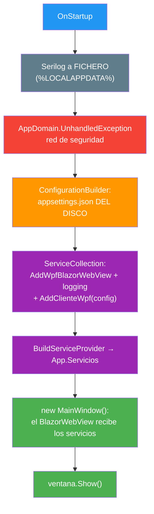
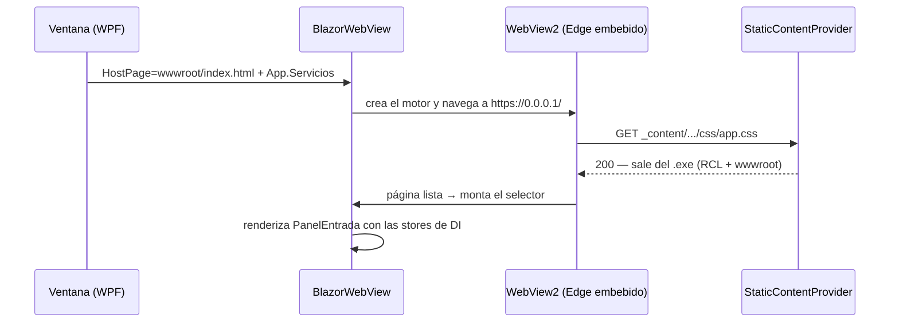
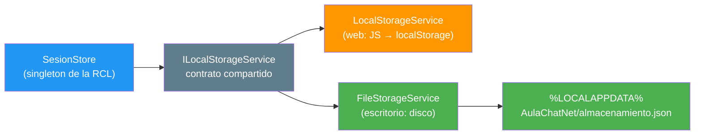

- [12. El cliente de escritorio (WPF + Blazor Hybrid)](#12-el-cliente-de-escritorio-wpf--blazor-hybrid)
  - [12.1. Qué es Blazor Hybrid y por qué un tercer cliente](#121-qués-es-blazor-hybrid-y-por-qué-un-tercer-cliente)
  - [12.2. Crear el proyecto paso a paso](#122-crear-el-proyecto-paso-a-paso)
  - [12.3. Qué hay dentro del proyecto](#123-qué-hay-dentro-del-proyecto)
  - [12.4. El arranque: de App.xaml.cs a la ventana con chat](#124-el-arranque-de-appxamlcs-a-la-ventana-con-chat)
  - [12.5. El mismo esqueleto de DI, con una diferencia](#125-el-mismo-esqueleto-de-di-con-una-diferencia)
  - [12.6. De dónde salen el HTML, el CSS y el JS](#126-de-dónde-salen-el-html-el-css-y-el-js)
  - [12.7. Guardar la sesión sin navegador](#127-guardar-la-sesión-sin-navegador)
  - [12.8. Recursos estáticos: cada host sirve lo suyo](#128-recursos-estáticos-cada-host-sirve-lo-suyo)
  - [12.9. Logging sin consola: Serilog a fichero](#129-logging-sin-consola-serilog-a-fichero)
  - [12.10. Cómo se prueba](#1210-cómo-se-prueba)
  - [12.11. Resumen del punto](#1211-resumen-del-punto)


# 12. El cliente de escritorio (WPF + Blazor Hybrid)

> 💡 **Punto de partida:** has creado el chat de Discord del aula, y funciona… pero tus alumnos lo ven **en el navegador**, colgado de una pestaña que se puede cerrar sin querer. Si abres Discord de verdad en Windows, ves una **ventana** con su icono en la barra de tareas, que se puede maximizar, cerrar con la X y arrancar con doble clic desde el escritorio. ¿Se puede hacer lo mismo con *nuestro* chat sin reescribir toda la interfaz? ¿Y si te digo que la misma carpeta `Components/` con los mismos `.razor` puede correr dentro de una ventana WPF?

Este punto cierra la fase de clientes: después de extraer toda la UI a la librería compartida `AulaChatNet.Client.Web`, aquí la **reutilizamos de verdad** en un cliente de escritorio. Lo haremos como se hace en clase: **paso a paso, desde un proyecto vacío hasta la ventana con el chat en marcha**, entendiendo en cada paso de dónde salen los ficheros, por qué no hace falta CORS y qué hacer cuando una aplicación "sin navegador" necesita guardar datos en local.

**Objetivos de aprendizaje:**

- Situar los tres modelos de Blazor (Server, WebAssembly y Hybrid) y decidir cuál encaja para un cliente de escritorio
- Crear el proyecto paso a paso: SDK Razor, paquetes NuGet, `wwwroot` propio y la ventana XAML con su `BlazorWebView`
- Seguir el arranque completo desde `App.OnStartup` hasta la ventana mostrando el chat
- Explicar de dónde salen el HTML, el CSS y el JS **sin servidor detrás** (el origen virtual `https://0.0.0.1/`)
- Entender qué puede pedirle JavaScript a WebView2 y qué no: el interop funciona para los **componentes**, no para todo el proceso
- Aplicar el patrón **mismo contrato, implementación por host** para guardar la sesión en un fichero en lugar de en el `localStorage`
- Saber qué recursos estáticos tiene que servir cada host y comprobarlo con la lista de humo

## 12.1. Qué es Blazor Hybrid y por qué un tercer cliente

Blazor tiene **tres formas de vivir**, y la tercera es la que nos ocupa:

| Modelo de Blazor | ¿Dónde corre la interfaz? | Cómo llega lo que ves |
|------------------|---------------------------|------------------------|
| Blazor Server | En el servidor | La pinta allí y manda diferencias por SignalR |
| Blazor WebAssembly (nuestro [cliente web](03-cliente-blazor.md)) | Dentro del navegador | El navegador descarga tu código y lo ejecuta él mismo |
| **Blazor Hybrid (este punto)** | **Dentro de una app nativa** | Un control **WebView2** (el motor de Edge) embebido en la ventana pinta el DOM que tu C# le manda |

**Blazor Hybrid** no compila a WebAssembly ni necesita servidor: monta tus componentes Razor en un **navegador embebido** — `WebView2`, el componente de Chromium que Windows trae de serie desde Windows 11 — dentro de una app de escritorio (WPF, WinForms) o móvil (MAUI). La diferencia clave con la web es **de dónde salen los ficheros**: en WASM los descarga un servidor; aquí salen del propio `.exe`, sin red de por medio.

> 📌 **Ejemplo real:** las apps de escritorio de Teams, Spotify o Steam no son "webs guardadas": son ventanas nativas con un motor web dentro. Blazor Hybrid hace lo mismo, pero **reutilizando tu C# y tus componentes Razor**, no reescribiéndolos en JavaScript como hace Electron.

**¿Por qué este cliente y no otro lenguaje?** Porque ya extrajimos toda la UI a `AulaChatNet.Client.Web` *pensando* en esto: los componentes, las stores reactivas, el `ProcesadorComandos` y hasta el CSS son **exactamente los mismos**. El cliente de escritorio es, en esencia, un `MainWindow.xaml` con un `BlazorWebView` dentro y un `App.xaml.cs` que registra los mismos servicios. Si mañana sale un cuarto cliente (MAUI, por ejemplo), repite el patrón.

> 📝 **Nota:** ¿y no valdría **Electron.NET** (la web dentro de Node.js)? Es una opción real, pero pesa cada ventana cientos de MB (trae su propio Chromium y Node), obliga a mantener dos mundos de dependencias y se aleja del "100% .NET" del módulo. Blazor Hybrid usa el WebView2 que **ya está en Windows**: el `.exe` pesa lo que pesa tu app.

## 12.2. Crear el proyecto paso a paso

Vamos a montarlo desde cero, en siete pasos. Si abres el proyecto real `AulaChatNet.Client.Wpf`, verás exactamente esto.

**Paso 1 — La plantilla.** Crear un WPF corriente y borrar el "Hola, mundo":

```bash
dotnet new wpf -n AulaChatNet.Client.Wpf
```

**Paso 2 — Cambiar el SDK a Razor.** Este es el paso que nadie se espera, y si te lo saltas la ventana sale en blanco:

```xml
<!-- ❌ El de la plantilla: sirve para WPF puro, pero sin "static web assets" -->
<Project Sdk="Microsoft.NET.Sdk">

<!-- ✅ El nuestro: empaqueta el wwwroot y los estáticos _content/... de la RCL -->
<Project Sdk="Microsoft.NET.Sdk.Razor">
```

¿Por qué? El `BlazorWebView` localiza `index.html` y los estáticos de la librería compartida mediante el **pipeline de static web assets**, que solo existe con el SDK Razor (de hecho, el propio paquete `WebView.Wpf` fija `StaticWebAssetBasePath=/`). Con el SDK plano, la librería compila perfectamente… y luego el control no encuentra nada.

Junto al SDK van dos propiedades que **no son cosméticas**:

```xml
<PropertyGroup>
    <OutputType>WinExe</OutputType>
    <!-- Versión de PLATAFORMA, no solo net10.0-windows: WebView2 renderiza
         en modo composición con WinRT y necesita los ensamblados de la
         versión de Windows (un TFM plano no los trae y la ventana crashea) -->
    <TargetFramework>net10.0-windows10.0.19041.0</TargetFramework>
    <UseWPF>true</UseWPF>
    <ApplicationIcon>resources\icon-app.ico</ApplicationIcon>
</PropertyGroup>
```

**Paso 3 — Los paquetes NuGet** (las versiones viven en `Directory.Packages.props`, Central Package Management):

| Paquete | Para qué |
|---------|----------|
| `Microsoft.AspNetCore.Components.WebView.Wpf` | El control `BlazorWebView`, el runtime embebido y el puente de JSInterop |
| `Microsoft.Extensions.Configuration.Json` + `.Binder` | Leer `appsettings.json` del disco |
| `Serilog` + `Serilog.Sinks.File` + `Serilog.Extensions.Logging` | Logging a fichero (la 12.9) |

**Paso 4 — Las referencias de proyecto**: `AulaChatNet.Client.Web` (¡toda la UI!) y `AulaChatNet.Shared` (contratos y constantes). Cero UI duplicada.

**Paso 5 — El `wwwroot` del host.** Cada app necesita su `index.html` (el marco que el WebView2 carga). El nuestro es casi idéntico al de la web, con dos detalles propios de Hybrid:

```html
<div id="app">Loading...</div>
<div id="blazor-error-ui" data-nosnippet>Ha ocurrido un error no controlado. …</div>

<!-- La UI de la librería: mismo fichero que la web, ruta _content/... -->
<script src="_content/AulaChatNet.Client.Web/js/aulachat.js"></script>
<!-- OJO al nombre: webview, NO webassembly: no hay runtime wasm que descargar -->
<script src="_framework/blazor.webview.js"></script>
```

> 📝 **Nota:** el `Loading...` y el `#blazor-error-ui` **son diagnóstico, no decorado** (los trae el template oficial de Blazor Hybrid): si la ventana se queda en `Loading...`, la página cargó pero Blazor no arranca; si aparece la barra de error, Blazor arrancó pero un componente ha fallado al pintarse. Quitártelos es quedarte ciego.

**Paso 6 — El `appsettings.json` al lado del ejecutable.** No hay servidor que lo sirva: viaja con el `.exe` (`CopyToOutputDirectory`). Contiene las secciones `Chat` y `Web` de siempre.

**Paso 7 — La ventana.** Todo el `MainWindow.xaml` se reduce a esto:

```xml
<Window x:Class="AulaChatNet.Client.Wpf.MainWindow"
        Title="AulaChatNet"
        Background="#36393f" …>
    <blazor:BlazorWebView x:Name="Navegador" HostPage="wwwroot/index.html">
        <blazor:BlazorWebView.RootComponents>
            <!-- El #app del index.html lo pinta el App.razor DE LA RCL -->
            <blazor:RootComponent Selector="#app"
                                  ComponentType="{x:Type componentes:App}" />
        </blazor:BlazorWebView.RootComponents>
    </blazor:BlazorWebView>
</Window>
```

`HostPage` es el HTML "embebido" (el del paso 5) y el selector `#app` monta el `App.razor` de la librería compartida: **la misma UI que la web, dentro de una ventana**.

## 12.3. Qué hay dentro del proyecto

`AulaChatNet.Client.Wpf` es una app WPF corriente y moliente con un puñado de piezas:

| Carpeta o fichero | Contenido | Detalle |
|-------------------|-----------|---------|
| `App.xaml.cs` | El arranque entero | Serilog, red de seguridad de excepciones, configuración del disco, servicios y ventana |
| `MainWindow.xaml(.cs)` | La ventana | El `BlazorWebView` (llamado `Navegador`): en el constructor recibe `App.Servicios` y comprueba que exista WebView2 |
| `Configuracion/` | `SerilogConfig.cs` | Solo fichero, en `%LOCALAPPDATA%\AulaChatNet\logs\` |
| `Infrastructures/` | `ServicesConfig.AddClienteWpf(...)` | El mismo esqueleto de DI que la web, con un `Replace` (la 12.5) |
| `Services/` | `FileStorageService` | `ILocalStorageService` persistido en un fichero JSON (la 12.7) |
| `wwwroot/` | `index.html` + `resources/icon-app.png` | El HTML del BlazorWebView y **el icono servible** (la 12.8) |
| `appsettings.json` | Secciones `Chat` y `Web` | **Viaja al lado del `.exe`**: no hay servidor que lo sirva |

Un detalle del constructor de la ventana que conviene entender: **WebView2 puede faltar en la máquina** (en Windows 10 no siempre viene instalado). Si no está, la ventana se levantaría vacía y sin explicación, así que se comprueba al abrir y se muestra un mensaje con el enlace de descarga:

```csharp
try
{
    var version = CoreWebView2Environment.GetAvailableBrowserVersionString();
    Log.Information("WebView2 disponible (versión {Version})", version);
}
catch (WebView2RuntimeNotFoundException)
{
    // Aviso DENTRO de la propia ventana: "necesitas el motor WebView2" + enlace
}
```

> ⚠️ **Advertencia:** el `wwwroot` del host WPF es **el suyo**: la RCL pone lo suyo bajo `_content/AulaChatNet.Client.Web/...`, pero cualquier fichero que tus componentes referencien **por ruta relativa** (como `resources/icon-app.png`, que se escribe igual en la web y aquí) tiene que existir también en el `wwwroot` del host. Olvidarlo da un 404 y una imagen rota — lo vemos en la 12.8.

## 12.4. El arranque: de App.xaml.cs a la ventana con chat

`App.xaml.cs` es el análogo del `Program.cs` del host WASM, pero con el ciclo de vida de WPF por medio. El orden importa (y está comentado en el código, que es lo que verá el alumnado):



Cuatro ideas de ese arranque:

1. **`AddWpfBlazorWebView()`** (ojo al sufijo: es el del paquete WPF) registra el `WebView2`, el renderizador y el puente de JSInterop. Sin él, la ventana revienta al aplicar la plantilla con *"Unable to find the required services"*.
2. **La configuración se lee del disco**: `AppContext.BaseDirectory` es la carpeta del ejecutable, donde viaja el `appsettings.json`. No hay "mismo origen" que lo sirva: esto es un `.exe`, no una página.
3. **La ventana se crea AQUÍ, no con `StartupUri`**: el `BlazorWebView` necesita el proveedor de servicios ya construido (`App.Servicios`), y eso solo existe después de `BuildServiceProvider()`. Por eso el constructor de la ventana entrega los servicios a mano:

   ```csharp
   if (App.Servicios is null)
       throw new InvalidOperationException(
           "Los servicios no están construidos: la ventana debe crearse desde App.OnStartup.");
   Navegador.Services = App.Servicios;
   ```

4. **La red de seguridad** (`AppDomain.UnhandledException`) deja constancia en el log antes de morir: un `.exe` sin consola no puede permitirse fallar en silencio.

Y al salir, `OnExit` hace `Log.CloseAndFlush()` para no perder los últimos eventos del fichero.

## 12.5. El mismo esqueleto de DI, con una diferencia

`AddClienteWpf(config)` es calco del `Program.cs` de la web: `ChatConfig` y `WebConfig` de `Shared`, un `HttpClient` para el `GET /estadisticas` y el mismo `AddChatStores(...)` de la RCL — las stores, el procesador de comandos y la sesión son **los objetos de siempre**. Las diferencias, todas con motivo:

| Tema | Web (WASM) | Escritorio (WPF) | Por qué |
|------|-----------|-------------------|---------|
| URL del servidor | `Web:UrlServidor` vacío = mismo origen | Vacío = `http://localhost:5030` | No hay página servida de la que derivar la URL |
| CORS | Imprescindible | **No aplica** | No hay navegador de verdad: el `HubConnection` es el de .NET, sin política de origen |
| `appsettings.json` | Lo sirve el DevServer | Al lado del `.exe` | Disco local |
| Almacenamiento de sesión | `LocalStorageService` (JS) | `FileStorageService` (fichero) | La 12.7 |

Ese último `Replace` merece una segunda lectura porque es **arquitectura, no apaño**: la RCL registra `ILocalStorageService → LocalStorageService` (navegador), y el host WPF **sustituye** esa implementación por la suya:

```csharp
services.Replace(ServiceDescriptor
    .Singleton<ILocalStorageService, FileStorageService>());
```

Ni `SesionStore` ni los componentes se enteran: reciben el mismo contrato y la política de "recordar al usuario" sigue viva en escritorio. Misma abstracción, implementación por host — el patrón de toda la vida de la inyección de dependencias.

## 12.6. De dónde salen el HTML, el CSS y el JS

Cuando la ventana se aplica, el `BlazorWebView` arranca el `WebView2` y le dice: "esta página y todo lo que pida bajo tu origen, sérvelo **tú**, desde mi contenido estático":



Con el nivel Debug de Serilog se ve el espectáculo completo en el log:

```text
[DBG] Creating file provider at content root '...\bin\...\wwwroot'
[DBG] Navigating to https://0.0.0.1/
[DBG] Handling web request to URI 'https://0.0.0.1/resources/icon-app.png'.
[DBG] Response content being sent ... with HTTP status code 200.
[DBG] Initializing component 6 (PanelEntrada) ...
[DBG] Rendering component 6 of type ...PanelEntrada
```

- El `https://0.0.0.1/` es un **origen virtual**: no hay servidor escuchando, el `StaticContentProvider` del control intercepta las peticiones y responde desde el `wwwroot` del `.exe` (el suyo + los `_content/...` de la RCL).
- Los estáticos de la RCL (`app.css`, `aulachat.js`, `blazor.webview.js`) salen igual que en la web, con la misma ruta `_content/AulaChatNet.Client.Web/...`.

**¿Y el JavaScript?** Aquí hay una idea central de Blazor Hybrid: *en este proceso no hay un navegador "haciendo lo suyo", hay un motor pintando lo que los componentes le mandan*. Consecuencias prácticas, en orden de lo que funciona a lo que no:

1. **Tu JS de UI (`aulachat.js`) funciona igual**: hay DOM de verdad (scroll, foco, parpadeo de pestaña…).
2. **El JSInterop desde un componente funciona**: el `BlazorWebView` cablea el `IJSRuntime` del ámbito en el que renderiza — por eso `LocalStorageService` (usado por `PanelEntrada`) funcionaría si lo llamaras desde ahí.
3. **El JSInterop desde fuera de ese ámbito NO**: el `IJSRuntime` de Hybrid es *scoped* y solo la instancia de los componentes está cableada; cualquier otro consumidor (por ejemplo, una store singleton resuelta desde la raíz del contenedor) recibe una instancia «en el aire» y la primera llamada lanza:

   ```text
   InvalidOperationException: Cannot invoke JavaScript outside of a WebView context.
   ```

   En la web no pasa porque WebAssembly registra el `IJSRuntime` como *singleton* cableado, y todos comparten esa única instancia.

La conclusión didáctica —y la regla de diseño que aplicamos en la 12.7—: **el navegador es un servicio de los componentes, no del proceso entero**. Si algo que no es componente necesita "guardar o leer" fuera de la UI, no le pidas JavaScript: dale el medio del escritorio (fichero, registro, base de datos…).

> 💡 **Consejo:** las trazas `[DBG]` del log son de oro para diagnosticar (se encienden bajando `.MinimumLevel.Debug()` en `SerilogConfig.cs`; en Information no se ven): son el mapa de qué fichero se pidió y qué código devolvió.

## 12.7. Guardar la sesión sin navegador

¿Qué guarda "la sesión"? La `SesionStore` de la RCL (nick y canal) a través del contrato `ILocalStorageService`: `GetItemAsync`, `SetItemAsync`, `RemoveItemAsync`, `ClearAsync`. La web lo implementa con el `localStorage` del navegador; el escritorio, aplicando la idea de la 12.6, **no le pide JS a nadie**:



`FileStorageService` es sencillo de leer y tiene tres detalles que conviene estudiar:

| Detalle | Cómo es | Por qué |
|---------|---------|---------|
| El fichero | Un JSON tipo diccionario `{ "clave": valor }` (`almacenamiento.json`) | La misma idea que el `localStorage`, pero en el disco de este equipo |
| La puerta | Un `SemaphoreSlim(1,1)` alrededor de leer-modificar-escribir | Dos operaciones a la vez (login + guardado) se serializan para no pisarse |
| La escritura | Temporal + renombrado (atómica) | Si el disco se queda a medias, queda el fichero anterior, no uno partido |
| La carpeta | Inyectable por constructor (por defecto, `%LOCALAPPDATA%`) | Los tests pasan una carpeta temporal y prueban el servicio **real** |

Por qué `%LOCALAPPDATA%` (DatosLocales) y no Roaming: igual que los logs, los datos de la app no deben viajar entre equipos del mismo perfil de Windows — es el equivalente de escritorio a "este navegador concreto".

Si aun así sustituyeras el registro por el `LocalStorageService` de navegador (o quitaras el `Replace`), la app no "se rompería poco a poco": la primera llamada lanzaría la excepción de la 12.6 y un componente sin capturar la pintaría. De ahí dos reglas que sí son de diseño:

- **La sesión nunca puede tumbar el chat**: `SesionStore` captura cualquier excepción en sus tres métodos; si la sesión no se puede leer, se empieza de cero, y si no se puede guardar, se avisa pero la app sigue.
- **No se arregla bajando el ámbito a *scoped***: las stores son *singletons* a propósito (una por ventana) y el `ProcesadorComandos` las consume; bajarles el ámbito contagiaría medio grafo de DI para parchear un síntoma. La implementación por host ataca la causa.

> 💡 **Consejo:** con la app cerrada, abre `almacenamiento.json` con cualquier editor: verás `{"aulachat.sesion":{"Nick":"...","Canal":"#general"}}`. «¿No eres tú? Borrar sesión» lo vuelve a dejar vacío.

## 12.8. Recursos estáticos: cada host sirve lo suyo

La regla, en una frase: **lo que la UI pida por ruta relativa debe existir en el `wwwroot` del host que la está sirviendo**.

| Recurso | ¿Quién lo sirve? | Dónde vive |
|---------|------------------|------------|
| `css/app.css`, `js/aulachat.js` (de la RCL) | Cualquier host, por la ruta `_content/AulaChatNet.Client.Web/...` | En el propio ensamblado de la RCL: no hay que copiar nada |
| `resources/icon-app.png` (ruta relativa escrita en los componentes) | El host concreto | En su `wwwroot`: `Client.Blazor/wwwroot/resources/` **y** `Client.Wpf/wwwroot/resources/` |
| `favicon.ico` | El host | Su `wwwroot`; si falta, el `StaticContentProvider` responde con el `index.html` (fallback) y no se entera nadie |

Si falta un fichero servible, el `LogDebug` lo dice sin ambigüedad (`Handling web request ... 404`) y el síntoma a pantalla es una imagen rota. Por eso la copia del icono maestro (`resources/icon-app.png` de la raíz) está en **cada** host: mismo origen, misma carpeta relativa, un fichero por app.

> 📝 **Nota:** en la web esto se veía bien porque el host WASM ya tenía su copia; el escritorio es el primer host nuevo, y la primera vez que sirve ficheros relativos es cuando la regla se pone de manifiesto. Cuando añadas un cuarto cliente, esta tabla es la lista de la compra.

## 12.9. Logging sin consola: Serilog a fichero

Un `.exe` de Windows arrancado con doble clic **no tiene consola**: `WriteTo.Console` se perdería (o abriría una ventana negra molesta). Por eso el escritorio registra **solo** fichero, en `%LOCALAPPDATA%\AulaChatNet\logs\escritorio-YYYY-MM-DD.log`, con el mismo rolling y retención de 7 días que la terminal. `Log.Logger` ataca por estático (como en la web) y `AddSerilog()` puentea los `ILogger<T>` de DI para las stores.

> 📝 **Nota:** y no es capricho, es coherente con todo el punto: si la web loguea a la consola del navegador porque *ahí* hay consola, el escritorio loguea a fichero porque *ahí* hay disco. Cada host usa el medio que tiene.

## 12.10. Cómo se prueba

Como en todo el proyecto, lo automatizable va a tests (`AulaChatNet.Client.Wpf.Tests`, hoy **14**):

| Qué | Cómo | Claves |
|-----|------|--------|
| `ResolverUrlServidor` | Tests puros | Vacío/espacios → `localhost:5030`; con URL → sin barra final |
| `AddClienteWpf` | `ConfigurationBuilder` real sobre JSON temporal + `BuildServiceProvider` | Secciones tipadas, `HttpClient` con `BaseAddress`, stores construidas y… |
| …el `Replace` | Assert sobre el proveedor | `GetRequiredService<ILocalStorageService>()` es `FileStorageService` |
| `FileStorageService` | Carpeta **temporal** por test (`[SetUp]`/`[TearDown]`), servicio real | Roundtrip, claves múltiples, borrar, limpiar, JSON corrupto → `null` sin lanzar, valor de otra versión → `null` y dos instancias compartiendo fichero |

La carpeta temporal es posible porque `FileStorageService` acepta la carpeta en el constructor (por defecto, `%LOCALAPPDATA%`): se prueba el servicio **real**, no un doble.

Lo que no se automatiza (todavía), la **lista de humo** manual con el servidor en pie:

1. `dotnet run --project AulaChatNet.Server` y `dotnet run --project AulaChatNet.Client.Wpf`.
2. Entrar con un nick → conecta y el chat se pinta, sin avisos de error.
3. Enviar un mensaje → viaja y vuelve (SignalR de verdad).
4. Cerrar y reabrir la app → el nick llega recordado (¡y se puede ver el `almacenamiento.json`!); «Olvidar sesión» lo borra.
5. Dos ventanas + la web + la terminal a la vez → los cuatro en el mismo `#general`.

## 12.11. Resumen del punto

| Concepto | En una frase |
|----------|-------------|
| Blazor Hybrid | Componentes Razor corriendo en un **WebView2 embebido** en una app nativa; mismos `.razor`, otro host |
| SDK Razor + TFM de Windows | Sin el SDK Razor no hay static web assets (ventana en blanco); sin el TFM `windows10.0.19041` no hay ensamblados de composición (crash al pintar) |
| `BlazorWebView` | El control WPF que pone el navegador dentro de la ventana; `HostPage` + selector `#app` + `App.Servicios` |
| `AddWpfBlazorWebView` | El registro imprescindible del paquete WPF: sin él, «Unable to find the required services» |
| Origen virtual | Los estáticos salen del propio `.exe` (`StaticContentProvider` ante `https://0.0.0.1/`), sin red |
| JS con horario | El interop funciona **desde los componentes**; fuera de ese ámbito, «Cannot invoke JavaScript outside of a WebView context» — por eso no se le pide JS a un singleton |
| Sesión sin navegador | **Mismo contrato, implementación por host**: `FileStorageService` (JSON en `%LOCALAPPDATA%`) sustituye al `LocalStorageService` con `Replace`; ni `SesionStore` ni la UI se enteran |
| Recursos relativos | Cada host sirve lo suyo: `_content/...` es de la RCL; `resources/icon-app.png` tiene que estar en el `wwwroot` de cada host |
| Sin CORS | El escritorio no es un navegador de verdad: su `HubConnection` es el de .NET y habla directo a `Web:UrlServidor` |
| Logging | Solo fichero en `%LOCALAPPDATA%\AulaChatNet\logs\`: un `.exe` no tiene consola |
| Tests | 14 en `Client.Wpf.Tests`: DI (incluido el `Replace`) + `FileStorageService` real sobre carpetas temporales |

Con este punto cerrado, la solución tiene **tres clientes** — terminal, web y escritorio — apoyados en la misma capa `Shared`, el mismo hub y la misma librería de interfaz. Ese es el mensaje de este punto: **el cliente es una decisión de host, no una reescritura**.
